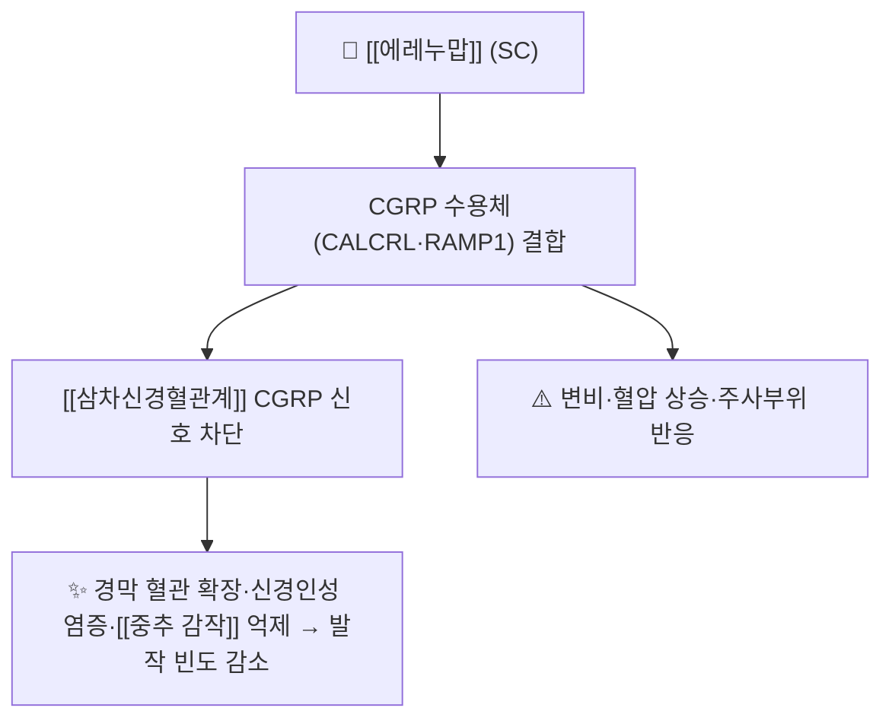

# 💊 [[에레누맙]] (Erenumab, Aimovig / 아이모빅, ATC N02CD01)

> **핵심 3줄 요약 (Key Summary)**:
> 🧪 주성분·제형: [[CGRP]] 수용체에 결합하는 완전 인간 단일클론항체(AMG 334, erenumab-aooe). 피하주사용 펜 70 mg/mL·140 mg/mL. 저분자 화합물이 아니어서 PubChem 2D 구조식이 없고, 항체 골격(IgG2 κ) 도해로 대체한다
> 📍 작용 기전: 리간드가 아니라 수용체(CALCRL·RAMP1 복합체)를 차단하는 계열 내 유일한 약물이다. [[삼차신경혈관계]]의 CGRP 신호를 수용체 수준에서 끊는다
> 🎯 임상 적응증: 성인 [[편두통]] 예방 — 70 mg 피하 4주 1회, 반응 불충분 시 140 mg 4주 1회. 반감기가 약 28일이라 월 1회 투여로 운용한다
> ⚠️ 주의: 변비와 혈압 상승이 계열 내 상대적으로 두드러진다. 고령·기저 고혈압·변비 성향 환자에서는 다른 항체를 먼저 고려한다

## 1. 약물 기본 정보 및 시판 제품 (Brand Identification)

![[에레누맙_01_아이모빅_자가주사기.png|420]]
> [그림 1] 아이모빅(에레누맙) 70 mg/mL 1회용 펜형 자가주사기 실사 — 라벨에 aimovig 70 mg/mL가 읽힌다. Wikimedia Commons, CC BY-SA 4.0, 촬영 BrokenSegue

![[CGRP_표적_편두통_기전도해.png|560]]
> [그림 2] CGRP 표적 치료의 작용 부위 도해(원본 독일어). 삼차신경 섬유에서 유리된 CGRP가 혈관 평활근의 CGRP 수용체(CALCRL·RAMP1)에 작용해 cAMP·PKA를 거쳐 혈관 확장을 일으키는 경로, 그리고 수용체 측 차단(에레누맙 유형)과 리간드 측 중화(갈카네주맙·프레마네주맙·에프티네주맙 유형)의 두 지점이 함께 표시돼 있다. Wikimedia Commons, CC BY-SA 4.0, Benff

> 🖼️ 이미지 미확보 — 프리필드 펜·주사기 제형이라 정제·PTP 블리스터 성상 이미지가 존재하지 않는다. 다른 약의 알약 사진으로 채우지 않고, 패키지 실사와 기전 도해 2장으로 정리한다.

| 항목 | 상세 정보 |
| :--- | :--- |
| 일반명 (Generic Name) | [[에레누맙]](한글) / Erenumab (USAN, erenumab-aooe) |
| 대표 상품명 (Brand Names) | Aimovig(아이모빅, Amgen/Novartis) |
| ATC 코드 / 분류 | N02CD01 — N02C 항편두통제 / N02CD CGRP 길항제 |
| PubChem CID | 없음 — 단일클론항체(단백질)로 소분자 CID 미부여 |
| 분자량 | 약 150 kDa(IgG2 κ 골격) |
| 주요 제형 및 함량 | 피하주사용 펜 70 mg/mL, 140 mg/mL(1회용) |
| 표적 | CGRP 수용체 복합체(CALCRL + RAMP1) |
| 허가 적응증 | 성인 편두통의 예방 치료(삽화성·만성) |

### 1.1 계열 내 위치

| 구분 | 약물 | 표적 | 투여 간격 |
| :--- | :--- | :--- | :--- |
| 수용체 차단 | [[에레누맙]] | CGRP 수용체 | 4주 |
| 리간드 중화 | [[프레마네주맙]] · [[갈카네주맙]] · [[에프티네주맙]] | CGRP 펩타이드 | 4주 / 12주 / 12주 |
| 경구 소분자 | [[아토게판트]] · 리메게판트 | CGRP 수용체 | 1일 1회 |

→ 계열 전체 지도는 [[CGRP 표적 약물]] 참조.

## 2. 분자 약리 기전 및 작용 경로 (Mechanism of Action)

- [[CGRP]]는 삼차신경절 감각뉴런에서 유리되어 경막 혈관 확장과 신경인성 염증을 일으키는 편두통의 핵심 매개체다. 에레누맙은 리간드를 중화하는 대신 수용체에 결합해, 리간드 농도가 올라가도 신호가 전달되지 않게 만든다
- 계열 내 유일한 수용체 차단제라는 점이 부작용 프로파일의 차이를 만든다. CGRP의 혈관 확장·장관 운동 조절 작용이 수용체 수준에서 함께 막히므로 변비와 혈압 상승 보고가 상대적으로 많다
- 반감기가 약 28일로 길어 월 1회 투여가 가능하고, 예방 효과 발현에는 통상 4~8주가 걸린다. 반응 판정은 12주(3회 투여) 시점에 하는 것이 관례다

## 3. 임상 근거

| 항목 | 내용 |
| :--- | :--- |
| 대표 시험 | STRIVE — 삽화성 편두통에서 에레누맙 70 mg·140 mg을 위약과 비교한 6개월 이중눈가림 3상(N Engl J Med 2017;377(22):2123-2132) |
| 결과 | 두 용량 모두 위약보다 월간 편두통 일수를 유의하게 감소시켰고, 50% 이상 반응자 비율도 높았다. 1년 연장 분석에서도 효과가 유지됐다 |
| 계열 간 비교 | 16편·9,123명 네트워크 메타분석에서 월간 편두통 일수 감소 순위는 갈카네주맙 240 mg이 가장 앞섰고, 에레누맙은 안전성 순위에서 가장 좋은 값을 보였으나 통계적으로 유의하지 않았다(P=0.2220) |
| 출처 | [PMID 29171821](https://pubmed.ncbi.nlm.nih.gov/29171821/) · DOI [10.1056/NEJMoa1705848](https://doi.org/10.1056/NEJMoa1705848) / [PMID 41546694](https://pubmed.ncbi.nlm.nih.gov/41546694/) |

- 해석 주의: 네트워크 메타분석의 안전성 순위는 신뢰구간이 넓고, 원문에 시판 용량이 아닌 표기(에레누맙 28 mg)가 섞여 있어 입력 오류 가능성이 있다. 순위를 처방 결정의 단독 근거로 쓰지 않는다 → [[네트워크 메타분석]] · [[SUCRA]]

## 4. 용법·용량 및 처방 가이드 (Dosage & Administration)

| 임상 상황 | 표준 용법·용량 | 비고 |
| :--- | :--- | :--- |
| 편두통 예방(시작) | 70 mg 피하, 4주 1회 | 자가주사 교육 후 외래 관리 |
| 반응 불충분 | 140 mg 피하, 4주 1회로 증량 | 12주 판정 후 결정 |
| 투여 중단 판정 | 12주(3회) 후 월간 편두통 일수 50% 미만 감소 | 계열 전환(gepant·보툴리눔독소) 또는 중단 논의 |

## 5. 부작용, 경고 및 약물 상호작용 (Adverse Effects & Interactions)

- 흔한 이상반응: 주사부위 반응, 변비, 비인두염. 대부분 경증이고 주사 후 수일 내 발생한다
- 혈압 상승: 허가사항에 경고로 등재돼 있다. 기저 고혈압 환자는 시작 전후 혈압을 기록하고, 조절되지 않는 고혈압에서는 다른 계열을 우선한다
- 과민반응: 아나필락시스·혈관부종 보고가 있어 첫 투여 후 관찰이 필요하다
- 상호작용: 단일클론항체는 간 CYP 대사 경로를 쓰지 않아 [[CYP3A4]] 매개 상호작용이 적다. 경구 gepant와 대비되는 장점이다
- 임신·수유: 근거가 제한적이어서 개별 판단이 필요하다. 임신 계획이 있는 환자에서는 [[토피라메이트]]보다 상대적으로 선호되는 경우가 있으나, 이는 절대적 안전이 아니라 상대적 위험 비교다

## 6. 한의 치료 연계 및 병용 프로토콜 (Integrative Medicine)

- 기전 상보성: CGRP 수용체 차단은 말초 발작 기전을 억제하고, 침·한약은 [[삼차신경혈관계]] 조절·자율신경 안정·수면 개선으로 발작 역치를 올린다. 두 접근은 상충하지 않는다
- 진료실 전략: 항체 투여를 유지하면서 발작 사이 이완·수면·자율신경 조절 목적으로 침·약침·한약을 병행한다. 풍지(GB20)·태양(EX-HN5)·두유(ST8)·합곡(LI4)·태충(LR3)을 변증에 맞춰 조정한다
- 근거 고지: 항체와 침의 병용을 검증한 RCT는 없다. 근거 공백임을 환자에게 밝히고, 침 단독으로 항체를 대체하지 않는다 → [[전침]] · [[침 자극 강도와 용량]]

## 7. 💡 진료실 핵심 필기 & 실전 임상 체크리스트

### 7.1 문진 체크리스트
1. 예방약 실패 이력 확인: [[토피라메이트]]·베타차단제·발프로산 중 2종 이상을 부작용 또는 효능 부족으로 중단했는지
2. 변비·혈압 확인: 시작 전 혈압과 배변 습관을 기록한다. 변비가 이미 있는 환자에게는 [[프레마네주맙]]·[[갈카네주맙]]이 무난하다
3. 판정 시점 합의: 12주 후 50% 감소 기준을 진료 전에 문서로 합의해 두면 기대치 관리가 쉽다

### 7.2 환자 티칭 스크립트
> *"이 약은 편두통을 일으키는 신경전달물질(CGRP)이 붙는 수용체를 직접 막는 주사제입니다. 4주에 한 번, 허벅지나 배에 스스로 놓습니다. 효과는 보통 4~8주에 나타나기 시작하고, 3개월 뒤에 편두통 일수가 절반 이상 줄었는지로 계속 쓸지를 정합니다. 변비나 혈압 상승이 있을 수 있어서 시작 전에 혈압을 재고 기록해 둡니다. 주사와 함께 침 치료를 병행하는 것은 괜찮지만, 침이 주사를 대신할 수 있다는 근거는 아직 없습니다."*

## 8. 출처 및 학술 참고 문헌 (References)

- Goadsby PJ, et al. A Controlled Trial of Erenumab for Episodic Migraine. N Engl J Med. 2017;377(22):2123-2132 ([PMID 29171821](https://pubmed.ncbi.nlm.nih.gov/29171821/) / DOI [10.1056/NEJMoa1705848](https://doi.org/10.1056/NEJMoa1705848))
  - [연구 요약] 삽화성 편두통에서 에레누맙 70 mg·140 mg 월 1회가 위약보다 월간 편두통 일수와 50% 반응자 비율을 유의하게 개선한 6개월 3상 시험.
- Shakir I, et al. Efficacy and safety of CGRP monoclonal antibodies for migraine prevention in episodic migraine: a network meta-analysis. Eur J Clin Pharmacol. 2026;82(2):27 ([PMID 41546694](https://pubmed.ncbi.nlm.nih.gov/41546694/) / DOI [10.1007/s00228-025-03934-3](https://doi.org/10.1007/s00228-025-03934-3))
  - [연구 요약] RCT 16편·9,123명에서 4종 항체의 효능·안전성 순위를 간접 비교. 에레누맙의 안전성 순위 우위는 통계적으로 유의하지 않았다.
- European Headache Federation. Guideline on monoclonal antibodies targeting the CGRP pathway for migraine prevention — 2022 update ([PMC9188162](https://pmc.ncbi.nlm.nih.gov/articles/PMC9188162/))
  - [연구 요약] 4종 항체의 승인 용량·근거 수준·권고 강도를 정리한 유럽 가이드라인. 용량 체계 대조용.

## 함께 보기
- [[CGRP 표적 약물]] · [[CGRP]] · [[삼차신경혈관계]] · [[편두통]] · [[프레마네주맙]] · [[갈카네주맙]] · [[에프티네주맙]] · [[네트워크 메타분석]] · [[SUCRA]] · [[토피라메이트]]
- 관련 논문: [[2026-10-23_신경계통증의학_심층리뷰]] 3번
