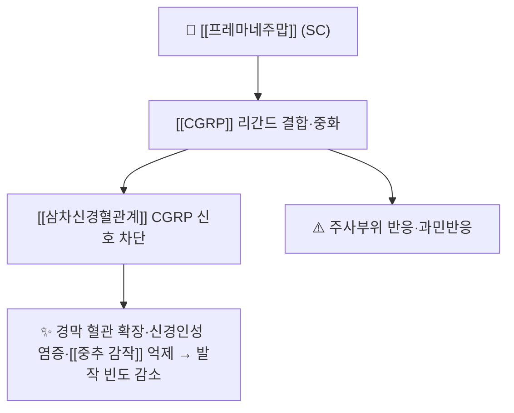

# 💊 [[프레마네주맙]] (Fremanezumab, Ajovy / 아조비, ATC N02CD03)

> **핵심 3줄 요약 (Key Summary)**:
> 🧪 주성분·제형: [[CGRP]] 리간드에 결합하는 인간화 단일클론항체(TEV-48125, fremanezumab-vfrm). 프리필드 시린지 225 mg/1.5 mL. 단백질이라 PubChem 2D 구조식이 없어 항체 골격 도해로 대체한다
> 📍 작용 기전: CGRP 펩타이드를 중화해 [[삼차신경혈관계]] 활성화와 신경인성 염증을 차단한다. 수용체가 아니라 리간드를 잡는 방식이다
> 🎯 임상 적응증: 성인 [[편두통]] 예방 — 225 mg 피하 월 1회 또는 675 mg 피하 3개월 1회. 분기 1회 옵션이 있어 주사 부담을 줄일 수 있다
> ⚠️ 주의: 주사부위 반응이 가장 흔하다. 계열 공통으로 과민반응·변비 보고가 있고, 임신·수유 근거는 제한적이다

## 1. 약물 기본 정보 및 시판 제품 (Brand Identification)

![[프레마네주맙_01_아조비_패키지.png|420]]
> [그림 1] 아조비(프레마네주맙) 225 mg/1.5 mL 프리필드 시린지 실사 — 라벨에 AJOVY 225 mg injection (fremanezumab)이 읽힌다. Wikimedia Commons, CC BY-SA 4.0, 촬영 Karl Johan Stensland

![[단일클론항체_IgG1_구조도해.png|420]]
> [그림 2] 단일클론항체의 리본 구조 도해(항체 골격 일반). 두 개의 중쇄(파랑·초록)와 두 개의 경쇄(분홍·노랑)가 Y자로 결합한 전형적 면역글로불린 구조로, 가변영역이 CGRP를 인식한다. Wikimedia Commons, CC BY-SA 4.0, Tokenzero

> 🖼️ 이미지 미확보 — 프리필드 시린지 제형이라 정제·PTP 블리스터 성상 이미지가 존재하지 않는다. 약물 특이적 결정구조가 아닌 항체 골격 도해만 수록하며, 이를 이 약의 구조식으로 표기하지 않는다.

| 항목 | 상세 정보 |
| :--- | :--- |
| 일반명 (Generic Name) | [[프레마네주맙]](한글) / Fremanezumab (USAN, fremanezumab-vfrm) |
| 대표 상품명 (Brand Names) | Ajovy(아조비, Teva) |
| ATC 코드 / 분류 | N02CD03 — N02C 항편두통제 / N02CD CGRP 길항제 |
| PubChem CID | 없음 — 단일클론항체(단백질)로 소분자 CID 미부여 |
| 분자량 | 약 148 kDa(IgG2 κ 골격) |
| 주요 제형 및 함량 | 프리필드 시린지 225 mg/1.5 mL(1회용) |
| 표적 | CALCA(CGRP) 리간드 — [[CGRP]] |
| 허가 적응증 | 성인 편두통의 예방 치료(삽화성·만성) |

### 1.1 계열 내 위치

| 구분 | 약물 | 표적 | 투여 간격 |
| :--- | :--- | :--- | :--- |
| 리간드 중화 | [[프레마네주맙]] | CGRP 펩타이드 | 4주 또는 12주 |
| 리간드 중화 | [[갈카네주맙]] · [[에프티네주맙]] | CGRP 펩타이드 | 4주 / 12주(IV) |
| 수용체 차단 | [[에레누맙]] | CGRP 수용체 | 4주 |

→ 계열 전체 지도는 [[CGRP 표적 약물]] 참조.

## 2. 분자 약리 기전 및 작용 경로 (Mechanism of Action)

- [[CGRP]]는 삼차신경절에서 유리되어 경막 혈관 확장과 비만세포 탈과립을 유도한다. 프레마네주맙은 이 펩타이드에 직접 결합해 수용체 접근을 막는다
- 전임상 연구에서 프레마네주맙이 경막의 얇은 유수신경(Aδ) 반응을 선택적으로 억제한다는 보고가 있어, 말초 삼차신경 말단이 주요 작용 부위로 설명된다
- 반감기가 약 31일로 길어 월 1회 또는 3개월 1회 투여가 가능하다. 675 mg을 3회 연속 주사하는 분기 요법은 편두통 예방에서 드문 장기 투여 옵션이다

## 3. 임상 근거

| 항목 | 내용 |
| :--- | :--- |
| 대표 시험 | HALO CM — 만성 [[편두통]] 환자에서 월 225 mg과 분기 675 mg을 위약과 비교한 3상(N Engl J Med 2017;377(22):2113-2122) |
| 결과 | 두 용법 모두 위약보다 월간 편두통 일수를 유의하게 감소시켰다. 즉 월 1회와 3개월 1회가 모두 유효해 투여 편의를 환자 상황에 맞출 수 있다 |
| 계열 간 비교 | 16편·9,123명 네트워크 메타분석에서 50% 이상 반응자 확률이 가장 높았다(OR 3.1684, P<0.0001). 효능 SUCRA 84.6%·안전성 SUCRA 61.8%로 균형이 가장 좋은 것으로 평가됐다 |
| 출처 | [PMID 29171818](https://pubmed.ncbi.nlm.nih.gov/29171818/) · DOI [10.1056/NEJMoa1709038](https://doi.org/10.1056/NEJMoa1709038) / [PMID 41546694](https://pubmed.ncbi.nlm.nih.gov/41546694/) |

- 해석 주의: 이 순위는 직접 비교시험이 없는 간접 비교 추정치다. 삽화성 편두통만 통합한 분석이므로 만성 편두통에서의 순위는 다를 수 있다 → [[네트워크 메타분석]] · [[SUCRA]]

## 4. 용법·용량 및 처방 가이드 (Dosage & Administration)

| 임상 상황 | 표준 용법·용량 | 비고 |
| :--- | :--- | :--- |
| 월 1회 요법 | 225 mg 피하, 4주 1회 | 자가주사 교육 후 외래 관리 |
| 분기 요법 | 675 mg 피하, 3개월(12주) 1회 | 225 mg을 3회 연속 주사 |
| 판정 | 12주 후 월간 편두통 일수 50% 미만 감소면 전환 논의 | 계열 내 교체 또는 gepant·보툴리눔독소 |

## 5. 부작용, 경고 및 약물 상호작용 (Adverse Effects & Interactions)

- 흔한 이상반응: 주사부위 반응(홍반·경결·통증), 비인두염. 대부분 경증이다
- 과민반응: 아나필락시스·혈관부종·두드러기 보고가 있어 첫 투여 후 관찰한다
- 변비: 계열 공통으로 보고되나 [[에레누맙]]보다 상대적으로 적다
- 상호작용: 간 CYP 대사를 쓰지 않아 [[CYP3A4]] 매개 상호작용이 적다. 경구 gepant와 대비되는 특성이다
- 임신·수유: 근거 제한. 임신 계획 환자에서는 위험-이득을 개별 상담한다

## 6. 한의 치료 연계 및 병용 프로토콜 (Integrative Medicine)

- 기전 상보성: 말초 CGRP 중화와 침의 중추 조절(하행 통증억제계·자율신경)은 층위가 달라 병용이 상충하지 않는다 → [[삼차신경혈관계]]
- 진료실 전략: 분기 요법을 택한 환자는 주사 사이 3개월이 비어 있어, 그 기간 침·한약으로 발작 역치를 관리하는 설계가 자연스럽다
- 근거 고지: 항체와 침의 병용 RCT는 없다. 침이 항체를 대체한다는 근거도 없다 → [[전침]] · [[침 자극 강도와 용량]]

## 7. 💡 진료실 핵심 필기 & 실전 임상 체크리스트

### 7.1 문진 체크리스트
1. 주사 부담 평가: 주사 횟수를 줄이고 싶어 하는 환자에게는 분기 675 mg이 실질적 선택지다
2. 반응자 판정: 12주 시점 50% 감소 기준을 미리 합의한다
3. 급성기 약 점검: 예방 시작 후에도 트립탄·NSAIDs 과용이 줄지 않으면 [[약물과용두통]]을 감별한다

### 7.2 환자 티칭 스크립트
> *"이 주사는 편두통을 일으키는 물질(CGRP) 자체를 붙잡아 무력화하는 약입니다. 한 달에 한 번 맞는 방법과, 석 달에 한 번 3대를 연달아 맞는 방법이 있습니다. 효과는 4주쯤부터 나타나고, 3개월 뒤에 편두통 일수가 절반 이상 줄었는지로 유지 여부를 정합니다. 가장 흔한 부작용은 맞은 자리가 빨갛게 되는 것이고, 드물게 알레르기 반응이 있어 첫 주사 후에는 상태를 확인합니다."*

## 8. 출처 및 학술 참고 문헌 (References)

- Silberstein SD, et al. Fremanezumab for the Preventive Treatment of Chronic Migraine. N Engl J Med. 2017;377(22):2113-2122 ([PMID 29171818](https://pubmed.ncbi.nlm.nih.gov/29171818/) / DOI [10.1056/NEJMoa1709038](https://doi.org/10.1056/NEJMoa1709038))
  - [연구 요약] 만성 편두통에서 월 225 mg과 분기 675 mg 모두 위약보다 월간 편두통 일수를 유의하게 감소시킨 3상 시험.
- Shakir I, et al. Efficacy and safety of CGRP monoclonal antibodies for migraine prevention in episodic migraine: a network meta-analysis. Eur J Clin Pharmacol. 2026;82(2):27 ([PMID 41546694](https://pubmed.ncbi.nlm.nih.gov/41546694/) / DOI [10.1007/s00228-025-03934-3](https://doi.org/10.1007/s00228-025-03934-3))
  - [연구 요약] 4종 항체 중 50% 반응자 확률 1위(OR 3.1684), 효능·안전성 종합 SUCRA에서 가장 균형 잡힌 것으로 평가.
- European Headache Federation. Guideline on monoclonal antibodies targeting the CGRP pathway for migraine prevention — 2022 update ([PMC9188162](https://pmc.ncbi.nlm.nih.gov/articles/PMC9188162/))
  - [연구 요약] 승인 용량·투여 간격·근거 수준을 정리한 유럽 가이드라인.

## 함께 보기
- [[CGRP 표적 약물]] · [[CGRP]] · [[삼차신경혈관계]] · [[편두통]] · [[에레누맙]] · [[갈카네주맙]] · [[에프티네주맙]] · [[네트워크 메타분석]] · [[SUCRA]] · [[약물과용두통]]
- 관련 논문: [[2026-10-23_신경계통증의학_심층리뷰]] 3번
