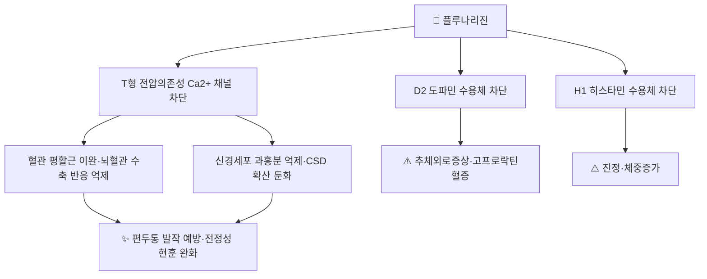

---
aliases:
  - 플루나리진
  - Flunarizine
  - Flunarizine Hydrochloride
  - 플루나리진염산염
  - Sibelium
  - 씨베리움
  - 씨베리움캡슐
  - N07CA03
  - 氟桂利嗪
tags:
  - 약리/양방약
  - 편두통예방제
  - 칼슘채널차단제
  - 항어지럼제
  - 신경계
출처: "PMID 40986334 · 30699098 · 28386684"
type: 양방약
category: 의약품/04_정신신경계
---

# 💊 [[플루나리진]] (Flunarizine, Sibelium, ATC N07CA03)

> 🖼️ 이미지 미확보 — 완제품 패키지 실사·PTP 성상 사진은 확보하지 못했다(식약처 제품허가정보08 이미지 미제공 품목, Commons에 제품 사진 없음). 구조식만 수록했으며, 다른 약의 사진으로 대체하지 않았다.

> **핵심 3줄 요약 (Key Summary)**:
> 🧪 주성분·제형: [[플루나리진]]염산염 5.9 mg(플루나리진으로서 5 mg) 경질캡슐. 비스(4-플루오로페닐)메틸기와 신나밀기를 가진 피페라진 유도체.
> 📍 작용 기전: T형 전압의존성 칼슘채널 차단이 주 기전이며, 여기에 D2 도파민 수용체 차단과 H1 히스타민 차단 작용이 겹친다.
> 🎯 임상 적응증: 중증·난치성 편두통의 예방, 전정계 기능성 장애에 의한 어지러움.
> ⚠️ 주의사항: 졸림·체중증가·우울·추체외로증상. 파킨슨병·우울증 병력·임부에는 금기이며 편두통 예방은 6개월 후 중지가 원칙이다.

## 1. 약물 기본 정보 및 시판 제품 (Brand Identification)

> [!abstract]+ 🧪 3D 약리 분자 구조 (Interactive 3D Viewer)
> <iframe src="https://molecule-viewer-rho.vercel.app/?cid=941361" width="100%" height="450px" frameborder="0" allow="webgl" style="border-radius: 8px;"></iframe>

![[플루나리진_03_구조식.png|320]]
> [그림 1] [[플루나리진]]의 2D 평면 화학 분자 구조식 — PubChem CID 941361 (구조식 정본: PubChem PNG API). 비스(4-플루오로페닐)메틸기 + 피페라진 + 신나밀기 구조로, 분자식 C26H26F2N2·분자량 404.49에 해당함을 확인했다.

| 항목 | 상세 정보 |
| :--- | :--- |
| **일반명 (Generic Name)** | 플루나리진(Flunarizine) / 염산염으로 사용 |
| **대표 상품명 (Brand Names)** | 씨베리움캡슐(Sibelium Cap., 한국얀센), 경동제약 Headache Capsule, 플루리진캡슐(수출용) |
| **ATC 코드 / 분류** | N07CA03 (N07C 항어지럼제) · KPIC 분류: 두통 치료제(편두통 예방 포함) Ca 통로 차단제(혈관확장) / 어지럼증 치료제 |
| **PubChem CID** | [941361](https://pubchem.ncbi.nlm.nih.gov/compound/941361) |
| **화학식 / 분자량** | C26H26F2N2 / 404.49 g/mol (KEGG DRUG D07971) |
| **주요 제형 및 함량** | 경질캡슐 5 mg(플루나리진염산염 5.9 mg). 30캡슐/병, 100캡슐/병 |
| **식약처 허가 적응증** | ① 중증의 난치성 편두통 ② 전정계의 기능성장애에 의한 어지러움 |

### 1.1 대표 시판 제품 및 함유 복합제 매핑 (Brand Identification & Combinations)

| 구분 | 대표 제품명 / 브랜드 | 함유 성분 및 1회당 함량 | 제형 및 특징 | 주요 적응증 및 복약 지도 핵심 |
| :--- | :--- | :--- | :--- | :--- |
| **단일제 (ETC)** | 씨베리움캡슐(Sibelium Cap.) | [[플루나리진]]염산염 5.9 mg | 상부 회색·하부 빨간색 경질캡슐 | 편두통 예방·현훈. 저녁 투여로 낮 졸림을 줄인다 |
| **단일제 (ETC)** | 경동제약 Headache Capsule | [[플루나리진]]염산염 5.9 mg | 상단 암회색·하단 연주홍색 경질캡슐 | 동일 성분 제네릭. 보험코드 648102410 |
| **수출용** | 플루리진캡슐 | [[플루나리진]]염산염 5.9 mg | 주황색 경질캡슐 | 국내 급여 대상 아님 |
| **복합제** | 해당 없음 | 단일 성분만 유통 | - | 다른 편두통 예방약과의 중복 투여는 근거 없음 |

## 2. 분자 약리 기전 및 작용 경로 (Mechanism of Action)

* **주요 작용 기전 (Primary MoA)**:
  * T형(저전압 활성화) 칼슘채널 차단이 중심이다. KEGG DRUG D07971은 표적을 CACNA1-T(Cav3 계열)로, 계열을 calcium channel T type blocker로 분류한다.
  * 피질확산억제(CSD)의 확산을 둔화하고 경막 혈관의 신경인성 염증 반응을 줄이는 것으로 설명된다. 다만 이는 주로 전임상 수준의 기전 가설이다.
* **오프타깃 작용과 부작용의 연결**:
  * D2 수용체 차단은 SPECT 연구에서 직접 확인됐다(PMID 7714010). 파킨슨증상·무월경·유즙분비가 여기서 나온다.
  * H1 차단은 진정 작용에 기여하고, 식욕 증가·체중증가는 기전이 완전히 정리되지 않았으나 계열 특유의 부작용으로 반복 보고된다.

## 3. 약동학적 특성 (Pharmacokinetics: ADME)

| 약동학 파라미터 | 수치 및 임상적 의미 |
| :--- | :--- |
| **생체이용률 (Bioavailability, F)** | 경구 흡수는 양호하나 식사 영향 평가가 따로 필요할 정도로 흡수 변동이 보고된다(생동성 시험에서 공복·식후 프로토콜을 분리, PMID 34472200) |
| **최고혈중농도 도달시간 (Tmax)** | 수 시간 내 도달. 5 mg 단회 경구 시험에서 LC-MS/MS로 측정(PMID 34472200) |
| **혈장 단백결합률 (Protein Binding)** | 높은 단백결합과 큰 조직 분포를 보이는 지용성 약물 |
| **간 대사 효소 (Metabolism)** | CYP2D6 기질(KEGG DRUG D07971). CYP2D6 저대사자는 혈중 농도가 상승할 수 있다 |
| **배설 반감기 (Elimination t1/2)** | 소실이 매우 느리다. 생동성 시험의 휴약기를 14일로 설정했고, 국내 허가 유지요법도 2일마다 또는 주 5일 투약으로 설계돼 있다 |
| **주요 배설 경로 (Excretion)** | 간대사 후 담즙·분변 배설이 주 경로 |

## 4. 용법·용량 및 처방 가이드 (Dosage & Administration)

| 임상 적응증 | 성인 표준 용법·용량 | 1일 최대 한도 용량 |
| :--- | :--- | :--- |
| **중증의 난치성 편두통(초회)** | 10 mg 1일 1회 저녁 (65세 이상 5 mg) | 10 mg/day |
| **편두통 유지요법** | 2일마다 10 mg 1회, 또는 주 5일 투약 후 2일 휴약 (65세 이상 5 mg) | 10 mg/day |
| **전정계 기능성 어지러움** | 편두통과 동일. 초회량은 일반적으로 2개월을 넘기지 않는다 | 10 mg/day |

* **중지 규칙**: 우울증·추체외로증상 등 중대한 이상반응이 나타나거나 2개월 투여 후에도 개선이 없으면 중단한다. 편두통 예방 유지요법은 증상이 없더라도 초회 투여 6개월 이후 중지하고, 재발 시에만 초회량부터 다시 시작한다.

## 5. 부작용, 경고 및 약물 상호작용 (Adverse Effects & Interactions)

### 5.1 주요 부작용 및 독성 경고 (Black Box Warnings)

* **위약 대조 2건 통합 분석(5~10 mg/일, 247명 대 253명)에서 1% 이상**:
  * 체중증가 11.3% 대 2.8%, 졸음 9.3% 대 1.2%, 우울 4.5% 대 0.8%, 식욕증가 4.0% 대 2.0%, 비염 4.0% 대 1.6%, 월경불순 2.8% 대 1.2%, 변비 2.4% 대 0.4%, 근육통 2.4% 대 0.8%, 유방통 1.2% 대 0.4%.
* **추체외로증상·파킨슨증**: 고령·장기 복용·고용량에서 위험이 커진다. 캘리포니아 계열 코호트 연구에서 플루나리진·시나리진 노출 후 추체외로증상 위험이 유의하게 높았다(PMID 28386684). 기전은 D2 차단이다(PMID 7714010).
* **우울·무동증**: 우울 병력자는 금기다. 복용 중 기분 저하가 나타나면 감량이 아니라 중단을 검토한다.

### 5.2 주요 병용 금기 및 상호작용

* **금기**: 파킨슨병, 우울증상 또는 그 병력, 임부(임부금기 2등급), 급성 심근경색, 두개내 출혈 후 지혈이 완료되지 않은 경우, 유당불내성 등 부형제 과민.
* **신중 투여**: 간장애, 고령자. 진정 작용이 겹치는 알코올·벤조디아제핀·항히스타민제 병용 시 졸림이 심해진다.
* **CYP2D6 기질**: 강한 CYP2D6 억제제(파록세틴, 플루옥세틴 등)와 병용하면 혈중 농도가 올라 부작용 위험이 커진다.

## 6. 한의 치료 연계 및 병용/테이퍼링 프로토콜 (Integrative Medicine)

### 6.1 한약·양약 병용 투여 안전성 및 시너지 배오

* **진정 중첩 회피**: 진정 작용이 있는 본초·처방(예: 산조인·용안육 중심 안신 처방)과 병용할 때는 낮 졸림을 확인하고, 플루나리진을 저녁 투여로 고정한다.
* **대체·병행 근거**: 조짓 없는 편두통 212명 무작위 시험에서 침 12회 + 한약 과립탕이 플루나리진 10 mg보다 MMD를 더 줄였고(군간차 −0.64일, 추적기 −1.13일), 이는 병용 또는 대체 선택의 근거로 쓸 수 있다(PMID 40986334). 다만 개방형 설계다.

### 6.2 양약 감량 및 한의 전환(테이퍼링) 가이드

* **감량 설계**: 소실이 느린 약이므로 갑자기 끊기보다 유지요법(2일마다 또는 주 5일 투약)으로 먼저 간격을 벌린 뒤 중지한다. 국내 허가사항도 이 방식을 유지요법으로 제시한다.
* **전환 순서**: 침·한약을 4~6주 먼저 시작해 두통 일지를 확보하고, MMD가 50% 이상 줄면 플루나리진을 유지요법으로 감량한다. 6개월 상한을 넘기지 않는다.

## 7. 💡 사용자 진료실 핵심 필기 & 실전 임상 체크리스트

### 7.1 진료실 3대 핵심 문진 체크리스트

1. **우울증 병력·현재 기분**: 금기 항목이다. 복용 중 기분 저하 호소는 중단 사유다.
2. **파킨슨 증상·보행·진전**: 서동, 자세 불안정, 손떨림이 새로 생기면 즉시 감량·중단을 검토한다. 고령일수록 먼저 확인한다.
3. **체중·졸림·운전 여부**: 6개월간 체중 변화와 주간 졸림을 기록한다. 운전·기계 조작 직업은 저녁 투여로도 위험할 수 있다.

### 7.2 환자 티칭 스크립트

> *"이 약은 편두통이 오는 횟수를 줄이는 예방약입니다. 잠이 올 수 있어서 저녁에 한 알 드시고, 2개월 써도 좋아지지 않으면 더 쓰지 않습니다. 편두통이 잡히면 6개월 안에 끊는 것이 원칙입니다. 우울했던 적이 있거나 손이 떨리거나 움직임이 굼떠지는 느낌이 들면 바로 말씀해 주세요. 대신 침과 한약으로 두통 일수를 줄이는 방법을 함께 설계할 수 있습니다."*

## 8. 출처 및 학술 참고 문헌 (References)

* 전침·한약 대 플루나리진 무작위 시험. *QJM*. 2026;119(1):15-22 ([PMID 40986334](https://pubmed.ncbi.nlm.nih.gov/40986334/) / [DOI 10.1093/qjmed/hcaf210](https://doi.org/10.1093/qjmed/hcaf210))
  * [연구 요약] 조짓 없는 편두통 성인 212명에서 침 12회 + 한약 4주가 플루나리진 10 mg 4주보다 MMD를 더 줄였고(1~4주 −0.64일, 추적기 −1.13일), 50% 반응률 57.6% 대 41.5%였다. 개방형 설계.
* Stubberud A, Flaaen NM, McCrory DC, et al. Flunarizine as prophylaxis for episodic migraine: a systematic review with meta-analysis. *Pain*. 2019;160(4):762-772 ([PMID 30699098](https://pubmed.ncbi.nlm.nih.gov/30699098/))
  * [연구 요약] 삽화성 편두통에서 플루나리진의 예방 효과를 위약 및 다른 예방약과 비교한 체계적 고찰·메타분석. 효과 크기가 크지 않고 근거 질이 제한적임을 정리했다.
* Jhang KM, Huang JY, Nfor ON, et al. Extrapyramidal symptoms after exposure to calcium channel blocker-flunarizine or cinnarizine. *Eur J Clin Pharmacol*. 2017;73(7):911-916 ([PMID 28386684](https://pubmed.ncbi.nlm.nih.gov/28386684/))
  * [연구 요약] 플루나리진·시나리진 노출 후 추체외로증상 발생 위험을 코호트로 평가한 연구. 고령·장기 노출에서 위험이 증가했다.
* Brücke T, Wöber C, Podreka I, et al. D2 receptor blockade by flunarizine and cinnarizine explains extrapyramidal side effects. A SPECT study. *J Cereb Blood Flow Metab*. 1995;15(3):513-518 ([PMID 7714010](https://pubmed.ncbi.nlm.nih.gov/7714010/))
  * [연구 요약] SPECT로 두 약물의 선조체 D2 수용체 점유를 확인해 추체외로증상의 기전을 설명한 영상 연구.
* Lai KL, Niddam DM, Fuh JL, et al. Flunarizine versus topiramate for chronic migraine prophylaxis: a randomized trial. *Acta Neurol Scand*. 2017;135(4):476-483 ([PMID 27306581](https://pubmed.ncbi.nlm.nih.gov/27306581/))
  * [연구 요약] 만성 편두통에서 플루나리진과 톱피라메이트를 직접 비교한 무작위 시험. 두 약의 효능이 유사했으나 부작용 프로파일이 달랐다.
* Xu YY, Yi ZH, Li XM, et al. Pharmacokinetics of Flunarizine Hydrochloride After Single Oral Doses in Healthy Subjects: Bioequivalence Study and Food Effects. *Clin Pharmacol Drug Dev*. 2022;11(3):341-347 ([PMID 34472200](https://pubmed.ncbi.nlm.nih.gov/34472200/))
  * [연구 요약] 5 mg 캡슐의 생동성과 식사 영향을 공복·식후 교차시험으로 평가. 14일 휴약기를 사용해 소실이 느린 약물임을 반영했다.
* KEGG DRUG D07971 (Flunarizine) — ATC N07CA03, 표적 CACNA1-T, 분자식 C26H26F2N2, CYP2D6 기질 ([https://rest.kegg.jp/get/dr:D07971](https://rest.kegg.jp/get/dr:D07971))
  * [연구 요약] 약물 분류·표적·분자식·대사 효소를 데이터베이스로 확인한 원자료.
* 식품의약품안전처 의약품안전나라 의약품통합정보시스템 ([https://nedrug.mfds.go.kr](https://nedrug.mfds.go.kr)) · 약학정보원 씨베리움캡슐 허가사항 ([https://health.kr/drug/2021101900007](https://health.kr/drug/2021101900007))
  * [연구 요약] 국내 허가 효능·용법용량(10 mg 1일 1회, 65세 이상 5 mg, 6개월 후 중지), 금기, 이상반응 빈도의 원문.

## 함께 보기

- [[편두통]] · [[전침]] · [[CGRP 표적 약물]] · [[프로프라놀롤]] · [[아미트립틸린]] · [[토피라메이트]] · [[삼차신경혈관계]] · [[중추 감작]]
- 관련 논문: [[2026-11-27_신경계통증의학_심층리뷰]] 1번 · [[2026-11-27_신경계통증의학_개념학습]]
