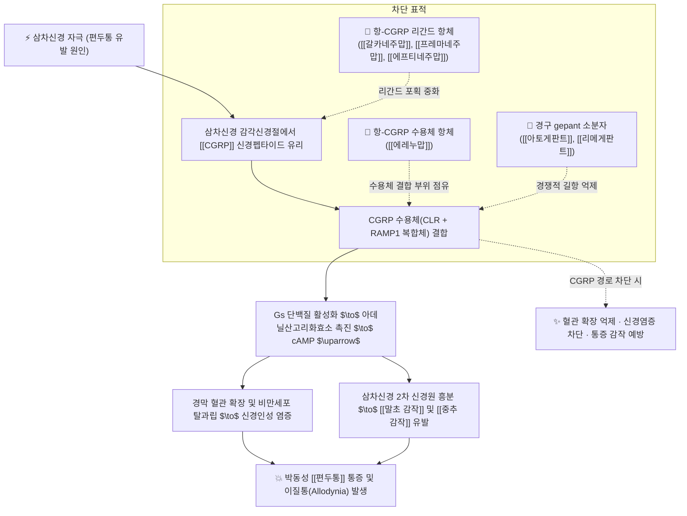

# 💊 [[CGRP 표적 약물]] (CGRP-Targeted Therapies, Anti-CGRP mAbs & Gepants, ATC N02CD / N02CX)

> **핵심 3줄 요약 (Key Summary)**:
> 🧪 **주성분·제형**: 편두통 병태생리의 핵심 신경전달물질인 [[CGRP]](Calcitonin Gene-Related Peptide) 신호전달 경로를 차단하는 최신 표적 치료제군. **항-CGRP 인간화 단일클론항체**(피하/정맥 주사: [[에레누맙]], [[갈카네주맙]], [[프레마네주맙]], [[에프티네주맙]])와 **경구용 소분자 수용체 길항제([[gepant]] 계열)**([[아토게판트]], [[리메게판트]], [[우브로게판트]])의 두 축으로 대별된다.
> 📍 **작용 기전**: 삼차신경절 및 경막 혈관 주변에서 유리된 CGRP가 CGRP 수용체복합체(CLR/RAMP1)에 결합하는 것을 차단함으로써, 삼차신경혈관계 활성화·경막 혈관 확장·비만세포 탈과립·신경인성 염증 및 2차 [[중추 감작]] 발생을 근원적으로 차단한다.
> 🎯 **임상 적응증**: 성인의 삽화성 및 만성 [[편두통]]의 예방요법(AAN 2026 가이드라인 1차 고신뢰도 권고). 기존 혈관수축성 [[트립탄]] 계열과 달리 혈관수축 부작용이 없어 심혈관 고위험군에서도 안전하게 사용 가능하며, 한의 임상에서는 '기존 2종 이상 예방약 불응' 환자의 병용 및 완화 관리가 핵심이다.
> ⚠️ **주의사항**: mAb 제제는 주사부위 반응, 중증 [[변비]](특히 수용체 차단제 [[에레누맙]]), 혈압 상승 모니터링이 필수적이며, gepant 계열은 간 대사([[CYP3A4]]) 및 유기음이온 수송체([[OATP1B1]]/1B3) 약물상호작용 주의가 요구된다.

---

## 1. 약물 기본 정보 및 시판 제품 (Brand Identification)

> [!abstract]+ 🧪 3D 약리 분자 구조 (Interactive 3D Viewer: Rimegepant CID 134689033)
> <iframe src="https://molecule-viewer-rho.vercel.app/?cid=134689033" width="100%" height="450px" frameborder="0" allow="webgl" style="border-radius: 8px;"></iframe>

| 항목 | 상세 정보 |
| :--- | :--- |
| **계열 일반명** | [[CGRP 표적 약물]] (CGRP-Targeted Therapies / CGRP Receptor Antagonists & Inhibitors) |
| **대표 약제군** | ① 항-CGRP 단일클론항체(mAbs): [[에레누맙]], [[갈카네주맙]], [[프레마네주맙]], [[에프티네주맙]] ② 경구 gepant 소분자: [[아토게판트]], [[리메게판트]], [[우브로게판트]] |
| **대표 상품명 (Brand Names)** | **앰겔러티(Emgality)**, **아조비(Ajovy)**, **에임보빅(Aimovig)**, **아퀼립타(Aquipta/Qulipta)**, **너텍(Nurtec ODT)** |
| **ATC 코드 / 분류** | **N02CD** (칼시토닌 유전자 관련 펩타이드 길항제) / **N02CX** (기타 편두통 치료제) |
| **PubChem CID** | [[아토게판트]] [72163100](https://pubchem.ncbi.nlm.nih.gov/compound/72163100) / [[리메게판트]] [134689033](https://pubchem.ncbi.nlm.nih.gov/compound/134689033) |
| **주요 제형 및 함량** | 프리필드시린지·오토인젝터 피하주사(70/120/140/225mg), 정맥주사액(100mg/바이알), 경구정제·구강붕해정(10/50/60/75mg) |
| **식약처 허가 적응증** | 성인에서의 편두통 예방(월 4회 이상 삽화성 편두통 및 만성 편두통) |

### 1.1 대표 시판 제품 및 함유 복합제 매핑 (Brand Identification & Combinations)

| 구분 | 대표 제품명 / 성분 | 제형 및 투여 경로 | 표적 부위 및 특성 | 주요 적응증 및 임상 위치 |
| :--- | :--- | :--- | :--- | :--- |
| **항-CGRP 리간드 항체** | [[갈카네주맙]] (앰겔러티) | 피하주사 (초회 240mg $\to$ 월 120mg) | CGRP $\alpha$/$\beta$ 리간드 결합 중화 | 삽화성/만성 편두통 예방 1차, 군발두통 적응증 |
| **항-CGRP 리간드 항체** | [[프레마네주맙]] (아조비) | 피하주사 (월 225mg 또는 3개월 675mg) | CGRP $\alpha$/$\beta$ 리간드 결합 중화 | 3개월 간격 투여 옵션, 복약 순응도 최우수 |
| **항-CGRP 수용체 항체** | [[에레누맙]] (에임보빅) | 피하주사 (월 70mg 또는 140mg) | CGRP 수용체(CLR/RAMP1) 경쟁적 차단 | 수용체 복합체 직접 차단, 중증 [[변비]] 모니터링 |
| **항-CGRP IV 주사제** | [[에프티네주맙]] (바이엡티) | 정맥주사 (3개월 간격 100mg IV) | CGRP 리간드 결합 | 100% 즉각 생체이용률, 급성 편두통 발작 진정 효과 |
| **경구 gepant (예방 전용)** | [[아토게판트]] (아퀼립타) | 경구정제 (1일 1회 60mg) | 경구용 저분자 CGRP 수용체 길항제 | 만성 편두통 예방(PROGRESS 3상), 주사 기피 환자 |
| **경구 gepant (급성/예방)** | [[리메게판트]] (너텍 ODT) | 구강붕해정 (75mg 격일 예방 / 급성기) | 경구용 저분자 CGRP 수용체 길항제 | 급성기 치료와 예방을 단일 제제로 병행 가능 |
| **기존 예방약 감별** | [[프로프라놀롤]], [[토피라메이트]] | 경구정제 | $\beta$ 차단제 / 항경련제 | 비특이적 전신 부작용(서맥, 인지저하) 대비 CGRP 표적성 |

---

## 2. 분자 약리 기전 및 작용 경로 (Mechanism of Action)

* **주요 작용 기전 (Primary MoA)**:
  * [[CGRP]]는 삼차신경절의 무수 C-섬유 및 유수 A$\delta$-섬유에서 분비되는 37개 아미노산의 강력한 신경펩타이드로, 혈관을 확장하고 통증 신호를 중추로 전달하는 편두통 발작의 핵심 매개체이다.
  * **항-CGRP 단일클론항체(mAbs)**: 거대 단백질 분자(MW ~150 kDa)로 혈뇌장벽(BBB)을 통과하지 않고, BBB 바깥에 위치한 경막 혈관 및 삼차신경절(Trigeminal Ganglion)의 말초 영역에서 작용하여 중추 진정 부작용이 없다.
  * **경구 소분자 gepant**: 저분자 화합물로서 CGRP 수용체의 친화적 결합 부위를 가역적·경쟁적으로 점유하여 내인성 CGRP 결합을 차단하며, 심혈관 수축(Vasoconstriction)을 유발하지 않아 심근경색이나 뇌졸중 병력자에게도 안전하다.
* **하류 신호전달 및 진통 억제 반응**:
  * CGRP가 Calcitonin Receptor-Like Receptor(CLR)와 Receptor Activity-Modifying Protein 1(RAMP1) 복합체에 결합하면 Gs 단백질이 활성화되어 세포 내 cAMP와 PKA가 증가한다. CGRP 억제제는 이 신호전달을 차단하여 경막 혈관 주위의 염증성 사이토카인 유리와 삼차신경 척수핵으로의 유해 자극 전달을 억제한다.

---

## 3. 약동학적 특성 (Pharmacokinetics: ADME)

| 약동학 파라미터 | 항-CGRP 단일클론항체 (mAb군) | 경구 저분자 gepant ([[아토게판트]] 기준) |
| :--- | :--- | :--- |
| **생체이용률 (Bioavailability, F)** | 피하주사 시 약 50~70% (IV 제제 [[에프티네주맙]] 100%) | 경구 흡수율 약 50~60% (고지방 식사 시 AUC 20% 감소) |
| **최고혈중농도 도달시간 (Tmax)** | 피하 투여 후 **3~7일** (IV 제제는 주입 직후 즉각 도달) | 경구 복용 후 **1~2시간** (신속한 혈중 도달) |
| **혈장 단백결합률 (Protein Binding)** | 해당 없음 (면역글로불린 IgG 분자) | **약 67%** (혈장 알부민 결합) |
| **간 대사 효소 (Metabolism)** | 간 CYP 효소 관여 없음 (세망내피계 대식세포 단백분해) | **주로 CYP3A4** 산화 대사 (일부 UGT 포합) |
| **배설 반감기 (Elimination t1/2)** | **약 27~31일** (월 1회 또는 3개월 1회 투여의 근거) | **약 10.5~11시간** (1일 1회 경구 투여) |
| **주요 배설 경로 (Excretion)** | 세포내 단백질 분해(Catabolism) 후 아미노산 재활용 | 분변 배설 42% (미변화체), 소변 배설 8% (신배설 미미) |

---

## 4. 용법·용량 및 처방 가이드 (Dosage & Administration)

| 임상 적응증 및 제제 | 표준 용법·용량 | 1일 / 1회 최대 권장 용량 |
| :--- | :--- | :--- |
| **[[갈카네주맙]] (앰겔러티)** | 초회 240mg(2회 연속 주사) 적재(Loading) 후, **월 1회 120mg** 피하 주사 | 1회 240mg (초회 적재 시) |
| **[[프레마네주맙]] (아조비)** | **월 1회 225mg** 또는 **3개월 간격 1회 675mg**(225mg 3회 연속) 피하 주사 | 3개월 1회 675mg |
| **[[에레누맙]] (에임보빅)** | **월 1회 70mg** 피하 주사 (반응 불충분 시 월 1회 140mg으로 증량 가능) | 월 1회 140mg |
| **[[에프티네주맙]] (바이엡티)** | **3개월 간격 100mg** 30분간 정맥(IV) 점적 주입 (필요 시 300mg) | 3개월 300mg IV |
| **[[아토게판트]] (아퀼립타)** | 성인 삽화성/만성 편두통: **1일 1회 60mg** 경구 복용 (음식 무관) | 1일 60mg / 중증 신장애 시 10mg |
| **[[리메게판트]] (너텍 ODT)** | 편두통 예방: **격일 1회 75mg** / 급성기 치료: 1일 1회 75mg | 24시간 내 최대 75mg |

---

## 5. 부작용, 경고 및 약물 상호작용 (Adverse Effects & Interactions)

### 5.1 주요 부작용 및 독성 경고
* **항-CGRP 단일클론항체 주요 이상반응**:
  * **주사부위 반응 (10~18%)**: 발적, 통증, 소양증(대개 경미하며 수일 내 소실).
  * **중증 변비 및 장폐색 위험**: 특히 수용체 차단제 [[에레누맙]] 투여 시 위장관 CGRP 매개 연동운동 저하로 인해 중증 변비 발생률이 높음(FDA 경고 사항).
  * **혈압 상승 및 고혈압 악화**: CGRP의 생리적 혈관확장 기능 차단으로 일부 환자에서 수축기/이완기 혈압 상승 관찰.
* **경구 저분자 gepant 주요 이상반응**:
  * **소화기계 불내성**: 메스꺼움(8~10%), [[변비]](10~11%), 복통.
  * **체중 감소**: PROGRESS 3상 연구에서 위약 대비 6% 이상의 환자에서 유의한 체중 감소 보고.
  * **간독성 안전성**: 1세대 gepant(텔카게판트)의 간독성 문제와 달리, 아토게판트·리메게판트는 유의한 간세포 손상이 없음이 입증됨.

### 5.2 주요 병용 금기 및 약물 상호작용
* **CYP3A4 대사 간섭 (Gepant 계열)**:
  * **강력한 CYP3A4 억제제**([[케토코나졸]], [[클래리트로마이신]], 이트라코나졸) 병용 시 아토게판트 농도가 급격히 상승하므로 용량을 **10mg QD**로 감량.
  * **강력한 CYP3A4 유도제**([[리팜피신]], [[카르바마제핀]], 세인트존스워트) 병용 시 혈중 농도가 감소하여 편두통 예방 실패 유발(병용 회피).
* **OATP1B1 / OATP1B3 수송체 억제제**:
  * 사이클로스포린 등과 병용 시 아토게판트 농도 증가로 용량 감량(10mg QD) 필요.

---

## 6. 한의 치료 연계 및 병용/테이퍼링 프로토콜 (Integrative Medicine)

### 6.1 한약·양약 병용 투여 안전성 및 시너지 배오
* **삼차신경혈관계 안정화 한의 복합요법**:
  * CGRP 표적 치료를 받는 난치성 만성 편두통 환자에서 [[침치료]] 및 [[전침]](풍지, 태충, 합곡, 솔곡, 백회) 병행 시 혈중 CGRP 분비 억제 및 중추 통증 억제계([[하행성 통증억제계]]) 활성화를 통해 시너지 효능을 발휘.
  * 한약 방제 연계: 풍열(風熱) 및 담탁(痰濁)으로 변증되는 박동성 두통 환자에게 [[천궁다조산]], [[조등산]], [[반하백출천마탕]]을 병용하여 뇌혈류 과민성을 안정화하고 두통 빈도를 추가 감소 유도.

### 6.2 양약 감량 및 한의 전환(테이퍼링) 가이드
* **고가 표적약 중단 후 반등(Rebound) 방지 프로토콜**:
  * 건강보험 급여 기준(약제 반응 평가 3~6개월) 종료 또는 약물 내약성 이슈로 주사제를 중단할 때 두통 일수가 급격히 반등할 수 있음.
  * 주사 간격 주기(월 1회)의 후반 2주부터 침·한약 치료 밀도를 주 2회로 강화하고, 두통 일기(Headache Diary)를 모니터링하여 자연스러운 한의 유지 요법으로 연착륙 유도.

---

## 7. 💡 사용자 진료실 핵심 필기 & 실전 임상 체크리스트

### 7.1 진료실 3대 핵심 문진 체크리스트
1. **과거 예방약 복용 실패력 확인**: 베타차단제([[프로프라놀롤]]), 항우울제([[아미트립틸린]]), 항뇌전증제([[토피라메이트]]) 등 2종 이상 실패 후 CGRP 제제로 넘어온 환자인지 확인(치료 저항성 난치성 평가).
2. **배변 습관 및 기저 혈압 모니터링**: 에레누맙 또는 아토게판트 복용 환자에서 주 3회 미만 배변이나 배변 곤란([[변비]]), 수축기 혈압 140 mmHg 초과 여부를 정기 문진.
3. **월간 편두통 일수(Monthly Migraine Days, MMD) 추적**: 투여 전 대비 월 두통 일수가 50% 이상 감소했는지 기록하여 약제 유효성 및 한의 치료 병용 효과 객관적 평가.

### 7.2 환자 티칭 스크립트
> *"환자분, 지금 투여받으시는 CGRP 표적 치료제는 편두통을 일으키는 특정 신경 전달 물질만을 정확히 억제해 주는 가장 진보된 예방약입니다. 기존 감기약이나 일반 진통제와 달리 혈관을 억지로 수축시키지 않아 심장에 부담이 덜합니다. 다만 약효로 인해 장운동이 둔해져 변비가 오거나 혈압이 약간 오를 수 있으므로 평소 물을 충분히 드셔야 합니다. 한의원에서는 삼차신경의 흥분을 가라앉히는 침과 한약 치료를 함께 시행하여 두통 재발을 막고 몸의 자율신경 균형을 바로잡아 드리겠습니다."*

---

## 8. 출처 및 학술 참고 문헌 (References)

* Ailani J, et al. Systematic Review of Pharmacologic Treatment for Migraine Prevention in Adults: Report of the American Academy of Neurology Guideline Subcommittee. *Neurology*. 2026. [PMID: 42673559](https://pubmed.ncbi.nlm.nih.gov/42673559/)
  * `[연구 요약]` 217건의 무작위 대조군 연구를 체계적으로 고찰하여 에레누맙, 갈카네주맙 등 CGRP 항체의 성인 편두통 예방 효능(고신뢰도)을 공인한 최신 임상 가이드라인.
* Pozo-Rosich P, et al. Atogepant for the preventive treatment of chronic migraine (PROGRESS): a randomised, double-blind, placebo-controlled, phase 3 trial. *Lancet*. 2023;402(10404):775-785. [PMID: 37516125](https://pubmed.ncbi.nlm.nih.gov/37516125/)
  * `[연구 요약]` 만성 편두통 환자 778명을 대상으로 경구 CGRP 길항제 아토게판트 60mg 1일 1회 요법의 월 편두통 일수 유의한 감소 및 내약성을 입증한 랜드마크 3상 임상시험.
* Goadsby PJ, et al. (2017). A Controlled Trial of Erenumab for Episodic Migraine. *New England Journal of Medicine*. 377(22):2123-2132. [PMID: 29171821](https://pubmed.ncbi.nlm.nih.gov/29171821/)
  * `[연구 요약]` CGRP 수용체 선택적 인간 단일클론항체 에레누맙 70mg/140mg의 삽화성 편두통 예방 효과를 최초로 확립한 무작위 대조 3상 연구.
* Stauffer VL, et al. Evaluation of Galcanezumab for the Prevention of Episodic Migraine: The EVOLVE-1 & EVOLVE-2 Phase 3 Randomized Clinical Trials. *JAMA Neurol*. 2018;75(9):1080-1088. [PMID: 29813147](https://pubmed.ncbi.nlm.nih.gov/29813147/)
  * `[연구 요약]` CGRP 리간드 중화 항체 갈카네주맙 120mg/240mg의 삽화성 편두통 예방 유효성 및 안전성을 확인한 대규모 3상 임상시험.
* Network Meta-Analysis of Calcitonin Gene-Related Peptide Monoclonal Antibodies in Episodic Migraine. *Eur J Clin Pharmacol*. 2026;82(2):27. [PMID: 41546694](https://pubmed.ncbi.nlm.nih.gov/41546694/)
  * `[연구 요약]` 4종 항-CGRP 단일클론항체(에레누맙, 갈카네주맙, 프레마네주맙, 에프티네주맙)의 삽화성 편두통 효능 및 안전성 순위를 다변량 네트워크 메타분석으로 비교 검증.

---
## 📎 개념 학습 보충 (2026-11-27 논문 연계)
- 논문: MBMA(PMID 43074738).
- 이 논문에서의 역할: 리간드 차단(프레마네주맙·갈카네주맙·에프티네주맙)과 수용체 차단([[에레누맙]])의 표적 차이가 표준 용법에서 임상적 우열로 이어지지 않음을 보여줬다.
- 새로 얻은 수치: 표준 용법 고유 효과 월 −1.5~−2.0일, 약물 간 차이 작음. 고용량 에레누맙 140 mg·에프티네주맙 300 mg만 용법 특이적 추가 효과.
- 실사용 맥락: 53편 메타분석에서 12개월 지속률 약 76%, 중단 사유 63.7%가 "효과 부족"(PMID 42814345) — 3개월 반응 평가를 프로토콜화한다.
- 관련 개념: [[CGRP]] · [[에레누맙]] · [[프레마네주맙]] · [[갈카네주맙]] · [[에프티네주맙]] · [[모델기반 메타분석]]
