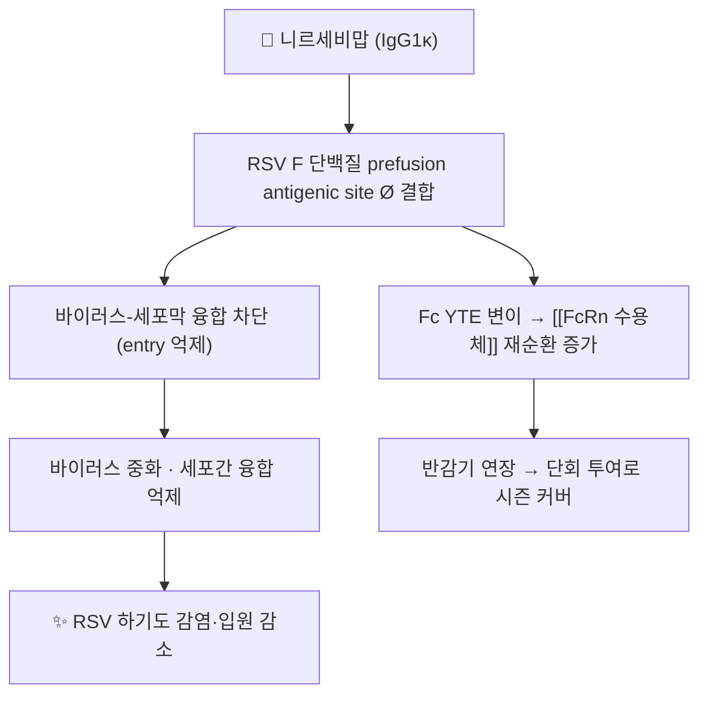

# 💊 니르세비맙 (Nirsevimab, Beyfortus, ATC J06BD08)

> **핵심 3줄 요약 (Key Summary)**:
> 🧪 주성분·제형: RSV F 단백질 융합 전(prefusion) 형태에 결합하는 재조합 인간 IgG1κ 단클론항체. 50 mg/0.5 mL·100 mg/1 mL 프리필드시린지 근육주사제.
> 📍 작용 기전: antigenic site Ø 결합(KD 0.12 nM / 1.22 nM, RSV A/B)으로 바이러스-세포막 융합을 차단. Fc YTE 치환(M252Y/S254T/T256E)으로 [[FcRn 수용체]] 친화도가 높아져 반감기가 길다.
> 🎯 임상 적응증: 첫 RSV 시즌을 맞는 신생아·영아의 RSV 하기도 감염 예방 — 체중 5 kg 미만 50 mg, 5 kg 이상 100 mg 단회 근육주사. 백신이 아닌 수동 면역이다.
> ⚠️ 주의사항: 중증 과민반응 병력은 금기. 접종 후 아나필락시스 대비 관찰. 급성 중증 질환·발열 시 회복 후 접종.

> 🖼️ 이미지 미확보 — 단클론항체(단백질)라 PubChem 2D 구조식이 제공되지 않고, 국내 유통 패키지·프리필드시린지 실사도 확보하지 못했다. 다른 약 사진으로 대체하지 않는다. 다음 회차에 식약처 제품허가정보(08) 조회를 재시도한다.

---

## 1. 약물 기본 정보 및 시판 제품 (Brand Identification)

| 항목 | 상세 정보 |
| :--- | :--- |
| **일반명 (Generic Name)** | 니르세비맙 (nirsevimab / nirsevimab-alip) |
| **대표 상품명 (Brand Names)** | 베이포투스(Beyfortus) |
| **ATC 코드 / 분류** | J06BD08 (WHO ATC/DDD Index — antiviral monoclonal antibodies) |
| **PubChem CID** | 해당 없음 — 단백질(단클론항체)로 CID·구조식 미제공 |
| **화학식 / 분자량** | 단백질 — 화학식 표기 대상 아님(약 146 kDa 수준의 IgG1) |
| **주요 제형 및 함량** | 프리필드시린지 50 mg/0.5 mL, 100 mg/1 mL (근육주사) |
| **허가 적응증** | 첫 RSV 시즌의 신생아·영아에서 RSV 하기도 감염 예방(단회). 두 번째 시즌 고위험군은 200 mg(100 mg 2회) |

### 1.1 대표 시판 제품·비교 매핑

| 구분 | 제품 | 성분·용량 | 특징 | 임상 위치 |
| :--- | :--- | :--- | :--- | :--- |
| **장기지속형 (본 약)** | 베이포투스 | 니르세비맙 50/100 mg 단회 근육주사 | 반감기 연장(YTE) — 시즌 전체 커버 | 건강한 만삭아·후기 조산아 포함 폭넓은 대상 |
| **단기형 (기존)** | 시나지스 | 팔리비주맙(J06BD01, 구 J06BB16) 월 1회 최대 5회 | 고위험 미숙아·선천성 심질환·BPD 한정 | 고위험군 표준(지역 급여 기준에 따름) |
| **산모 백신** | 아브리소(Abrysvo) | RSV prefusion F 백신, 임신 32~36주 접종 | 모체 항체를 태반으로 이전 | 국내 미도입(해외 사용) |

---

## 2. 분자 약리 기전 및 작용 경로 (Mechanism of Action)

* **주요 작용 기전**: RSV F 단백질은 융합 전(prefusion) 형태에서 감염성이 높다. 니르세비맙은 이 형태의 보존된 epitope(antigenic site Ø)에 결합해 막 융합 단계를 막는다. KD는 RSV A 0.12 nM, B 1.22 nM로 보고됐다(EMA SmPC).
* **반감기 연장 설계**: Fc의 YTE 삼중 치환이 FcRn 결합을 pH 의존적으로 강화해 재순환을 늘린다. 이 덕분에 월 1회 반복이 필요했던 팔리비주맙과 달리 단회 접종이 가능하다.
* **면역학적 성격**: 수동 면역이다. 능동 면역·기억세포를 만들지 않으므로 집단면역 효과를 기대할 수 없고, 다음 시즌에는 새 접종이 필요하다.

---

## 3. 약동학적 특성 (Pharmacokinetics)

| 약동학 파라미터 | 수치 및 임상적 의미 |
| :--- | :--- |
| **생체이용률 (F)** | 근육주사 — 절대 생체이용률 수치는 허가문서에 별도 제시되지 않음 |
| **최고혈중농도 도달시간 (Tmax)** | 근육주사 후 수일 내 최고치(제품 정보 기준) |
| **혈장 단백결합률** | 해당 없음(항체 자체가 단백질) |
| **대사** | 단백질 분해 경로(간 CYP 대사 아님) — 약물상호작용이 적은 이유 |
| **반감기 (t1/2)** | Fc YTE 변이로 수개월 수준 — 150일(약 5개월) 시즌 커버를 가능하게 한다 |
| **배설** | 단백질 이화 후 아미노산 재이용 |

* **임상 해석**: 단회 투여 후 150일이 1차 종점 기간이었다. 시즌이 긴 지역·조기 출생아에서는 커버 기간을 감안해 접종 시점을 조정한다.

---

## 4. 용법·용량 및 처방 가이드

| 임상 상황 | 용법·용량 | 비고 |
| :--- | :--- | :--- |
| 첫 RSV 시즌, 체중 5 kg 미만 | 50 mg (0.5 mL) 1회 근육주사 | 대개 대퇴부 외측 |
| 첫 RSV 시즌, 체중 5 kg 이상 | 100 mg (1 mL) 1회 근육주사 | 시즌 시작 전 접종 |
| 두 번째 시즌 고위험군 | 200 mg (100 mg 2회) | 중증 RSV 위험 높은 ≤24개월 |
| 심폐바이패스 수술 예정 | 수술 후 추가 접종 권고 | 허가사항 기준 |

* 접종 시기는 지역 RSV 유행(국내 대개 10월~3월)에 맞춘다. 시즌 중 출생아는 출생 직후 접종이 원칙이다.
* **금기·중단**: 니르세비맙 또는 부형제(폴리소르베이트 80 등)에 대한 중증 과민반응 병력. 급성 중증 질환·발열 시 회복 후 접종.

---

## 5. 부작용, 경고 및 약물 상호작용

### 5.1 주요 부작용
* MELODY 시험: 중대 이상반응 6.8%(67/987) vs 위약 7.3%(36/491) — 군간 차이 없음. 주사부위 반응·발진·발열이 흔한 수준.
* 기저치 후 항약물항체(ADA) 검출 6.1%(58/951) vs 위약 1.1%(5/473). 임상적 유효성·안전성 저하와의 연관은 확인되지 않았다(추적 361일 한계).
* 과민반응·아나필락시스: 드물지만 허가사항에 경고 — 접종 후 관찰이 필요하다.

### 5.2 상호작용·병용
* 단백질(항체)이라 CYP 대사 기반 상호작용이 없다. 다른 예방접종과 같은 날 시행 가능(부위 분리).
* **백신과 병용 시 해석 주의**: 홍역 등 생백신과의 면역학적 간섭은 알려진 바 없으나, 접종 일정은 국가 예방접종 기준을 따른다.
* **한약 병용**: 면역억제 성분(대량 감초·면역조절 한약)을 장기 복용하는 영아에서 접종 반응 관찰을 강화한다(이론적 주의, 근거 제한).

---

## 6. 한의 치료 연계 및 병용/테이퍼링

### 6.1 병용 위치
* 한의원의 역할은 처방이 아니라 **선별·의뢰·보호자 교육**이다. 접종 대상 여부(미숙아·선천성 심질환·BPD·면역저하)를 확인해 소아청소년과로 연결한다.
* 접종 후에도 RSV 감염은 발생할 수 있어, 발열·기침·수유 저하의 급성기 관리와 회복기 보조(한약·[[소아추나]])는 별개 축으로 남는다.

### 6.2 감량·중단 개념이 없는 약
* 예방 목적 단회 항체로 테이퍼링 개념이 없다. 접종 후 이상반응이 의심되면 재접종이 아니라 원인 평가가 우선이다.

---

## 7. 💡 진료실 핵심 필기 & 실전 체크리스트

### 7.1 문진 체크리스트
1. **출생 시 재태연령과 현재 체중** — 용량(50 mg vs 100 mg)이 체중으로 갈린다.
2. **RSV 시즌 진입 여부와 출생 시점** — 시즌 중 출생아인가, 시즌 전 출생아인가.
3. **고위험 기저질환** — 미숙아, 기관지폐이형성증, 선천성 심질환, 면역저하, 다운증후군.
4. **과민반응 병력** — 주사 후 두드러기·호흡곤란 병력.

### 7.2 환자 티칭 스크립트
> “이 주사는 백신이 아니라 바이러스를 막아 주는 항체입니다. RSV가 유행하기 전에 한 번 맞으면 시즌 내내 도움이 됩니다. 건강한 아기 1,490명 연구에서 RSV 때문에 병원에 가는 비율이 5%에서 1.2%로 줄었고, 중대한 부작용은 위약과 차이가 없었습니다. 다만 100% 예방은 아니고 다른 감기 바이러스에는 효과가 없으니 손 씻기와 환기가 여전히 중요합니다.”

### 7.3 실전 팁
* 보호자가 “맞았으니 이제 감기 걱정 없다”고 이해하면 위험 신호를 놓친다. 접종 후에도 빈호흡·수유 저하가 나타나면 [[모세기관지염]] 기준으로 즉시 평가한다.
* 국내 도입·급여 기준은 매 시즌 질병관리청·소아감염학회 안내로 재확인한다(변동이 잦다).

---

## 8. 출처 및 학술 참고 문헌 (References)

1. **Hammitt LL, Dagan R, Yuan Y, et al. (2022)**. *Nirsevimab for Prevention of RSV in Healthy Late-Preterm and Term Infants*. **New England Journal of Medicine**, 386(9), 837–846. [PMID 35235726](https://pubmed.ncbi.nlm.nih.gov/35235726/) · [DOI](https://doi.org/10.1056/NEJMoa2110275)
   - [연구 요약] MELODY 3상(2:1, 1,490명). 의료기관 방문 RSV 하기도 감염 1.2% vs 5.0%(예방효과 74.5%, 95% CI 49.6–87.1). 입원은 0.6% vs 1.6%로 유의하지 않았다(P=0.07).
2. **FDA 허가사항(DailyMed) — BEYFORTUS (nirsevimab-alip)** [링크](https://dailymed.nlm.nih.gov/dailymed/drugInfo.cfm?setid=2f08fa60-f674-432d-801b-1f9514bd9b39)
   - [연구 요약] 체중 5 kg 미만 50 mg·이상 100 mg, 두 번째 시즌 200 mg, 과민반응 금기 등 실제 처방 기준.
3. **EMA 제품정보(SmPC) — Beyfortus** [링크](https://www.ema.europa.eu/en/documents/product-information/beyfortus-epar-product-information_en.pdf)
   - [연구 요약] ATC J06BD08, antigenic site Ø 결합(KD 0.12/1.22 nM), Fc YTE 치환에 의한 반감기 연장, HARMONIE(8,034명) 안전성 자료.
4. **WHO ATC/DDD Index — J06BD08** [링크](https://atcddd.fhi.no/atc_ddd_index/?code=J06BD08)
   - [연구 요약] nirsevimab의 ATC 코드와 분류(antiviral monoclonal antibodies) 확인.
5. **ClinicalTrials.gov NCT03979313 (MELODY)** [링크](https://clinicaltrials.gov/study/NCT03979313)
   - [연구 요약] 2:1 배정, 시즌 전 단회 투여, 150일 1차 종점, 361일 안전성 추적 일정.
