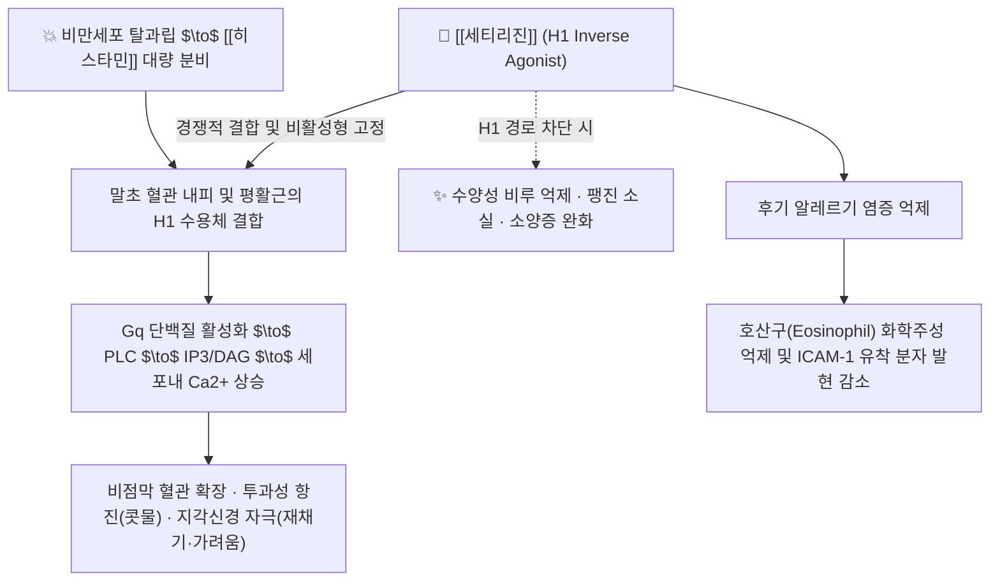

# 💊 [[세티리진]] (Cetirizine, Zyrtec, ATC R06AE07)

> **핵심 3줄 요약 (Key Summary)**:
> 🧪 **주성분·제형**: 1세대 항히스타민제인 [[히드록시진]](Hydroxyzine)의 활성 카르복실산 대사체로 개발된 2세대 피페라진(Piperazine)계 선택적 말초 H1 수용체 역작용제(Inverse Agonist). 정제(10mg), 연질캡슐(10mg), 액제·시럽제(1mg/mL)로 시판되며 식약처 141 항히스타민제 분류.
> 📍 **작용 기전**: 말초 혈관 내피 및 평활근의 H1 수용체에 고친화력으로 결합하여 비활성 상태를 안정화시키고, 알레르기 후기 반응에서 호산구(Eosinophil) 침윤과 비만세포의 염증성 매개물질 유리를 차단한다. 친수성 에톡시아세트산 작용기 도입으로 혈뇌장벽(BBB) 투과율이 1세대에 비해 현저히 낮고 항콜린성 부작용이 거의 없다.
> 🎯 **임상 적응증**: [[알레르기 비염]](계절성·통년성)의 재채기, 콧물, 가려움 완화 및 만성 특발성 [[두드러기]], 소양증 완화. 성인 기준 **1일 1회 10mg** 투여(신장애 시 엄격 감량).
> ⚠️ **주의사항**: 2세대 항히스타민제 중에서는 BBB 투과율이 상대적으로 높아 약 10~14%의 환자에서 **중등도 졸림·진정**이 유발될 수 있으므로 야간 복용을 권장하며, 간 대사가 거의 없고 약 70%가 신장 미변화체로 배설되므로 **중증 신부전(CrCl < 10 mL/min) 환자는 금기**이다.

---

## 1. 약물 기본 정보 및 시판 제품 (Brand Identification)

![[세티리진_패키지.jpg]]
> [그림 1] 세티리진(Cetirizine 10mg) 완제의약품 패키지 외형

![[세티리진_알약성상.jpg]]
> [그림 2] 세티리진 10mg 분할선이 있는 백색 타원형 필름코팅정제 성상

![[세티리진_화학구조식.png]]
> [그림 3] 세티리진(Cetirizine)의 2D 화학 분자 구조식 (PubChem CID: 2678)

> [!abstract]+ 🧪 3D 약리 분자 구조 (Interactive 3D Viewer)
> <iframe src="https://molecule-viewer-rho.vercel.app/?cid=2678" width="100%" height="450px" frameborder="0" allow="webgl" style="border-radius: 8px;"></iframe>

| 항목 | 상세 정보 |
| :--- | :--- |
| **일반명 (Generic Name)** | [[세티리진]](Cetirizine) / 세티리진염산염 (Cetirizine Dihydrochloride) |
| **대표 상품명 (Brand Names)** | **지르텍정(Zyrtec)**, 노텍정, 쎄로테정, 알러샷연질캡슐, 코세티정 |
| **ATC 코드 / 분류** | **R06AE07** (항히스타민제 - 피페라진 유도체) / 식약처 141 (항히스타민제) |
| **PubChem CID** | [2678](https://pubchem.ncbi.nlm.nih.gov/compound/2678) |
| **화학식 / 분자량** | C21H25ClN2O3 / 388.89 g/mol (염산염: 461.8 g/mol) |
| **주요 제형 및 함량** | 10mg 필름코팅정, 10mg 연질캡슐, 1mg/mL 경구액·시럽제 |
| **식약처 허가 적응증** | 계절성 및 통년성 알레르기 비염, 알레르기성 결막염, 만성 특발성 두드러기, 피부 소양증 |

### 1.1 대표 시판 제품 및 함유 복합제 매핑 (Brand Identification & Combinations)

| 구분 | 대표 제품명 / 브랜드 | 함유 성분 및 함량 | 제형 및 특징 | 주요 적응증 및 복약 지도 핵심 |
| :--- | :--- | :--- | :--- | :--- |
| **단일제 (OTC/ETC)** | [[지르텍정]], 쎄로테정 | [[세티리진염산염]] 10mg | 정제, 연질캡슐 | 1차 표준 항히스타민제, 신속한 소양증 완화, 취침 전 복용 권장 |
| **소아용 액제 (OTC)** | 지르텍시럽, 세티린시럽 | [[세티리진염산염]] 1mg/mL | 경구 시럽 | 2세 이상 소아 비염·두드러기, 연령별 정밀 계량 투약 |
| **비충혈 복합제 (ETC)** | 슈도에페드린 복합제 | [[세티리진]] 5mg + [[슈도에페드린]] 120mg | 서방정 | 코막힘이 극심한 비염, 불면·두근거림 주의, 저녁 늦게 복용 회피 |
| **단일 대사체 (ETC)** | [[레보세티리진]] (씨잘) | R-거울상이성질체 5mg | 정제, 액제 | 세티리진의 활성 광학이성질체, 수용체 결합력 2배, 진정 부작용 감소 |
| **2세대 항히스타민 감별** | [[펙소페나딘]] (알레그라) | 펙소페나딘 120mg/180mg | 정제 | BBB 투과율 0%로 무졸림, 세티리진보다 졸림이 없으나 산성 주스 상호작용 |
| **2세대 항히스타민 감별** | [[로라타딘]] (클라리틴) | 로라타딘 10mg | 정제 | 간 CYP 대사 의존, 진정률 낮으나 급성 가려움 억제 속도는 세티리진이 우위 |

---

## 2. 분자 약리 기전 및 작용 경로 (Mechanism of Action)

* **주요 작용 기전 (Primary MoA)**:
  * 세티리진은 히스타민 H1 수용체에 높은 친화력으로 결합하여 수용체의 기본 활성(Constitutive activity)을 억제하는 **선택적 역작용제(Inverse Agonist)**이다.
  * 혈관 내피세포의 H1 수용체를 차단하여 NO 및 프로스타사이클린 유리를 막아 **혈관 투과성 증가, 부종, 팽진(Wheal), 발적(Flare)을 신속히 억제**한다.
  * 지각신경 종말의 H1 수용체 차단을 통해 재채기 반사와 극심한 소양감을 경감시킨다(Simons 2004).
* **1세대와의 구조적 차이 및 항염증 부가 효과**:
  * 말단에 카르복실산(-COOH) 작용기를 보유하여 생리적 pH에서 양쪽성 이온(Zwitterion)으로 존재한다. 이 높은 극성으로 인해 혈뇌장벽(BBB) 침투가 제한되어 1세대 약물([[클로르페니라민]], [[히드록시진]]) 대비 중추 억제 부작용이 현저히 적다.
  * 무스카린성 콜린 수용체(Anti-muscarinic) 차단능이 거의 없어 구갈, 시야 장애, 요저류 등 항콜린성 이상반응을 유발하지 않는다.
  * 알레르기 반응 후기(Late-phase)에 호산구 침윤을 억제하고 혈관 내피세포의 ICAM-1 유착 분자 발현을 낮추어 만성 비염 점막의 염증성 악순환을 차단한다(Spencer et al. 1993).

---

## 3. 약동학적 특성 (Pharmacokinetics: ADME)

| 약동학 파라미터 | 수치 및 임상적 의미 |
| :--- | :--- |
| **생체이용률 (Bioavailability, F)** | 경구 투여 시 **70% 이상 신속 흡수** (음식물 섭취 시 흡수 총량은 유지되나 Tmax가 약 1시간 지연) |
| **최고혈중농도 도달시간 (Tmax)** | **0.5 ~ 1.0시간** (알레르기 급성 발작 시 30분~1시간 내의 매우 빠른 약효 발현) |
| **작용 지속 시간 (Duration)** | **24시간** (H1 수용체와의 느린 해리 속도로 인해 1일 1회 복용으로 종일 증상 제어) |
| **혈장 단백결합률 (Protein Binding)** | **93%** (주로 혈청 알부민과 결합, 타 약물과의 단백치환 상호작용 미미) |
| **분포 용적 (Vd)** | **0.56 L/kg** (혈관 및 세포외액에 주로 분포, 중추 침투율 약 10~14%) |
| **간 대사 효소 (Metabolism)** | **간 CYP450 대사 < 10% 미만** (비활성 O-탈알킬화 산물 소량 형성, 간기능 저하의 영향 적음) |
| **배설 반감기 (Elimination t1/2)** | 성인 정상 신기능: **약 8.3시간** (소아 6시간, 고령자 12시간, 말기 신부전 시 19~21시간으로 대폭 연장) |
| **주요 배설 경로 (Excretion)** | **신장 소변 배설 약 70% (대부분 미변화체)**, 분변 배설 약 10% (신장애 시 용량 조절 필수) |

---

## 4. 용법·용량 및 처방 가이드 (Dosage & Administration)

| 대상 환자군 | 표준 용법·용량 | 복약 지도 및 조절 기준 |
| :--- | :--- | :--- |
| **성인 및 12세 이상 청소년** | **1일 1회 10mg** 경구 복용 | 졸림에 민감한 환자는 **취침 전 복용** 권장. 초기 경증 환자는 5mg(반정) 시작 가능 |
| **6세 이상 ~ 12세 미만 소아** | 1회 5mg 1일 2회 (아침, 저녁) 또는 1일 1회 10mg | 소아 비염 증상 제어 |
| **2세 이상 ~ 6세 미만 소아** | 1회 2.5mg 1일 2회 (시럽제 2.5mL씩) | 정밀 눈금 스푼 또는 시린지 사용 |
| **경·중등도 신장애 (CrCl 30~49 mL/min)** | **1일 1회 5mg** (통상 용량의 50% 감량) | 약물 체내 축적 및 주간 진정 방지 |
| **중증 신장애 (CrCl 10~29 mL/min)** | **5mg을 2일 간격(격일)으로 1회 투여** | 배설 지연에 따른 반감기 연장 보정 |
| **말기 신부전 (CrCl < 10 mL/min) 및 투석** | **투여 금기 (Contraindicated)** | 신장 배설 불가로 인한 독성 위험 |

---

## 5. 부작용, 경고 및 약물 상호작용 (Adverse Effects & Interactions)

### 5.1 주요 부작용 및 독성 경고
* **중추신경계 진정 및 졸림 (10~14%)**:
  * 2세대 항히스타민제 중 BBB 투과율이 약 10~14%로 존재하여 [[펙소페나딘]]이나 [[로라타딘]]에 비해 주간 졸림, 권태감, 피로, 어지럼증 발생 빈도가 상대적으로 높음.
  * 운전, 정밀 기계 조작 전 복용 주의 교육 필수.
* **약물 중단성 반등 소양증 (Rebound Pruritus)**:
  * 수개월 이상 장기 연속 복용한 세티리진을 갑자기 단절할 경우, 투여 전보다 극심한 전신 가려움증이 반등할 수 있으므로 점진적 테이퍼링 권장.
* **경미한 항콜린 반응 (1~2%)**:
  * 구갈(입마름), 경미한 소화불량.

### 5.2 주요 병용 금기 및 상호작용
* **중추신경 억제제 및 알코올 병용 위험**:
  * 알코올, 벤조디아제핀계([[알프라졸람]], [[디아제팜]]), 수면진정제([[졸피뎀]]), 삼환계 항우울제([[아미트립틸린]])와 병용 시 중추신경 진정 효과가 상승 작용을 일으켜 운동실조 및 인지 저하 유발.
* **CYP450 상호작용 측면의 탁월한 안전성**:
  * 간의 CYP3A4, CYP2D6 대사를 거치지 않으므로 마크로라이드계 항생제([[에리스로마이신]])나 아졸계 항진균제([[케토코나졸]])와 병용 시에도 혈중 농도가 변하지 않아 약물상호작용 위험이 극히 낮음.

---

## 6. 한의 치료 연계 및 병용/테이퍼링 프로토콜 (Integrative Medicine)

### 6.1 한약·양약 병용 투여 안전성 및 시너지 배오
* **알레르기 비염 급성기 병용 요법**:
  * 수양성 비루와 발작성 재채기가 극심한 급성기에는 [[소청룡탕]] 투여와 함께 세티리진 10mg을 취침 전 단회 병용하여 야간 수면 질 개선과 증상 제어 속도를 극대화.
  * 비염 점막 건조감이나 구갈을 호소하는 경우 [[생맥산]]이나 [[맥문동탕]]을 합방하여 진액을 보충.
* **만성 두드러기 한약 치료 및 시너지**:
  * 풍열(風熱) 및 습열(濕熱)로 인한 만성 특발성 두드러기 환자에게 [[형개연교탕]], [[소풍산]], [[방풍통성산]]을 투여하여 피부 면역 과민 반응을 근본적으로 조절.

### 6.2 양약 감량 및 한의 전환(테이퍼링) 가이드
* **항히스타민제 감량 프로토콜**:
  * 3개월 이상 장기 복용 중인 환자에서 반등 소양증을 방지하기 위해:
    - 1단계: 10mg 매일 복용 $\to$ 5mg(반알) 매일 복용 (2주간).
    - 2단계: 5mg 격일 복용으로 감량하면서 [[침치료]](곡지, 합곡, 족삼리, 혈해) 주 2회 병행 (2주간).
    - 3단계: 주 1~2회 필요시 복용(PRN)으로 전환 후 완전 중단.

---

## 7. 💡 사용자 진료실 핵심 필기 & 실전 임상 체크리스트

### 7.1 진료실 3대 핵심 문진 체크리스트
1. **복용 시간대 및 주간 운전 여부 확인**: 낮에 복용 후 졸림이나 집중력 저하가 있었는지 묻고, 가급적 **취침 전 30분** 복용으로 복용 시간대를 조정.
2. **신기능 기저 질환 유무 확인**: 신부전 병력 또는 고령 환자에서 신기능 저하 여부를 문진하여 필요 시 5mg으로 감량 처방 지도.
3. **만성 복용 환자의 갑작스러운 투약 중단 여부 문진**: 약을 하루만 안 먹어도 온몸이 찢어지듯 가려운 반등 소양증 증상이 있는지 확인하고 한약 병용 테이퍼링 계획 수립.

### 7.2 환자 티칭 스크립트
> *"환자분, 지르텍(세티리진)은 콧물과 피부 가려움증을 가라앉히는 데 가장 빠르고 확실한 약입니다. 복용 후 30분에서 1시간이면 효과가 나타나 하루 종일 지속됩니다. 다만 이 약은 알레르기 약 중 졸음이 다소 올 수 있으므로 낮보다는 주무시기 30분 전에 복용하시는 것이 가장 좋습니다. 또한 이 약은 대부분 콩팥으로 빠져나가므로, 신장이 약하신 분은 반드시 반 알로 줄여서 드셔야 합니다. 오랫동안 드시던 약을 한 번에 끊으면 가려움이 갑자기 심해질 수 있으니, 한의원에서 침과 한약 치료를 병행하면서 서서히 줄여나가도록 도와드리겠습니다."*

---

## 8. 출처 및 학술 참고 문헌 (References)

* Simons FE. Advances in H1-antihistamines. *N Engl J Med*. 2004;351(21):2203-2217. [PMID: 15548781](https://pubmed.ncbi.nlm.nih.gov/15548781/)
  * `[연구 요약]` 1세대 대비 2세대 항히스타민제의 H1 수용체 역작용제 분자 기전, 양쪽성 이온 구조, 낮은 BBB 투과성 및 중추 진정 부작용 감소를 규명한 랜드마크 종설.
* Spencer CM, Faulds D, Peters DH. Cetirizine. A reappraisal of its pharmacological properties and therapeutic use in selected allergic disorders. *Drugs*. 1993;46(6):1055-1080. [PMID: 7510611](https://pubmed.ncbi.nlm.nih.gov/7510611/)
  * `[연구 요약]` 세티리진의 체내 약동학(신속 흡수, Tmax 1시간, 70% 신장 미변화체 배설) 및 알레르기 비염과 만성 두드러기에서의 강력한 항호산구 임상 효능을 확립한 핵심 문헌.
* Li Z, Zhang J, Zheng Y, et al. Second-generation H1 antihistamines for the treatment of chronic urticaria: a network meta-analysis. *Front Med (Lausanne)*. 2026;13:1880701. [PMID: 42662818](https://pubmed.ncbi.nlm.nih.gov/42662818/)
  * `[연구 요약]` 만성 두드러기 환자 대상 2세대 항히스타민제 간의 네트워크 메타분석으로, 세티리진이 팽진 억제 및 가려움 완화 속도에서 최상위 유효성을 실증한 연구.
