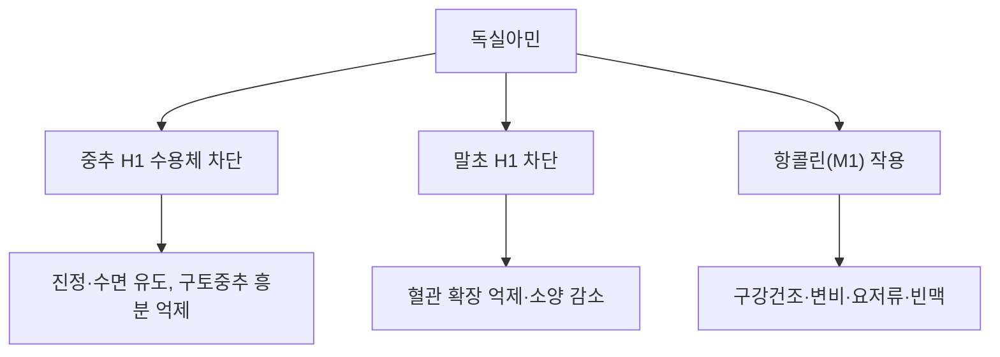

# 💊 독실아민 (Doxylamine)

> **핵심 3줄 요약 (Key Summary)**:
> - 💊 **약물 개요**: 에탄올아민계 1세대 항히스타민제(H1 차단). 진정 작용이 강해 수면 보조 및 임신 오심·구토([[입덧]]) 1차 치료에 사용한다.
> - 🎯 **핵심 적응증**: 임신오심·구토에서 [[비타민 B6]](피리독신)와의 복합 서방정이 표준 1차 요법. 단독으로는 단기 불면.
> - ⚠️ **주요 주의**: 강한 진정·항콜린 작용. 운전·기계 조작 금지, 임신 초기에는 B6 병용 저용량으로 시작한다.
> - 🖼️ **이미지**: 분자구조식 1장 수록. 시판 패키지·블리스터 알약 이미지는 확보하지 못했다(미확보 명시).

---

## 📌 목차
1. [약물 개요 및 식별 정보](#1-약물-개요-및-식별-정보)
2. [적응증](#2-적응증)
3. [용법·용량](#3-용법용량)
4. [약리 기전](#4-약리-기전)
5. [금기·주의·부작용](#5-금기주의부작용)
6. [임상 포인트·상호작용](#6-임상-포인트상호작용)
7. [출처 및 참고 문헌](#7-출처-및-참고-문헌)

---

## 1. 약물 개요 및 식별 정보

![[독실아민_01_구조식.png|320]]
> [그림 1: 독실아민 2D 구조식 — 피리딘 고리와 디메틸아미노에톡시 사슬을 가진 에탄올아민계 구조 — 출처: PubChem CID 3162, National Library of Medicine]

| 항목 | 내용 |
| :--- | :--- |
| **일반명 (INN)** | Doxylamine |
| **한글명** | 독실아민 (독실아민숙신산염으로 시판) |
| **계열** | 1세대 항히스타민제 (에탄올아민계, H1 수용체 길항) |
| **ATC 코드** | R06AA09 |
| **PubChem CID** | 3162 |
| **분자식 / 분자량** | C17H22N2O / 약 270.4 g/mol |
| **임신 safety** | 미국 FDA 임신 카테고리 A(복합제 기준 자료), 수유 중 단기 사용은 제한적 자료 |
| **대표 복합제** | 독실아민+피리독신 서방정(지연방출) — 임신오심·구토 적응 |

* **물리화학**: 지용성이 높아 중추신경계로 잘 투과하며, 이 때문에 진정 작용이 다른 1세대 항히스타민보다 강하다.
* **대사**: 간 CYP 효소를 통한 대사, 활성 대사체 없음. 반감기 약 10~12시간으로 1일 1~2회 복용 설계가 가능하다.

---

## 2. 적응증

* **임신오심·구토([[입덧]])**: [[비타민 B6]]와의 복합 서방정이 1차 약물 요법. [[임신 오조]]로 진행하면 수액·전해질 교정과 함께 단계적으로 상향한다.
* **불면(단기)**: OTC 수면 보조제 성분으로 사용. 2주 이내 단기 원칙.
* **알레르기성 비염·두드러기**: 1세대 항히스타민으로서 야간 증상 완화 목적.
* **한의 임상에서의 위치**: 임신부에게 한약을 쓸 때 병용 약물력을 반드시 확인해야 하는 대표 약물. 졸림이 심해 복약 순응도를 떨어뜨리는 경우가 많다.

---

## 3. 용법·용량

| 상황 | 용법 |
| :--- | :--- |
| **임신오심·구토(복합 서방정)** | 취침 전 1정으로 시작 → 필요 시 아침 1정 추가 → 증상 지속 시 1일 최대 4정까지 증량(각 정 독실아민 10 mg + 피리독신 10 mg 기준 제형) |
| **복용 타이밍** | 진정 작용이 있으므로 취침 전 복용을 기본으로 하고, 낮 복용은 졸림을 감수할 수 있을 때만 |
| **불면(단독)** | 취침 30분 전 25 mg 1회, 최대 2주 |
| **신기능·간기능 저하** | 감량 또는 간격 연장을 고려 |
| **고령자** | 항콜린 부작용 위험이 커 최소 용량, 가급적 대체 약물 우선 |

* **감량·중단**: 증상 호전 후 1~2주에 걸쳐 서서히 감량하면 반동성 오심을 줄일 수 있다.
* **최대 용량 준수**: 피리독신 성분이 포함되므로 [[비타민 B6]] 상한(성인 100 mg/일)을 넘기지 않도록 복합제 총량을 계산한다.

---

## 4. 약리 기전

* **H1 차단**: 시상하부·전정핵·구토 유발영역(area postrema)의 H1 수용체를 차단해 오심·구토 반사를 낮춘다.
* **시너지**: [[비타민 B6]](피리독신)는 피리독살인산으로 전환되어 신경전달물질(GABA·세로토닌·도파민) 합성에 관여한다. 임신 중 B6 요구량 증가와 오심의 연관성이 근거가 되어, 두 성분 병용이 단독보다 우수한 것으로 평가된다.
* **항콜린 작용**: 치료 효과와 무관한 부작용의 원천이다. 고령자·전립선비대·녹내장 환자에서 문제가 된다.

---

## 5. 금기·주의·부작용

* **절대 금기**: 이 약 또는 성분에 과민반응, MAO 억제제 복용 중, 폐쇄각 녹내장, 전립선비대에 의한 배뇨장애, 중증 중증 근무력증.
* **신중 투여**: 천식, 중증 심혈관질환, 간질, 갑상선기능항진, 고령자, 수유부.
* **흔한 부작용**: 졸림(가장 흔함), 구강건조, 어지럼, 변비, 시야 흐림.
* **드문 부작용**: 요저류, 혼동·섬망(고령), 빈맥, 광과민.
* **과량**: 항콜린 증후군(발열·홍조·동공산대·섬망), 경련, 호흡억제. 소아에서는 치명적일 수 있어 즉시 응급실 이송.
* **임신·수유**: 임신오심 목적의 복합제는 임상시험 근거가 축적되어 있으나, 임신 초기에는 최소 유효량을 원칙으로 한다.

---

## 6. 임상 포인트·상호작용

* **상호작용**: 알코올·벤조디아제핀·오피오이드·다른 항히스타민과 병용 시 중추 억제가 가중된다. 항콜린제(삼환계 항우울제, 항정신병약)와 병용 시 항콜린 부작용이 겹친다.
* **진료실 포인트**: 임신오심 환자가 "약을 먹으면 너무 졸려서 못 먹겠다"고 하면, 취침 전 1정으로 시간을 옮기고 낮에는 [[비타민 B6]] 단독 또는 침 치료로 버티는 전략이 현실적이다.
* **한약 병용**: 진정 작용이 강한 본초(예: 산조인·원지 계열)와 겹치면 과진정이 될 수 있어 복용 시간을 분리한다.
* **모니터링**: 2주 이상 지속 시 졸림·변비·배뇨 상태를 확인하고, 임신오조로 체중 감소·케톤뇨가 있으면 입원 평가로 전환한다.

---

## 7. 출처 및 참고 문헌

1. **PubChem CID 3162 — Doxylamine**. [PubChem](https://pubchem.ncbi.nlm.nih.gov/compound/3162)
   * [연구 요약] 분자식·분자량·구조식의 1차 데이터베이스 확인(CID 3162 실조회).
2. **Wu XK, et al. (2023)**. Acupuncture and Doxylamine-Pyridoxine for Nausea and Vomiting in Pregnancy: A Randomized, Controlled, 2×2 Factorial Trial. *Ann Intern Med*, 176(7), 922-933. [PMID 37335994](https://pubmed.ncbi.nlm.nih.gov/37335994/)
   * [연구 요약] 임신오심·구토에서 침과 독실아민-피리독신 병용의 2×2 요인설계 무작위 시험. 두 중재 병용이 단독보다 우수했다.
3. **Drug and Therapeutics Bulletin (2019)**. Doxylamine/pyridoxine for nausea and vomiting in pregnancy. *Drug Ther Bull*. [PMID 30705026](https://pubmed.ncbi.nlm.nih.gov/30705026/)
   * [연구 요약] 복합 서방정의 근거·용량·임신 중 안전성 자료를 정리한 약물평가 문헌.
4. **Persaud N, et al. (2014)**. Should doxylamine-pyridoxine be used for nausea and vomiting of pregnancy? *J Obstet Gynaecol Can*. [PMID 24798673](https://pubmed.ncbi.nlm.nih.gov/24798673/)
   * [연구 요약] 1차 요법으로서의 근거 수준과 한계를 검토한 임상 고찰.
