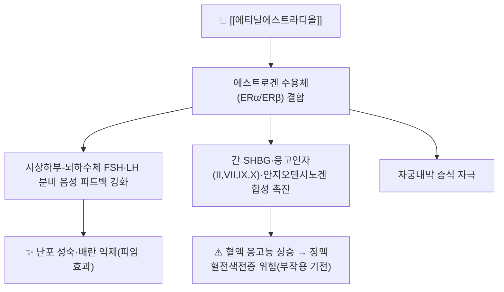

# 💊 [[에티닐에스트라디올]] (Ethinylestradiol, Estinyl / 각종 복합경구피임제 배합성분, ATC G03CA01)

> ⚠️ **이미지 미확보 (2026-10-17)** — 첨부 폴더에 단일 성분 패키지·알약 사진이 없어 2D 구조식 슬롯만 유지하고 패키지·성상 슬롯은 생략했습니다. [[야즈]] 노트의 구조식(`에티닐에스트라디올_화학구조식.png`)을 동일 자료로 재사용할 수 있습니다.

> **핵심 3줄 요약 (Key Summary)**:
> 🧪 **주성분·제형**: 천연 [[에스트라디올]]의 17α 위치에 에티닐기(-C≡CH)를 붙여 간 초회통과 대사(특히 2번 위치 산화·황산화 결합)에 대한 저항성을 극적으로 높인 **합성 에스트로겐**이다. 단일제로는 거의 유통되지 않고, 프로게스틴(레보노르게스트렐·드로스피레논·노르에틴드론 등)과 배합된 복합 경구피임제(COC)의 에스트로겐 성분으로 0.01~0.035mg 저용량 정제 형태로 시판된다.
> 📍 **작용 기전**: 에스트로겐 수용체(ERα/ERβ)에 결합하여 시상하부-뇌하수체-난소(HPO) 축의 음성 피드백을 강화, FSH·LH 분비를 억제해 난포 성숙과 배란을 차단한다. 동시에 자궁내막 증식, 간의 SHBG·응고인자 합성 촉진 등 전신 에스트로겐 작용을 나타낸다.
> 🎯 **임상 적응증**: 프로게스틴과 배합한 복합 경구피임, 월경곤란증·월경전불쾌장애([[PMDD]]) 완화, 중등도 여드름(항안드로겐 프로게스틴 배합 시), 폐경기 호르몬요법(HRT)의 에스트로겐 보충 성분.
> ⚠️ **주의사항**: 용량·연령 의존적 **정맥혈전색전증([[VTE]])·뇌졸중·심근경색** 위험 증가가 가장 중요한 경고이며, **35세 이상 흡연 여성에서는 심혈관 위험으로 사용이 엄격히 제한**된다. CYP3A4 유도제(리팜핀, 카르바마제핀, 페니토인, 세인트존스워트 등) 병용 시 혈중농도 저하로 피임 실패 위험이 있다.

---

## 1. 약물 기본 정보 및 시판 제품 (Brand Identification)

![[에티닐에스트라디올_화학구조식.png|300]]
> [그림 1] 에티닐에스트라디올(Ethinylestradiol)의 2D 평면 화학 분자 구조식 — PubChem CID 5991 ([[야즈]] 노트와 동일 자료)

> [!abstract]+ 🧪 3D 약리 분자 구조 (Interactive 3D Viewer)
> <iframe src="https://molecule-viewer-rho.vercel.app/?cid=5991" width="100%" height="450px" frameborder="0" allow="webgl" style="border-radius: 8px;"></iframe>

| 항목 | 상세 정보 |
| :--- | :--- |
| **일반명 (Generic Name)** | [[에티닐에스트라디올]](한글) / Ethinylestradiol, Ethinyl Estradiol |
| **대표 상품명 (Brand Names)** | 단일제는 국내 유통 거의 없음(해외 Estinyl 등). 국내는 대부분 **복합 경구피임제** 배합성분으로 유통: [[야즈]](드로스피레논 배합), 머시론·쎄스콘·미뉴렛(데소게스트렐 배합), 트리퀼라·마이보라(레보노르게스트렐 배합) 등 |
| **ATC 코드 / 분류** | G03CA01 (Estrogens, Ethinylestradiol) |
| **PubChem CID** | [5991](https://pubchem.ncbi.nlm.nih.gov/compound/5991) |
| **화학식 / 분자량** | C20H24O2 / 296.4 g/mol |
| **주요 제형 및 함량** | 복합 경구피임제 내 0.01~0.035mg 정제(단독 복용 없음). 해외에는 0.02~0.05mg 단일 정제(Estinyl 등) 존재 |
| **식약처 허가 적응증** | 복합 경구피임제의 에스트로겐 성분으로서 피임, 월경곤란증·월경전불쾌장애 완화, 중등도 여드름(항안드로겐 배합제), 폐경기 호르몬요법 |

### 1.1 대표 시판 제품 및 함유 복합제 매핑 (Brand Identification & Combinations)

| 구분 | 대표 제품명 / 브랜드 | 함유 성분 및 1회당 함량 | 제형 및 특징 | 주요 적응증 및 복약 지도 핵심 |
| :--- | :--- | :--- | :--- | :--- |
| **4세대 프로게스틴 배합** | [[야즈]] (Yaz) | [[에티닐에스트라디올]] 0.02mg + [[드로스피레논]] 3mg | 24/4 활성·위약 요법 | 피임 + PMDD + 여드름, 고칼륨혈증·VTE 모니터링 |
| **3세대 프로게스틴 배합** | 머시론, 미뉴렛 | [[에티닐에스트라디올]] 0.02~0.03mg + 데소게스트렐 | 21정 요법 | 저용량 표준 피임, 2세대 대비 VTE 위험 약간 높음 보고 |
| **2세대 프로게스틴 배합** | 트리퀼라, 마이보라 | [[에티닐에스트라디올]] 0.03~0.04mg(3상성) + 레보노르게스트렐 | 3상성(단계별 용량 변화) | VTE 위험이 상대적으로 낮은 편, 표준 피임 |
| **항안드로겐 프로게스틴 배합** | 디아안느, 다이안느-35 | [[에티닐에스트라디올]] 0.035mg + 사이프로테론아세테이트 | 21정 요법 | 중증 여드름·다모증·피임 동시 목적, VTE 위험 상대적으로 높음 |
| **긴급피임약(고용량 단독 프로게스틴과 구분)** | - | - | - | 에티닐에스트라디올은 긴급피임약(레보노르게스트렐 단독, 울리프리스탈)의 성분이 아님 — 혼동 주의 |

---

## 2. 분자 약리 기전 및 작용 경로 (Mechanism of Action)

* **주요 작용 기전 (Primary MoA)**:
  * ERα/ERβ에 결합해 시상하부 GnRH 박동 및 뇌하수체 FSH·LH 분비를 억제, 난포 성장과 배란을 차단한다(배합된 프로게스틴이 LH 서지 억제·자궁경관 점액 비후를 추가로 담당).
  * 17α-에티닐기가 간 CYP 대사 효소에 의한 산화적 분해를 입체적으로 방해하여 천연 에스트라디올보다 경구 생체이용률과 효력이 크게 높아진 것이 핵심 구조적 특징이다.
* **하류 신호전달 및 생화학적 반응**:
  * 간 단백 합성 유도: SHBG, 코르티솔결합글로불린(CBG), 응고인자(II·VII·IX·X), 안지오텐시노겐 합성이 증가하여 혈액 응고능이 전반적으로 항진된다. 이것이 VTE·고혈압 위험 증가의 생화학적 배경이다.
  * 자궁내막 증식 및 간세포 지질 대사(HDL 상승, 중성지방 상승) 변화를 유발한다.

---

## 3. 약동학적 특성 (Pharmacokinetics: ADME)

| 약동학 파라미터 | 수치 및 임상적 의미 |
| :--- | :--- |
| **생체이용률 (Bioavailability, F)** | 약 38~48% (경구). 장벽(gut wall)에서의 1차 황산화(sulfation) 대사가 간 대사보다도 크게 기여하며 개인차가 크다(Back et al., 1982, PMID 7059434). |
| **최고혈중농도 도달시간 (Tmax)** | 약 1~2시간 |
| **혈장 단백결합률 (Protein Binding)** | 약 95~98% — 주로 **알부민**에 결합(SHBG에는 거의 결합하지 않아 다른 프로게스틴의 유리형 비율에 간접 영향) |
| **간 대사 효소 (Metabolism)** | 주로 **CYP3A4**에 의한 2-하이드록실화, 이후 황산화(sulfation)·포합(glucuronidation) — 장벽 초회통과 황산화가 생체이용률을 좌우하는 핵심 변수 |
| **배설 반감기 (Elimination t1/2)** | 약 13~27시간(문헌상 범위가 넓음, 흔히 약 24시간으로 인용) |
| **주요 배설 경로 (Excretion)** | 담즙을 통한 **대변 배설**이 주이며 장간순환(enterohepatic recirculation)을 거침, 대사체의 일부(약 40%)는 소변으로 배설 |

---

## 4. 용법·용량 및 처방 가이드 (Dosage & Administration)

| 임상 적응증 | 성인 표준 용법·용량 | 1일 최대 한도 용량 |
| :--- | :--- | :--- |
| **복합 경구피임(단독 성분 아님)** | 배합 제제 기준 1일 1정(0.01~0.035mg 에티닐에스트라디올 함유), 21일 또는 24일 활성정 복용 후 휴약/위약 | 제품별 배합 용량 준수(단일 투여 없음) |
| **폐경기 호르몬요법(HRT) 보조** | 매우 저용량(5㎍/day 수준) 배합 제제로 사용되는 경우가 있으나 국내는 주로 에스트라디올 제제를 사용, 에티닐에스트라디올 단독 HRT는 드묾 | 제품 라벨 기준 |

---

## 5. 부작용, 경고 및 약물 상호작용 (Adverse Effects & Interactions)

### 5.1 주요 부작용 및 독성 경고 (Black Box Warnings)
* **심혈관계 위험**: 정맥혈전색전증(VTE), 뇌졸중, 심근경색 위험이 용량·연령·흡연 여부에 비례해 증가한다. **35세 이상 흡연 여성은 심혈관 위험으로 사용이 엄격히 제한**된다.
* **간 독성**: 드물게 간세포 선종(hepatic adenoma), 담즙정체성 황달 유발 가능.
* **기타**: 유방 압통, 오심, 두통, 기분 변화(우울 경향), 체액 저류로 인한 부종, 색소 과다(기미) 등.

### 5.2 주요 병용 금기 및 상호작용
* **CYP3A4 유도제**: 리팜핀, 카르바마제핀, 페니토인, 세인트존스워트 등 병용 시 에티닐에스트라디올 혈중농도가 저하되어 **피임 실패** 위험이 증가한다.
* **CYP1A2 억제**: 에티닐에스트라디올이 CYP1A2를 억제하여 카페인·테오필린 등의 혈중농도를 높일 수 있다.
* **항응고제·흡연**: 혈액 응고능 항진 성분이므로 흡연, 기존 혈전 위험 인자와 상가적으로 작용해 VTE 위험을 크게 높인다.

---

## 6. 한의 치료 연계 및 병용/테이퍼링 프로토콜 (Integrative Medicine)

### 6.1 한약·양약 병용 투여 안전성 및 시너지 배오
* **혈전 위험 완충**: 당귀·천궁·단삼 등 활혈 본초는 항혈소판 경향을 가지므로, 에티닐에스트라디올 복용 중 VTE 고위험군(흡연·비만·혈전 가족력)에서는 병용 시 출혈·혈전 양방향 위험을 모두 고려해 신중히 접근한다.
* **월경통·PMDD 보조**: 복합 경구피임제를 복용 중인 환자의 잔존 월경통·부종에 [[당귀작약산]] 등 활혈·이수 처방을 보조적으로 병용할 수 있으나, 피임 효과 자체에 대한 한약의 간섭 여부는 보고가 제한적이다.

### 6.2 양약 감량 및 한의 전환(테이퍼링) 가이드
* 경구피임제는 임의 중단 시 불규칙 출혈·배란 재개가 발생하므로, 피임이 목적인 환자에서 한의 치료로의 "감량"은 원칙적으로 권장하지 않으며, 중단은 산부인과 상담을 전제로 한다. 여드름·다모증 목적 복용의 경우 한의 치료(청열해독·활혈 처방) 효과가 안정화되면 산부인과와 상담 후 단계적 조정을 고려할 수 있다.

---

## 7. 💡 사용자 진료실 핵심 필기 & 실전 임상 체크리스트

### 7.1 진료실 3대 핵심 문진 체크리스트
1. **흡연 여부 및 연령 확인**: 35세 이상 흡연 여성은 복합 경구피임제 복용 자체가 심혈관 위험으로 제한되는 환자군임을 인지하고 문진한다.
2. **혈전 위험 인자 청취**: 혈전 가족력, 장시간 부동(장거리 비행 등), 비만 여부를 확인하여 한약 중 활혈 본초 병용의 위험-이익을 판단한다.
3. **복용 목적 구분**: 피임 목적인지, 여드름·PMDD·월경통 조절 목적인지에 따라 한의 치료의 보조 역할과 "감량 가능성"에 대한 설명이 달라진다.

### 7.2 환자 티칭 스크립트
> *"지금 드시는 피임약의 에스트로겐 성분은 혈액이 좀 더 잘 뭉치게 만드는 효과가 있어서, 담배를 피우시거나 장시간 앉아 계시는 경우 혈전 위험이 올라갈 수 있습니다. 저희 쪽에서 활혈 작용이 있는 한약을 함께 쓸 때는 이 부분을 같이 고려해서 용량과 병용 시점을 조절하겠습니다."*

---

## 8. 출처 및 학술 참고 문헌 (References)

1. Back DJ, Breckenridge AM, MacIver M, Orme M, Purba HS, Rowe PH, Taylor I. (1982). *The gut wall metabolism of ethinyloestradiol and its contribution to the pre-systemic metabolism of ethinyloestradiol in humans*. Br J Clin Pharmacol. 13(3):325-330. doi:10.1111/j.1365-2125.1982.tb01382.x. [PMID 7059434](https://pubmed.ncbi.nlm.nih.gov/7059434/).
   - **[연구 요약]**: 경구 투여된 에티닐에스트라디올이 간보다 장벽(gut wall)에서 더 크게 황산화 포합되어 초회통과 대사됨을 문맥정맥·말초정맥 혈중 농도 비교로 입증 — 생체이용률 변동성의 핵심 기전적 근거.
2. Yonkers KA, Brown C, Pearlstein TB, et al. (2005). *Efficacy of a new low-dose oral contraceptive with drospirenone in premenstrual dysphoric disorder*. Obstet Gynecol. 106(3):492-501. doi:10.1097/01.AOG.0000175834.77215.2e. [PMID 16135578](https://pubmed.ncbi.nlm.nih.gov/16135578/).
   - **[연구 요약]**: 에티닐에스트라디올 20㎍/드로스피레논 3mg 24/4 요법의 PMDD 개선 효과를 입증한 임상시험([[야즈]] 노트 §8 공유 문헌).
3. Lidegaard Ø, Nielsen LH, Skovlund CW, Skjeldestad FE, Løkkegaard E. (2011). *Risk of venous thromboembolism from use of oral contraceptives containing different progestogens and oestrogen doses*. BMJ. 343:d6423. doi:10.1136/bmj.d6423. [PMID 22027398](https://pubmed.ncbi.nlm.nih.gov/22027398/).
   - **[연구 요약]** 덴마크 160만 명 코호트 — 프로게스틴 종류·에티닐에스트라디올 용량에 따른 VTE 상대위험도 차이를 정량화한 대규모 국가 코호트 연구.
4. 식품의약품안전처 의약품안전나라 의약품통합정보시스템 (https://nedrug.mfds.go.kr)
   - **[연구 요약]** 국내 허가 복합 경구피임제의 품목 기준코드, 허가사항, 용법용량 및 부작용 안전성 정보.
