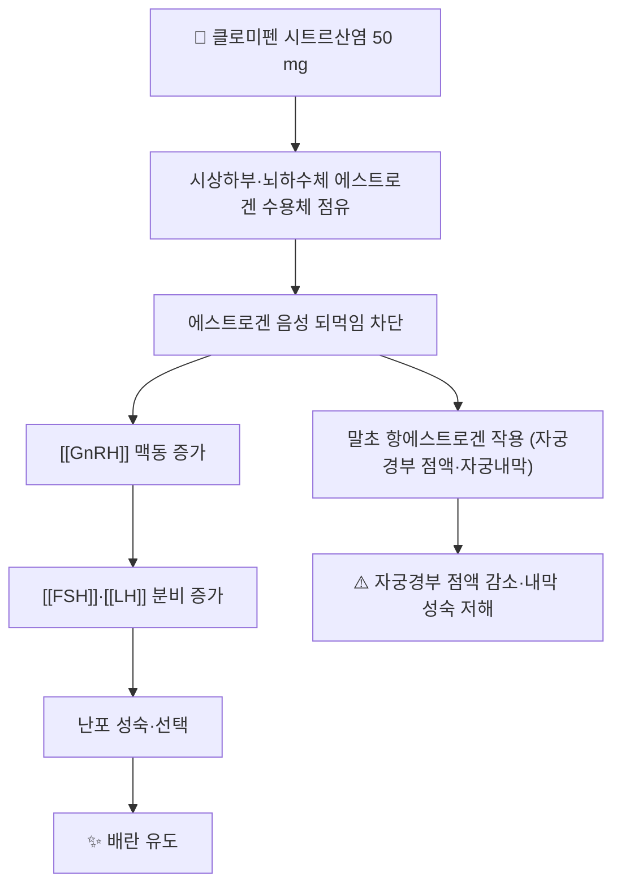

# 💊 클로미펜 (Clomiphene, G03GB02)

> **핵심 요약 (Key Summary)**:
> 🧪 주성분·제형: 선택적 [[에스트로겐]] 수용체 조절제(SERM) 계열 경구 배란유도제. 클로미펜 시트르산염 50 mg 정제가 표준 제형이며, 트랜스 이성질체 엔클로미펜과 시스 이성질체 주클로미펜의 혼합물이다.
> 📍 작용 기전: [[시상하부]]·뇌하수체의 [[에스트로겐]] 수용체를 점유해 에스트로겐 음성 되먹임을 차단하고, 결과적으로 [[GnRH]] 맥동이 늘어 [[FSH]]·[[LH]] 분비가 증가해 난포 성숙과 배란을 유도한다.
> 🎯 임상 적응증: 무배란성 불임의 일차 배란유도제. [[다낭성 난소 증후군]] 배란 장애에서 일차 선택이다.
> ⚠️ 주의사항: 다태임신율이 높고(시험 기준 7.4%) [[난소 과자극증후군]] 위험이 있어 초음파 추적이 원칙이다. 임신이 확인되면 즉시 중단하며, 시각 이상·심한 하복통은 즉시 보고하도록 교육한다.

---

## 1. 약물 기본 정보 및 시판 제품 (Brand Identification)

![[클로미펜_01_성상_영풍클로미펜시트르산염정_블리스터_실사.jpg|420]]
> [그림 1: 국내 허가 클로미펜시트르산염정의 PTP 포장 및 정제 성상 (주황색 원형 정제) — 식약처 제품허가정보(08) 제품 이미지, 영풍제약(주) 영풍클로미펜시트르산염정]

![[클로미펜_02_구조식2D.png|320]]
> [그림 2: 클로미펜의 2D 화학 분자 구조식 — PubChem CID 2800 (PubChem PNG 정본)]

> 🖼️ 이미지 미확보 — 시판 완제품의 **박스 패키지 외형 실사**는 이번 회차에 확보하지 못했다(식약처 제품허가정보에 해당 품목의 제품 이미지가 정제 성상 1장만 등록). 다른 약 사진으로 대체하지 않고 사유를 남긴다.

| 항목 | 상세 정보 |
| :--- | :--- |
| **일반명 (Generic Name)** | 클로미펜(한글) / Clomiphene, Clomifene |
| **대표 상품명 (Brand Names)** | 클로미드, 영풍클로미펜시트르산염정 (국내) · Clomid, Serophene (해외) |
| **ATC 코드 / 분류** | G03GB02 (배란 촉진제, Ovulation stimulants) |
| **PubChem CID** | [2800](https://pubchem.ncbi.nlm.nih.gov/compound/2800) |
| **화학식 / 분자량** | C26H28ClNO / 406.0 g/mol |
| **주요 제형 및 함량** | 정제 50 mg (국내 시판 기준) |
| **식약처 허가 적응증** | 배란 장애로 인한 불임증, 무배란·희발월경 |

### 1.1 대표 시판 제품 및 함유 복합제 매핑

| 구분 | 대표 제품명 / 브랜드 | 함유 성분 및 1회당 함량 | 제형 및 특징 | 주요 적응증 및 복약 지도 핵심 |
| :--- | :--- | :--- | :--- | :--- |
| **단일제 (ETC)** | 클로미드, 영풍클로미펜시트르산염정 | 클로미펜시트르산염 50 mg | 경구 정제 | 무배란성 불임, 5일 단기 투여 후 배란 추적이 원칙 |
| **병용(배란유도 강화)** | (전문과 처방) | 클로미펜 + [[메트포르민]] | 경구 정제 병용 | [[인슐린 저항성]] 동반 [[다낭성 난소 증후군]]에서 배란율 개선 목적 |

---

## 2. 분자 약리 기전 및 작용 경로 (Mechanism of Action)

- **주요 작용 기전 (Primary MoA)**: 시상하부와 뇌하수체 전엽의 [[에스트로겐]] 수용체에 결합해 내인성 에스트로겐의 음성 되먹임을 차단한다. 뇌가 '에스트로겐이 부족하다'고 인식하면서 [[GnRH]] 맥동이 늘고, 이에 따라 [[FSH]]·[[LH]] 분비가 상승해 난포 발육이 촉진되고 성숙 난포에서 배란이 일어난다 → [[시상하부-뇌하수체-난소축]]
- **말초 항에스트로겐 작용**: 같은 분자가 자궁내막·자궁경부에서는 에스트로겐 작용을 방해한다. 그래서 배란은 유도되지만 자궁경부 점액이 줄고 자궁내막 두께가 충분히 자라지 못해 임신율이 배란율을 따라가지 못하는 해석이 나온다. 이는 배란유도와 '임신율' 사이의 간극을 설명하는 핵심 개념이다.
- **이성질체**: 트랜스(엔클로미펜)가 수용체 친화도가 높고 시스(주클로미펜)는 반감기가 길어 말초 항에스트로겐 작용이 오래 남는다고 설명된다.
- **반감기·배설**: 경구 투여 후 소화관에서 흡수되어 주로 간에서 대사되고 담즙·대변으로 배설된다. 시스 이성질체의 잔류가 길어 투여 주기 종료 후에도 작용이 일부 남는다.

---

## 3. 약동학적 특성 (Pharmacokinetics)

| 약동학 파라미터 | 수치 및 임상적 의미 |
| :--- | :--- |
| **생체이용률 (Bioavailability, F)** | 경구 흡수 양호 — 정제 투여가 표준 경로 |
| **최고혈중농도 도달시간 (Tmax)** | 수 시간 내 도달, 5일 연속 투여 시 혈중 축적이 관찰된다 |
| **혈장 단백결합률 (Protein Binding)** | 높음(주로 알부민 결합) |
| **간 대사 효소 (Metabolism)** | 간 대사가 주 경로 — 심한 간기능 장애에서는 사용하지 않는다 |
| **배설 반감기 (Elimination t1/2)** | 이성질체별로 다르며 시스 이성질체가 더 길다 |
| **주요 배설 경로 (Excretion)** | 담즙·대변 배설이 주, 일부 신장 배설 |

> ⚠️ 개별 수치는 허가사항·교과서마다 표기 범위가 달라 단일 값으로 단정하지 않는다(원문 미기재 항목은 서술로 대체).

---

## 4. 용법·용량 및 처방 가이드 (Dosage & Administration)

| 임상 적응증 | 표준 용법·용량 | 1일 최대 한도 용량 |
| :--- | :--- | :--- |
| 무배란성 불임 (일차) | 월경 3~5일째부터 50 mg 1일 1회 5일간 | 50 mg/day (시작 용량) |
| 반응 없을 때 증량 | 주기마다 50 mg씩 증량 | 최대 150 mg/day |
| 주기당 최대 총량 | 5일 투여 기준 상한 | 750 mg/주기 |
| 투여 주기 수 | 통상 3~6주기, 최대 4~6주기까지 시도 | 초과 시 전문과 의뢰 |

- 2026-10-11 심층리뷰 1번 시험도 50 mg(1정)부터 시작해 배란이 없으면 1정씩 증량, 최대 150 mg/일·750 mg/주기, 최대 4주기로 설계했다 → [[2026-10-11_부인과소아과_심층리뷰]]
- **배란 추적**: 기초체온·배란예측검사보다 초음파 난포 추적이 표준이다. 배란이 확인되면 다음 주기는 유지하고, 3주기 이상 무배란이면 다른 배란유도제([[레트로졸]]) 또는 전문과 의뢰를 검토한다.
- **임신 확인 시 즉시 중단**이 원칙이다.

---

## 5. 부작용, 경고 및 약물 상호작용 (Adverse Effects & Interactions)

### 5.1 주요 부작용 및 독성 경고
- **다태임신**: 배란유도 특성상 다태임신율이 자연임신보다 높다. 2026-10-11 리뷰 1번이 인용한 자료에서 클로미펜 5개월 사용 시 다태임신율 7.4%로 보고됐다 → 다태임신
- [[난소 과자극증후군]]: 난소 종대·복수·흉수·혈전색전증. 주사 배란유도제와 병용할 때 위험이 커진다. 심한 하복부 팽만·체중 급증·호흡곤란 시 즉시 의뢰한다.
- **혈관운동 증상**: 안면홍조·발한이 흔하다([[에스트로겐]] 차단에 따른 저에스트로겐 상태).
- **시각 증상**: 시야 흐림·번쩍임·복시가 보고된다. 발생 시 즉시 중단하고 안과 평가를 받도록 한다.
- **기타**: 오심·유방 압통·기분 변화·두통, 드물게 간수치 상승.
- **자궁내막**: 항에스트로겐 작용으로 자궁내막이 얇아져 착상 환경이 나빠질 수 있다는 해석이 있다.

### 5.2 주요 병용 금기 및 상호작용
- **임신 중 금기**: 태아에 대한 위험이 있어 임신이 확인되면 중단한다.
- **중증 간질환·간종양 병력**: 사용하지 않는다. 원인 불명의 자궁출혈도 배제 후 사용한다.
- **호르몬 요법·경구피임약 병용**: 시상하부-뇌하수체 축을 억제해 배란유도 효과를 상쇄하므로 같은 주기에 병용하지 않는다.
- **한약·건강기능식품**: 간 대사 경로를 공유할 수 있어 간수치 감시가 필요하다 → [[CYP3A4]]

---

## 6. 한의 치료 연계 및 병용/테이퍼링 프로토콜 (Integrative Medicine)

### 6.1 한약·침 치료와의 병용 위치
- 기전이 서로 겹치지 않아 배타적이지 않다. 클로미펜은 시상하부-뇌하수체 축의 되먹임을 인위적으로 차단하는 접근이고, 침·한약은 월경 불순·골반통·불면·불안·소화기 증상 등 동반 증상 축을 다룬다 → [[전침]] · [[다낭성 난소 증후군]]
- 2026-10-11 리뷰 1번(JAMA, PCOSAct)은 **개별화 한약 처방을 금지**한 고정 프로토콜이었다. 즉 '한약이 배란유도를 대체한다'는 근거는 이 시험에서 나오지 않았다. 한약은 배란유도제에 병행하는 증상 관리 축으로 위치시킨다.

### 6.2 병용 시 모니터링
- 같은 주기에 한약을 시작할 때는 배란 추적 초음파 일정을 공유하고, 간수치 이상 소견이 있으면 시작을 미룬다.
- 배란유도 성공 후에는 임신 초기 안전성이 확인되지 않은 처방·약재를 정리한다.

---

## 7. 💡 사용자 진료실 핵심 필기 & 실전 임상 체크리스트

### 7.1 진료실 3대 핵심 문진 체크리스트
1. **주기와 복용 일수**: 월경 3~5일째 시작해 5일간 복용했는지, 증량 여부와 현재 용량은 얼마인지 확인한다. 배란일이 아니라 '주기 며칠째'가 배란 판정의 기준이다.
2. **배란 추적 여부**: 초음파 추적을 받고 있는지, 배란 확인이 되었는지. 배란은 되는데 임신이 안 되는 경우가 흔하므로 '배란 = 임신'으로 설명하지 않는다.
3. **위험 신호 청취**: 심한 하복부 팽만·호흡곤란·시야 이상·심한 두통 여부를 매 방문 확인한다.

### 7.2 환자 티칭 스크립트
> "이 약은 난소를 직접 자극하는 것이 아니라, 뇌가 '에스트로겐이 부족하다'고 착각하게 만들어 배란 신호를 더 내보내게 하는 약입니다. 그래서 생리 시작 3~5일째부터 5일간 먹고, 그 뒤 초음파로 난포가 자라는지 확인합니다. 임신이 되면 바로 끊습니다. 열이 나거나 배가 심하게 부풀고 숨이 차거나, 눈앞이 흐려지고 번쩍이는 증상이 생기면 즉시 연락 주세요. 쌍둥이 임신 가능성이 자연임신보다 높다는 점도 함께 알고 계시면 좋습니다."

---

## 8. 출처 및 학술 참고 문헌 (References)

1. **Legro RS 등 (2017)**. *Effect of Acupuncture and Clomiphene in Chinese Women With Polycystic Ovary Syndrome: A Randomized Clinical Trial*. **JAMA**, 317(24):2502-2514. [PMID 28655015](https://pubmed.ncbi.nlm.nih.gov/28655015/) · [DOI 10.1001/jama.2017.7217](https://doi.org/10.1001/jama.2017.7217)
   - [연구 요약] PCOS 무배란 여성 1,000명 2×2 요인설계 RCT — 클로미펜은 위약 대비 출산율을 유의하게 높였고(28.7% vs 15.4%, 차이 13.3%), 침은 클로미펜 효과를 더하지 못했다. 본 노트 §4 용법·§5 부작용 수치의 근거다.
2. **Cochrane 리뷰 — Zhang GS 등 (2025)**. *Acupuncture for polycystic ovary syndrome*. **Cochrane Database Syst Rev**, 10(10):CD007689. [PMID 41147529](https://pubmed.ncbi.nlm.nih.gov/41147529/)
   - [연구 요약] RCT 9건·1,606명 종합 — 침은 샴침 대비 출산·배란·임상임신에서 차이가 없었다. 배란유도는 약물 축이 담당한다는 위치를 재확인한다.
3. **식품의약품안전처 의약품안전나라** — 제품허가정보(08) '영풍클로미펜시트르산염정' 항목. [링크](https://nedrug.mfds.go.kr)
   - [연구 요약] 국내 허가 품목의 성분·함량·제품 이미지(그림 1) 및 허가 적응증을 확인한 1차 출처다.
4. **PubChem Compound Summary — Clomiphene (CID 2800)**. [링크](https://pubchem.ncbi.nlm.nih.gov/compound/2800)
   - [연구 요약] 분자식 C26H28ClNO·분자량 406.0 g/mol·2D 구조식(그림 2)을 확인했다.
5. **WHO ATC/DDD Index — G03GB02 clomifene**. [링크](https://atcddd.fhi.no/atc_ddd_index/?code=G03GB02)
   - [연구 요약] 배란 촉진제 계열 코드(G03GB02) 등재 확인.

## 함께 보기
- [[다낭성 난소 증후군]] · [[불임]] · [[시상하부-뇌하수체-난소축]] · [[GnRH]] · [[FSH]] · [[LH]] · [[에스트로겐]] · [[레트로졸]] · [[메트포르민]] · [[전침]] · [[난소 과자극증후군]]
- [[2026-10-11_부인과소아과_심층리뷰]] 1번
