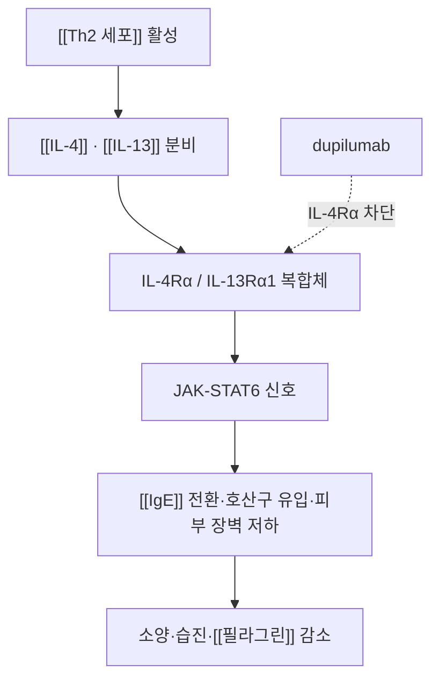

# 💊 dupilumab (두필루맙)

> **핵심 3줄 요약 (Key Summary)**:
> - 💊 **약물 개요**: IL-4 수용체 알파 소단위를 차단하는 인간 단일클론 항체(IgG4). [[IL-4]]와 [[IL-13]] 신호를 동시에 막는다.
> - 🎯 **핵심 적응증**: 중등도-중증 [[아토피 피부염]](소아 6개월 이상 포함), [[천식]], 만성 부비동염·비용종, 호산구성 식도염.
> - ⚠️ **주요 주의**: 주사 부위 반응, 결막염·안구 건조, 호산구 일시 증가. 생백신 병용 금지.
> - 🖼️ **이미지**: 항체(단백질)라 소분자 구조식이 없어 구조 이미지를 수록하지 못했다(미확보 명시). 시판 패키지 이미지도 미확보.

---

## 📌 목차
1. [약물 개요 및 식별 정보](#1-약물-개요-및-식별-정보)
2. [적응증](#2-적응증)
3. [용법·용량](#3-용법용량)
4. [약리 기전](#4-약리-기전)
5. [금기·주의·부작용](#5-금기주의부작용)
6. [임상 포인트·모니터링](#6-임상-포인트모니터링)
7. [출처 및 참고 문헌](#7-출처-및-참고-문헌)

---

## 1. 약물 개요 및 식별 정보

| 항목 | 내용 |
| :--- | :--- |
| **일반명 (INN)** | Dupilumab |
| **한글명 / 상품명** | 두필루맙 / 듀피젠트(Dupixent) |
| **계열** | 생물학적 제제 — 인간 IgG4 단일클론 항체, IL-4Rα 길항 |
| **ATC 코드** | D11AH05 |
| **분자량** | 약 147 kDa (당단백, 재조합 CHO 세포 발현) |
| **투여 경로** | 피하주사 |
| **적응증 연령** | 아토피 피부염: 6개월 이상 소아부터 성인(지역 허가에 따라 상이) |
| **PubChem CID** | 해당 없음(단백질 의약품) |

* **구조**: IL-4Rα에 결합하는 인간화 IgG4 항체로, 수용체의 공통 감마 사슬 및 IL-13Rα1 복합체 형성을 물리적으로 차단한다. IgG4 골격이라 항체 의존성 세포독성이 낮다.
* **약동학**: 피하 투여 후 흡수는 서서히, 반감기는 약 3주 수준으로 2주 또는 4주 간격 유지 요법이 가능하다.

---

## 2. 적응증

* **[[아토피 피부염]]**: 국소 스테로이드로 조절되지 않는 중등도-중증. 소아 6개월~6세 미만에서도 위약 대비 유의한 개선이 무작위 시험으로 확인되었다(PMID 36116481).
* **[[천식]]**: 2형 염증(호산구 상승·FeNO 상승) 표현형에서 악화 감소.
* **만성 부비동염·비용종**: 스테로이드 의존 환자에서 수술·스테로이드 사용 감소.
* **호산구성 식도염**: 연하곤란·조직 호산구 침윤 개선.
* **한의 임상 연계**: 아토피 환자가 생물학적 제제를 시작하면, 한약·침 치료는 유지하되 면역억제 중복을 피하고 피부 감염 징후 모니터링을 강화한다.

---

## 3. 용법·용량

| 대상 | 용량 |
| :--- | :--- |
| **성인 아토피 피부염** | 1일차 600 mg 피하주사(2회 분산) → 이후 300 mg 2주 간격 |
| **소아(체중별)** | 체중에 따라 200 mg 또는 300 mg을 2주/4주 간격으로 조정(제품 허가사항 기준) |
| **천식·비용종** | 300 mg 2주 간격(적응증별 허가사항 확인) |
| **투여 기술** | 복부·허벅지·상완 외측에 피하주사, 부위 순환. 자가주사 교육 후 가정 투여 가능 |

* **효과 판정**: 아토피는 [[EASI]] 75% 개선, [[IGA]] 0/1 도달을 16주 시점에 평가하는 것이 일반적이다.
* **중단·감량**: 16주에 임상적 반응이 없으면 적응증 재검토. 장기 유지 시 4주 간격 연장을 시도할 수 있으나 근거는 제한적이다.

---

## 4. 약리 기전

* **이중 차단**: IL-4와 IL-13은 모두 IL-4Rα를 공유한다. 따라서 IL-4Rα 차단은 두 사이토카인 경로를 동시에 억제한다.
* **결과**: STAT6 인산화가 줄어 Th2 염증 사이토카인·케모카인 발현이 감소하고, 피부 장벽 단백질(필라그린·로리크린) 발현이 회복되는 방향으로 작용한다.
* **소양 기전**: [[IL-31]] 등 소양 유발 사이토카인의 하류 활성도 함께 낮아진다.

---

## 5. 금기·주의·부작용

* **금기**: dupilumab 또는 부형제 과민반응. **생백신** 접종과 병용 금지(불활성화 백신은 가능).
* **흔한 부작용**: 주사 부위 반응(홍반·통증), [[결막염]]·안구 건조·가려운 눈, 구순 헤르페스.
* **주의할 부작용**: 호산구 일시 증가(대개 임상적 의미 없음, 지속 상승 시 평가), 아나필락시스(드물), 관절통.
* **기생충 감염**: IL-4/IL-13 차단은 장내 기생충 방어를 약화시킬 수 있어 유행지역 여행 전 평가.
* **임신·수유**: 자료 제한적. 임신 계획 시 전문과와 상의.

---

## 6. 임상 포인트·모니터링

* **치료 전 확인**: 결핵·B형간염 선별은 적응증별 지침에 따르고, 생백신 접종력과 최근 감염력을 확인한다.
* **환자 교육**: "주사 후 눈이 건조하거나 충혈되면 안과 평가를 받으세요. 발진은 좋아지는데 눈이 불편한 경우가 흔합니다."
* **한의 병용**: dupilumab 시작 후 피부가 건조해지는 시기에 보습·한약 외치를 병행하면 순응도가 좋아진다. 면역억제제(사이클로스포린 등)와의 중복은 감염 위험을 높이므로 감량을 검토한다.
* **반응 평가 도구**: [[EASI]], [[IGA]], 소양 NRS, DLQI(삶의 질)를 4~8주 간격으로 기록.

---

## 7. 출처 및 참고 문헌

1. **Paller AS, et al. (2022)**. Dupilumab in children aged 6 months to younger than 6 years with uncontrolled atopic dermatitis: a randomised, double-blind, placebo-controlled, phase 3 trial. *Lancet*, 400(10356), 908-919. [PMID 36116481](https://pubmed.ncbi.nlm.nih.gov/36116481/)
   * [연구 요약] 6개월~6세 미만 중등도-중증 아토피에서 16주 dupilumab이 위약보다 [[EASI]]·[[IGA]] 개선이 유의하게 컸고 안전성 프로파일은 기존과 유사했다.
2. **Simpson EL, et al. (2016)**. Two Phase 3 Trials of Dupilumab versus Placebo in Atopic Dermatitis. *N Engl J Med*, 375, 2335-2348. [PMID 27690741](https://pubmed.ncbi.nlm.nih.gov/27690741/)
   * [연구 요약] 중등도-중증 아토피에서 dupilumab이 위약보다 [[EASI]] 개선·소양 감소에서 우수했고, 주사 부위 반응 외 안전성 신호가 두드러지지 않았다.
