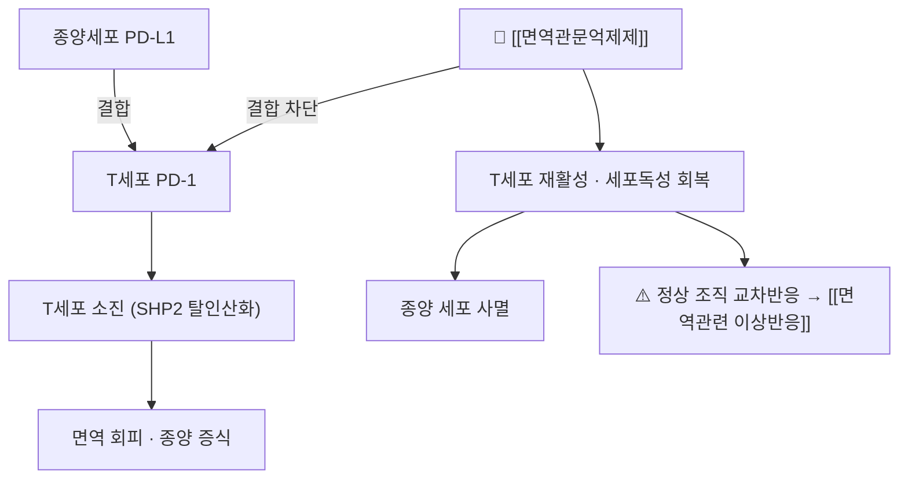

# 💊 [[면역관문억제제]] (Immune Checkpoint Inhibitor, ICI)

> **핵심 3줄 요약 (Key Summary)**:
> 🧪 주성분·제형: 단일클론항체 계열(PD-1·PD-L1·CTLA-4 차단) — 정맥 점적, 2~6주 간격. 단일 분자가 아닌 계열(class) 개념이라 분자구조식은 각 개별 약물 노트를 참조한다.
> 📍 작용 기전: 종양세포의 [[면역관문]] 리간드–수용체 결합을 차단해 [[세포독성 T세포]]의 소진(exhaustion)을 되돌린다.
> 🎯 임상 적응증: [[비소세포폐암]]·[[흑색종]]·[[신세포암]]·[[방광암]]·두경부암 등 진행성 고형암의 표준 치료 축.
> ⚠️ 주의사항: 정상 조직까지 공격하는 [[면역관련 이상반응]]이 특징적 — 피부·갑상선·폐·대장·간·뇌하수체. 한약 병용 시 감별이 안전의 핵심

---

## 1. 약물 기본 정보 및 시판 제품 (Brand Identification)

> 🖼️ 이미지 미확보 — 계열(class) 노트로 대표 단일 성분이 없어 패키지·블리스터·구조식 3종을 특정할 수 없다. 개별 약물(펨브롤리주맙·니볼루맙 등) 노트에서 규격을 채우는 것이 원칙이며, 여기서는 계열 지도표로 대체한다.

| 항목 | 상세 정보 |
| :--- | :--- |
| **계열명** | [[면역관문억제제]] (Immune checkpoint inhibitor) |
| **표적 분류** | PD-1 차단 / PD-L1 차단 / CTLA-4 차단 / LAG-3·TIGIT 등 신표적 |
| **국내 대표 성분** | [[펨브롤리주맙]], [[니볼루맙]], [[아테졸리주맙]], [[이필리무맙]], [[티슬레리주맙]], [[신티리맙]] |
| **제형** | 정맥 점적(대부분), 일부 피하주사 제형 개발 |
| **투여 간격** | 2주·3주·4주·6주 — 성분·적응증별로 다름 |
| **식약처 허가 적응증** | 비소세포폐암, 흑색종, 신세포암, 요로상피암, 두경부 편평세포암, 호지킨 림프종 등 |

### 1.1 표적별 계열 지도

| 표적 | 대표 성분 | 단독/병용 | 임상 메모 |
| :--- | :--- | :--- | :--- |
| PD-1 | [[펨브롤리주맙]], [[니볼루맙]] | 단독·화학병용 | 국내 사용량 최다, irAE 스펙트럼 가장 넓음 |
| PD-L1 | [[아테졸리주맙]] | 단독·화학병용 | PD-L1 발현율에 따라 1차 선택 |
| CTLA-4 | [[이필리무맙]] | 주로 PD-1과 병용 | 단독보다 병용, irAE 발생률·중증도 높음 |
| PD-1 (국내 개발) | [[티슬레리주맙]], [[신티리맙]] | 단독·화학병용 | 국내 임상에서 처방 접할 기회 증가 |

---

## 2. 분자 약리 기전 및 작용 경로 (Mechanism of Action)

* **주요 작용 기전**: PD-1은 활성화된 T세포 표면에 발현되고, 종양·대식세포의 PD-L1/PD-L2가 결합하면 SHP-2 매개로 TCR 신호가 억제된다. 항체가 이 결합을 막으면 T세포 탈진이 풀리고 종양 살상능이 회복된다.
* **CTLA-4 차단**: 항원제시세포의 CD80/86과 경쟁해 T세포 활성화 초기 단계(림프절)의 브레이크를 해제한다. 그래서 PD-1 차단(말초 조직 단계)과 병용하면 상승효과와 함께 독성도 증가한다.
* **역설적 기전**: 정상 조직에도 같은 축이 존재하므로, 관문 해제가 곧 자가면역 유사 반응으로 이어진다. [[면역관련 이상반응]]은 "부작용"이 아니라 "약효의 그림자"다.

---

## 3. 약동학적 특성 (Pharmacokinetics)

| 약동학 파라미터 | 수치 및 임상적 의미 |
| :--- | :--- |
| **생체이용률** | 정맥 투여 100% (경구 제형 없음) |
| **Tmax** | 점적 종료 시점이 최고 혈중농도 |
| **단백결합률** | IgG 구조로 FcRn 재순환 — 반감기가 길다 |
| **대사** | 간 CYP 대사가 아니라 단백분해 경로(망상내피계) |
| **반감기** | 성분별 약 2~4주 (6주 간격 요법의 근거) |
| **배설** | 단백 분해 후 아미노산 재이용 |

> ⚠️ **임상 함의**: 간·신 기능에 따른 용량 조절이 원칙적으로 필요 없다. 대신 **면역 관련 독성**이 용량·기간과 무관하게 나타날 수 있어, 증상 기반 모니터링이 약동학보다 중요하다.

---

## 4. 용법·용량 및 처방 가이드

| 임상 적응증 | 표준 용법 (성분별 예) | 비고 |
| :--- | :--- | :--- |
| 진행성 [[비소세포폐암]] | PD-1/PD-L1 3주 또는 6주 간격, 화학요법과 병용 | PD-L1 발현율·조직형에 따라 1차 선택 |
| [[흑색종]] | PD-1 단독 또는 CTLA-4 병용 | 병용 시 irAE 위험 유의 증가 |
| [[신세포암]] | PD-1 + CTLA-4 또는 TKI 병용 | 병용 독성 모니터링 필수 |

> 이 노트는 계열 개요다. **개별 성분의 정확한 용량·감량 규칙은 각 성분 노트와 허가사항을 확인**해야 한다(성분별 mg/kg·고정용량 체계가 다르다).

---

## 5. 부작용, 경고 및 약물 상호작용

### 5.1 주요 부작용 — [[면역관련 이상반응]]
* **피부**: 반구진 발진·소양감(가장 흔함), 드물게 스티븐스-존슨 증후군.
* **내분비**: 갑상선기능저하·항진([[갑상선염]]), 뇌하수체염, 부신 기능부전 — 대개 비가역적이어서 호르몬 보충이 필요하다.
* **폐**: 면역관문억제제 관련 [[폐렴]] — 기침·호흡곤란은 즉시 영상 검사.
* **소화기**: [[대장염]](설사·혈변), [[간염]](ALT 상승).
* **기타**: 관절염·근육통, 신염, 심근염(드물지만 치명적).

### 5.2 주요 병용 주의
* **스테로이드**: irAE 치료의 1차 약제. 고용량 [[프레드니솔론]] 장기 사용 시 항종양 효과 저하 우려가 있으나, 독성 조절이 우선이다.
* **항생제**: 광범위 항생제가 장내 미생물을 교란해효과를 낮출 수 있다는 관찰이 있었으나, 무작위시험 사후 분석에서는 효과가 사라졌다(PMID 42269396).
* **한약**: [[황련]]·[[황금]] 등 CYP3A4·P-gp 간섭 본초 병용 시 [[와파린]]·DOAC 환자에서 INR 확인.

---

## 6. 한의 치료 연계 및 병용/테이퍼링 프로토콜

### 6.1 병용 안전성
* **복용 시점 분리**: 한약은 점적일 전후 2시간 이상 간격을 두고, 점적 당일에는 새 처방을 시작하지 않는다(이상반응 귀속 판별).
* **변증 우선**: 항암 환자는 기허(氣虛)·음허(陰虛)가 기본이고, 급성 염증기에는 습열이 얹힌다. 순수 청열만 쓰면 기력을 떨어뜨린다.

### 6.2 근거 있는 병용 예
* [[갈근금련탕]] — [[면역관련 이상반응]] 발생률을 낮춘 무작위시험(PMID 40561860). 습열 변증에서만 근거를 그대로 옮길 수 있다.
* 보익 계열([[사군자탕]]·[[이중탕]])은 기력 저하·식욕 부진에서 보조적으로 쓰되, 발열·발진 활성기에는 후향 조정한다.

### 6.3 감량·중단 판단
* 한약은 "항암 치료를 대체"하는 개념이 아니다. 스테로이드·면역억제제가 필요한 등급(Grade 2 이상)에서는 한약을 중단하고 담당의 판단을 우선한다.

---

## 7. 💡 사용자 진료실 핵심 필기 & 실전 임상 체크리스트

> [!important] 초진 3문진
> 1. **어떤 면역관문억제제를, 몇 주기째** 맞는가(성분·주기) — 성분에 따라 독성 스펙트럼이 다르다.
> 2. **최근 3개월 항생제 투여력** — 폐렴·요로감염 입원력 포함.
> 3. **새로 생긴 증상 5종**: 발진·소양감, 갑상선 증상(체중·추위·피로), 기침·호흡곤란, 설사·혈변, 황달·진한 소변.

* **레드플래그 즉시 의뢰**: 호흡곤란·저산소, 혈변·복통, ALT 3배 초과, 두통·시야장애(뇌하수체염), 심계항진·흉통(심근염).
* **환자 티칭 스크립트**: "이 항암제는 면역세포의 브레이크를 푸는 약이라, 암을 공격하면서 정상 조직도 함께 공격할 수 있습니다. 그래서 피부·갑상선·폐·장 증상을 빨리 알아채는 것이 치료의 일부입니다. 한약은 그 부작용을 줄이는 방향으로 돕겠지만, 열이 나거나 숨이 차면 한약보다 먼저 항암 담당 선생님께 알려야 합니다."

---

## 8. 출처 및 학술 참고 문헌 (References)

1. **Lu X, et al. (2025)**. *Gegen Qinlian Tablets attenuate immune-related adverse events in NSCLC patients: A multi-center randomized controlled trial in China*. **Phytomedicine**, 145:156968. [PMID 40561860](https://pubmed.ncbi.nlm.nih.gov/40561860/)
   - **[연구 요약]**: ICI+항암화학요법에 갈근금련정을 병용해 irAE 발생률을 31.91%까지 낮춘 RCT — ICI 독성 관리에서 한약 병용의 임상 근거.
2. **Stylianakis D, et al. (2026)**. *The antibiotic-immunotherapy interaction in NSCLC: a systematic review and meta-analysis of 54,250 patients across three outcomes*. **Cancer Treat Rev**, 148:103162. [PMID 42269396](https://pubmed.ncbi.nlm.nih.gov/42269396/)
   - **[연구 요약]**: 관찰연구에서는 항생제 노출이 OS 악화(HR 1.47)와 연관됐지만, 무작위시험 사후 분석에서는 유의성이 사라져(HR 1.20, p=0.07) 교란 효과가 큼을 시사했다.
3. **Yoshimaru R, et al. (2026)**. *Incidence, Clinical Characteristics, Management, and Outcomes of Hematologic Immune-Related Adverse Events Associated With Immune Checkpoint Inhibitors*. **Cancer Med**. [PMID 42839531](https://pubmed.ncbi.nlm.nih.gov/42839531/)
   - **[연구 요약]**: ICI 관련 혈액학적 irAE의 발생률·임상상·치료 결과를 정리한 최신 코호트 연구.
4. **Ohara N, et al. (2019)**. *Isolated adrenocorticotropic hormone deficiency and thyroiditis associated with nivolumab therapy in a patient with advanced lung adenocarcinoma: a case report and review of the literature*. **J Med Case Rep**. [PMID 30909965](https://pubmed.ncbi.nlm.nih.gov/30909965/)
   - **[연구 요약]**: 니볼루맙 치료 중 갑상선염과 단독 ACTH 결핍이 함께 발생한 증례 — 내분비 irAE의 다발성·비가역성.
