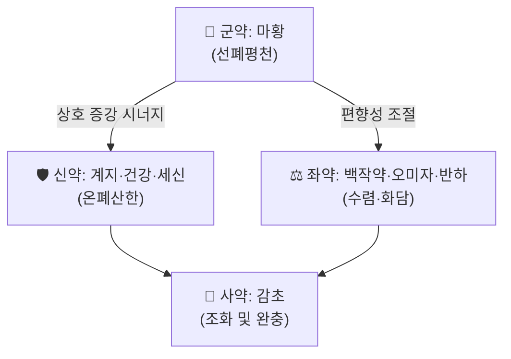

# 🍵 [[소청용탕]] (小靑龍湯, Minor Green Dragon Decoction)

> ℹ️ **정본 연계 안내**: 본 노트는 [[소청룡탕]](小靑龍湯)의 두음 표기(`소청용탕`) 노트로, 원전 『[[상한론]]』·『[[금궤요략]]』 조문 및 원방 가감법 상세 해설을 보존하며 [[소청룡탕]]과 상호 참조됩니다.

> **핵심 3줄 요약 (Key Summary)**:
> - 🌿 **모체 구조**: [[마황탕]]·[[계지탕]] 계열의 해표(解表) 배합을 뼈대로 삼고, 여기에 [[세신]]·[[건강]]·[[오미자]]·[[반하]] 네 약재를 더해 **표한(表寒)을 흩으면서 동시에 이(裏)의 한음(寒飮, 찬 담음)을 녹이는** 표리동치(表裏同治) 처방.
> - 🎯 **임상 최적 적응증**: 오한·발열 등 표한 증상에 **물처럼 묽은 콧물, 목구멍·가슴의 그렁그렁한 담성 기침, 누우면 심해지는 천명(水雞聲)**이 겹치는 한음형 환자. 소음인·태음인 경향의 냉성·수독 체형에서 적중률이 높고, [[알레르기 비염]]·[[기관지 천식]]·급성 [[기관지염]]·[[냉방병]]에 빈용된다.
> - 🔬 **핵심 기전**: [[마황]]([[에페드린]])·[[세신]]([[히게나민]])의 기관지 평활근 이완 및 비점막 수축, IL-33/ST2-ILC2 축 및 Th2 사이토카인(IL-4·IL-5·IL-13) 억제, TRPV1/TRPM8 감각신경 과민 조절, NF-κB 경로 억제를 통한 기도 상피 밀착연접 보호.
> - ⚠️ 주의사항: 음허조해(마른기침·무담·인후건조), 이열형(고열·번조·설홍태황)에는 금기. [[마황]] 함유로 고혈압·심질환·갑상선기능항진·불면·전립선비대·임신부는 신중 투여하고, 교감신경 흥분성 양약과의 병용에 주의한다.
---
## 📌 목차
1. [기본 처방 정보 & 군신좌사 구성](#1-기본-처방-정보--군신좌사-구성)
2. [방제학적 약재 상호작용 & 시너지 네트워크](#2-방제학적-약재-상호작용--시너지-네트워크)
3. [현대 분자약리학적 효능 & 작용 기전](#3-현대-분자약리학적-효능--작용-기전)
4. [적응 병증 및 체질별 감별 (Sweet Spot vs 금기)](#4-적응-병증-및-체질별-감별-sweet-spot-vs-금기)
5. [유사 처방군 감별 매트릭스](#5-유사-처방군-감별-매트릭스)
6. [임상 가감례 & 현대 질환별 응용](#6-임상-가감례--현대-질환별-응용)
7. [💡 사용자 진료실 핵심 필기 & 임상 팁 (원문 보존)](#7--사용자-진료실-핵심-필기--임상-팁-원문-보존)
8. [출처 및 학술 참고 문헌 (References)](#8-출처-및-학술-참고-문헌-references)
---
## 1. 기본 처방 정보 & 군신좌사 구성

* **출전**: 장중경(張仲景) 『[[상한론]]』 「변태양병맥증병치 중(辨太陽病脈證幷治 中)」 및 『[[금궤요략]]』 「담음해수병맥증병치(痰飮咳嗽病脈證幷治)」. 『[[동의보감]]』 「잡병편·해수」·「한문」에도 동일 구성으로 수록되어 한국 임상에서 널리 활용된다.
* **치법**: **해표산한(解表散寒) · 온폐화음(溫肺化飮) · 지해평천(止咳平喘)**
* **구성 원칙(방제 구성)**: 팔미(八味)로 이루어진 구조로, 발산하는 약([[마황]]·[[계지]]·[[세신]]·[[건강]])과 수렴하는 약([[오미자]]·[[백작약]])을 동시에 배치하여 "흩으면서 지키고[散中有收], 덥히면서 내리[溫而能降]"는 상반상성(相反相成)의 설계를 취한다.

| 구분 | 약재명 | 표준 용량 | 본초 효능 & 방제 내 역할 |
| :--- | :--- | :--- | :--- |
| **군약 (君藥)** | [[마황]] | 6g (원방 麻黃 三兩) | 발한해표·선폐평천. 폐기불선으로 인한 해·천 주증을 정면 공략하는 주약. [[계지]]와 배합하여 표한을 밀어낸다. |
| **신약 (臣藥)** | [[계지]] | 6g (桂枝 三兩) | 해표산한·온통경맥·화영. [[마황]]의 발한을 보조(相須)하면서 영위를 조화시켜 한출 후 표허를 방지한다. |
| **신약 (臣藥)** | [[건강]] | 3~6g (乾薑 三兩) | 온폐산한·회양화음. [[생강]] 대신 [[건강]]을 쓴 것이 특징으로, 이한·한담을 데우는 축이 된다. |
| **신약 (臣藥)** | [[세신]] | 3g (細辛 三兩) | 온폐화음·산한지통·통비규. 수기를 흩고 비색·청체에 작용하며 [[건강]]·[[오미자]]와 삼각 배합을 이룬다. |
| **좌약 (佐藥)** | [[반하]] | 6g (半夏 半升) | 조습화담·화위강역. 수기로 인한 구·담다를 처리하고 폐위의 역기를 내린다. |
| **좌약 (佐藥)** | [[오미자]] | 3~6g (五味子 半升) | 수렴폐기·지해렴한. [[마황]]·[[계지]]·[[세신]]의 과도한 신산을 제어하여 구해에 정기가 상하지 않게 한다. |
| **좌약 (佐藥)** | [[백작약]] | 6g (芍藥 三兩) | 렴음화영·완급지통. [[계지]]와 배합해 영위를 조화하고, 평활근·근육 긴장을 완화한다. |
| **사약 (使藥)** | [[감초]] | 3g 炙 (甘草 三兩) | 조화제약·화중지해. 팔미를 조화시키고 [[마황]]·[[세신]]의 자극성을 완충한다. |

> **배오 특징**: 원방 용량 비율은 대체로 [[마황]]·[[계지]]·[[백작약]]·[[세신]]·[[건강]]·[[감초]]가 각 삼량(三兩)으로 균등하고 [[반하]]·[[오미자]]가 반승(半升)으로 가장 많다. 즉 **발산약과 수렴약의 비중이 대칭**이며, 승강의 관점에서는 [[마황]]·[[계지]]의 승산(升散)과 [[반하]]·[[오미자]]의 강수(降收)가 짝을 이루어 폐의 선숙(宣肅) 기능을 회복시킨다.
---
## 2. 방제학적 약재 상호작용 & 시너지 네트워크

* [[마황]] + [[계지]] 배오 (相須): 발한해표의 대표 배합으로, [[마황]]이 위분의 표한을 열고 [[계지]]가 영분을 통해 통양시켜 오한·무한·발열·신체통을 함께 처리한다.
* [[건강]] + [[세신]] + [[오미자]] 배합 (온폐화음의 핵심 삼각): [[건강]]·[[세신]]이 온산하여 폐의 한담·수기를 녹이고, [[오미자]]가 산수하여 흩어진 폐기를 다시 모은다("溫而不燥, 斂而不滯").
* [[마황]]·[[계지]]·[[세신]] (辛散) ↔ [[오미자]]·[[백작약]] (酸收) 배오: 산(散)과 수(收)의 길항적 배치는 발한 후 나타나는 진상(津傷)과 표허(表虛)를 예방하는 부작용 완충 장치로 기능한다.
* [[반하]] + [[감초]] 배합: [[반하]]의 조성과 독성을 [[감초]]가 완충하고, 화위강역 작용으로 구역·오심을 동반한 해천에 대응한다.
---
## 3. 현대 분자약리학적 효능 & 작용 기전

### 1) 호흡기 항알레르기·항염증 및 상피 장벽 보호
* **IL-33/ST2 및 JAK/STAT 경로 억제**: OVA 유발 [[알레르기 비염]] 모델에서 제2형 선천 림프구(ILC2) 활성화와 Th2 사이토카인(IL-4, IL-5, IL-13) 분비를 유의하게 억제하여 비점막 호산구 침윤과 점액 과분비를 차단한다 ([PMID 37586158](https://pubmed.ncbi.nlm.nih.gov/37586158/)).
* **NF-κB 억제 및 상피 밀착연접 보호**: 기관지 상피세포에서 염증성 NF-κB 신호전달을 차단하여 밀착연접(tight junction) 단백질 손상을 방지하고 기도 장벽 무결성을 유지한다 ([PMID 42041881](https://pubmed.ncbi.nlm.nih.gov/42041881/)).
* **NET-수지상세포-Th17 축 조절**: 호중구성 [[천식]] 모델에서 중성구 세포외 함정(NET) 형성과 수지상세포-Th17 면역축 활성화를 억제하여 스테로이드 저항성 기도 염증을 완화한다 ([PMID 41196933](https://pubmed.ncbi.nlm.nih.gov/41196933/)).

### 2) 순환기·미세순환 및 기관지 평활근 이완
* [[마황]]의 [[에페드린]]과 [[세신]]의 [[히게나민]]이 $\beta_2$-아드레날린 수용체 작용을 통해 기관지 평활근을 이완시키고, 비점막 정맥동을 수축시켜 코막힘과 수양성 비루를 신속히 감소시킨다.
* [[계지]]·[[백작약]]([[페오니플로린]])과 [[건강]]([[진저롤]])이 말초 미세순환을 촉진하고 체액 대사를 활성화하여 표한·수기를 배출한다.

### 3) 자율신경·감각신경(TRP 채널) 및 대식세포 조절
* M1 대식세포 분극을 억제하고 감각신경의 TRPV1/TRPM8 채널 과민성을 조절하여 한랭 자극에 의해 유발되는 재채기·비소양증·기침 반사를 안정화한다 ([PMID 41455386](https://pubmed.ncbi.nlm.nih.gov/41455386/)).
---
## 4. 적응 병증 및 체질별 감별 (Sweet Spot vs 금기)

[✅ 최적 적응증 (Sweet Spot)]
• 원전 조문:
  - 『[[상한론]]』: "傷寒 表不解, 心下有水氣, 乾嘔 發熱而咳, 或渴, 或利, 或噎, 或小便不利 少腹滿, 或喘者, 小青龍湯主之."
  - 『[[금궤요략]]』 「담음해수병맥증병치」: "咳逆倚息不得臥, 小青龍湯主之." (누우면 기침이 심해져 눕지 못하는 한음형 해역)
  - 『[[금궤요략]]』 「담음」 일음(溢飲) 조문: "病溢飮者, 當發其汗, 大靑龍湯主之, 小青龍湯亦主之."
• 체질 소견: 소음인·태음인 경향. 피부가 창백하고 안면·안검 부종감이 잘 생기며, 추위·찬 음식·에어컨·새벽 냉기에 증상이 악화되는 냉성·수독형
• 임상 주치: 맑고 물 같은 콧물이 줄줄 흐르는 [[비염]](재채기 연발, 코막힘), 목과 가슴에서 그렁그렁 소리가 나는 기침, 누우면 악화되는 야간 기침·천명([[천식]]), 구역·오심·물 같은 침이 올라오는 위한 담음 동반 증상
• 설진/맥진: 설질 담홍~담백, 설태 백활(白滑) 또는 백니(水滑苔), 맥 부긴(浮緊) 또는 현긴(弦緊)·현활(弦滑)

[⚠️ 신중 투여 및 금기 (Caution / Contraindication)]
• 음허조해(陰虛燥咳): 마른기침·무담·인후건조·야간 도한이 있는 경우 [[마황]]·[[세신]]·[[건강]]의 온조가 음액을 손상시키므로 금기
• 이열형(裏熱型): 고열·번조·구갈희냉·설홍태황·맥삭 시 [[소청룡가석고탕]] 또는 [[마행감석탕]] 계열로 전환
• [[마황]]·[[세신]] 관련 주의: 고혈압, 관상동맥질환·부정맥, 갑상선기능항진, 불면증, 전립선비대 환자는 신중 투여하며 [[세신]]은 표준 용량(3g 내외)을 준수한다
---
## 5. 유사 처방군 감별 매트릭스

| 처방명 | 핵심 구성 차이 | 주치 및 체질 차이 | 맥진/설진 차이 |
| :--- | :--- | :--- | :--- |
| [[소청룡탕]] | 기준 구성: [[마황]]·[[계지]]·[[백작약]]·[[세신]]·[[건강]]·[[반하]]·[[오미자]]·[[감초]] | **표한 + 이한수기(담음)** 동반 해천·수양성 비루. 냉성·수독 체형, 겨울·냉방 악화 | 설담 태백활(수활), 맥부긴 또는 현긴 |
| [[마황탕]] | [[마황]]·[[계지]]·[[행인]]·[[감초]] ([[건강]]·[[세신]]·[[반하]]·[[오미자]] 없음) | 태양상한 표실증 위주. 무한·오한·신체통, 수기 없음 | 태박백, 맥부긴 |
| [[계지탕]] | [[계지]]·[[백작약]]·[[생강]]·[[대추]]·[[감초]] ([[마황]] 없음) | 태양중풍 표허(자한·오풍), 영위불화. 허약·민감 체형 | 태박백, 맥부완 |
| [[대청룡탕]] | [[마황]] 대량 + [[석고]] + [[행인]]·[[감초]]·[[계지]]·[[생강]]·[[대추]] | **표한 + 이열** 동반의 무한 고열·번조·기침 | 태황, 맥부긴유력 |
| [[사간마황탕]] | [[사간]]·[[마황]]·[[생강]]·[[세신]]·[[반하]]·[[오미자]]·[[자완]]·[[관동화]]·[[대추]] | **후중수계성**(담명)이 뚜렷한 해이상기, 표증 없음. 소아 천식에 다용 | 태백활, 맥현 |
| [[복령감오미강신탕]] | [[복령]]·[[감초]]·[[오미자]]·[[건강]]·[[세신]] ([[마황]]·[[계지]] 없음) | 표증이 이미 풀렸으나 한음 해천이 지속되는 허증형 | 태백활, 맥현세 |
---
## 6. 임상 가감례 & 현대 질환별 응용

* **수반 증상별 가감법** (원방의 가감법 및 한국 임상 상용 가감):
  * 구갈·이열이 겹칠 때 $\rightarrow$ + [[석고]] ([[소청룡가석고탕]])
  * 미리(微利, 무른 변) $\rightarrow$ 원방 가감법에 따라 [[마황]]을 빼고 + [[무이]]
  * 열(噎, 목이 막히는 느낌) $\rightarrow$ [[마황]]을 빼고 + [[부자]]
  * 소변불리·소복만 $\rightarrow$ [[마황]]을 빼고 + [[복령]]
  * 천(喘)이 주증일 때 $\rightarrow$ [[마황]]을 빼고 + [[행인]]
  * 후중담명·천명 심함 $\rightarrow$ + [[사간]], [[자완]], [[관동화]] ([[사간마황탕]] 방향)
  * 코막힘·청체(淸涕) 심함 $\rightarrow$ + [[신이]], [[창이자]], [[백지]]
  * 인후 불편 $\rightarrow$ + [[길경]], [[우방자]]
  * 담(痰)이 많고 소화가 더부룩할 때 $\rightarrow$ + [[복령]], [[진피]] ([[이진탕]] 합방 방향)
  * 기허·피로가 겹친 재발성 비염·천식 $\rightarrow$ + [[황기]], [[백출]], [[방풍]] ([[옥병풍산]] 방향)
* **현대 질환별 임상 매핑**:
  * **호흡기계**: [[알레르기 비염]](수양성 비루·재채기), 급성 [[기관지염]], [[기관지 천식]](한랭 유발형), 감모·인플루엔자의 표한 단계
  * **이비인후과**: 비색·후비루, 삼출성 [[중이염]]의 수기형 보조 요법
  * **기타**: [[냉방병]], 일음형 부종감
* **양약 상호작용 (Herb–Drug Interaction)**:
  * **교감신경 흥분제 병용 주의**: [[마황]]([[에페드린]]) 함유로 MAO 억제제, $\beta_2$-작용제(기관지확장제), [[슈도에페드린]], 카페인과 병용 시 혈압 상승·심계항진·불면 위험이 있으므로 병용을 피하거나 감량한다.
  * **항고혈압제·이뇨제 간섭**: [[마황]]의 혈압 상승 작용이 강압제 효과를 상쇄할 수 있으며, [[감초]] 장기 병용 시 이뇨제에 의한 저칼륨혈증을 악화시킬 수 있다.
  * **복용 시점 분리**: 양약과 2시간 이상 간격을 두고 복용한다.
---
## 7. 💡 사용자 진료실 핵심 필기 & 임상 팁 (원문 보존)

> [!tip] **진료실 실전 노하우 (User Clinical Insight)**
> - **실전 선택 플로우**: ① 오한·무한 등 표한이 있는가 $\rightarrow$ 있으면 [[소청룡탕]] 검토, 없으면 [[계지탕]]·[[복령감오미강신탕]] 계열 ② 콧물·담이 맑고 물 같은가 $\rightarrow$ 시(是)이면 [[소청룡탕]], 걸쭉하고 누렇다면 열화(熱化)로 판단하여 다른 처방 ③ 누우면 심해지는가 $\rightarrow$ 시(是)이면 적중률 상승 (원장님 상세 임상 필기는 [[소청룡탕]] §7 참조).
> - **환자 티칭 포인트**: 복용 중 찬 음료·생냉식·에어컨 직풍을 피하게 안내. 초기 2~3일은 발한·콧물 변화가 나타날 수 있음을 설명하고, 이후 담이 걸쭉해지거나 목이 마르면 복약을 멈추고 내원하도록 지도.
> - **복약 반응 관찰 포인트**: 심계항진·불면·혈압 상승·식욕 저하 여부, 소변량 변화, 설태 변화(백활 $\rightarrow$ 정상화)를 기록.
---
## 8. 출처 및 학술 참고 문헌 (References)

1. **장중경 (200년경)**. 『[[상한론]]』 및 『[[금궤요략]]』.
   - **[고전 원전]**: 태양병 중편의 소청룡탕 조문 및 가감법, 담음해수병편의 "咳逆倚息不得臥, 小青龍湯主之" 및 일음(溢飮) 조문.
2. **허준 (1613)**. 『[[동의보감]]』.
   - **[임상 문헌]**: 해수(咳嗽)·한문(寒門) 등에서의 소청룡탕 주치 및 임상 운용 원문.
3. **Zhang JJ et al. (2023)**. *Xiao-qing-long-tang ameliorates OVA-induced allergic rhinitis by inhibiting ILC2s through the IL-33/ST2 and JAK/STAT pathways*. **Phytomedicine**, 119: 155012. [PMID 37586158](https://pubmed.ncbi.nlm.nih.gov/37586158/)
   - **[연구 요약]**: OVA 유발 알레르기 비염 마우스에서 IL-33/ST2 및 JAK/STAT 경로를 차단하여 ILC2 활성화와 Th2 사이토카인(IL-4·IL-5·IL-13) 생성을 억제함을 입증.
4. **Zhou L et al. (2026)**. *Xiao-Qing-Long-Tang alleviates allergic rhinitis by inhibiting M1 macrophage polarization and modulating the TRPV1 channel*. **Phytomedicine**, 150: 157732. [PMID 41455386](https://pubmed.ncbi.nlm.nih.gov/41455386/)
   - **[연구 요약]**: M1 대식세포 분극 억제 및 TRPV1 이온채널 조절을 통해 알레르기 비염의 신경-면역 염증 반응을 완화함을 규명.
5. **Ji X et al. (2025)**. *Xiao Qing Long Tang ameliorates neutrophil extracellular trap-dendritic cells-T helper 17 cell axis in Neutrophilic Asthma*. **PLoS One**, 20: e0336333. [PMID 41196933](https://pubmed.ncbi.nlm.nih.gov/41196933/)
   - **[연구 요약]**: 호중구성 천식 모델에서 NET-수지상세포-Th17 면역축을 제어하여 기도 염증을 개선함을 확인.
6. **Lu J et al. (2026)**. *Shoseiryuto May Prevent Bronchial Epithelial Tight Junction Disruption by Inhibiting the Inflammatory NF-κB Signaling Pathway*. **Biology (Basel)**, 15. [PMID 42041881](https://pubmed.ncbi.nlm.nih.gov/42041881/)
   - **[연구 요약]**: 염증성 NF-κB 신호전달 억제를 통해 기관지 상피세포 밀착연접(tight junction) 파괴를 예방함을 입증.
