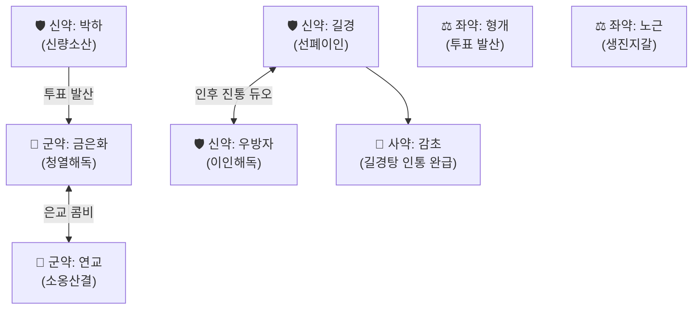

# 🍵 [[은교산]] (銀翹散, Yin-Qiao-San / Ginkyosan)

> **핵심 3줄 요약 (Key Summary)**:
> - 🌿 [[금은화]], [[연교]], [[박하]], [[우방자]], [[길경]], [[노근]], [[죽엽]], [[형개]], [[대두황권]], [[감초]] ([[금은화]]·[[연교]]의 청열해독 베이스에 [[박하]]·[[형개]]의 신량투표, [[길경]]·[[우방자]]의 이인개음 결합).
> - 🎯 감기 초기 오한발열, 무한 또는 미한(微汗), 목구멍이 붓고 타는 듯이 아픈 [[인후통]](咽喉腫痛), 마른 기침, [[편도염]] 환자.
> - 🔬 호흡기 및 전신 바이러스 흡착 차단(워고닌-HSP90AA1 결합), NF-κB 억제를 통한 인두 점막 급성 염증 완화 및 아토피 피부염 등 염증성 면역 경로 조절.
> - ⚠️ 주의사항: 맑은 콧물과 오한이 심한 풍한표증(風寒表證) 금기, 비위허한 환자 복용 후 설사 시 주의.
---
## 📌 목차
1. [기본 처방 정보 & 군신좌사 구성](#1-기본-처방-정보--군신좌사-구성)
2. [방제학적 약재 상호작용 & 시너지 네트워크](#2-방제학적-약재-상호작용--시너지-네트워크)
3. [현대 분자약리학적 효능 & 작용 기전](#3-현대-분자약리학적-효능--작용-기전)
4. [적응 병증 및 체질별 감별 (Sweet Spot vs 금기)](#4-적응-병증-및-체질별-감별-sweet-spot-vs-금기)
5. [유사 처방군 감별 매트릭스](#5-유사-처방군-감별-매트릭스)
6. [임상 가감례 & 현대 질환별 응용](#6-임상-가감례--현대-질환별-응용)
7. [💡 사용자 진료실 핵심 필기 & 임상 팁 (원문 보존)](#7--사용자-진료실-핵심-필기--임상-팁-원문-보존)
8. [출처 및 학술 참고 문헌 (References)](#8-출처-및-학술-참고-문헌-references)
---
## 1. 기본 처방 정보 & 군신좌사 구성

* **출전**: 오국통(吳鞠通) 『[[온병조변(溫病條辨)]]』 상초편(上焦篇)
* **치법**: 신량투표(辛涼透表), 청열해독(淸熱解毒)

| 구분 | 약재명 | 표준 용량 | 본초 효능 & 방제 내 역할 |
| :--- | :--- | :--- | :--- |
| **군약 (君藥)** | [[금은화]] | 10~15g | 청열해독(淸熱解毒), 방향소열, 체표의 온열사(溫熱邪)를 해독 |
| **군약 (君藥)** | [[연교]] | 10~15g | 청열해독(淸熱解毒), 소옹산결(消癰散結), 인후와 상초의 열독을 삭힘 |
| **신약 (臣藥)** | [[박하]] | 6~8g | 신량소표(辛涼疏表), 청리두목(淸利頭目), 풍열사를 흩고 목구멍을 시원하게 함 |
| **신약 (臣藥)** | [[우방자]] | 6~8g | 소산풍열(疏散風熱), 해독투진(解毒透疹), 이인산결(利咽散結), 편도선 부종 진정 |
| **신약 (臣藥)** | [[길경]] | 6~8g | 개선폐기(開宣肺氣), 이인배농(利咽排膿), 약 기운을 인후와 폐로 이끄는 인경약 |
| **좌약 (佐藥)** | [[형개]] | 4~6g | 미온(微溫)하나 신산(辛散)하여 표사를 열고 투표(透表) 작용 강화 |
| **좌약 (佐藥)** | [[대두황권]] | 6~8g | 투열외달(透熱外達), 청해표습(淸解表濕), 피부 표면의 열사를 밖으로 유도 |
| **좌약 (佐藥)** | [[죽엽]] | 6~8g | 청열제번(淸熱除煩), 생진이뇨, 심화(心火)를 소변으로 배출 |
| **좌약 (佐藥)** | [[노근]] | 10~15g | 청열생진(淸熱生津), 지갈(止渴), 온열사로 손상된 진액을 보충 |
| **사약 (使藥)** | [[감초]] | 3~5g | 청열해독, 조화제약, [[길경]]과 합쳐져 [[길경탕]](桔梗湯)을 이루어 목 통증을 완해 |

🔬 **분자 구조** (Wikimedia Commons, Public Domain)
![[Chlorogenic_acid_구조.png|480]]
> [그림 1: Chlorogenic acid (클로로겐산, C16H18O9) 분자 구조 — 출처: Wikimedia Commons (군약 [[금은화]] 주성분, 기존 첨부 보존)]

> **배오 특징**: **"향기가 나면 즉시 불을 끄고 달이지 말라(香氣大出, 卽宜拿服, 勿過煮)"**는 온병학의 철칙이 적용되는 방제입니다. 휘발성 정유 성분을 보존하여 상초 인후부의 풍열을 신속하게 날려보내는 대표적인 신량해표·소염 방제입니다.
---
## 2. 방제학적 약재 상호작용 & 시너지 네트워크

* [[길경]] + [[감초]] 배오 ([[길경탕]]): 인후 점막의 통각 수용체 과흥분을 억제하고 염증성 부종을 직접 가라앉히는 목 통증의 핵심 조합입니다.
* [[형개]] + [[대두황권]]의 묘용: 신량(辛涼)한 차가운 약재들 사이에 약간 따뜻하고 흩어주는 [[형개]]·[[대두황권]]을 소량 섞어, 약 기운이 뭉치지 않고 체표 밖으로 시원하게 뿜어져 나가도록 만듭니다.
---
## 3. 현대 분자약리학적 효능 & 작용 기전

### 1) 항바이러스 활성 및 숙주 수용체 흡착 차단
* [[금은화]]의 [[클로로겐산]](Chlorogenic acid)과 [[연교]]의 [[필리린]](Phillyrin) 성분이 호흡기 감염 초기 염증성 손상을 완화합니다.
* > 🧬 **현대 학술 근거 (2026-09-20 B-7 패치)**: 항바이러스 표적 기전이 분자 수준까지 규명됨 — 뎅기바이러스(DENV) 감염 모델에서 은교산이 흡착(adsorption) 단계 특이적으로 항바이러스 효능을 나타냄(IC50 468.5 μg/mL)이 시간차 약물 첨가 실험으로 확인됨. 네트워크 약리 분석으로 도출된 핵심 활성 성분 워고닌(wogonin)이 숙주 수용체 HSP90AA1에 직접 결합하여 바이러스 E 단백질과의 상호작용을 차단함으로써 바이러스 흡착을 억제하는 것이 규명되었으며(세포열이동측정법·분자도킹·표면플라즈몬공명으로 검증), DENV-2 감염 AG129 마우스에서 체중 감소 완화·생존기간 연장·혈중 바이러스량 감소·간 보호 효과가 입증됨 ([PMID 42061084](https://pubmed.ncbi.nlm.nih.gov/42061084/)).

### 2) NF-κB 경로 억제 및 면역·피부염 염증 조절
* 인후 점막 상피세포에서 염증 전사인자인 NF-κB의 핵 내 이동을 억제하여 TNF-α, IL-1β, IL-6, COX-2 발현을 낮추고 편도선 및 인두의 모세혈관 투과성을 정상화합니다.
* 또한 네트워크 약리학 및 단일세포·벌크 RNA 시퀀싱 통합 분석을 통해 은교산이 [[아토피 피부염]]에서도 다중 표적 면역·염증 경로를 조절할 수 있는 분자 기전이 탐색되었습니다 ([PMID 42502642](https://pubmed.ncbi.nlm.nih.gov/42502642/)).

### 3) 천연 해열 및 면역 방어 조절
* 시상하부 $\text{PGE}_2$ 과다 유리를 억제하면서도 면역 세포의 식균 작용을 방해하지 않아, 체력 소모 없이 온열성 발열을 해열합니다.
---
## 4. 적응 병증 및 체질별 감별 (Sweet Spot vs 금기)

[✅ 최적 적응증 (Sweet Spot)]
• 온병조변 조문: "태양온병(太陽溫病), 초기(初起), 발열이갈(發熱而渴), 미악한(微惡寒), 구고인통(口苦咽痛), 해수(咳嗽), 은교산주지"
• 임상 핵심: 목구멍이 칼칼하게 아프면서 침 삼키기 힘들고, 열이 나며, 오한은 심하지 않고 갈증이 나는 목감기 초기
• 질환: 급성 [[인후염]], 급성 [[편도염]], 유행성 이하선염, 헤르페스성 [[구내염]], 초기 수포진
• 설진/맥진: 설첨홍(舌尖紅, 혀끝이 붉음), 설태박백 또는 박황(薄黃), 맥부삭(脈浮數, 빠르고 표면에 뜸)

[⚠️ 신중 투여 및 금기 (Caution / Contraindication)]
• 풍한표증(風寒表證) 금기: 맑은 콧물이 줄줄 흐르고, 목 통증 없이 온몸이 춥고 떨리는 오한 감기 환자에게는 금기 ([[갈근탕]], [[마황탕]] 적용)
• 비위허한(脾胃虛寒): 평소 소화기가 차고 설사를 자주 하는 환자가 장복하면 복통·설사 유발
• 복용 타이밍: 온병 초기에 즉시 투여해야 하며, 사기가 이미 폐포 깊숙이 들어가 누런 가래가 끓는 기분(氣分) 열증으로 진행된 경우에는 [[마행감석탕]]이나 [[백호탕]]으로 변경
---
## 5. 유사 처방군 감별 매트릭스

| 처방명 | 핵심 배오 차이 | 주치 및 임상 감별점 | 맥진/설진 |
| :--- | :--- | :--- | :--- |
| [[은교산]] | [[금은화]], [[연교]], [[박하]], [[길경]] 등 | **신량해표, 목구멍 통증(인후통), 미열, 마른 기침** | 설첨홍, 맥부삭(浮數) |
| [[갈근탕]] | [[갈근]], [[마황]], [[계지]] 등 | **신온해표, 목·어깨 결림, 오한, 땀 안 남, 냉방병** | 설담홍, 맥부긴(浮緊) |
| [[형개연교탕]] | [[형개]], [[연교]], [[방풍]], [[황련]], [[황금]] 등 | **만성 풍열, 만성 축농증, 화농성 여드름, 이비인후 화열** | 설홍, 황니태, 맥활삭 |
| [[마행감석탕]] | [[마황]], [[행인]], [[감초]], [[석고]] | **폐열 해수, 쌕쌕거림(천식), 끈적하고 누런 가래, 땀 남** | 설홍, 황태, 맥활삭 |
| [[패독산]] | [[시호]], [[전호]], [[강활]], [[독활]], [[인삼]] 등 | **기허자 감기, 으슬으슬 춥고 팔다리가 무거우며 담음 동반** | 맥부완무력 |
---
## 6. 임상 가감례 & 현대 질환별 응용

* **수반 증상별 가감법**:
  * [[인후통]] 및 편도 부종이 극심할 때 $\rightarrow$ + [[마발]], [[현삼]], [[판람근]]
  * 기침이 심하고 가슴이 울릴 때 $\rightarrow$ + [[행인]], [[패모]]
  * 열이 극심하고 입이 바짝 마를 때 $\rightarrow$ + [[석고]], [[지모]]
* **현대 질환 매핑**:
  * 급성 [[인후염]], [[편도염]], 후두염, 목감기
  * 성대 결절 초기 염증, 소아 수족구병 초기 [[구내염]]
* **양약 상호작용 (Herb–Drug Interaction)**:
  * **항생제·해열진통제 병용**: 급성 인두편도염에서 페니실린·세팔로스포린계 항생제나 아세트아미노펜/NSAIDs와 병용 시 위장장애(속쓰림·설사)를 예방하고 흡수 간섭을 피하기 위해 **2시간 이상 복용 간격**을 둔다.
  * **G6PD 결핍 및 박하 주의**: 극히 드물게 G6PD 결핍 환자에서 [[금은화]]·[[박하]] 함유 제제 사용 시 용혈 위험 보고가 있으므로 소아·유아 투여 시 과거력을 확인한다.
---
## 7. 💡 사용자 진료실 핵심 필기 & 임상 팁 (원문 보존)

> [!tip] **진료실 실전 노하우 (User Clinical Insight)**
> - 감기로 오한발열, 무한, 두통과 인후통, 기침을 하는 경우에 사용
> - **구성**: [[연교]], [[금은화]], [[우방자]], [[박하]], [[길경]], [[죽엽]], [[형개]], [[대두황권]], [[감초]]
---
## 8. 출처 및 학술 참고 문헌 (References)

1. **오국통 (1798)**. 『[[온병조변(溫病條辨)]]』.
   - **[고전 원전]**: "太陰溫病, 惡風寒, 服桂枝湯已, 惡寒何? 病在手太陰, 溫病忌汗, 汗之不惟不愈, 反見神昏譫語... 銀翹散主之." (태음온병 초기에 땀을 내는 [[계지탕]]을 쓰지 말고 신량청열하는 은교산으로 푼다.)
2. **허준 (1613)**. 『[[동의보감]]』.
   - **[임상 문헌]**: 풍열(風熱) 감모로 목구멍이 붓고 아픈 열성 상초 병증의 신량청열 소염 치료 원리에 부합.
3. **Guo Z et al. (2026)**. *Deciphering the core antiviral mechanism of Yinqiao powder: Inhibition of dengue virus adsorption mediated by wogonin via host receptor HSP90AA1 blockade*. **Phytomedicine**, 156: 158184. [PMID 42061084](https://pubmed.ncbi.nlm.nih.gov/42061084/)
   - **[연구 요약]**: 은교산의 활성 성분 워고닌(wogonin)이 숙주 수용체 HSP90AA1 차단을 통해 뎅기바이러스 흡착을 억제하고, DENV-2 감염 마우스에서 생존율·간 보호 효과를 입증 (B-7 패치, 2026-09-20).
4. **Luo L et al. (2026)**. *Exploration of the Potential Mechanisms of Yinqiao Powder in Treating Atopic Dermatitis: Integrating Network Pharmacology, Single-Cell, and Bulk RNA Sequencing*. **Journal of Asthma and Allergy**, 19: 592593. [PMID 42502642](https://pubmed.ncbi.nlm.nih.gov/42502642/)
   - **[연구 요약]**: 네트워크 약리학, 단일세포 및 벌크 RNA 시퀀싱을 통합해 아토피 피부염에서 은교산의 잠재적 표적 유전자와 면역·염증 조절 기전을 탐색.
