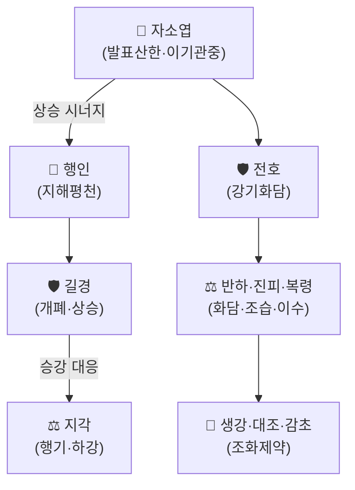

# 🍵 행소탕 (杏蘇散, Xing Su San)

> **핵심 3줄 요약 (Key Summary)**:
> - 🌿 기본 구성: [[행인]]·[[자소엽]]을 중심으로 [[반하]]·[[전호]]·[[길경]]·[[지각]]·[[진피]]·[[복령]]·[[생강]]·[[대조]]·[[감초]]로 구성된 12미(味) 처방. 청대 오국통(吳鞠通)의 『온병조변(溫病條辨)』 치조제(治燥劑) 범주에 속한다.
> - 🎯 임상 적응증: 가을철 서늘한 건조한 기운(凉燥)이 폐를 침범해 생긴 기침 — 마르거나 묽은 백태 가래, 목 마르고 껄끄러움, 경미한 두통·오한발열, 코막힘·콧물, 흉부 답답함.
> - 🔬 배오 특징: [[자소엽]]의 발표산한(發表散寒)·이기관중(理氣寬中)에 [[행인]]의 지해평천(止咳平喘)을 더하고, [[전호]]·[[길경]]·[[지각]]으로 폐기(肺氣)의 승강을 조절하며 [[복령]]·[[진피]]·[[반하]]로 담(痰)을 삭여 윤조지해(潤燥止咳)·선폐화담(宣肺化痰)을 도모한다.
> - ⚠️ 주의사항: 고열·심한 열증(溫燥)이거나 가래가 누렇고 끈적한 경우에는 부적합하며, 온조(溫燥) 증상에는 상행탕(桑杏湯) 계열을 고려해야 한다.

---

## 📌 목차
1. [기본 처방 정보 & 구성](#1-기본-처방-정보--구성)
2. [방제학적 약재 상호작용 & 시너지 네트워크](#2-방제학적-약재-상호작용--시너지-네트워크)
3. [현대 분자약리학적 효능 & 작용 기전](#3-현대-분자약리학적-효능--작용-기전)
4. [적응 병증 및 감별 (Sweet Spot vs 금기)](#4-적응-병증-및-감별-sweet-spot-vs-금기)
5. [유사 처방군 감별 매트릭스](#5-유사-처방군-감별-매트릭스)
6. [임상 가감례 & 현대 질환별 응용](#6-임상-가감례--현대-질환별-응용)
7. [💡 사용자 진료실 핵심 필기 & 임상 팁](#7--사용자-진료실-핵심-필기--임상-팁)
8. [출처 및 학술 참고 문헌 (References)](#8-출처-및-학술-참고-문헌-references)

---

## 1. 기본 처방 정보 & 구성

* **출전**: 오국통(吳鞠通) 『온병조변(溫病條辨)』(1798) — 治燥劑 중 경선외조(輕宣外燥) 범주.
* **치법**: 윤조지해(潤燥止咳), 선폐화담(宣肺化痰).

| 구분 | 약재명 | 표준 용량(원방 기준) | 본초 효능 & 방제 내 역할 |
| :--- | :--- | :--- | :--- |
| **군약** | [[자소엽]] | 3~9g | 발표산한(發表散寒), 이기관중(理氣寬中) |
| **군약(보조)** | [[행인]] | 6~10g | 지해평천(止咳平喘), 폐기 하강 |
| **신약** | [[전호]] | 6~9g | 강기화담(降氣化痰) — 풍열·담음 기침에 범용 |
| **신약** | [[길경]] | 1~10g (원방 ~5g) | 개폐거담(開肺祛痰), 폐기 상승 조절 |
| **좌약** | [[지각]] | 용량 미상(원방 미기재) | 행기관흉(行氣寬胸) — 길경과 승강(昇降) 대응 |
| **좌약** | [[반하]](법제) | 6~10g | 화담(化痰), 조습(燥濕) |
| **좌약** | [[진피]] | 3~6g | 이기화담(理氣化痰) |
| **좌약** | [[복령]] | 9~12g | 이수거담(利水祛痰), 건비(健脾) |
| **사약** | [[생강]], [[대조]] | 각 1~6g | 조화영위(調和營衛) |
| **사약** | [[감초]] | 1~6g | 조화제약(調和諸藥), 지해(止咳) 보조 |

> **배오 특징**: [[자소엽]]+[[행인]]이 발표(解表)와 지해(止咳)를 함께 담당하는 군약 축이며, [[길경]](상승)과 [[지각]](하강)의 승강 대응, [[전호]]·[[반하]]·[[진피]]·[[복령]]의 화담(化痰) 사약군이 더해져 "표(表)를 살짝 풀면서 폐기를 아래로 내려 담을 삭이는" 경선윤조(輕宣潤燥)의 전형적 구조를 이룬다.

---

## 2. 방제학적 약재 상호작용 & 시너지 네트워크

* [[자소엽]] + [[행인]] 배오: 발표(表를 품)와 지해(咳를 멎게 함)가 동시에 이루어지는 방제의 핵심 축.
* [[길경]] + [[지각]] 배오: 폐기의 승강을 함께 조절해 흉부 답답함과 기침을 완화하는 전형적인 '승강 대응 약대'.

---

## 3. 현대 분자약리학적 효능 & 작용 기전

### 1) 진해·거담 네트워크
* [[행인]]의 아미그달린(Amygdalin) 유래 대사체와 [[전호]]의 쿠마린(Coumarin) 계열 성분(프라에룹토린 등)이 기침 반사 억제 및 기관지 평활근 이완에 관여한다고 보고된다.
* [[반하]]·[[진피]]의 정유·플라보노이드 성분이 기도 점액 분비를 조절해 거담(祛痰) 작용을 돕는다.

### 2) 항염증·항알레르기 네트워크
* [[자소엽]]의 [[페릴알데히드]](Perillaldehyde)·로즈마린산(Rosmarinic acid)이 항염증·항알레르기 작용을 나타내 상기도 자극 증상을 완화한다.

### 3) 상기도 점막 보호
* [[길경]]의 사포닌 성분이 기도 점막의 점액 분비를 촉진해 건조한 가래를 묽게 하는 데 관여한다(윤조 효능의 현대적 설명 축 중 하나로 제시된다).

---

## 4. 적응 병증 및 감별 (Sweet Spot vs 금기)

[✅ 최적 적응증 (Sweet Spot)]
* 가을철 또는 건조한 날씨에 발생한 외감 양조(凉燥) 기침 — 마른 기침이나 묽은 백색 가래, 목이 건조하고 껄끄러움.
* 경미한 두통·오한발열, 코막힘 또는 약한 콧물, 흉부 답답함을 동반.
* 설태: 희고 건조한 설태(薄白而燥) / 맥상: 부(浮) 혹은 현(弦) 또는 부긴(浮緊).

[⚠️ 신중 투여 및 금기]
* 가래가 누렇고 끈적하거나 고열·인후통이 심한 온조(溫燥)·풍열(風熱) 증상에는 부적합 — 이 경우 상행탕(桑杏湯) 등 청윤(淸潤) 계열을 고려한다.
* 반하·행인은 임신부·간질환자에서 용량 및 병용 약물에 유의가 필요하다(행인의 아미그달린은 과량 섭취 시 시안화물 중독 위험이 있어 표준 포제·용량을 지킨다).

---

## 5. 유사 처방군 감별 매트릭스

| 처방명 | 핵심 구성 차이 | 주치 및 특징 | 감별 포인트 |
| :--- | :--- | :--- | :--- |
| [[행소탕]] (본 처방) | [[자소엽]]+[[행인]] 중심, 화담약 다수 | 양조(凉燥) 기침 — 마른/묽은 백태 가래 | 오한 경하고 건조한 자극감 중심 |
| 상행탕(桑杏湯) | [[상엽]]·[[행인]]·사삼 등 | 온조(溫燥) 기침 — 마른기침, 열상 | 발열·인후 건조통이 더 뚜렷 |
| [[삼소음]] | [[인삼]]·[[자소엽]]·전호·반하 등 | 외감풍한+기허 겸 담음 기침 | 기허(氣虛) 겸증이 있을 때 선택 |
| [[이진탕]] | [[반하]]·[[진피]]·[[복령]]·[[감초]] | 담음(痰飮) 단독, 외감 증상 없음 | 외감 증상 없이 담음만 있을 때 |

---

## 6. 임상 가감례 & 현대 질환별 응용

* **수반 증상별 가감법**:
  * 건조감이 심할 때 → + 사삼(沙參)·맥문동(麥門冬)
  * 한증(寒證)이 뚜렷할 때 → + 생강 증량·갈근
  * 인후통 동반 시 → + 우방자(牛蒡子)·판람근(板藍根)
  * 기침이 오래갈 때 → + 백부(百部)·자원(紫苑)
  * 천명(喘鳴) 동반 시 → + 소량의 마황·백과(은행)
* **현대 질환별 임상 매핑**:
  * **호흡기계**: 감기·상기도감염, 급성 기관지염, 건조성 기침, 가을철 환절기 기침.
  * **이비인후계**: 인후 건조감, 알레르기성 비염의 건조형 콧물·코막힘.

---

## 7. 💡 사용자 진료실 핵심 필기 & 임상 팁

> [!tip] **진료실 실전 노하우 (User Clinical Insight)**
> - 현재 별도로 기록된 원장님 임상 필기가 없습니다. 추후 실전 진료 경험이 누적되면 이 섹션에 추가합니다.
> - 참고: 본 볼트의 [[전호]]·[[티페피딘시트르산염]] 노트에서 행소탕이 거담·진해 처방 비교군으로 이미 인용되고 있어, 임상 가감 시 해당 노트의 비교표도 함께 참고.

---

## 8. 출처 및 학술 참고 문헌 (References)

1. **오국통(吳鞠通) (1798)**. 『온병조변(溫病條辨)』 — 치조제(治燥劑), 경선외조(輕宣外燥).
   - **[고전 원전]**: 양조(凉燥)로 인한 기침의 군신좌사 배오 및 주치 조문.
2. [[전호]] 노트 — 행소탕 내 전호·행인·패모 배오 설명 및 처방 비교표 (본 볼트 내부 참고).
3. [[티페피딘시트르산염]] 노트 — 행소탕 계열과 진해거담 양약의 기능적 중복·병용 시 고려사항 정리 (본 볼트 내부 참고).
