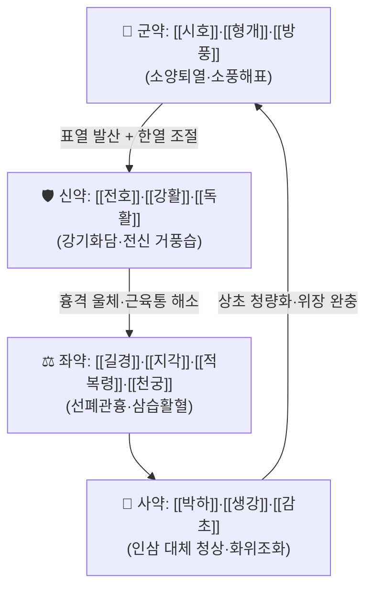

# 🍵 [[형방청해산]] (荊防淸解散, Hyeongbang Cheonghae-san)

> **핵심 3줄 요약 (Key Summary)**:
> - 🌿 모체/기원 처방 + 가감 핵심 약재 배오 구조: 『동의수세보원』 계열 [[형방패독산]]의 변방으로, 원방에서 [[인삼]]을 빼고 [[박하]]·[[생강]]을 배합한 중기 [[감기]] 대표 해표청열 처방.
> - 🎯 임상 최적 적응증: 감기 발병 2~3일 이후 고열·한열왕래, 온몸이 두드려 맞은 듯 붓고 무거운 신체통, 코막힘·[[인후통]]·흉만(가슴 답답함)이 겹치면서 [[인삼]] 복용 시 열·두통·짜증이 악화되기 쉬운 열성·[[소양인]]·실열 체질 환자.
> - 🔬 핵심 분자약리 기전: [[시호]]·[[전호]]의 해열·항염 작용과 [[형개]]·[[방풍]]·[[박하]]의 말초 혈관 이완 및 상기도 점막 울혈 완화, [[길경]]·[[지각]]의 거담·기관지 순환 개선 기전이 복합적으로 작용한다.
> - ⚠️ 주의사항: 진액과 원기가 크게 빠진 허약자·기허형 감기(이 경우 [[인삼]]을 포함한 [[형방패독산]] 또는 [[도씨보익탕]] 우선) 및 설사·복통이 심한 비위허한 환자에는 신중 투여하며, [[감초]]·[[시호]] 함유 처방과의 장기 중복 복용을 피한다.

---

## 📌 목차
1. [기본 처방 정보 & 군신좌사 구성](#1-기본-처방-정보--군신좌사-구성)
2. [방제학적 약재 상호작용 & 시너지 네트워크](#2-방제학적-약재-상호작용--시너지-네트워크)
3. [현대 분자약리학적 효능 & 작용 기전](#3-현대-분자약리학적-효능--작용-기전)
4. [적응 병증 및 체질별 감별 (Sweet Spot vs 금기)](#4-적응-병증-및-체질별-감별-sweet-spot-vs-금기)
5. [유사 처방군 감별 매트릭스](#5-유사-처방군-감별-매트릭스)
6. [임상 가감례 & 현대 질환별 응용](#6-임상-가감례--현대-질환별-응용)
7. [💡 사용자 진료실 핵심 필기 & 임상 팁 (원문 보존)](#7--사용자-진료실-핵심-필기--임상-팁-원문-보존)
8. [출처 및 학술 참고 문헌 (References)](#8-출처-및-학술-참고-문헌-references)

---

## 1. 기본 처방 정보 & 군신좌사 구성

* **출전**: 청강(晴岡) 김영훈(金永勳) 『청강의감(晴崗醫鑑)』 일반감모(一般感冒) 문
* **치법**: 소풍해표(疏風解表) · 청해표리(淸解表裏) · 거습지통(祛濕止痛)
* **구성 배경**: [[형방패독산]]([[인삼패독산]]에서 변용)에서 [[인삼]]을 제거하고 [[박하]]·[[생강]]을 가미한 13味 방제.

| 구분 | 약재명 | 표준 용량 | 본초 효능 & 방제 내 역할 |
| :--- | :--- | :--- | :--- |
| **군약 (君藥)** | [[시호]] | 4~6g | 화해소양(和解少陽)·퇴열해표. 감기 중기 한열왕래와 고열·번조의 주증을 푼다. |
| **군약 (君藥)** | [[형개]] | 4g | 소풍해표·투진소종. 상초·안면·비인두의 풍열을 외표로 발산한다. |
| **군약 (君藥)** | [[방풍]] | 4g | 거풍승습·지통. 형개와 짝을 이뤄 전신 두통·몸살 기운을 푼다. |
| **신약 (臣藥)** | [[전호]] | 4g | 강기화담·소산풍열. [[시호]]의 승산과 짝을 이뤄 흉격의 열담과 기침을 내린다. |
| **신약 (臣藥)** | [[강활]] | 4g | 산한거풍·승양제습. 상체·항강(목 뻣뻣함)·견배통의 풍습을 제거한다. |
| **신약 (臣藥)** | [[독활]] | 4g | 거풍승습·지통. 하체·요배부까지 두드려 맞은 듯 붓고 무거운 신체통을 해소한다. |
| **좌약 (佐藥)** | [[길경]] | 4g | 선폐이인·거담배농. 인후 종통과 가래가 목에 걸려 잘 뱉어지지 않는 증상을 뚫는다. |
| **좌약 (佐藥)** | [[지각]] | 4g | 이기관흉·행기소비. 기침과 가래로 답답한 흉만(胸滿)을 풀어준다. |
| **좌약 (佐藥)** | [[적복령]] | 4g | 이수삼습·건비. 조직 부종과 습체(몸이 무겁고 붓는 느낌)를 소변으로 뺀다. |
| **좌약 (佐藥)** | [[천궁]] | 4g | 활혈행기·거풍지통. 두면부·비강 울혈을 개선하고 혈행성 두통을 완화한다. |
| **사약 (使藥)** | [[박하]] | 2~4g | 신량소풍·청리두목. [[인삼]] 대신 들어가 상초 열감을 시원하게 식히고 인후·비강을 개규한다. |
| **사약 (使藥)** | [[생강]] | 3~4g | 온중산한·해표화위. 표부 잔류 미열·오한을 조율하고 13미 전체의 위장 부담을 줄인다. |
| **사약 (使藥)** | [[감초]] | 2~3g | 조화제약·완급지통·인후 진정. 여러 발산·강기 약재의 편향성을 완충한다. |

> **배오 특징**: 『청강의감』 원방 구조상 `형방패독산 = 형방청해산 + 인삼 − 박하·생강`의 관계를 가진다. 즉 기허가 없는 일반 성인·열성 체질 환자에게 [[인삼]]의 온보·승압 작용이 오히려 두통·설사·열 상승을 부를 수 있다는 임상 관찰에서 [[인삼]]을 덜어내고, 辛凉發散하는 [[박하]]와 溫中和胃하는 [[생강]]으로 치환해 **표(表)의 풍열은 시원하게 흩고 흉격(胸膈)의 열담은 아래로 내리는 균형 구조**를 완성한 방제이다.

---

## 2. 방제학적 약재 상호작용 & 시너지 네트워크

* [[시호]] + [[전호]] 배오 (升降相因): [[시호]]가 소양 반표반리의 사열을 위로 끌어올려 흩는 사이, [[전호]]는 폐기를 아래로 내려 담열과 기침을 가라앉혀 흉만·인후 답답함을 동시에 해소합니다.
* [[강활]] + [[독활]] + [[적복령]] 배오 (상하 거풍습): [[강활]]은 상지·경항부, [[독활]]은 하지·요부 근육통을 분담하고 [[적복령]]이 국소 부종성 습기를 삼습시켜 감기 중기 "온몸이 붓고 두드려 맞은 듯 아픈" 신체통을 해결합니다.
* [[길경]] + [[지각]] 배오 (선폐관흉): [[길경]]의 상행(宣肺)과 [[지각]]의 하행(降氣·寬胸)이 길항하면서도 상보적으로 작동해 기도 개방과 객담 배출을 돕습니다.
* [[박하]] + [[생강]] 배오 (인삼 대체 축): [[인삼]]이 빠진 자리에 [[박하]](멘톨)의 시원한 상초 발산과 [[생강]]의 중초 화위·미세발한을 배치하여, 과한 발열·두통 부작용 없이 중기 감기를 무난히 넘기게 설계되었습니다.

---

## 3. 현대 분자약리학적 효능 & 작용 기전

> ⚠️ 아래 기전은 청강 김영훈 경험방 **형방청해산 전체 처방을 직접 실험한 PubMed 문헌은 현재 확인되지 않아**(근거 미확인), 구성 핵심 본초군의 확립된 분자약리 기전 수준에서 해석한 것입니다.

### 1) 해열 및 전염증성 사이토카인(IL-1β·IL-6·TNF-α) 하향 조절
* 상기도 바이러스 감염 2~3일 차 중기에는 IL-1β, IL-6, TNF-α 급증에 의해 시상하부 체온 세트포인트가 상승하고 전신 근육통이 극대화됩니다. [[시호]]의 사이코사포닌(Saikosaponin a·d)과 [[전호]]의 쿠마린류(Praeruptorin A)는 NF-κB·MAPK 염증 신호를 억제해 발열과 급성기 염증 반응을 완화하는 것으로 알려져 있습니다.

### 2) 인후·상기도 점막 울혈 개선 및 거담·진해 작용
* [[길경]]의 [[플라티코딘 D]]는 기관지 점액 분비를 조절해 끈적한 객담 배출을 돕고 국소 대식세포 식균 활성을 보조하며, [[박하]]의 [[멘톨]](Menthol)은 상기도 TRPM8 냉감 수용체를 활성화해 코막힘의 주관적 답답함과 인후 작열통을 신속히 경감합니다.

### 3) 근막·관절 부종 완화 및 미세순환 재개선
* [[강활]]·[[독활]]·[[천궁]]의 [[페룰산]](Ferulic acid) 및 테트라메틸피라진 계열과 [[적복령]]의 파키민산(Pachymic acid)은 말초 미세혈관 투과성 항진을 억제하고 국소 프로스타글란딘 합성을 조절해 몸살 근육통과 안면·사지 부종감을 완화합니다.

---

## 4. 적응 병증 및 체질별 감별 (Sweet Spot vs 금기)

### [✅ 최적 적응증 (Sweet Spot)]
* **감기 타임라인 (청강의감 기준)**: 발병 1~2일 초기를 지나 **2~3일 이후의 중기 감모** — 발열이 주증이 되면서 한열왕래가 있고, 온몸이 붓고 두드려 맞은 듯 무겁고 아프며, 기침으로 가슴이 답답하고 코가 막혀 목([[인후염]]·[[편도선염]])이 붓고 아플 때.
* **체질 소견 (핵심 분기점)**:
  * 평소 기운이 처지지 않는 보통 체격 이상의 성인, 열성 체질, [[소양인]] 또는 열화(熱化) 경향 [[태음인]].
  * 감기에 걸리면 오히려 예민해지고 열감·번조·짜증이 치솟으며, [[인삼]] 복용 시 손발·머리가 뜨끈해지거나 두통·설사가 올라오기 쉬운 환자(**박하생강증**).
* **이비인후과·피부 초기 확대**: 감기 외에 귀·코·목의 급성 염증 초기, 옹저(癰疽)·피부 발진 초기에서 맥이 유력하고 삭(數)할 때.
* **맥진/설진**: 맥부삭(浮數) 또는 유력·활삭(滑數), 설질 홍(紅) 또는 설변첨 홍·설태 박백~미황.

### [⚠️ 신중 투여 및 금기 (Caution / Contraindication)]
* **기허·허약 감기(인삼증) 감별**: 감기에 걸리면 완전히 기운이 빠져 축 처지고 밤샘·과로 후 면역력이 급락한 허약자나 [[소음인]]에게는 [[인삼]]이 들어간 [[형방패독산]]이나 후기 처방인 [[도씨보익탕]]·[[가미화정음]]이 적합합니다.
* **순수 리실열(裏實熱) 고열·폐렴**: 39~40℃ 이상의 고열과 화농성 객담이 동반된 세균성 폐렴·편도 주위 농양 의심 시에는 한약 단독으로 끌지 않고 신속히 영상·혈액검사 및 양방 항생제 병용·의뢰를 판단합니다.
* **소화기·전해질 주의**: [[지각]]·[[전호]]·[[강활]] 등이 위장관 운동에 영향을 줄 수 있어 평소 심한 설사나 위궤양 환자는 식후 온복하며, 장기 연용 시 [[감초]]에 따른 부종·혈압 상승 여부를 살핍니다.

---

## 5. 유사 처방군 감별 매트릭스

| 처방명 | 핵심 구성 차이 | 주치 및 체질 차이 | 맥진/설진 차이 |
| :--- | :--- | :--- | :--- |
| [[형방청해산]] | [[형방패독산]]에서 [[인삼]] 제외 + [[박하]]·[[생강]] 가미 | **감기 중기(2~3일 이후)** 고열·신체통·흉만·인후통. 열성·소양인 등 인삼 부적합자 | 맥 유력·부삭, 설홍·태박황 |
| [[형방패독산]] | 기준 구성 + [[인삼]] (박하·생강 없음) | 감기 중기 중 **기운 없고 시름시름 앓는 허약형·과로 후 감기** | 맥 부삭이나 중안 무력 |
| [[가미보정산]] | [[향갈탕]] 변방 ([[향부자]]·[[창출]]·[[갈근]] 등 12미) | **감기 초기(1~2일)** 으슬으슬 오한·식욕저하·가벼운 몸살·기분 저하 | 맥 부긴, 설태 박백 |
| [[도씨보익탕]] | [[보중익기탕]](거 [[승마]]) + [[사물탕]] + 해표약 | **감기 후기(1주일 이상)** 마르고 무기력·식욕부진·미열 오한 반복 | 맥 허약·세삭, 설담 |
| [[연교패독산]] | 패독산류 + [[연교]]·[[금은화]] | 감기 중기 중 **피부 발진·편도 화농·인후 종통**이 훨씬 심할 때 | 맥 활삭, 설홍 태황 |

---

## 6. 임상 가감례 & 현대 질환별 응용

### 1) 변증 가감법 (『청강의감』 가감)
* **두통 심(頭痛甚)**: [[황금]], [[백지]] 각 4g 가미
* **인통난탄(咽痛難呑, 목이 부어 삼키기 어려움)**: [[금은화]], [[현삼]] 각 6g 가미
* **발열유갈(發熱有渴, 열나고 갈증)**: [[갈근]], [[천화분]], [[맥문동]] 각 4g 가미
* **해수(咳嗽) 심**: [[행인]], [[상백피]], [[과루인]] 각 4g 가미
* **협통(脇痛, 옆구리 통증)**: [[청피]] 4g, [[백개자]] 3g 가미
* **하계서풍(夏季暑風, 여름 감기)**: [[향유]] 6g, [[황련]](또는 [[황금]])·[[백편두]] 각 4g 가미
* **신피신열(身疲身熱) / 식불소(食不消)**: [[쌍화탕]] 또는 [[불환금정기산]] 합방
* **옹저 초기 발열오한 / 반진종독**: [[금은화]]·[[연교]]·[[황금]]·[[치자]] 가미, 풍진 소양에는 [[천마]]·[[박하]] 가미, 소아 발열에는 반량 감량 후 [[천마]]·[[지골피]] 각 2g 가미

### 2) 현대 질환별 매핑
* **호흡기·이비인후과([[감기]]·[[급성 인후염]]·[[급성 편도염]]·[[급성 기관지염]])**: 발병 2~3일 이후 고열과 전신 몸살, 인후통이 정점에 오른 중기 상기도 감염에 1차 적용.
* **근골격계(감기 후유 근육통 동반 요통·경항통)**: 감기 몸살 직후 목·어깨·허리 근육통이 증폭된 환자에게 침·추나 치료와 병행해 1주 단위로 운용.

### 양약 상호작용 (Herb–Drug Interaction)
* **해열진통제([[아세트아미노펜]]·[[NSAIDs]]) 및 종합감기약**: 한약의 해열·발한 작용과 양방 해열제의 작용이 중첩될 수 있으며, [[감초]]·[[강활]]이 [[NSAIDs]]의 위장관 자극을 더할 수 있으므로 1~2시간 간격을 두고 식후 온복합니다.
* **항고혈압제·이뇨제·코르티코스테로이드**: [[감초]]의 [[글리시리진]] 함량은 높지 않으나 타 감초 처방이나 이뇨제와 2주 이상 병용 시 저칼륨혈증 및 혈압 상승 여부를 관찰합니다.
* **항혈소판제·항응고제([[아스피린]]·[[와파린]])**: [[천궁]]이 활혈 행기 약재로 혈류 순환을 높이므로 항응고제 복용 환자에게 7일 이상 병용 시 출혈·멍 증가 여부를 점검합니다.

---

## 7. 💡 사용자 진료실 핵심 필기 & 임상 팁 (원문 보존)

> [!tip] **진료실 실전 노하우 (User Clinical Insight)**
> - **청강의감 1 강의록 원문 보존 (청강 김영훈 감기 3단계 프레임)**:
>   - 감기는 변증이 아니라 **"며칠 되셨어요?"** 로 시기를 먼저 잡는다: 초기 1~2일은 [[가미보정산]], 2~3일 지난 **중기 감기의 주력 처방이 형방청해산**, 일주일~열흘 넘은 만성·후기는 [[도씨보익탕]] / [[가미화정음]].
>   - **인삼증 vs 박하생강증 분기점**: `형방패독산 = 형방청해산 + 인삼 - 박하·생강`. 한국인은 열성 체질이 많아 [[인삼]]이 들어가면 10~20%에서 두통·설사·열 상승이 나타날 수 있으므로, 평소 비실비실 처진 사람에게만 [[형방패독산]]을 쓰고 **감기 걸려 열나고 짜증내는 일반적인 환자에게는 형방청해산을 1번으로 권한다.**
>   - **한의원 실전 적용 팁**: 약을 지어 며칠 뒤 복용할 때쯤이면 이미 감기 중기로 넘어가 있으므로 실전에서는 형방청해산이 가장 자주 적중한다. 근골격 통증 환자에게 감기 직후 겹친 근육통 여부를 물어 1주일 치 병행 처방 시 예후가 깔끔하다.

---

## 8. 출처 및 학술 참고 문헌 (References)

1. 김영훈 (晴岡 金永勳). 『청강의감(晴崗醫鑑)』 일반감모(一般感冒) 편.
   - **[임상 원전]**: [[형방패독산]]에서 [[인삼]]을 제거하고 [[박하]]·[[생강]]을 가미한 형방청해산의 13미 구성, 중기 감모 적응증 및 13종 대증 가감법 수록.
2. 전국한의과대학 방제학교수 공편. 『방제학』 해표제·화해제 편. 영림사.
   - **[임상 문헌]**: [[인삼패독산]]·[[형방패독산]]의 군신좌사 배오 원리 및 신량해표·거풍승습 약재 상호작용 해설.
3. Simbio 볼트 강의록 정본. [일반감기_가미보정산·형방청해산·도씨보익탕·가미화정음(청강의감 1)](file:///C:/Simbio/_지식/강의/2.%20한의%20임상%20및%20진단학%20(부인과·내과)/일반감기_가미보정산·형방청해산·도씨보익탕·가미화정음(청강의감%201).md).
   - **[강의 정리]**: 감기 3단계 타임라인, 박하생강증 vs 인삼증 임상 감별 기준, 근골격 통증 환자 병행 상담 스크립트 수록.
