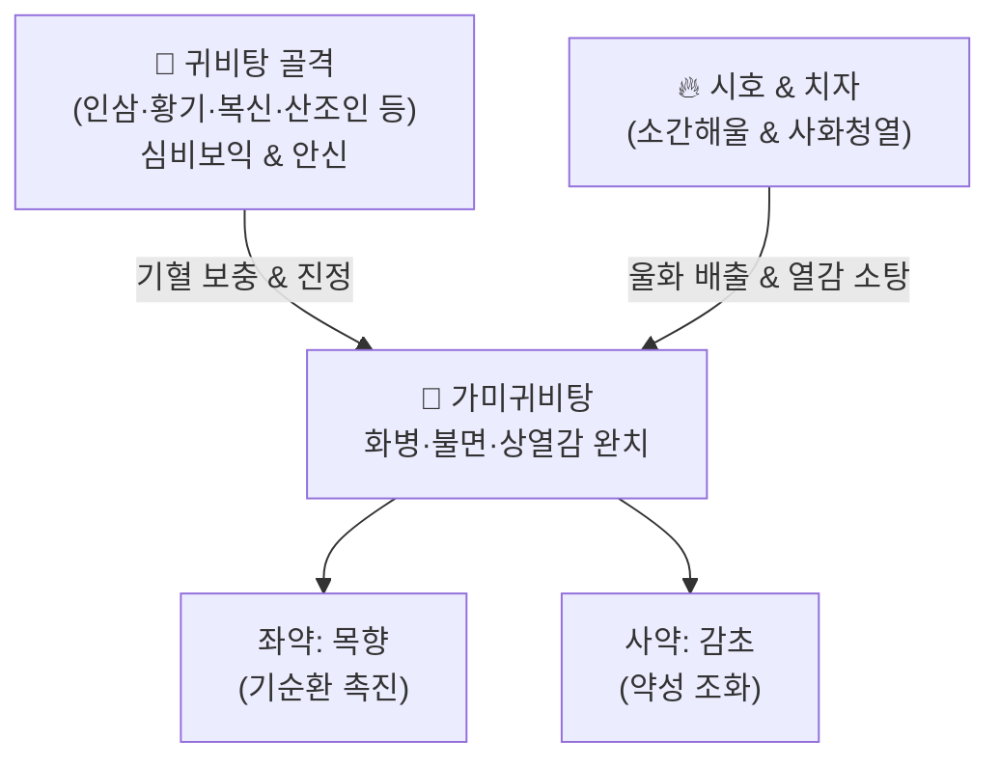

# 🍵 [[가미귀비탕]] (加味歸脾湯, Jia-Wei-Gui-Pi-Tang / Kamikihito)

> **핵심 3줄 요약 (Key Summary)**:
> - 🌿 [[귀비탕]]([[인삼]]·[[황기]]·[[백출]]·[[복신]]·[[당귀]]·[[용안육]]·[[산조인]]·[[원지]]·[[목향]]·[[감초]]·[[생강]]·[[대추]]) + [[시호]]·[[치자]].
> - 🎯 심비양허(心脾兩虛) 겸 간울화화(肝鬱化火), 억울한 스트레스로 인한 화병(火病), 신경성 [[불면증]], 가슴 답답함(흉민), 안면 상열감, [[갱년기]] 우울·불안.
> - 🔬 중추 GABA-A 수용체 조절을 통한 수면 유도, [[치자]]([[제니포시드]]) 및 [[시호]]([[사이코사포닌]])의 HPA 축 과활성화 억제, 해마 BDNF 발현 촉진 및 치료저항성 [[우울증]] 모델 행동·분자 개선.
> - ⚠️ 주의사항: [[치자]]의 고한성으로 인해 평소 소화기가 몹시 차고 설사가 잦은 환자는 감량 또는 식후 온복 지도.
---
## 📌 목차
1. [기본 처방 정보 & 군신좌사 구성](#1-기본-처방-정보--군신좌사-구성)
2. [방제학적 약재 상호작용 & 시너지 네트워크](#2-방제학적-약재-상호작용--시너지-네트워크)
3. [현대 분자약리학적 효능 & 작용 기전](#3-현대-분자약리학적-효능--작용-기전)
4. [적응 병증 및 체질별 감별 (Sweet Spot vs 금기)](#4-적응-병증-및-체질별-감별-sweet-spot-vs-금기)
5. [유사 처방군 감별 매트릭스](#5-유사-처방군-감별-매트릭스)
6. [임상 가감례 & 현대 질환별 응용](#6-임상-가감례--현대-질환별-응용)
7. [💡 사용자 진료실 핵심 필기 & 임상 팁 (원문 보존)](#7--사용자-진료실-핵심-필기--임상-팁-원문-보존)
8. [출처 및 학술 참고 문헌 (References)](#8-출처-및-학술-참고-문헌-references)
---
## 1. 기본 처방 정보 & 군신좌사 구성

* **출전**: 명대(明代) 설기(薛己) 『[[내과적요]](內科摘要)』 및 허준 『[[동의보감]]』
* **치법**: 건비양심(健脾養心), 소간청열(疎肝淸熱), 해울안신(解鬱安神)

| 구분 | 약재명 | 표준 용량 | 본초 효능 & 방제 내 역할 |
| :--- | :--- | :--- | :--- |
| **군약 (君藥)** | [[인삼]] | 6~8g | 대보원기, 건비익폐, 쇠약해진 세포 활력 증진 |
| **군약 (君藥)** | [[황기]] | 8~12g | 보기승양, 고표지한, 신경계 피로 회복 |
| **군약 (君藥)** | [[백출]] | 6~8g | 조습건비, 소화기 기초 운화 복구 |
| **군약 (君藥)** | [[복신]] | 6~8g | 영심안신, 심신 불안 및 불면 진정 |
| **신약 (臣藥)** | [[당귀]] | 6~8g | 보혈활혈, 혈액 공급 증대 |
| **신약 (臣藥)** | [[용안육]] | 6~8g | 보익심비, 양혈안신, 건망과 두근거림 완화 |
| **신약 (臣藥)** | [[산조인]](초) | 6~8g | 양심익간, 안신염한, 수면 잠복기 단축 |
| **신약 (臣藥)** | [[원지]] | 4~6g | 영심안신, 거담개규 |
| **신약 (臣藥)** | [[시호]] | 3~4g | 소간해울, 투달울열, 억압된 감정(간기울결) 해소 |
| **신약 (臣藥)** | [[치자]] | 3~4g | 사화제번, 청열이습, 가슴 속 번열과 상초 화열 소탕 |
| **좌약 (佐藥)** | [[목향]] | 2~3g | 행기지통, 비위 기체 방지 |
| **좌약 (佐藥)** | [[생강]] | 4g | 온위지구, 발표산한 |
| **좌약 (佐藥)** | [[대추]] | 4g | 보비생진, 영위 조화 |
| **사약 (使藥)** | [[감초]](자) | 2~3g | 보기화중, 완급지통, 제약 조화 |

> **배오 특징**: [[귀비탕]]의 전형적인 심비(心脾) 보혈안신 골격에, 간기(肝氣)가 뭉쳐 열로 변한 간울화화(肝鬱化火)를 꺼주는 [[시호]]와 [[치자]]를 가미했습니다. 기혈이 바닥나서 불안하고 잠을 못 자는데, 억울한 분노나 스트레스로 인해 가슴이 답답하고 얼굴로 열이 훅 치밀어 오르는 복합 증상(허증 + 울열)을 다스리는 배오입니다.
---
## 2. 방제학적 약재 상호작용 & 시너지 네트워크

* [[시호]] + [[치자]] 배오: [[시호]]가 뭉친 간기를 풀어헤치고(소간), [[치자]]가 가슴에 맺힌 번열을 소변으로 내려 꺼줌으로써(청열), 스트레스로 인한 흉민, 상열감, 두통을 완화합니다.
* [[산조인]]·[[복신]] + [[치자]] 배오: [[치자]]가 뇌혈관 열감을 식히고, [[산조인]]·[[복신]]이 흥분된 중추신경을 가라앉혀 잡념과 화(火)로 인한 수면장애를 조절합니다.
---
## 3. 현대 분자약리학적 효능 & 작용 기전

### 1) 해마 BDNF 발현 촉진 및 치료저항성 우울증 행동·분자 조절
* [[치자]]의 [[제니포시드]](Geniposide)와 [[시호]]의 [[사이코사포닌]](Saikosaponin) 성분이 해마의 뇌유래신경영양인자(BDNF) 및 TrkB 신호 전달을 활성화하여 우울·불안과 신경 피로를 회복시킵니다.
* 치료저항성 [[우울증]](two-hit) 동물 모델에서 가미귀비탕(Kamikihito) 투여가 행동학적 우울 지표와 관련 분자 신호를 조절함이 보고되었습니다 ([PMID 42460528](https://pubmed.ncbi.nlm.nih.gov/42460528/)).

### 2) HPA Axis 피드백 정상화 및 심계항진 완화
* 교감신경의 과도한 노르에피네프린 분비를 완화하고 부교감신경 균형을 도와 공황·화병 발작 시 동반되는 빈맥·불안·식은땀을 안정화합니다.

### 3) 만성 신경염증(Neuroinflammation) 억제
* 뇌 미세아교세포(Microglia) 과활성화와 TNF-$\alpha$, IL-6 등 염증성 사이토카인 방출을 억제해 뇌 피로감과 긴장성 두통을 완화합니다.
---
## 4. 적응 병증 및 체질별 감별 (Sweet Spot vs 금기)

### 1) 임상 적응증 (Sweet Spot)
* **화병(Hwa-byung) 및 울화증**: 억울한 일이나 심한 갈등을 겪은 후 가슴이 꽉 막힌 듯 답답하고, 한숨을 자주 쉬며, 얼굴로 열이 치솟고 잠을 못 자는 상태.
* [[갱년기]] 증후군 [[불면증]]: 폐경 전후로 안면 홍조, 가슴 두근거림, 불안, 감정 기복이 심하며 밤마다 잠을 깨는 여성 환자.
* 시험 스트레스 수험생의 긴장성 [[두통]] & [[불면증]]: 머리에 열이 오르고 신경이 극도로 예민해진 상태.

### 2) 사상의학 체질 감별 & 금기
* [[소음인]] / [[태음인]]: 평소 심비가 약한 [[소음인]]이 심한 울화를 겪을 때, 또는 스트레스성 열증이 겹친 체질에 적합.
* **금기(Contraindication)**:
  * 비위가 너무 차서 찬물을 마시면 바로 설사하는 극허한 환자는 [[치자]] 용량을 줄이거나 [[생강]]을 증량하여 투여.
---
## 5. 유사 처방군 감별 매트릭스

| 처방명 | 구성 특징 | 화열(火熱) 위치 | 주요 타겟 질환 |
| :--- | :--- | :--- | :--- |
| [[가미귀비탕]] | [[귀비탕]] + [[시호]]·[[치자]] | 흉격(가슴) + 심비허약 | 화병, 갱년기 불면, 불안, 상열감 |
| [[귀비탕]] | 보기혈 + 양심안신 | 열증 없음 (순수 허증) | 단순 신경쇠약, 빈혈, 멍 잘 듦, 피로 |
| [[가미소요산]] | [[소요산]] + [[목단피]]·[[치자]] | 간담울열 (하복부 울혈) | 생리불순, PMS, 유방창통, 상열하한 |
| [[황련해독탕]] | [[황련]]·[[황금]]·[[황백]]·[[치자]] | 삼초 실열 (고열) | 급성 안면홍조, 고혈압성 두통, 충혈 |

---
## 6. 임상 가감례 & 현대 질환별 응용

1. **상열감과 목마름이 심한 경우**: [[맥문동]] 6g, [[지모]] 4g 가미.
2. **가슴 두근거림과 공황 발작 증상 시**: [[자석]] 12g, [[진주모]] 12g 가미하여 중진안신.
3. 만성 [[두통]]과 눈 충혈 동반 시: [[국화]] 4g, [[결명자]] 6g 가미.
4. **양약 상호작용 (Herb–Drug Interaction)**:
   - **항응고제·혈당강하제 주의**: [[인삼]]([[진세노사이드]])과 [[당귀]]는 와파린·항혈소판제 출혈 위험 및 혈당강하제 저혈당 변동을 유발할 수 있어 모니터링이 필요하다.
   - **수면제·항우울제 병용**: GABA 수용체 및 중추 신경 조절 작용으로 벤조디아제핀·SSRI 병용 시 과도한 진정 여부를 살피며 **2시간 이상 간격**을 둔다.
   - **장기 연용 주의(치자)**: [[치자]] 함유 제제를 수년 이상 장기 복용할 경우 장간막 정맥경화증 위험이 보고되므로 정기적으로 복용 기간을 점검한다.
---
## 7. 💡 사용자 진료실 핵심 필기 & 임상 팁 (원문 보존)

# 구성
[[귀비탕]] + [[시호]] [[치자]]
---
## 8. 출처 및 학술 참고 문헌 (References)

1. **설기 (1529)**. 『[[내과적요]](內科摘要)』 卷下.
   - **[고전 원전]**: "加味歸脾湯, 治思慮傷脾, 鬱怒傷肝, 健忘怔忡, 驚悸盜汗, 發熱盜汗, 飲食少思."
2. **허준 (1613)**. 『[[동의보감]]』.
   - **[임상 문헌]**: 심비양허 및 사려과다(思慮過多)로 인한 건망·정충·불면 치료의 [[귀비탕]] 계열 확장 운용 근거.
3. **Deriha K et al. (2026)**. *Behavioral and Molecular Effects of Kamikihito and Mesenchymal Stem Cells in a Two-hit Model of Treatment-resistant Depression*. **Current Neuropharmacology**. [PMID 42460528](https://pubmed.ncbi.nlm.nih.gov/42460528/)
   - **[연구 요약]**: 치료저항성 우울증 투-히트(two-hit) 모델에서 가미귀비탕(Kamikihito)과 중간엽줄기세포의 행동학적 개선 및 분자적 기전을 평가.
