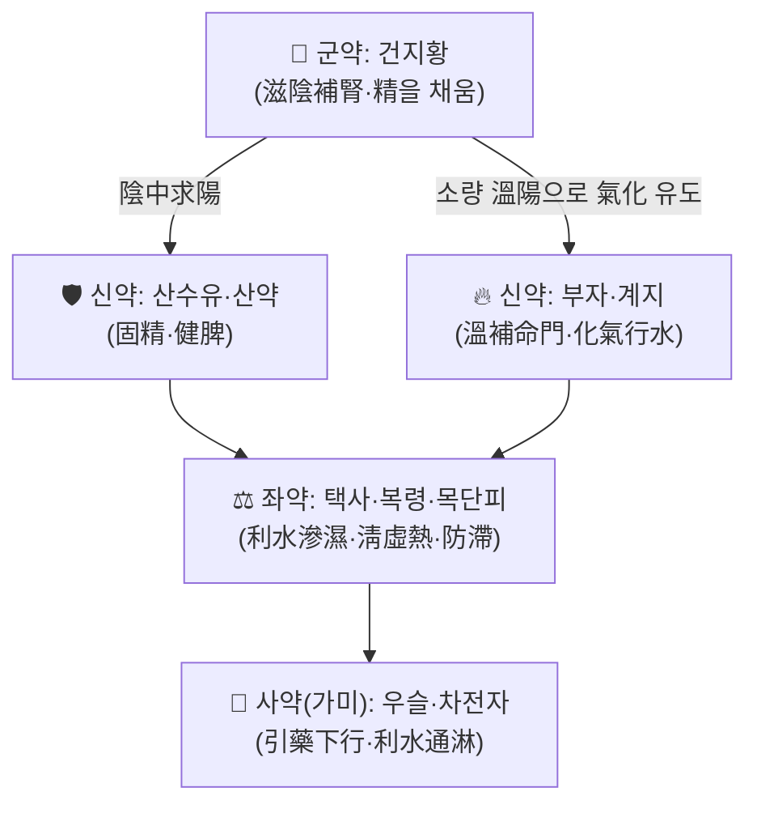

# 🍵 [[금궤신기환]] (金匱腎氣丸, Jinkui Shenqi Wan / Kidney Qi Pill from the Golden Cabinet)

> **핵심 3줄 요약 (Key Summary)**:
> - 🌿 모체 처방은 장중경 『[[금궤요략]]』의 [[팔미지황환|腎氣丸]](八味腎氣丸)이며, 기본 구조는 [[육미지황환]]([[건지황]]·[[산수유]]·[[산약]]·[[택사]]·[[복령]]·[[목단피]])에 온양의 핵심인 [[계지]]·[[부자]]를 더한 8味 구성이다. 여기에 [[우슬]]·[[차전자]]를 가미한 형태가 [[제생신기환|계부팔미지황환(濟生腎氣丸)]]으로, 임상에서는 두 처방이 "금궤신기환(가미)"이라는 이름 아래 혼용되는 경우가 많아 처방명 확인이 필요하다.
> - 🎯 최적 적응증은 신양허(腎陽虛)로 인한 신기불고(腎氣不固)·하초허한(下焦虛寒) — 야간뇨·빈뇨·요실금, 소변불리, 하복부 냉감·무력감, 신허요통, 노인성 배뇨장애, 만성 신질환·[[당뇨병성 신증]] 보조, 소갈(消渴). 체질적으로는 소음인·태음인 계열의 허한·냉성 체형, 근육량 적고 하복벽이 무르며 손발이 찬 환자가 Sweet Spot이다.
> - 🔬 분자약리적으로는 다표적·다경로 네트워크 약리 기전(당뇨병성 신증에서 circRNA-miRNA-mRNA 조절 네트워크 규명)이 보고되었고, 자연노화 동물모델에서 요도 기능 및 방광 배뇨근 β-아드레날린 수용체(β-AR) 기능 조절이 확인되었다. 신양허 병태에서 테스토스테론 저하와 안드로겐 수용체(AR) 유전자 발현 저하가 회복된다는 보고는 [[토사자]] 총플라보노이드 연구에서 제시되었다.
> - ⚠️ 주의사항: 실열(實熱)·습열(濕熱)·음허화왕(陰虛火旺)의 진성 열증, 급성 감염성 발열기, 소화력이 극히 떨어져 지황류에 체하는 환자에게는 신중 투여. [[부자]]·[[계지]]의 온조(溫燥) 작용으로 구건·변비·상열감을 호소할 수 있으며, 이뇨제·혈당강하제·강심배당체 복용 환자에서는 병용 관찰이 필요하다.

---
## 📌 목차
1. [기본 처방 정보 & 군신좌사 구성](#1-기본-처방-정보--군신좌사-구성)
2. [방제학적 약재 상호작용 & 시너지 네트워크](#2-방제학적-약재-상호작용--시너지-네트워크)
3. [현대 분자약리학적 효능 & 작용 기전](#3-현대-분자약리학적-효능--작용-기전)
4. [적응 병증 및 체질별 감별 (Sweet Spot vs 금기)](#4-적응-병증-및-체질별-감별-sweet-spot-vs-금기)
5. [유사 처방군 감별 매트릭스](#5-유사-처방군-감별-매트릭스)
6. [임상 가감례 & 현대 질환별 응용](#6-임상-가감례--현대-질환별-응용)
7. [💡 사용자 진료실 핵심 필기 & 임상 팁 (원문 보존)](#7--사용자-진료실-핵심-필기--임상-팁-원문-보존)
8. [출처 및 학술 참고 문헌 (References)](#8-출처-및-학술-참고-문헌-references)

---
## 1. 기본 처방 정보 & 군신좌사 구성

* **출전**: 장중경(張仲景) 『[[금궤요략]]』(金匱要略) — 血痺虛勞病·痰飮咳嗽病·消渴小便不利淋病·中風歷節病·婦人雜病 등 여러 편에 걸쳐 신기환(八味腎氣丸)으로 수록되어 있으며, 후대에 금궤신기환으로 통칭되었다. 『[[동의보감]]』 身形門·小便門·消渴門 등에도 신기환 계열 처방이 실려 있어 한국 임상에서 그대로 계승되었다.
* **치법**: **온보신양(溫補腎陽) · 자음화기(滋陰化氣) · 이수행습(利水行濕)** — 즉 음(陰)을 채우면서(滋陰) 양(陽)을 움직여(溫陽) 신(腎)의 기화 기능을 회복시키는 이른바 음중구양(陰中求陽)의 대표 방제.
* **명칭 주의(임상 필수 확인)**: 한국 한의학 임상에서 "금궤신기환"은 문헌·제약사·처방전에 따라 ①원방 8味([[팔미지황환]])을 지칭하기도 하고 ②[[우슬]]·[[차전자]]를 가미한 10味([[제생신기환]] = 계부팔미지황환)을 지칭하기도 한다. 처방명을 볼 때 반드시 가미 약재 유무를 확인해야 한다. 본 노트는 원방(8味) 기준으로 서술하고, 가미 형태는 별도 항목으로 표기한다.

| 구분 | 약재명 | 표준 용량 | 본초 효능 & 방제 내 역할 |
| :--- | :--- | :--- | :--- |
| **군약 (君藥)** | [[건지황]] (乾地黃, [[숙지황]] 포제 통용) | 12~24g | 滋陰補腎·填精益髓. 腎陰을 채워 精을 저장하게 하고, 陽을 움직일 수 있는 물질적 기반(陰中求陽의 陰)을 마련한다. 방제 전체의 무게중심. |
| **신약 (臣藥)** | [[산수유]] | 6~12g | 補益肝腎·收斂固澀. 腎精이 새어나가지 않도록 固攝(요실금·조루·야간뇨 억제 방향). |
| **신약 (臣藥)** | [[산약]] (山藥) | 6~12g | 健脾補腎·固精. 脾胃를 받쳐 地黃類의 滋膩함을 흡수·소화시키는 완충 역할. |
| **신약 (臣藥)** | [[부자]] (炮附子) | 3~6g | 溫補命門之火·回陽. 腎氣를 실제로 "움직이게" 하는 온양의 원동력. |
| **신약 (臣藥)** | [[계지]] | 3~6g | 溫通陽氣·化氣行水. 附子와 짝을 이뤄 온양하되 通經·행수(行水) 작용을 담당. |
| **좌약 (佐藥)** | [[택사]] | 4~9g | 利水滲濕·泄腎濁. 補한 陰이 滯하지 않도록 배출 통로를 열어준다. |
| **좌약 (佐藥)** | [[복령]] | 4~9g | 健脾滲濕·寧心. 水濕 대사와 中焦 운화를 담당. |
| **좌약 (佐藥)** | [[목단피]] | 4~9g | 淸熱凉血·活血. 補益 과정에서 생길 수 있는 虛熱을 제어하고 血滯를 예방. |
| **사약 (使藥)** | [[우슬]]·[[차전자]] (가미 시, 제생신기환) | 각 6~9g | 補肝腎·强筋骨(牛膝) / 利水通淋(車前子). 下部로 藥勢를 이끌어 부종·소변불리에 집중시킨다. |

> **배오 특징**: 방제의 골격은 [[육미지황환]]의 삼보삼사(三補三瀉) 구조(補: [[건지황]]·[[산수유]]·[[산약]] / 瀉: [[택사]]·[[복령]]·[[목단피]])이며, 여기에 소량의 [[부자]]·[[계지]]를 얹는 것이 핵심이다. 그래서 단순 보양제(예: [[우귀환]])와 달리 허열·구건·변비로 치우치지 않는 온보(溫補) 평형을 지향한다.

---
## 2. 방제학적 약재 상호작용 & 시너지 네트워크

* **건지황 + 부자·계지 배오**: 상사(相使) 관계의 정수. [[건지황]]이 음(陰)의 재료를 공급하고, [[부자]]·[[계지]]가 그것을 기화시켜 소변·수액 대사로 드러나게 한다.
* **산수유·산약 + 택사·복령·목단피 배오**: 수렴([[산수유]])과 삼설([[택사]]·[[복령]])이 서로 견제하여, 보하면서도 막히지 않고(補而不滯) 사하면서도 허해지지 않게(瀉而不傷) 만드는 삼보삼사 구조. [[목단피]]는 온약·자니약이 만드는 미열을 식혀 온조 부작용을 완충한다.
* **가미 우슬·차전자**: 하부 인경(引經)과 통림 작용을 더해, 부종·소변불리·요도 자극 증상 쪽으로 표적을 좁힌다.

---
## 3. 현대 분자약리학적 효능 & 작용 기전

> 아래 기전 서술은 제공된 3편의 논문에서 확인된 범위를 우선 기술하고, 논문에서 직접 확인되지 않은 항목은 "근거 미확인" 또는 "전통 방제학 서술"로 명시하였다.

### 1) 당뇨병성 신증(DKD)에서의 다표적 네트워크 조절 — ceRNA 기전
* Xu Y, Tan Q (2026)는 금궤신기환(Jinkui Shenqi Wan)의 [[당뇨병성 신증]] 치료 효과를 규명하기 위해 네트워크 약리학 + 생물정보학 통합 분석을 수행하고, circRNA–miRNA–mRNA 조절 네트워크를 구축하였다 (§8 참고).
* **[연구 요약]**: 처방 구성 약재–성분–표적–경로를 연결한 네트워크 분석을 통해 DKD 관련 핵심 표적과 신호 경로 후보가 제시되었고, circRNA–miRNA–mRNA 축이 상위 조절층으로 제안되었다.
* ⚠️ **근거 미확인 항목**: 구체적 유전자명·통계 수치(예: P값, 허브 유전자 개수)는 원문 전문 확인이 필요하며, 예측(in silico) 기반이므로 임상 검증이 별도로 필요하다.

### 2) 노화에 따른 요도 기능 및 방광 배뇨근 β-수용체 기능 조절
* Cao HY, Kuang ZJ (2015)는 자연노화 랫트에서 [[축천환]](縮泉丸)과 신기환(腎氣丸) 투여가 요도(urethra) 기능과 방광 배뇨근(detrusor)의 β-아드레날린 수용체(β-AR) 기능에 미치는 영향을 비교·평가하였다 ([PMID 26672350](https://pubmed.ncbi.nlm.nih.gov/26672350/)).
* **[연구 요약]**: 노화에 따라 변화하는 하부요로의 배뇨·요저장 조절 기능에 대해, 신기환 계열 처방이 요도 및 배뇨근의 β-AR 매개 이완 기능에 영향을 주는 방향으로 작용함이 보고되었다. (동물모델 결과로 세부 수치는 원문 대조 필요)

### 3) 신양허(腎陽虛)와 성호르몬·안드로겐 수용체 축 (간접 근거)
* Yang J, Wang Y (2008)는 [[토사자]](Semen cuscutae) 총플라보노이드가 신양허 마우스 모델에서 저하된 테스토스테론 수치와 안드로겐 수용체(AR) 유전자 발현을 역전시켰다고 보고하였다 ([PMID 18640256](https://pubmed.ncbi.nlm.nih.gov/18640256/)).
* ⚠️ **해석상 한계**: 이 논문은 금궤신기환 자체 연구가 아닌 [[토사자]] 단일 본초 연구로, 동일 신양허 병기 모델에서의 **간접 근거**로만 사용한다.

### 4) 그 밖의 전통 방제학적 기전 서술 (⚠️ 현대 논문 근거 미확인)
* **수액·전해질 대사 및 이뇨 조절**: [[택사]]·[[복령]]·[[차전자]]의 이수삼습 작용과 [[계지]]·[[부자]]의 화기 작용이 결합하여 수습 저류를 개선하는 방향으로 설명된다(전통 방제학 서술 / 본 노트 인용 논문에서 직접 확인되지 않음).
* **HPA축·항염증·항섬유화 사이토카인 조절**: 교과서적으로 자주 언급되나 본 노트 인용 논문에서는 정량 수치가 확인되지 않아 근거 미확인으로 둔다.

---
## 4. 적응 병증 및 체질별 감별 (Sweet Spot vs 금기)

### [✅ 최적 적응증 (Sweet Spot)]

* **원전 조문** (『[[금궤요략]]』):
  * 血痺虛勞病脈證并治: "虛勞腰痛, 少腹拘急, 小便不利者, 八味腎氣丸主之." → 허로로 인한 요통, 아랫배 당김, 소변불리.
  * 消渴小便不利淋病脈證并治: "男子消渴, 小便反多, 以飮一斗, 小便一斗, 腎氣丸主之." → 물을 많이 마시고 소변도 많이 나오는 소갈(다음·다뇨).
  * 痰飮咳嗽病脈證并治: 短氣·微飮이 있어 소변으로 배출시켜야 하는 경우 신기환을 겸용.
  * 婦人雜病脈證并治: 轉胞(소변이 막혀 나오지 않음)에 신기환.
* **체질 소견**: [[소음인]] · [[태음인]] 계열에서 적중률이 높다. 허한 성향, 손발·아랫배가 차고 추위에 약하며 근육 긴장도가 낮고 복벽이 무른(少腹不仁) 유형.
* **임상 주치(진료실 최빈 적중 양상)**:
  * 야간뇨·빈뇨·요절박·잔뇨감 (노인 남성의 LUTS, [[전립선비대증]] 동반)
  * 소변불리·부종(하지 부종, 아침 눈꺼풀 부종), 다뇨와 다음을 동반한 소갈
  * 허로성 요통·하지 무력·관절 냉통, 하복부 냉감·당김(少腹拘急)
  * 만성 신장질환·[[당뇨병성 신증]]에서의 보조적 신기 회복
* **설진/맥진**: 설질 담백(淡白)·반대(胖大), 설태 박백 또는 백활, 설변 치흔. 맥 침·세·약·지(척맥 무력). 설홍·황조태·맥활삭은 부적합.

### [⚠️ 신중 투여 및 금기 (Caution / Contraindication)]

* **실열·습열·음허화왕**: 발열, 갈증, 황조태, 요도 작열감, 도한·오심번열 시에는 溫補가 악화 요인이 될 수 있으므로 [[육미지황환]]·[[지백지황환]] 계열로 전환한다.
* **급성 감염·발열기**: 표사(表邪)나 급성 요로감염 발열기에는 보익제를 보류한다.
* **소화기 취약자 & 임신부**: [[건지황]]·[[산약]] 자니감으로 복만·연변 시 [[진피]]·[[사인]]·[[백출]]을 배합하며, [[우슬]] 가미 형태([[제생신기환]])는 임신 중 사용을 피한다.
* **양약 병용 주의점**: 이뇨제·강압제(탈수·기립성 저혈압·전해질 이상), 혈당강하제·인슐린(저혈당 관찰), 강심배당체(저칼륨혈증 시 독성 증가), 항응고제([[목단피]]·[[우슬]] 활혈 작용) 병용 시 모니터링한다.

---
## 5. 유사 처방군 감별 매트릭스

| 처방명 | 핵심 구성 차이 | 주치 및 체질 차이 | 맥진/설진 차이 |
| :--- | :--- | :--- | :--- |
| [[금궤신기환]] | 기준 구성 (육미 + [[계지]]·[[부자]]) | 신양허로 인한 소변불리·야간뇨·허로요통·소갈. 허한성 소음인·태음인 | 沈細弱·尺脈無力, 설담백·백활 |
| [[육미지황환]] | [[계지]]·[[부자]] 없음 (補陰만, 三補三瀉) | 음허(陰虛) 중심 — 오심번열·도한·구건·현훈·이명 | 細數, 설홍소태 |
| [[팔미지황환]] | 금궤신기환과 동일 구성의 8味 | 명칭상 실질 동일 처방군. 제형·포제(건지황/숙지황) 차이 | 금궤신기환과 동일 기준 |
| [[제생신기환]] | [[팔미지황환]] + [[우슬]]·[[차전자]] (10味) | 부종·소변불리·요도 자극이 더 뚜렷한 경우 | 沈緩·沈細, 설담·수활태 |
| [[우귀환]] | 순수 溫補(육계·부자·녹각교·구기자 등) | 순수 신양허·명문화쇠 — 극심한 한랭감·성기능 저하 | 沈遲微細, 설담·백 |
| [[축천환]] | 익지인·오약 등 固脬縮尿 중심 | 요실금·야간뇨 등 배뇨 조절 자체에 특화 | 沈弱, 설담 |

---
## 6. 임상 가감례 & 현대 질환별 응용

* **수반 증상별 가감법**:
  * 야간뇨·빈뇨·요실금이 주증상 $\rightarrow$ + [[복분자]], [[익지인]], [[상표초]] ([[축천환]] 합방 방향)
  * 부종·소변불리가 두드러짐 $\rightarrow$ + [[우슬]], [[차전자]] ([[제생신기환]]으로 전환), 필요 시 [[오령산]] 합방
  * 허로성 요통·하지 무력 $\rightarrow$ + [[두충]], [[속단]], [[우슬]] ([[독활기생탕]] 계열 참조)
  * 소화불량·복부 팽만·연변 $\rightarrow$ + [[진피]], [[사인]], [[백출]] (지황 자니 완충)
  * 상열·불면·구건 등 온조 반응 $\rightarrow$ + [[지모]], [[황백]] 소량, 또는 [[육미지황환]] 계열로 전환 검토
  * 다음·다뇨가 뚜렷한 소갈 $\rightarrow$ + [[천화분]], [[맥문동]], [[오미자]] ([[생맥산]] 계열 병용)
  * 성기능 저하·한랭감 $\rightarrow$ + [[토사자]], [[음양곽]] 등 보신 온양 약재
* **현대 질환별 임상 매핑**:
  * **비뇨·생식기계**: 노인성 야간뇨·빈뇨·요절박, [[전립선비대증]] 동반 LUTS, 과민성 방광의 허한형
  * **신장·내분비계**: [[당뇨병성 신증]], 만성 신장질환 보조 관리, 당뇨병성 말초신경병증 동반 허로
  * **근골격계·노인**: 허로성 요통, 만성 하지 무력감, [[골다공증]], 노쇠·수술 후 회복 지연
* **양약 상호작용 (Herb–Drug Interaction)**:
  * **강심배당체·이뇨제·강압제 병용 주의**: [[부자]] 성분과 강심배당체(디곡신 등) 병용 시 부정맥·독성 위험이 있고, [[택사]]·[[복령]]의 이뇨 작용이 루프계·티아지드계 이뇨제·강압제와 겹쳐 저칼륨혈증 및 기립성 저혈압을 유발할 수 있다.
  * **혈당강하제·항응고제 및 복용 간격**: [[당뇨병성 신증]] 환자에서 혈당강하제·인슐린 병용 시 저혈당을, [[목단피]]·[[우슬]] 함유 시 항응고제 출혈 경향을 관찰하며 양약과 **2시간 이상 간격**을 둔다.

---
## 7. 💡 사용자 진료실 핵심 필기 & 임상 팁 (원문 보존)

> [!tip] **진료실 실전 노하우 (User Clinical Insight)**
> - **[원문 필기 미입력 상태]** 본 노트 작성 시점에 사용자(원장님)의 기존 메모·필기 원문이 제공되지 않았습니다. 기존 필기가 있는 경우 **삭제하지 말고 이 콜아웃 안에 그대로 추가**하십시오. 아래 항목은 원문 보존용이 아니라, 앞의 학술 내용을 진료실 언어로 정리한 **편집자 초안**입니다.
>
> **① 처방 선택 기준 (체질·병증)**
> - **소음인 + 虛寒 + 야간뇨/하복 냉감** → [[금궤신기환]] 원방(8味) 우선.
> - **태음인 + 부종/소변불리 뚜렷** → [[제생신기환]](우슬·차전자 가미) 쪽으로 이동.
> - **음허 열성(설홍·구건·도한)** → 온양약이 부담되므로 [[육미지황환]]·[[지백지황환]]으로 방향 전환.
> - **노인 LUTS에서 요실금·절박뇨가 주증** → [[축천환]] 계열과의 비교·병용 검토.
>
> **② 환자 티칭 팁**
> - "이 약은 **기운을 데워 소변이 잘 나가게 하는** 처방"이라고 설명하면 복약 순응도가 올라간다.
> - **복용 시간**: 소화가 약한 환자는 **식후 복용**으로 地黃 滋膩로 인한 속쓰림·더부룩함을 줄인다.
> - **초기 2주 관찰 포인트**: 야간뇨 횟수, 하복부 냉감, 손발 온도, 부종(체중 변화), 식욕·대변 상태.
> - **주의 안내**: 상열감·구건·변비·두통이 새로 생기면 **복용 중단 후 재진**하도록 안내한다.
>
> **③ 복약 반응 관찰 포인트**
> - 야간뇨·빈뇨 횟수의 **주간 기록**(환자 자가 기록 권장).
> - 부종 환자는 **아침 체중·하지 둘레** 변화 추적.
> - 당뇨·신장질환자: **혈당, Cr/eGFR, 단백뇨** 추적(병용약 조정 필요 여부 판단).
> - 온조 반응(구건·상열·불면) 발생 시 **부자·계지 용량 조정 또는 陰補 중심 처방으로 전환**.

---
## 8. 출처 및 학술 참고 문헌 (References)

1. **Xu Y, Tan Q (2026)**. *Integrated analysis of the circRNA-miRNA-mRNA regulatory network underlying the therapeutic effects of Jinkui Shenqi Wan, a traditional Chinese medicine formula, in diabetic kidney disease: A network pharmacology and bioinformatics study*. **Medicine (Baltimore)**, 105: e48377. [PMID 41995568](https://pubmed.ncbi.nlm.nih.gov/41995568/)
   - **[연구 요약]**: 금궤신기환의 당뇨병성 신증 치료 효과를 규명하기 위한 네트워크 약리학·생물정보학 통합 분석 연구로, 다표적·다경로 및 circRNA–miRNA–mRNA 조절 네트워크를 제시하였다. ※ 구체적 허브 유전자·정량 수치는 원문 확인 필요.
2. **Cao HY, Kuang ZJ (2015)**. *[Effects of Suoquan Wan and Shenqi Wan on Urethra Function and β-AR Function of Detrusor in Natural Aged Rats]*. **Zhong Yao Cai**, 38: 794-7. [PMID 26672350](https://pubmed.ncbi.nlm.nih.gov/26672350/)
   - **[연구 요약]**: 자연노화 랫트에서 [[축천환]]과 신기환(腎氣丸) 투여가 요도 기능 및 방광 배뇨근의 β-아드레날린 수용체(β-AR) 기능에 미치는 영향을 평가하여 노인성 빈뇨·야간뇨 응용의 실험적 배경을 제시하였다.
3. **Yang J, Wang Y (2008)**. *The total flavones from Semen cuscutae reverse the reduction of testosterone level and the expression of androgen receptor gene in kidney-yang deficient mice*. **Journal of Ethnopharmacology**, 119: 166-71. [PMID 18640256](https://pubmed.ncbi.nlm.nih.gov/18640256/)
   - **[연구 요약]**: [[토사자]](Semen cuscutae) 총플라보노이드가 신양허 마우스 모델에서 저하된 테스토스테론 수치와 안드로겐 수용체(AR) 유전자 발현을 역전시킴을 보고하였다. ※ 단일 본초 연구로 간접 근거임.
4. **장중경 (200년경)**. 『[[금궤요략]]』(金匱要略).
   - **[고전 원전]**: 血痺虛勞病脈證并治 "虛勞腰痛, 少腹拘急, 小便不利者, 八味腎氣丸主之", 消渴小便不利淋病脈證并治 "男子消渴, 小便反多, 以飮一斗, 小便一斗, 腎氣丸主之", 婦人雜病脈證并治 轉胞 조문 수록.
5. **허준 (1613)**. 『[[동의보감]]』.
   - **[임상 문헌]**: 身形門·小便門·消渴門·虛勞門 등에 신기환 계열 처방의 주치와 가감이 수록됨.

<!-- 보관 태그(1회용·링크오류, 필요시 복원): 보양제, 신양허, 신기불고 -->
