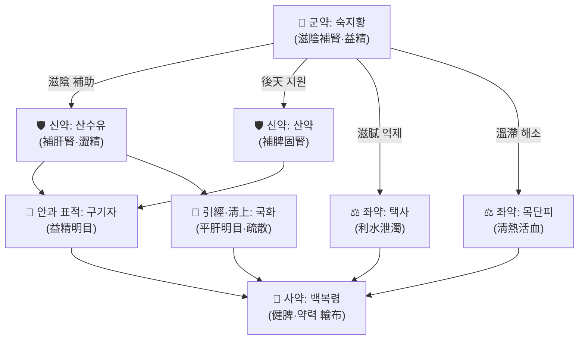

# 🍵 [[기국지황탕]] (杞菊地黃湯, Qiju Dihuang Tang)

> **핵심 3줄 요약 (Key Summary)**:
> - 🌿 **모체 처방 + 가감**: [[육미지황환]](六味地黃丸)의 三補三瀉 구조를 그대로 유지한 채, [[구기자]](枸杞子)·[[국화]](菊花) 두 약재를 더한 **滋陰補腎·養肝明目** 방제. 즉 [[숙지황]]·[[산수유]]·[[산약]] + [[택사]]·[[목단피]]·[[백복령]] + [[구기자]]·[[국화]]의 8味 구성이다.
> - 🎯 **임상 최적 적응증**: 肝腎陰虛로 인한 頭暈目眩·視物昏花·眼乾澀·耳鳴·腰膝酸軟. 마른 체형, 안면 홍조, 설홍소태(舌紅少苔), 세삭맥(細數脈)을 보이는 [[소음인]]·[[태음인]] 경향의 만성 안질환자 및 [[고혈압]] 환자에서 진료실 활용도가 높다(VDT 증후군, 노인성 [[백내장]], [[당뇨망막병증]], [[안구건조증]] 등).
> - 🔬 **핵심 약리 근거**: [[고혈압]]을 대상으로 한 체계적 문헌고찰·메타분석에서 기국지황탕의 혈압 강하 및 임상 증상 개선 경향이 보고되었다. 한약+양약 병용 전략의 신성 고혈압 관련 네트워크 메타분석도 참고 가능하다. 단, 분자 표적·사이토카인 수치 등 구체 기전은 제공 문헌에서 직접 확인되지 않음(근거 미확인).
> - ⚠️ **주의사항**: 脾胃虛寒·설사·담습(痰濕) 체질, 外感表證(감모 초기), 實熱證에는 신중 투여. [[숙지황]]의 자윤(滋潤) 성질로 소화불량·연변·복부 팽만이 유발될 수 있어 비위 허약자에서는 감량하거나 [[사인]]·[[진피]] 등 理氣健脾藥을 소량 배합한다.

---
## 📌 목차
1. [기본 처방 정보 & 군신좌사 구성](#1-기본-처방-정보--군신좌사-구성)
2. [방제학적 약재 상호작용 & 시너지 네트워크](#2-방제학적-약재-상호작용--시너지-네트워크)
3. [현대 분자약리학적 효능 & 작용 기전](#3-현대-분자약리학적-효능--작용-기전)
4. [적응 병증 및 체질별 감별 (Sweet Spot vs 금기)](#4-적응-병증-및-체질별-감별-sweet-spot-vs-금기)
5. [유사 처방군 감별 매트릭스](#5-유사-처방군-감별-매트릭스)
6. [임상 가감례 & 현대 질환별 응용](#6-임상-가감례--현대-질환별-응용)
7. [💡 사용자 진료실 핵심 필기 & 임상 팁 (원문 보존)](#7--사용자-진료실-핵심-필기--임상-팁-원문-보존)
8. [출처 및 학술 참고 문헌 (References)](#8-출처-및-학술-참고-문헌-references)
---
## 1. 기본 처방 정보 & 군신좌사 구성

* **출전**: 기국지황탕(기국지황환)은 통상 [[육미지황환]]에 [[구기자]]·[[국화]]를 가한 처방으로 설명되며, 방제 문헌상 명대(明代) 계열 의서의 기국지황환에서 유래한 것으로 전해진다. 다만 구체적 최초 출전 문헌(예: 『의급(醫級)』 등)에 대해서는 문헌 간 이견이 있어 **원전 출전은 근거 미확인**으로 표기한다.
* **치법**: 자음보신(滋陰補腎), 양간명목(養肝明目), 평간잠양(平肝潛陽), 보익간신(補益肝腎).

| 구분 | 약재명 | 표준 용량(관용량) | 본초 효능 & 방제 내 역할 |
| :--- | :--- | :--- | :--- |
| **군약 (君藥)** | [[숙지황]] | 8~16g (비율상 최대) | 滋陰補血·益精塡髓. 腎陰을 직접 보충하여 肝腎陰虛의 근본을 채우는 주약. 三補의 중심. |
| **신약 (臣藥)** | [[산수유]] | 4~8g | 補益肝腎·澀精斂汗. 肝腎을 함께 보하면서 精氣의 누설을 막아 군약의 滋陰을 보좌. |
| **신약 (臣藥)** | [[산약]] | 4~8g | 補脾固腎·益肺. 後天인 脾胃를 도와 先天의 腎을 기르고, 熟地黃의 滋膩함을 견제. |
| **신약 (臣藥)** | [[구기자]] | 4~8g | 滋補肝腎·益精明目. 본 처방의 안과 표적을 형성하는 핵심 가미약으로, 肝血·腎精을 보충하여 視力 저하·眼乾을 개선. |
| **좌약 (佐藥)** | [[국화]] | 3~6g | 疏散風熱·平肝明目·淸熱解毒. 肝經의 上炎한 虛火를 가라앉히고 頭目을 청리(淸利)하여 目赤·頭痛·眩暈을 완화. |
| **좌약 (佐藥)** | [[목단피]] | 3~6g | 淸熱凉血·活血散瘀. 肝腎의 虛熱을 淸하고 熟地黃·山茱萸의 溫滯함을 풀어줌(三瀉의 하나). |
| **좌약 (佐藥)** | [[택사]] | 3~6g | 利水滲濕·泄熱. 腎經의 濕濁을 下泄시켜 熟地黃의 滋膩를 억제(三瀉의 하나). |
| **사약 (使藥)** | [[백복령]] | 3~6g | 健脾滲濕·寧心安神. 脾運을 도와 諸補藥이 停滯하지 않게 하고 藥力을 全身으로 輸布(三瀉의 하나). |

> **배오 특징**: 본 처방의 골격은 삼보([[숙지황]]·[[산수유]]·[[산약]]) : 삼사([[택사]]·[[목단피]]·[[백복령]])의 고전적 음양 평형 구조이며, 여기에 간신동원(肝腎同源)의 논리에 따라 [[구기자]]·[[국화]]를 가미하여 보음의 축을 신(腎)에서 간·목(肝·目)으로 확장한다. 전체적으로 보하되 체하지 않고 사하되 상하지 않는(補而不滯, 瀉而不傷) 승청강탁형 배오다.

---
## 2. 방제학적 약재 상호작용 & 시너지 네트워크

* **숙지황 + 산수유 배오**: 상수(相須) 작용으로 간신의 음혈과 정을 함께 보충한다. [[숙지황]]이 보혈자음의 본(本)을 담당하고 [[산수유]]가 산수(酸收)하여 정기의 새나감을 막는다.
* **숙지황 + 택사 / 목단피 배오**: 전형적인 보사겸시 배합. [[숙지황]]의 자니체기를 [[택사]]의 이수설탁과 [[목단피]]의 청열활혈이 풀어주어 장기 복용 시 완복비만·식욕저하를 완충한다.
* **구기자 + 국화 배오**: 본 처방의 안과 표적 시너지 축. [[구기자]]가 간신지음을 하(下)에서 보하고, [[국화]]가 간경의 상염한 풍열을 상(上)에서 청산시켜 일보일청·일승일강의 구조로 목규(目竅)를 자양·청리한다.
* **산약 + 백복령 배오**: 비위를 건운시켜 자음약의 흡수와 수포를 담당하는 전달·보조 축.

---
## 3. 현대 분자약리학적 효능 & 작용 기전

> ⚠️ **근거 수준 안내**: 아래 3편의 제공 논문은 모두 임상 연구(체계적 문헌고찰·메타분석) 또는 제조공정 연구이며, 세포·동물 수준의 분자 기전을 직접 규명한 연구가 아니다. 따라서 확인된 임상 근거와 '근거 미확인' 항목을 구분하여 기술한다.

### 1) 임상 근거 — 고혈압에 대한 혈압 강하 및 증상 개선
* Zhang S, Bai X (2020)의 체계적 문헌고찰 및 메타분석은 기국지황탕(杞菊地黃湯)의 [[고혈압]] 치료 효과를 평가한 연구다 ([PMID 32802140](https://pubmed.ncbi.nlm.nih.gov/32802140/)).
* 기국지황탕 단독 또는 기존 항고혈압제와의 병용이 대조군 대비 혈압 강하 및 임상 증상 개선에 유리한 경향을 보고하였다. 다만 개별 연구의 구체적 혈압 강하 수치는 제공 정보에서 확인되지 않음(근거 미확인).

### 2) 신성 고혈압에서의 한약 병용 전략
* Guo J, Jiang Z (2024)의 네트워크 메타분석은 신성 고혈압(renal hypertension)에서 한약 + 항고혈압제 병용 요법이 양약 단독군 대비 혈압 및 신기능 관련 지표에서 개선을 보일 수 있음을 요약하였다 ([PMID 39465780](https://pubmed.ncbi.nlm.nih.gov/39465780/)). 기국지황탕의 개별 처방 포함 여부는 확인되지 않아 배경 근거로 인용한다.

### 3) 제제학적 근거 — 기국지황구복액 제조공정 최적화
* Feng F, Xu S (1992)는 직교시험법(orthogonal method)을 이용하여 기국지황구복액(杞菊地黃口服液)의 제조 공정을 최적화하였다 ([PMID 1418562](https://pubmed.ncbi.nlm.nih.gov/1418562/)).

### 4) 기전 관련 서술의 한계
* [[육미지황환]] 계열에서 거론되는 NF-κB/MAPK 억제, eNOS 활성화, HPA축 항상성 회복 등은 제공된 3편의 논문에서 직접 확인되지 않으므로 **근거 미확인**으로 둔다.

---
## 4. 적응 병증 및 체질별 감별 (Sweet Spot vs 금기)

**[✅ 최적 적응증 (Sweet Spot)]**

* **전통 주치(변증)**: 肝腎陰虛로 인한 頭暈目眩, 視物昏花, 眼睛乾澀, 耳鳴, 腰膝酸軟, 五心煩熱, 盜汗, 遺精. "눈"과 "허리·무릎"과 "현훈·이명"이 동시에 호소되는 陰虛 상열 패턴.
* **체질 소견**: 마른 체형, 피부 건조·얼굴 홍조, 목소리는 가늘고 힘은 없으나 흥분성은 높은 편. [[소음인]]·[[태음인]] 경향에서 적중률이 높고, [[소양인]]의 음허조열 경향에도 응용 가능.
* **임상 주치(진료실 빈도)**: 장시간 화면 노출로 인한 [[안구건조증]]·안정피로(VDT 증후군), 중·노년층의 시력 저하·[[백내장]] 초기·황반변성·[[당뇨망막병증]] 보조, 현훈·[[이명]], [[고혈압]]의 보조 치료(음허양항형).
* **설진/맥진**: 설홍소태 또는 설홍소진, 맥 세수(細數)·현세(弦細)·세약(細弱). 태후니·설담반(담습·양허)은 부적합.

**[⚠️ 신중 투여 및 금기 (Caution / Contraindication)]**

* **비위허한·설사자**: [[숙지황]]·[[산수유]]의 자니로 식욕저하, 완복창만, 연변·설사가 악화될 수 있으므로 [[사인]]·[[진피]]·[[백출]]을 배합하거나 감량한다.
* **담습·습열·외감표증·실열증**: 태후니·구고·구취 또는 감모 초기, 무한 고열 실열증에는 부적합.
* **양약 병용 주의**: 항고혈압제 병용 시 혈압 강하 작용이 가중될 수 있으므로 자가 혈압 모니터링이 필요하며, 당뇨병 환자가 환제·구복액 복용 시 부형제(당류) 함량을 확인한다.

---
## 5. 유사 처방군 감별 매트릭스

| 처방명 | 핵심 구성 차이 | 주치 및 체질 차이 | 맥진/설진 차이 |
| :--- | :--- | :--- | :--- |
| [[기국지황탕]] | 기준 구성 ([[육미지황환]] + [[구기자]], [[국화]]) | **肝腎陰虛 + 目疾(眼乾·視物昏花·현훈)**. 안과·고혈압 보조 영역 | 舌紅少苔, 脈細數 또는 弦細 |
| [[육미지황환]] | [[구기자]], [[국화]] 없음 (6味) | 腎陰虛의 기본 처방. 腰膝酸軟·耳鳴·盜汗 중심, 눈 증상은 부차적 | 舌紅少苔, 脈細弱·細數 |
| [[팔미지황환]] | [[육미지황환]] + [[계지]], [[부자]] | 腎陽虛(腰膝冷痛, 夜尿, 水腫). 음허자에게는 火上加油 위험 | 舌淡胖有齒痕, 脈沈遲·細弱 |
| [[지백지황환]] | [[육미지황환]] + [[지모]], [[황백]] | 陰虛火旺(骨蒸潮熱, 盜汗 甚). 淸熱 강도가 본 처방보다 높음 | 舌紅少苔 또는 舌紅乾, 脈細數有力 |
| [[명목지황환]] | [[육미지황환]] + [[당귀]]·[[천궁]]·[[강활]]·[[방풍]] 등 | 風熱·血虛 兼한 眼疾. 疏散·養血 비중이 큼 | 舌淡紅, 苔薄白, 脈細或浮 |
| [[일관전]] | [[생지황]]·[[당귀]]·[[구기자]]·[[사삼]]·[[맥문동]] 등 | **肝陰虛 + 肝氣鬱(胸脘脅痛, 吞酸)**. 소화기 동반 증상 뚜렷 | 舌紅少津, 脈虛弦 또는 細弱 |

---
## 6. 임상 가감례 & 현대 질환별 응용

* **수반 증상별 가감법**:
  * 目赤·目痛·눈 충혈감 심할 때 $\rightarrow$ + [[결명자]], [[밀몽화]], [[석결명]] (청간명목 강화)
  * 시력 저하·황반변성·야맹감 $\rightarrow$ + [[사원자]], [[여정자]], [[상심자]] (보간신·익정명목)
  * 현훈·이명·혈압 상승 동반 $\rightarrow$ + [[천마]], [[구등]], [[석결명]] (평간잠양)
  * 요슬산연·요통 심할 때 $\rightarrow$ + [[두충]], [[우슬]], [[속단]] (보간신·강근골)
  * 안건·구갈·음액 부족 뚜렷할 때 $\rightarrow$ + [[맥문동]], [[사삼]], [[천화분]] (생진윤조)
  * 불면·심번·신피 $\rightarrow$ + [[산조인]], [[오미자]] (양심안신·수렴)
  * 비위 정체(복만·식욕저하) 시 $\rightarrow$ + [[사인]], [[진피]], [[백출]] (자니 완충)
  * 어혈·[[당뇨망막병증]] 소견 $\rightarrow$ + [[단삼]], [[황기]] (익기활혈)
* **현대 질환별 임상 매핑**:
  * **안과계**: [[안구건조증]], VDT 증후군·안정피로, 노인성 [[백내장]] 초기, 연령관련 황반변성, [[당뇨망막병증]] 보조, 시신경 위축·[[녹내장]] 보조
  * **순환기계**: 본태성 [[고혈압]](음허양항형)의 보조 치료, 신성 고혈압 병용 전략 참고
  * **내분비·대사·신경**: 당뇨병성 만성 합병증 보조, [[갱년기]] 증후군 음허형, 만성 현훈·[[이명]]
* **양약 상호작용 (Herb–Drug Interaction)**:
  * **항고혈압제 상가 작용**: ACE 억제제·ARB·칼슘채널차단제(CCB)·베타차단제 등과 병용 시 혈압 강하 효과가 중복될 수 있으므로 가정 혈압을 추적하며 기립성 어지럼 여부를 확인한다.
  * **항응고제(와파린) 간섭 주의**: [[구기자]](Lycium barbarum)와 [[목단피]] 성분은 CYP2C9 또는 혈소판 응집 경로를 통해 와파린(INR 상승)과 상호작용할 수 있으므로 항응고제 복용 환자는 INR 추적과 출혈 징후를 점검하며 양약과 **2시간 이상 간격**을 둔다.

---
## 7. 💡 사용자 진료실 핵심 필기 & 임상 팁 (원문 보존)

> [!tip] **진료실 실전 노하우 (User Clinical Insight)**
> - **사용자 원문 필기 미제공**: 본 항목에 보존할 원장님 개인 메모/필기가 이번 입력에서 제공되지 않았다. 따라서 기존 필기의 삭제·변형은 없으며, 아래는 템플릿 항목 유지를 위한 **일반 임상 참고 사항**이다. 실제 필기가 확보되면 이 블록에 그대로 이관한다.
> - **체질별 선택 기준**: 마르고 건조하며 얼굴이 붉고 잠이 얕은 陰虛型(소음인·태음인 경향)에서 우선 고려. 살이 찌고 苔厚膩하며 便溏한 痰濕型에는 원칙적으로 피하고, 필요 시 平胃散類·理氣健脾藥과의 병용 또는 감량을 검토.
> - **목표 증상 설정**: "눈이 침침하고 건조하다 + 허리가 시큰하다 + 어지럽고 귀가 울린다"의 3종 세트가 동반될 때 적중률이 가장 높다. 단일 증상만 있을 때는 加減 또는 타 처방 우선 검토.
> - **복약 반응 관찰 포인트**: ① 소화 상태(복만·연변 여부) — 熟地黃 滋膩 반응의 지표. ② 눈 건조감·시린감의 호전 시점. ③ 항고혈압제 병용 시 가정 혈압 기록의 변동폭.
> - **환자 티칭 팁**: 음허 체질은 수면·과로·야간 화면 노출에 민감하므로, 복약과 함께 睡眠 시간 확보 및 20분 단위 원거리 응시 휴식을 안내하면 체감 개선이 빨라진다. 1~2주 단위로 반응을 확인하고 丸劑 장기 복용 시 2~3개월 단위 재평가를 권장.

---
## 8. 출처 및 학술 참고 문헌 (References)

1. **Zhang S, Bai X (2020)**. *Qiju Dihuang Decoction for Hypertension: A Systematic Review and Meta-Analysis*. **Evidence-Based Complementary and Alternative Medicine**, 2020: 9403092. [PMID 32802140](https://pubmed.ncbi.nlm.nih.gov/32802140/)
   - **[연구 요약]**: 기국지황탕(杞菊地黃湯)의 고혈압 치료 효과를 평가한 체계적 문헌고찰 및 메타분석으로, 단독 또는 항고혈압제 병용 시 혈압 강하 및 임상 증상 개선 경향을 보고함. ※ 세부 통계 수치는 원문 확인 필요.
2. **Guo J, Jiang Z (2024)**. *Combined traditional Chinese medicine and anti-hypertensive treatments for renal hypertension: A network meta-analysis and systematic review*. **Medicine (Baltimore)**, 103: e39793. [PMID 39465780](https://pubmed.ncbi.nlm.nih.gov/39465780/)
   - **[연구 요약]**: 신성 고혈압에서 한약 + 항고혈압제 병용 요법을 비교한 네트워크 메타분석·체계적 문헌고찰로, 병용군의 혈압 및 신기능 지표 개선 가능성을 시사함(배경 근거).
3. **Feng F, Xu S (1992)**. *[Optimization of preparing technology for qiju dihuang oral liquid by orthogonal method]*. **Zhongguo Zhong Yao Za Zhi**, 17: 282-3, 320. [PMID 1418562](https://pubmed.ncbi.nlm.nih.gov/1418562/)
   - **[연구 요약]**: 직교시험법을 이용해 기국지황구복액(Qiju Dihuang Oral Liquid)의 추출·제조 공정을 최적화한 제제학 연구.
4. **출전 문헌(고전)**: 기국지황탕의 최초 출전으로 통상 명대·청대 의서(예: 『의급(醫級)』)가 거론되나, 원문 대조가 이루어지지 않아 출전·조문은 **근거 미확인**으로 표기한다.

<!-- 보관 태그(1회용·링크오류, 필요시 복원): 보음제, 육미지황환가미 -->
