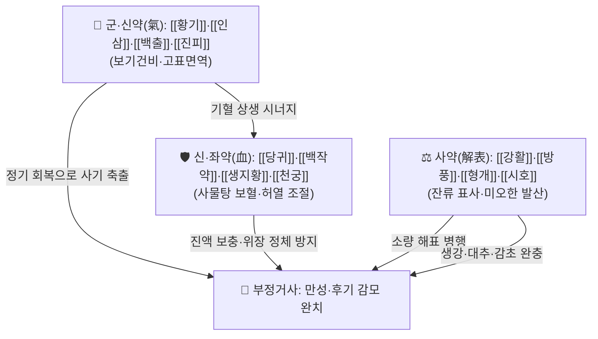

# 🍵 [[도씨보익탕]] (陶氏補益湯, Dossi Boik-tang)

> **핵심 3줄 요약 (Key Summary)**:
> - 🌿 모체/기원 처방 + 가감 핵심 약재 배오 구조: [[보중익기탕]]에서 [[승마]]를 빼고 [[사물탕]]과 외감 해표약([[강활]]·[[방풍]]·[[형개]])·[[생강]]·[[대추]]를 결합한 15味 부정거사(扶正祛邪)형 감기 처방.
> - 🎯 임상 최적 적응증: 감기가 일주일~열흘 이상 낫지 않고 심신이 쇠약해진 만성·후기 감기 환자 중 특히 마르고 식욕이 없으며 기력이 떨어진 노동형·허약 체질 환자.
> - 🔬 핵심 분자약리 기전: [[황기]]·[[인삼]]·[[백출]]의 상기도 점막 sIgA·대식세포·선천면역 증강 기전과 [[당귀]]·[[작약]]의 말초 혈류 회복, [[시호]]·[[강활]]의 잔류 저등급 염증 해소 작용이 병행된다.
> - ⚠️ 주의사항: 39~40℃ 이상의 급성 고열·폐렴 등 실열(實熱) 상태나 비만하고 습담이 많은 체형([[사물탕]] 지루함 부적합)에는 피하며, [[인삼]]·[[감초]] 함유로 고혈압·저칼륨혈증 및 열성 체질에서의 상열감 여부를 확인한다.

---

## 📌 목차
1. [기본 처방 정보 & 군신좌사 구성](#1-기본-처방-정보--군신좌사-구성)
2. [방제학적 약재 상호작용 & 시너지 네트워크](#2-방제학적-약재-상호작용--시너지-네트워크)
3. [현대 분자약리학적 효능 & 작용 기전](#3-현대-분자약리학적-효능--작용-기전)
4. [적응 병증 및 체질별 감별 (Sweet Spot vs 금기)](#4-적응-병증-및-체질별-감별-sweet-spot-vs-금기)
5. [유사 처방군 감별 매트릭스](#5-유사-처방군-감별-매트릭스)
6. [임상 가감례 & 현대 질환별 응용](#6-임상-가감례--현대-질환별-응용)
7. [💡 사용자 진료실 핵심 필기 & 임상 팁 (원문 보존)](#7--사용자-진료실-핵심-필기--임상-팁-원문-보존)
8. [출처 및 학술 참고 문헌 (References)](#8-출처-및-학술-참고-문헌-references)

---

## 1. 기본 처방 정보 & 군신좌사 구성

* **출전**: 명대 도화(陶華, 陶節庵) 계통 원방을 청강 김영훈(金永勳)이 『청강의감(晴崗醫鑑)』 일반감모(一般感冒) 편 후기·허약 감모 처방으로 집대성
* **치법**: 부정거사(扶正祛邪) · 익기보혈(益氣補血) · 조화영위(調和營衛) · 완산잔사(緩散殘邪)
* **구성 배경**: [[보중익기탕]](거 [[승마]]) + [[사물탕]]([[생지황]]·[[백작약]]·[[당귀]]·[[천궁]]) + [[강활]]·[[방풍]]·[[형개]]·[[생강]]·[[대추]] 15味 구성.

| 구분 | 약재명 | 표준 용량 | 본초 효능 & 방제 내 역할 |
| :--- | :--- | :--- | :--- |
| **군약 (君藥)** | [[황기]] | 6~8g | 보기승양·고표지한. 떨어진 면역 방어력(衛氣)을 끌어올리고 허한(虛汗)을 멎게 한다. |
| **군약 (君藥)** | [[인삼]] | 4g | 대보원기·생진익폐. 만성 피로와 식욕부진을 회복시켜 정기로 사기를 몰아낸다. |
| **신약 (臣藥)** | [[백출]] | 4g | 건비익기·조습. 비위 소화흡수력을 살려 영양 대사와 후기 회복을 뒷받침한다. |
| **신약 (臣藥)** | [[당귀]] | 4g | 보혈활혈. 혈허로 인한 어지럼·무력감과 말초 순환 저하를 개선한다. |
| **신약 (臣藥)** | [[백작약]] | 4g | 양혈렴음·완급지통. 허한으로 땀이 새는 것을 막고 근육 긴장을 푼다. |
| **좌약 (佐藥)** | [[생지황]] | 4g | 자음양혈·청허열. 장기 감기로 마른 음액과 미열(허열)을 식혀 보약 편중을 막는다. |
| **좌약 (佐藥)** | [[천궁]] | 3~4g | 행기활혈·지통. 사물탕의 보혈 성분이 정체되지 않도록 기혈 순환을 돕는다. |
| **좌약 (佐藥)** | [[진피]] | 3~4g | 이기건비·화담. 보기보혈 약재가 위장에 얹혀 답답해지는(滯氣) 부작용을 예방한다. |
| **좌약 (佐藥)** | [[시호]] | 3~4g | 소산반표·퇴열. 오래 남아 있는 미오한 왕래와 잔여 열감을 정리한다. |
| **사약 (使藥)** | [[강활]]·[[방풍]]·[[형개]] | 각 2~3g | 거풍해표. 표부에 남아 으슬으슬하고 뻐근한 감기 잔사(殘邪)를 밖으로 내보낸다. |
| **사약 (使藥)** | [[생강]]·[[대추]]·[[감초]] | 각 3g | 조화영위·화중익위. 영혈과 위기를 조화시키고 15미 약성을 안정화한다. |

> **배오 특징**: 본방의 가장 결정적인 방제학적 장치는 [[보중익기탕]]에서 [[승마]]를 뺀 것이다. 『청강의감』 임상 해설에 따르면 [[승마]]는 골반저 및 복부 장기를 끌어올려 복압을 높이는 성질이 있어, 이미 기침이 잦아 복압이 상승한 감기 환자에게 [[승마]]를 쓰면 옆구리·하복부 통증과 기침 발작이 악화되기 쉽다. 따라서 [[승마]]를 덜어내는 대신 [[사물탕]]으로 혈허를 보강하고 [[강활]]·[[방풍]]·[[형개]]로 잔여 표사만 가볍게 열어주는 **"기혈쌍보 + 소량 해표"** 구성을 취한다.

---

## 2. 방제학적 약재 상호작용 & 시너지 네트워크

* [[황기]]·[[인삼]]·[[백출]] + [[강활]]·[[방풍]]·[[형개]] 배오 (扶正祛邪): 정기가 허해진 상태에서 강한 해표제([[마황]]·과량 [[형방청해산]])를 쓰면 땀만 새고 병이 길어집니다. 보기약으로 衛氣를 채우면서 소량의 거풍해표약을 얹어 정기를 해치지 않고 남은 사기를 밀어냅니다.
* [[보중익기탕]](거 승마) + [[사물탕]] 배오: 기허(식욕부진·무기력)와 혈허(건조·미열·마른 체형)를 동시에 채우며, [[생지황]]이 [[인삼]]·[[황기]]의 온조한 편향을 누그러뜨리고 [[진피]]가 [[사물탕]]의 소화 장애를 완충합니다.
* [[생강]] + [[대추]] + [[백작약]] 배오: [[계지탕]] 류의 영위조화 구조를 일부 공유해, 식은땀·자한(自汗)과 오한이 번갈아 오는 자율신경 실조 양상을 안정화합니다.

---

## 3. 현대 분자약리학적 효능 & 작용 기전

> ⚠️ **도씨보익탕 처방 자체에 대한 직접 PubMed 실험·임상 논문은 현재 확인되지 않아**(근거 미확인), 핵심 모체 처방([[보중익기탕]]·[[사물탕]]) 및 구성 본초의 일반 약리 기전을 중심으로 서술합니다.

### 1) 상기도 점막 면역(sIgA) 및 선천면역 세포 활성 회복
* [[황기]]의 아스트라갈로사이드 IV(Astragaloside IV)·다당체(APS)와 [[인삼]]의 [[진세노사이드]]는 만성 스트레스·수면 부족·과로로 저하된 T림프구 증식, NK세포 세포독성, 호흡기 점막 분비형 IgA(sIgA) 생성을 촉진해 반복적인 상기도 바이러스 재감염을 억제하는 방향으로 작용합니다.

### 2) 비위 에너지 대사 및 근피로 회복
* [[백출]]의 아트락틸레놀라이드와 [[인삼]]·[[감초]] 복합 배합은 위장관 융모 미세순환과 소화효소 분비를 회복시켜 만성 질환 회복기의 식욕부진·영양 결핍을 교정하고, 말초 근육의 미토콘드리아 ATP 생성을 도와 곤권(무기력)을 완화합니다.

### 3) 저등급 잔류 염증 억제 및 혈행 개선
* [[시호]]·[[강활]]·[[천궁]]과 [[당귀]]·[[백작약]]의 페룰산·페오니플로린 조합은 회복기 이후에도 남아 있는 경도의 근막 염증과 말초 혈관 수축을 완화해 감기 후유 잔기침과 전신 뻐근함을 해소합니다.

---

## 4. 적응 병증 및 체질별 감별 (Sweet Spot vs 금기)

### [✅ 최적 적응증 (Sweet Spot)]
* **감기 타임라인 (청강의감 기준)**: 발병 **일주일~열흘 이상** 낫지 않고 골골대며 끄는 만성·후기 감기, 또는 환절기마다 [[감기]]·[[비염]]을 달고 사는 환자.
* **체질 및 체형 (핵심 선별 기준)**:
  * **마르고 비실비실하며, 입맛도 없고 기운도 없는데 생업(택배·현장직·육아 등) 때문에 쉬지 못하고 일해야 하는 사람**.
  * 기력이 쇠퇴해 미열과 으슬으슬한 오한이 왕래하며, 허한(虛汗)·곤권(피로 무기력)을 동반한 허약자.
* **증상 감별**: 식욕부진·무기력 축이 두드러지면 도씨보익탕([[보중익기탕]] 감기방), 추위를 많이 타고 방사·과로 후 컨디션이 뚝 떨어진 축이면 [[가미화정음]]([[쌍화탕]]+[[백출]])을 선택합니다.
* **맥진/설진**: 맥 허약(虛弱)·세약(細弱) 또는 허삭(虛數), 설질 담백(淡白)하거나 경미한 치흔·설태 박백.

### [⚠️ 신중 투여 및 금기 (Caution / Contraindication)]
* **급성 고열·폐렴·실열증 금기**: 39~40℃에 육박하는 고열이나 급성 세균성 폐렴·중이염·편도 농양 같은 실열 국면에서는 본방 같은 보익제를 투여하지 않고 [[형방청해산]]이나 양방 항생제·영상 검사 의뢰를 우선합니다.
* **비만·담습 체질 주의**: 『청강의감』 기준 마르지 않고 체격이 비대하며 습담이 많은 사람에게는 [[사물탕]]([[생지황]]·[[당귀]]) 배합이 속을 더부룩하게 하거나 설사를 부를 수 있어 부적합합니다.
* **인삼·감초 주의군**: 조절되지 않는 고혈압, 열성·[[소양인]] 중 상열감이 강한 환자, 저칼륨혈증 위험군에서는 [[인삼]]·[[감초]] 용량을 조절하거나 투여 기간을 점검합니다.

---

## 5. 유사 처방군 감별 매트릭스

| 처방명 | 핵심 구성 차이 | 주치 및 체질 차이 | 맥진/설진 차이 |
| :--- | :--- | :--- | :--- |
| [[도씨보익탕]] | [[보중익기탕]](거 [[승마]]) + [[사물탕]] + [[강활]]·[[방풍]]·[[형개]] | **감기 후기(1주일 이상)** 마르고 식욕부진·무기력·미오한 왕래. 노동형 허약자 | 맥 허약·세약, 설담 치흔 |
| [[가미화정음]] | [[쌍화탕]] + [[백출]] (해표약 없음) | 과로·추위 타는 컨디션 저하형 후기 감기, 몸이 권하고 자한 | 맥 침약·지, 설담태백 |
| [[보중익기탕]] | [[황기]]·[[인삼]]·[[백출]]·[[승마]]·[[시호]] 등 8미 | 감기 표사가 없는 순수 **중기하함(위하수·탈장·만성피로)** | 맥 허대 무력, 설담윤 |
| [[형방청해산]] | [[시호]]·[[형개]]·[[방풍]]·[[박하]] 등 13미 (인삼 없음) | **감기 중기(2~3일 이후)** 고열·전신 몸살·인후통·열성 체질 | 맥 유력·부삭, 설홍 태박황 |
| [[가미보정산]] | [[향갈탕]] 변방 12미 | **감기 초기(1~2일)** 으슬으슬한 오한·신체통·기분 다운 | 맥 부긴, 설태 박백 |

---

## 6. 임상 가감례 & 현대 질환별 응용

### 1) 변증 가감법
* **해수·잔기침이 오래 남을 때**: [[승마]] 대신 [[행인]], [[오미자]], [[맥문동]]을 가미해 진해렴폐(鎭咳斂肺)를 돕습니다.
* **소화 불량·더부룩함이 겹칠 때**: [[사물탕]] 비중(특히 [[생지황]])을 절반으로 줄이고 [[산사]], [[맥아]], [[사인]]을 가미해 비위 부담을 낮춥니다.
* **허한·식은땀이 심할 때**: [[황기]]를 증량하고 [[모려]], [[부소맥]]을 가미해 고표지한력을 강화합니다.

### 2) 현대 질환별 매핑
* **감기 후유증·아급성 상기도염([[감기]]·[[만성 기침]]·[[알레르기 비염]])**: 급성 발열기가 끝난 뒤에도 2~4주 이상 기운이 회복되지 않고 잔기침·콧물이 이어지는 회복기 환자에게 2주~1개월 단위 면역 보강으로 적용.
* **만성 피로·근골격 통증 병발 환자**: 과로성 요통·어깨통증 환자가 감기 후유로 컨디션이 무너진 경우 침·약침과 병행 투여.

### 양약 상호작용 (Herb–Drug Interaction)
* **항고혈압제·강심배당체([[디곡신]])·이뇨제**: [[감초]]의 [[글리시리진]]과 [[인삼]] 배합이 장기 복용 시 혈압 상승이나 저칼륨혈증 위험에 간섭할 수 있어 심혈관 약물 복용 환자는 혈압·전해질 상태를 확인합니다.
* **항혈소판제·항응고제([[아스피린]]·[[와파린]])**: [[당귀]], [[천궁]], [[인삼]]은 항응고제 약효 변동(출혈 위험 또는 INR 변화)에 간섭 보고가 있으므로 [[와파린]] 복용 환자는 병용을 신중히 하거나 모니터링합니다.
* **면역억제제·경구 혈당강하제([[메트포르민]] 등)**: [[황기]]·[[인삼]]의 면역 활성 및 혈당 변동 가능성을 고려해 자가면역질환 면역억제제 복용 환자에게는 투여를 피하고, 당뇨약 복용 시 혈당 추이를 확인합니다.

---

## 7. 💡 사용자 진료실 핵심 필기 & 임상 팁 (원문 보존)

> [!tip] **진료실 실전 노하우 (User Clinical Insight)**
> - **청강의감 1 강의록 원문 보존 (만성·후기 감기 운용)**:
>   - **도씨보익탕 = 보중익기탕 감기방 ([[승마]] 제거가 핵심)**: [[승마]]는 골반저를 조여 복압을 높이는 약이므로, 이미 기침으로 복압이 올라간 감기 환자에게 쓰면 배·옆구리가 아프고 기침이 심해진다. 청강 선생님이 [[보중익기탕]]에서 [[승마]]를 빼고 [[사물탕]]·해표약을 결합한 것이 임상적 신의 한 수.
>   - **도씨보익탕 vs [[가미화정음]] 선택 기준**:
>     - **도씨보익탕**: 마르고 비실비실하며 **식욕부진 + 무기력**이 주증인 노동형(일해야 하는) 환자. 단, 뚱뚱한 체형에는 [[사물탕]]이 맞지 않는다.
>     - [[가미화정음]]: 평소 추위를 많이 타고 과로·방사 후 컨디션이 뚝 떨어진 경우([[쌍화탕]]+[[백출]]).
>   - **상담 프레임**: 환절기마다 감기를 달고 살거나 코로나·독감 후유증으로 체력이 빠진 근골격 환자 에게 2주(후유증) ~ 1개월(체질 개선) 단위로 제안하면 순응도와 만족도가 높다.

---

## 8. 출처 및 학술 참고 문헌 (References)

1. 김영훈 (晴岡 金永勳). 『청강의감(晴崗醫鑑)』 일반감모(一般感冒) 편.
   - **[임상 원전]**: 감기 후기·만성 허약 감모에 [[보중익기탕]](거 [[승마]])·[[사물탕]]·해표약을 결합한 도씨보익탕 15미 구성과 적응증 수록.
2. 전국한의과대학 방제학교수 공편. 『방제학』 보익제 편. 영림사.
   - **[임상 문헌]**: [[보중익기탕]]·[[사물탕]] 배합의 익기보혈·조화영위 방제학적 원리 해설.
3. Simbio 볼트 강의록 정본. [일반감기_가미보정산·형방청해산·도씨보익탕·가미화정음(청강의감 1)](file:///C:/Simbio/_지식/강의/2.%20한의%20임상%20및%20진단학%20(부인과·내과)/일반감기_가미보정산·형방청해산·도씨보익탕·가미화정음(청강의감%201).md).
   - **[강의 정리]**: 도씨보익탕에서 승마를 제외한 임상 기전, 체형별(마름 vs 비만) 감별, 가미화정음과의 선택 기준 수록.
