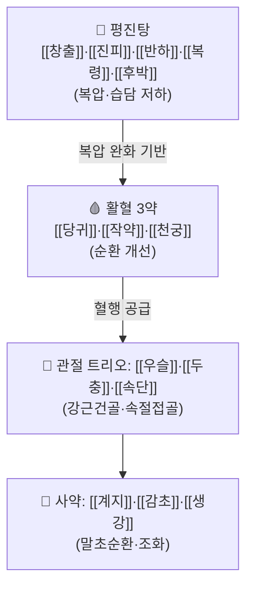

# 🍵 [[두속오화음]] (杜續五和飮, Dusok-ohwaeum)

> **핵심 3줄 요약 (Key Summary)**:
> - 🌿 [[오적산]]과 동일한 뼈대([[평위산]]+[[이진탕]]=[[평진탕]] + 사물탕 일부 + [[계지탕]] 일부)에 **[[우슬]]·[[두충]]·[[속단]]** 관절 트리오를 얹은 요통 기본방으로, 처방명(杜=두충, 續=속단)도 이 트리오에서 유래한다.
> - 🎯 야식·과음·고량후미(기름진 음식)로 복압이 높고 디스크·협착증·퇴행성 관절염 등 **뼈·인대 조직 문제**가 있는 중장년 실증형 요통·하지통의 메인 처방이다.
> - 🔬 평진탕으로 복압·습담을 낮추고, 당귀·천궁·작약으로 혈행을 개선하며, 우슬·두충·속단이 결합조직(인대·건·연골) 재생을 돕는 복합 기전이다.
> - ⚠️ 주의사항: 마르고 손발이 차며 소화력이 약한 허증 노인·여성에게는 평진탕이 부담스러워 [[여신양영전]]으로 대체하는 것이 더 적합하다.

---
## 📌 목차
1. [기본 처방 정보 & 군신좌사 구성](#1-기본-처방-정보--군신좌사-구성)
2. [방제학적 약재 상호작용 & 시너지 네트워크](#2-방제학적-약재-상호작용--시너지-네트워크)
3. [현대 분자약리학적 효능 & 작용 기전](#3-현대-분자약리학적-효능--작용-기전)
4. [적응 병증 및 체질별 감별 (Sweet Spot vs 금기)](#4-적응-병증-및-체질별-감별-sweet-spot-vs-금기)
5. [유사 처방군 감별 매트릭스](#5-유사-처방군-감별-매트릭스)
6. [임상 가감례 & 현대 질환별 응용](#6-임상-가감례--현대-질환별-응용)
7. [💡 사용자 진료실 핵심 필기 & 임상 팁 (원문 보존)](#7--사용자-진료실-핵심-필기--임상-팁-원문-보존)
8. [출처 및 학술 참고 문헌 (References)](#8-출처-및-학술-참고-문헌-references)
---
## 1. 기본 처방 정보 & 군신좌사 구성

* **출전**: 청강의감 처방 스터디 27회차(흉협통·요통·하지통 동통 처방) — 요통 기본방으로 제시
* **치법**: 거습화담(祛濕化痰) + 활혈행기(活血行氣) + 강근건골(强筋健骨) — 복압을 낮추고 혈을 돌리며 뼈·인대를 강화한다

> 🖼️ 이미지는 첨부 폴더에 확보분이 없어 생략합니다(.agents\rules\이미지_가이드.md §3.3 — 확보 실패 시 억지로 채우지 않음). 강의 PPT 원본에는 "두속오화음 적응 중장년 환자" 삽화가 있으나 저작권 확인 전 미첨부.

| 구분 | 약재명 | 표준 용량(참고) | 본초 효능 & 방제 내 역할 |
| :--- | :--- | :--- | :--- |
| **군약 (君藥)** | [[우슬]], [[두충]], [[속단]] | 각 6~9g | 강근건골·속절접골(續折接骨) — 처방명(杜續)의 유래이자 인대·건·연골 등 결합조직 손상에 대응하는 핵심 트리오 |
| **신약 (臣藥)** | [[당귀]], [[작약]], [[천궁]] | 사물탕 중 혈행 3약 | 활혈화어(活血化瘀) — 숙지황을 제외한 사물탕으로, 혈액을 맑게 하고 순환을 개선 |
| **좌약 (佐藥)** | [[창출]], [[진피]], [[반하]], [[복령]], [[후박]] | [[평위산]]+[[이진탕]]=[[평진탕]] 표준량 | 거습화담·행기소창(行氣消脹) — 복압을 낮추고 담음을 풀어 디스크·관절에 걸리는 부하를 줄임 |
| **사약 (使藥)** | [[계지]], [[감초]], [[생강]] | 각 2~4g | 계지탕 골격의 잔류분으로 말초 순환을 돕고 조화제약(조문 원문에 대조는 명시되지 않음) |

> **배오 특징**: [[오적산]](평위산+이진탕+사물탕+계지탕+마황·지각·길경·백지)과 "쌍둥이 구조"이며, 오적산이 요방형근·척추기립근 같은 **근육**(체중 부하근)을 겨냥한다면, 두속오화음은 우슬·두충·속단을 더해 **뼈·디스크·관절**로 벡터를 바꾼 처방이다. 임상에서는 "오적산합두속오화음"처럼 교차 운용도 가능하다.
---
## 2. 방제학적 약재 상호작용 & 시너지 네트워크

* [[우슬]] + [[두충]] + [[속단]] 배오: 관절·인대·건 등 결합조직 손상에 "생각하지 말고 셋 중 하나를 넣는다"는 강의자의 표현대로, 상호 상승(相須)하여 강근건골 작용을 증폭한다.
* [[창출]] + [[후박]] + [[진피]] 배오([[평위산]]): 비위 기체(氣滯)를 풀어 복압을 낮추는 것이 요통·하지통 치료의 전제 조건이 된다.
* [[당귀]] + [[천궁]] + [[작약]] 배오: 사물탕에서 숙지황을 제외해 자윤성을 줄이고 활혈 작용에 집중시킨 구조로, 습담이 많은 실증 환자에 적합하다.
---
## 3. 현대 분자약리학적 효능 & 작용 기전

### 1) 우슬·두충·속단 — 결합조직 재생 및 항염
* 우슬(Achyranthes bidentata)·두충(Eucommia ulmoides)·속단(Dipsacus asper)은 전통적으로 "속절접골(續折接骨, 끊어지고 부러진 것을 이어준다)"의 효능으로 묶이는 본초로, 연골·인대 등 결합조직 보호 및 항염 작용이 다수 보고되어 있다. 강의에서는 퇴행성 관절염·류마티스 관절염·인대 염좌·회전근개 파열 등 뼈·연골·인대 문제 전반에 범용으로 적용한다고 설명한다.
* 진품 속단은 산토끼꽃과(川續斷, 중국속단)이며, 한국산 속단(꿀풀과)은 기원 식물이 다른 대체재라는 점이 본초강목 수준에서 구분된다(원외탕전 대부분은 천속단 사용).

### 2) 평진탕(평위산+이진탕) — 복압·장관 가스 조절
* 창출·후박·진피 계열의 방향성 정유 성분은 위장관 평활근 운동 조절 및 가스 배출 촉진 작용이 보고되어 있어, "복압을 낮춘다"는 강의의 설명과 약리적으로 부합한다. 반하·복령은 담음(체액 정체) 배출을 돕는다.

### 3) 당귀·천궁 — 미세순환 개선
* 당귀의 리구스틸라이드, 천궁의 테트라메틸피라진(ligustrazine)은 항혈소판·혈관이완 작용이 널리 보고되어 디스크·관절 주변 미세순환 개선의 기전적 기반이 된다.

> ⚠️ 위 기전은 개별 본초의 일반 약리 보고를 근거로 하며, **두속오화음 전방(全方)에 대한 임상시험 문헌은 확인되지 않았다**. 추가 문헌 확보 시 보강이 필요하다.
---
## 4. 적응 병증 및 체질별 감별 (Sweet Spot vs 금기)

[✅ 최적 적응증 (Sweet Spot)]
* 핵심 주치: 야식·음주·고량후미로 인한 실증형 요통·하지통, 디스크(추간판탈출증)·척추관협착증·퇴행성 관절염 등 **뼈·인대 조직 문제**
* 체질 소견: 복압이 높고(배가 빵빵하거나 팽만), 소화력은 양호한 중장년층(남녀 불문)
* 환자 베이스: 저녁 식사가 불규칙하고 야식·음주가 잦으며 체중 관리가 안 된 경우 — 식이·생활 관리 병행이 치료의 핵심

[⚠️ 신중 투여 및 금기 (Caution / Contraindication)]
* 마르고 손발이 차며 소화력이 약한 허증 환자 — 평진탕이 부담될 수 있어 [[여신양영전]](평진탕 제외, 사물탕+계지탕+관절 트리오)으로 대체
* 혈압·당뇨 등 기저질환 약을 다수 복용하며 음허 소견(허열·야간발한)이 뚜렷한 노인 — [[청아지황탕]](육미+관절 가감) 쪽이 더 적합
* 평위산 계열 방향성 약재가 많아 임신부·심한 기허(氣虛) 환자에서는 신중 투여
---
## 5. 유사 처방군 감별 매트릭스

| 처방명 | 핵심 구성 차이 | 주치 및 체질 차이 | 비고 |
| :--- | :--- | :--- | :--- |
| **[[두속오화음]]** | 평진탕 + 사물탕(일부) + 계지탕(일부) + 우슬·두충·속단 | 잘 먹는 실증형, 복압 높은 중장년 요통·하지통 | 요통 기본방 |
| [[오적산]] | 평위산+이진탕+사물탕+계지탕+마황·지각·길경·백지 | 요방형근·척추기립근 등 체중부하 **근육통** | 두속오화음과 쌍둥이 구조(벡터만 근육↔관절로 다름) |
| [[여신양영전]] | 사물탕+계지탕+우슬·두충·속단+현호색(평진탕 제외) | 손발 차고 마른 허약형 노인·여성 관절병, 진통 강화(현호색) | 두속오화음의 "허약형" 버전 |
| [[청아지황탕]] | 육미지황탕+두충·보골지·오미자·호두 | 음허(육미증)+관절증 동반 노인, 양약 다수 복용자 | 자신(滋腎) 중심, 두속오화음과 골격이 다름 |
---
## 6. 임상 가감례 & 현대 질환별 응용

* **수반 증상별 가감법**:
  * 근육 부하(요방형근·척추기립근) 통증이 더 두드러질 때 → "오적산합두속오화음" 형태로 [[마황]]·[[지각]]·[[길경]]·[[백지]] 추가 운용
  * 통증이 심할 때 → + [[현호색]] (여신양영전의 진통 가감 참고)
  * 허약 소견으로 전환 시 → 평진탕을 빼고 [[여신양영전]]으로 전방 교체
* **현대 질환별 임상 매핑**:
  * **근골격계**: 요추간판탈출증, 척추관협착증, 퇴행성 관절염, 좌골신경통, 각기병(하지 부종·통증)
  * **생활습관 연계**: 복부비만·야식증후군 동반 요통 — 체중 감량이 곧 치료 효과로 이어짐(비만·태음인 처방 병용 가능)

* **양약 상호작용 (Herb–Drug Interaction)**:
  * 당귀·천궁의 항혈소판 작용 — 항응고제(와파린·아스피린·DOAC) 병용 시 출혈 위험 증가 가능, 복용 시점 분리 권고
  * 속단·우슬 등은 알려진 주요 CYP 간섭 보고가 제한적이나, NSAIDs·근육이완제와 병용 시 진통 효과는 상가적일 수 있음
---
## 7. 💡 사용자 진료실 핵심 필기 & 임상 팁 (원문 보존)

> [!tip] 강의 핵심 노트 (청강의감 처방 스터디 27회차)
> - 통증약을 쓸 때는 "무조건 복압을 봐라. 배가 빵빵한지, 물살인지, 긴장도가 높은지"를 먼저 본다.
> - 야식·술·고량후미로 혈액이 맑지 못하고 순환이 나빠지며 복부 압력이 걸려 디스크가 좁아지는 사람이 두속오화음의 타깃이다. 밥을 잘 챙겨 먹고 생활 관리가 되는 마른 사람에게는 잘 맞지 않는다.
> - 식이 관리 자체가 치료다 — 야식·치킨·술을 끊고 저녁밥을 규칙적으로 먹이는 것만으로 허리가 좋아질 수 있다.
> - 관절에는 "생각하지 말고" 우슬·두충·속단 중 편한 것 하나를 넣는다는 것이 강의자의 실전 원칙이다.
> - 손상이 있다고 반드시 아픈 것은 아니며, 통증 처방은 환자의 베이스(복압·소화·혈액·체온)부터 맞춰야 한다는 것이 동통 처방 전체의 메시지다.
---
## 8. 출처 및 학술 참고 문헌 (References)

1. **청강의감 처방 스터디 27회차** (흉협통·요통·하지통_동통 처방, 2026-09-08 정리).
   - **[임상 강의 자료]**: 처방 구성·군신좌사 해석, 오적산과의 쌍둥이 구조 설명, 임상 적응증의 1차 출처. [[흉협통·요통·하지통_동통 처방(청강의감 27)]]
2. 허준 (1613). 『동의보감』 — 요통·관절통 변증 및 속단·두충·우슬의 전통 효능 관련 원문(참고, 본 처방 자체의 수록 여부는 미확인).
