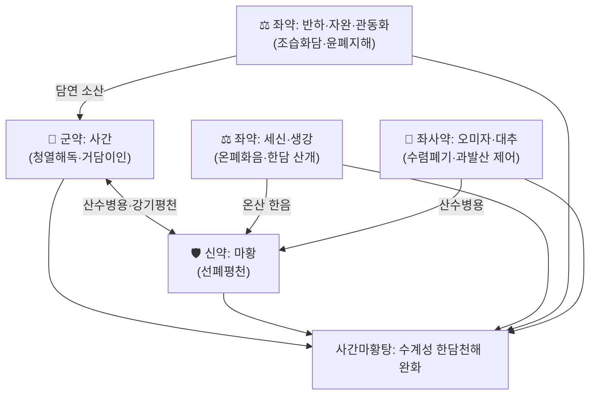

# 💊 사간마황탕 (射干麻黃湯)

> **핵심 3줄 요약 (Key Summary)**:
> - 🌿 [[사간]]·[[마황]]·[[세신]]·[[생강]]·[[반하]]·[[오미자]]·[[자완]]·[[관동화]]·[[대추]] 9미로 구성된 한담천해(寒痰喘咳) 대표 처방. 금궤요략 수록.
> - 🎯 목구멍에서 가래 끓는 소리(水鷄聲)가 나는 한담옹폐(寒痰壅肺) [[천식]]·[[해수]], 흉민, 묽고 흰 가래, 오한 등 한상(寒象). 기침 변이형 [[천식]]·만성 [[기관지염]] 등에 변증 활용.
> - 🔬 기도평활근 증식·세포자멸사 조절(TAS2R10 경로), Th2/Th17 하향조절·Treg 상향조절을 통한 기도과민성 개선 관련 현대 약리 연구가 보고됨.
> - ⚠️ 주의사항: 마황·세신 등 발산력이 강한 약재가 군신을 이루므로 다한(多汗)·심계항진 경향 환자, [[고혈압]] 환자는 신중 투여.

---

## 📌 목차
1. [기본 처방 정보 & 군신좌사 구성](#1-기본-처방-정보--군신좌사-구성)
2. [방제학적 약재 상호작용 & 시너지 네트워크](#2-방제학적-약재-상호작용--시너지-네트워크)
3. [현대 분자약리학적 효능 & 작용 기전](#3-현대-분자약리학적-효능--작용-기전)
4. [적응 병증 및 체질별 감별 (Sweet Spot vs 금기)](#4-적응-병증-및-체질별-감별-sweet-spot-vs-금기)
5. [유사 처방군 감별 매트릭스](#5-유사-처방군-감별-매트릭스)
6. [임상 가감례 & 현대 질환별 응용](#6-임상-가감례--현대-질환별-응용)
7. [💡 사용자 진료실 핵심 필기 & 임상 팁 (원문 보존)](#7--사용자-진료실-핵심-필기--임상-팁-원문-보존)
8. [출처 및 학술 참고 문헌 (References)](#8-출처-및-학술-참고-문헌-references)

---

## 1. 기본 처방 정보 & 군신좌사 구성

후한(後漢) 장중경(張仲景)의 《금궤요략(金匱要略)》에 수록된 처방으로, 한담(寒痰)이 폐에 옹체(壅滯)되어 목구멍에서 마치 물닭이 우는 듯한 가래 끓는 소리(水鷄聲)가 나는 해천(咳喘)을 치료하는 대표 처방입니다.

* **치법**: 산한화음(散寒化飮), 강기평천(降氣平喘).

| 약재 | 역할 |
| :--- | :--- |
| [[사간]] | 군약(君藥) — 청열해독(淸熱解毒)·거담이인(祛痰利咽), 인후의 담연(痰涎) 직접 소산 |
| [[마황]] | 신약(臣藥) — 선폐평천(宣肺平喘) |
| [[세신]]·[[생강]] | 온폐화음(溫肺化飮), 한담 산개 |
| [[반하]] | 조습화담(燥濕化痰), 강역지구(降逆止嘔) |
| [[자완]]·[[관동화]] | 윤폐하기지해(潤肺下氣止咳) |
| [[오미자]] | 수렴폐기(收斂肺氣), 발산 약재의 과도한 발산력 제어 |
| [[대추]] | 조화제약, 비위 보호 |

---

## 2. 방제학적 약재 상호작용 & 시너지 네트워크

군약인 [[사간]]으로 인후에 뭉친 담연을 직접 풀어내고, 신약인 [[마황]]으로 폐기를 선발(宣發)하여 [[천식]]을 가라앉힙니다. [[세신]]·[[생강]]의 온산(溫散) 작용으로 한담을 흩뜨리고, [[반하]]로 담을 조습화담(燥濕化痰)하며, [[자완]]·[[관동화]]가 윤폐지해를 보강합니다. [[오미자]]는 발산 약재들의 과도한 발산력을 수렴으로 제어하여 폐기 손상을 방지하는 산수병용(散收竝用)의 배오 구조가 특징입니다.

---

## 3. 현대 분자약리학적 효능 & 작용 기전

* **기도평활근 증식/자멸사 조절**: 냉유발 [[천식]] 동물모델에서 TAS2R10 경로를 통해 기도평활근세포의 증식·세포자멸사를 조절함이 보고되었습니다(§8 Li Q et al., 2024 참고).
* **Th2/Th17 하향조절 및 Treg 상향조절**: [[천식]] 기도과민성 모델에서 Th2/Th17 세포를 하향조절하고 CD4+FoxP3+ 조절T세포(Treg)를 상향조절하여 기도과민성을 개선함이 보고되었습니다(§8 Lin CC et al., 2020 참고).
* **폐섬유증 및 바이러스 폐렴 모델 기전**: 블레오마이신 유발 [[폐섬유증]] 모델에서 CCL3 매개 NETosis 억제(§8 Zhou W et al., 2026 참고), [[인플루엔자]] 바이러스 폐렴 모델 억제 기전이 보고되었습니다(§8 Du XY et al., 2026 참고).

⚠️ 내용 검토 필요: 위 연구는 동물모델 기반이며, 사람 대상 RCT 수준의 근거는 이번 검색 범위 내에서 확인되지 않았습니다.

---

## 4. 적응 병증 및 체질별 감별 (Sweet Spot vs 금기)

* **한담옹폐(寒痰壅肺)**: 목에서 가래 끓는 소리(水鷄聲)가 나는 [[천식]]·[[해수]], 흉민(胸悶), 묽고 흰 가래, 오한 등 한상(寒象)을 동반.
* 현대적으로는 기침 변이형 [[천식]], 만성 [[기관지염]], [[알레르기]] [[비염]]을 동반한 후비루·천명(喘鳴), 백일해 보조 치료 등에 변증 활용됩니다.

---

## 5. 유사 처방군 감별 매트릭스

| 처방명 | 핵심 구성 차이 | 주치 및 특징 | 맥진/설진 차이 |
| :--- | :--- | :--- | :--- |
| [[사간마황탕]] (본 처방) | [[사간]]·[[마황]]·[[세신]]·[[생강]]·[[반하]]·[[오미자]]·[[자완]]·[[관동화]]·[[대추]] | 한담옹폐 — 목에서 수계성(水鷄聲)이 나는 [[천식]]·[[해수]] | 백태(白苔), 맥부긴(浮緊) |
| [[소청룡탕]] | [[마황]]·[[계지]]·[[건강]]·[[세신]]·[[반하]]·[[오미자]]·[[백작약]]·[[감초]] | 외감풍한 + 내정수음(內停水飮) — 표한증 겸 묽은 콧물·가래 | 백활태, 맥부긴 |

> ⚠️ 표 내부에서는 파이프(`|`)가 들어간 링크를 쓰지 않고 순수한 [[처방명]] 단독 형태로만 작성합니다.

---

## 6. 임상 가감례 & 현대 질환별 응용

* **수반 증상별 가감법**:
  * 기침·가래가 짙어지고 인후 열감이 비칠 때 $\rightarrow$ [[석고]] 또는 [[황금]] 가미 검토([[소청룡탕]]·[[마행감석탕]] 감별)
  * 비위 허약이 겹친 경우 $\rightarrow$ [[진피]]·[[백출]]·[[감초]] 보강
* **현대 질환별 임상 매핑**:
  * 기침 변이형 [[천식]], 만성 [[기관지염]], [[알레르기 비염]]을 동반한 후비루·천명(喘鳴), 백일해·[[폐섬유증]]·[[인플루엔자]] 폐렴 보조 치료에 변증 활용.
* **양약 상호작용 (Herb–Drug Interaction)**:
  * **MAO 억제제 및 교감신경흥분제·기관지확장제(마황)**: [[마황]]([[에페드린]])과 MAO 억제제 병용은 중증 [[고혈압]] 위기 위험으로 금기하며, 흡입/경구 β2-작용제(살부타몰·포르모테롤)·테오필린·삼환계 항우울제·갑상선호르몬제 병용 시 [[부정맥]]·빈맥·심계항진·[[불면증]] 위험이 증가한다.
  * **CYP3A4 기질 약물(오미자) 및 세신 안전성**: [[오미자]]는 간·장관 CYP3A4를 억제하므로 경구 스테로이드·면역억제제(타크로리무스)·칼슘채널차단제 혈중 농도 상승에 유의하며, [[세신]]은 정품 뿌리(아리스톨로킨산 지상부 배제)만 법규 용량 내 단기 사용한다.
  * **강심제·이뇨제·항응고제**: [[디곡신]]·[[푸로세미드]]·[[와파린]]·[[아스피린]] 병용 시 혈압·맥박·전해질 변화를 관찰하고 경구 양약과 2시간 간격 복용을 원칙으로 하며, [[반하]]는 반드시 법제품을 사용한다.

---

## 7. 💡 사용자 진료실 핵심 필기 & 임상 팁 (원문 보존)

> [!tip] **진료실 실전 노하우 (User Clinical Insight)**
> - 현재 별도로 기록된 원장님 임상 필기가 없습니다. 추후 실전 진료 경험이 누적되면 이 섹션에 추가합니다.

---

## 8. 출처 및 학술 참고 문헌 (References)

1. **장중경 (200년경)**. 『[[금궤요략]](金匱要略)』 폐위폐옹해역상기병편(肺痿肺癰咳嗽上氣病篇).
   - **[고전 원전]**: "咳而上氣, 喉中水鷄聲, 射干麻黃湯主之." (기침하며 기가 치솟고 목구멍에서 물닭 울음 같은 가래 끓는 소리가 나는 것은 사간마황탕이 주관한다.)
2. **Li Q et al. (2024)**. Shegan-Mahuang decoction ameliorates cold-induced asthma via regulating the proliferation and apoptosis of airway smooth muscle cells through TAS2R10: An in vivo and in vitro study. *Journal of ethnopharmacology*, 334: 118504. [PMID: 38950796](https://pubmed.ncbi.nlm.nih.gov/38950796/)
   - **[연구 요약]**: 냉유발 [[천식]] 동물모델 및 세포실험에서 [[사간마황탕]]이 TAS2R10 경로를 통해 기도평활근세포 증식/자멸사를 조절함을 규명하였다.
3. **Lin CC et al. (2020)**. Shegan-Mahuang Decoction ameliorates asthmatic airway hyperresponsiveness by downregulating Th2/Th17 cells but upregulating CD4+FoxP3+ Tregs. *Journal of ethnopharmacology*, 253: 112656. [PMID: 32035217](https://pubmed.ncbi.nlm.nih.gov/32035217/)
   - **[연구 요약]**: [[천식]] 기도과민성 모델에서 [[사간마황탕]]이 Th2/Th17 세포 하향조절 및 조절T세포(Treg) 상향조절을 통해 기도과민성을 개선함을 확인하였다.
4. **Zhou W et al. (2026)**. Shegan Mahuang Decoction ameliorates pulmonary fibrosis progression by inhibiting CCL3-mediated NETosis. *Phytomedicine : international journal of phytotherapy and phytopharmacology*, 158: 158386. [PMID: 42275874](https://pubmed.ncbi.nlm.nih.gov/42275874/)
   - **[연구 요약]**: [[사간마황탕]]이 CCL3 매개 호중구 세포외덫(NETosis) 억제를 통해 [[폐섬유증]] 진행을 완화함을 입증하였다.
5. **Du XY et al. (2026)**. Elucidating the material basis and mechanism of Shegan Mahuang decoction in inhibiting influenza virus pneumonia based on UHPLC-HRMS, network pharmacology and experimental verification. *Journal of ethnopharmacology*, 362: 121332. [PMID: 41651040](https://pubmed.ncbi.nlm.nih.gov/41651040/)
   - **[연구 요약]**: UHPLC-HRMS와 네트워크 약리학·실험 검증을 통해 [[인플루엔자]] 바이러스 폐렴 억제 물질 기반 및 기전을 규명하였다.

<!-- 보관 태그(1회용·링크오류, 필요시 복원): 한담천해 -->
