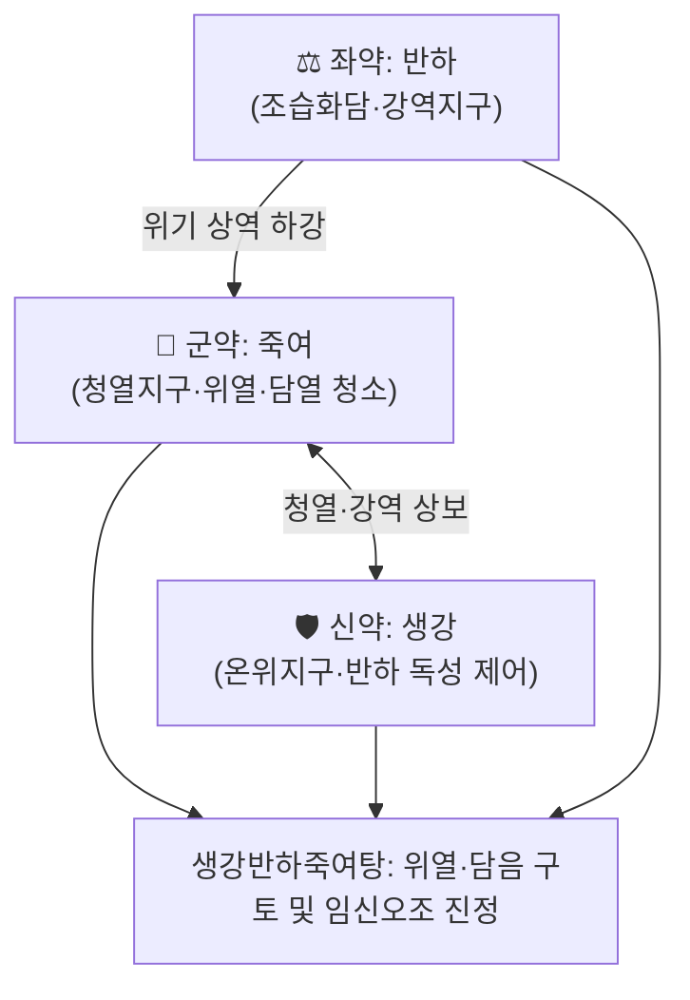

# 💊 생강반하죽여탕 (生薑半夏竹茹湯)

> **핵심 3줄 요약 (Key Summary)**:
> - 🌿 [[죽여]]·[[생강]]·[[반하]] 3미로 구성된 임신 입덧(임신오조, 妊娠惡阻) 치료 배합. 독립 출전은 미확인이며 볼트 내 [[죽여]] 노트의 배오 정보로 수록(아래 1번 섹션 참고).
> - 🎯 위열(胃熱)로 냄새만 맡아도 헛구역질을 하고 물조차 넘기기 힘든 극심한 입덧·위열 [[구토]]. 신경성 [[위염]]·[[역류성 식도염]]의 트림·딸꾹질에도 변증 활용 가능.
> - 🔬 [[죽여]]의 [[오리엔틴]] 등 플라보노이드 C-배당체, [[생강]]·[[반하]]의 전통적 강역화담 배오가 지구(止嘔) 효능의 본초학적 근거로 제시됨(이 조합 자체에 대한 현대 임상연구는 미확인).
> - ⚠️ 주의사항: 임신부 처방이므로 반드시 한의사의 임신주수·태아상태 평가 하에 사용해야 하며, 극심한 탈수 등 응급 소견이 있으면 산과적 평가를 우선해야 함.

---

## 📌 목차
1. [기본 처방 정보 & 군신좌사 구성](#1-기본-처방-정보--군신좌사-구성)
2. [방제학적 약재 상호작용 & 시너지 네트워크](#2-방제학적-약재-상호작용--시너지-네트워크)
3. [현대 분자약리학적 효능 & 작용 기전](#3-현대-분자약리학적-효능--작용-기전)
4. [적응 병증 및 체질별 감별 (Sweet Spot vs 금기)](#4-적응-병증-및-체질별-감별-sweet-spot-vs-금기)
5. [유사 처방군 감별 매트릭스](#5-유사-처방군-감별-매트릭스)
6. [임상 가감례 & 현대 질환별 응용](#6-임상-가감례--현대-질환별-응용)
7. [💡 사용자 진료실 핵심 필기 & 임상 팁 (원문 보존)](#7--사용자-진료실-핵심-필기--임상-팁-원문-보존)
8. [출처 및 학술 참고 문헌 (References)](#8-출처-및-학술-참고-문헌-references)

---

## 1. 기본 처방 정보 & 군신좌사 구성

⚠️ 내용 검토 필요: "생강반하죽여탕"이라는 명칭으로 독립된 출전(원전)을 명시한 문헌을 이번 조사에서는 확인하지 못했습니다. 볼트 내 [[죽여]] 노트에서는 이 배합을 "죽여+생강+반하 → 임신 입덧과 [[구토]]를 멎게 함"이라는 임상 배오 조합으로 소개하고 있으며, 금궤요략의 생강반하탕(반하·생강 2미, 心中痞·嘔逆 치료)이나 귤피죽여탕(진피·죽여·인삼·감초·생강·대추, 噦逆 치료) 등 관련 고전 처방과 구성이 유사하나 동일하지는 않습니다. 원장님 임상 처방집이나 별도 원전 확인이 필요합니다.

---

* **치법**: 강역지구(降逆止嘔), 화담강역(化痰降逆).

| 약재 | 역할 |
| :--- | :--- |
| [[죽여]] | 군약 — 청열지구(淸熱止嘔), 담열로 인한 [[구토]]·딸꾹질 완화 |
| [[생강]] | 신약 — 온위지구(溫胃止嘔), 강역화담(降逆化痰) |
| [[반하]] | 좌약 — 조습화담(燥濕化痰), 강역지구(降逆止嘔) |

---

## 2. 방제학적 약재 상호작용 & 시너지 네트워크

[[죽여]]가 담열을 청소하는 청열지구 작용의 중심을 이루고, [[생강]]·[[반하]]의 전통적 배오(강역화담)가 더해져 담음(痰飮)과 위열이 겹친 극심한 [[구토]]를 함께 다스립니다. 유사 배오인 [[온담탕]]([[죽여]]+[[지실]]+[[반하]]+[[진피]]+[[복령]]+[[감초]])이 담열 심번·불면을 다스리는 것과 달리, [[생강반하죽여탕]]은 구성이 단순하고 신속한 지구(止嘔) 효과에 집중된 구급방적 성격을 지닙니다.

---

## 3. 현대 분자약리학적 효능 & 작용 기전

* **플라보노이드 항염·진정**: [[죽여]]의 플라보노이드 C-배당체([[오리엔틴]] 등)는 항염증·진정 작용이 알려져 있으며, [[생강]]([[진저롤]]·쇼가올의 5-HT3 억제) 및 [[반하]]의 강역지구 기전은 이미 개별 본초 노트에 정리되어 있습니다(각 노트 참고).

⚠️ 내용 검토 필요: "생강반하죽여탕" 배합 자체를 대상으로 한 현대 임상·약리 연구는 이번 검색 범위 내에서 확인되지 않았습니다. 개별 본초의 알려진 약리를 조합적으로 제시한 것이며, 이 조합 자체의 효능을 직접 검증한 연구는 아닙니다.

---

## 4. 적응 병증 및 체질별 감별 (Sweet Spot vs 금기)

* **임신오조(妊娠惡阻)**: 임신 중 위열로 인해 냄새만 맡아도 헛구역질을 하고 물조차 넘기기 힘든 극심한 입덧, 위열 [[구토]].
* **위장관 질환**: 신경성 [[위염]] 및 [[역류성 식도염]]으로 인한 트림·[[딸꾹질]]에도 변증에 맞으면 활용될 수 있습니다.
* **주의·금기**: 임신부 투여 시 [[반하]]의 법제·수치 상태와 임신주수·탈수(케톤뇨) 여부를 먼저 평가해야 하며, 심한 탈수·전해질 불균형 시 정맥 수액 요법을 최우선으로 합니다.

---

## 5. 유사 처방군 감별 매트릭스

| 처방명 | 핵심 구성 차이 | 주치 및 특징 |
| :--- | :--- | :--- |
| [[생강반하죽여탕]] | [[죽여]]·[[생강]]·[[반하]] | 임신 입덧·위열 [[구토]], 구성이 단순한 구급방적 성격 |
| [[온담탕]] | [[죽여]]·[[지실]]·[[반하]]·[[진피]]·[[복령]]·[[감초]] | 담열 심번·[[불면증]] — [[구토]]보다 심담 안신에 주력 |
| [[생강반하탕]] | [[반하]]·[[생강]] (2미) | 심중비(心中痞)·구역(嘔逆) — [[금궤요략]] 수록, [[죽여]] 없이 더 단순 |
| [[귤피죽여탕]] | [[진피]]·[[죽여]]·[[인삼]]·[[감초]]·[[생강]]·[[대추]] | 얼역([[딸꾹질]]) — 보익 성분([[인삼]]·[[대추]]) 포함 |

> ⚠️ 표 내부에서는 파이프(`|`)가 들어간 링크를 쓰지 않고 순수한 [[처방명]] 단독 형태로만 작성합니다.

---

## 6. 임상 가감례 & 현대 질환별 응용

* **수반 증상별 가감법**:
  * 임신 중 비위 기허가 겹쳐 입덧과 피로가 심한 경우 $\rightarrow$ [[진피]]·[[인삼]]·[[대추]] 보강([[귤피죽여탕]] 방향 검토)
  * 속쓰림과 위산 역류가 동반될 때 $\rightarrow$ [[황련]] 소량(청위열) 또는 식후 소량 빈복
* **현대 질환별 임상 매핑**:
  * [[임신오조]](입덧), 신경성 [[위염]] 및 [[역류성 식도염]]으로 인한 트림·[[딸꾹질]]에 변증 활용.
* **양약 상호작용 (Herb–Drug Interaction)**:
  * **입덧 치료제·항구토제**: 산부인과에서 처방된 독실아민/피리독신(디클렉틴), [[메토클로프라미드]], 온단세트론과 병용 시 진토 작용이 겹칠 수 있으며, 임신 중 [[반하]] 투여는 반드시 법제품을 사용하고 산과 주치의·한의사의 평가 하에 단기 운용한다(중증 탈수·케톤뇨 시 수액 요법 우선).
  * **제산제·임산부 영양제**: PPI·H2 수용체 차단제·제산제 및 경구 [[철분제]]·엽산·칼슘 보충제와는 흡수 간섭을 막기 위해 최소 2시간 간격으로 복용한다.
  * **항응고제 주의**: [[생강]] 고용량 병용 시 [[와파린]]·[[아스피린]] 출혈 경향에 유의한다.

---

## 7. 💡 사용자 진료실 핵심 필기 & 임상 팁 (원문 보존)

> [!tip] **진료실 실전 노하우 (User Clinical Insight)**
> - 현재 별도로 기록된 원장님 임상 필기가 없습니다. 추후 실전 진료 경험이 누적되면 이 섹션에 추가합니다.

---

## 8. 출처 및 학술 참고 문헌 (References)

1. 볼트 내부 참고: `_의학/02_약리/본초/13_화담지해평천약/죽여.md` — [[죽여]]의 배오 정보 중 "죽여+생강+반하 → 임신 입덧과 [[구토]]를 멎게 함" 서술.
2. **장중경 (200년경)**. 『[[금궤요략]](金匱要略)』 妊娠病脈證并治 · 嘔吐噦下利病脈證并治: [[생강반하탕]](반하·생강 2미) 및 [[귤피죽여탕]](橘皮竹茹湯) 관련 조문 — 유사 계열 처방으로서 참고용이며, 본 배합과 동일 처방은 아님을 명시.
3. *(※ [[생강반하죽여탕]] 단독 배합의 현대 영문 PubMed 등재 논문은 본 검증 시점 기준 미확인으로 볼트 내 본초 배오 및 유사 고전 조문만 수록함)*

<!-- 보관 태그(1회용·링크오류, 필요시 복원): 임신오조 -->
