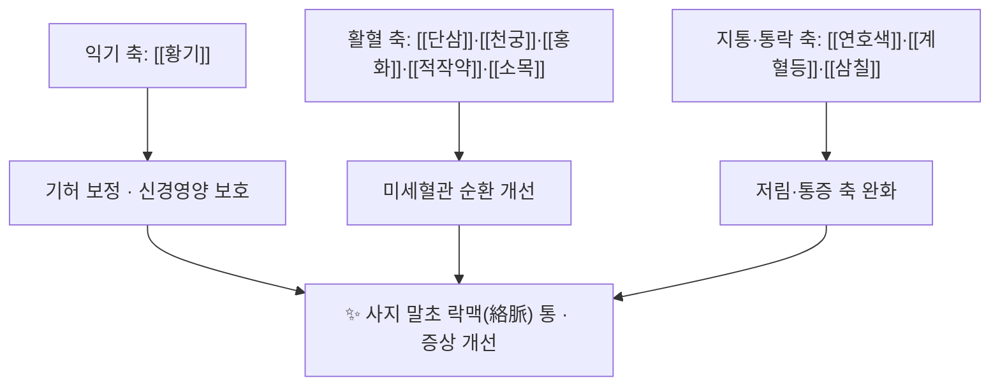

# 📜 목단과립 (牧丹顆粒, Mudan Granules)

> **핵심 요약 (Key Summary)**:
> 🧪 구성·제형: [[황기]]·[[연호색]]·[[삼칠]]·[[적작약]]·[[단삼]]·[[천궁]]·[[홍화]]·[[소목]]·[[계혈등]] 9味로 이루어진 중국 NMPA 승인 과립제. 7 g/포, 1일 3회(총 21 g/일).
> 📍 치법: 익기(益氣)·활혈화어(活血化瘀)·통락(通絡) — 기허혈어(氣虛血瘀) 변증의 [[당뇨병성 말초신경병증]]에 배치된다.
> 🎯 근거: 다기관·이중맹검·위약대조 RCT(중국 13개 기관, 400명 무작위·357명 완전분석, 24주)에서 [[메코발라민]] 기반 치료에 더했을 때 [[MDNS]]가 약 2점 추가 개선되었다.
> ⚠️ 주의사항: 활혈화어 본초 비중이 높아 [[와파린]]·[[아스피린]]·직접경구항응고제 복용자, 출혈 경향, 임신·수유, 활동성 소화성 궤양에서는 신중히 판단한다. 국내에는 동일 제품이 없어 성분이 겹치는 처방으로 대응한다.

---

## 1. 기본 처방 정보 & 군신좌사 구성

| 항목 | 상세 정보 |
| :--- | :--- |
| 처방명 | 목단과립(牧丹顆粒) |
| 제형·용량 | 과립 7 g/포, 1일 3회 경구(2026-10-15 시험 프로토콜 기준) |
| 승인 | 중국 국가의약품관리국(NMPA) 승인 한약제제 |
| 주치(변증) | 기허락조(氣虛絡阻) — 기허혈어(氣虛血瘀) 변증의 [[당뇨병성 말초신경병증]] |
| 치법 | 익기(益氣)·활혈화어(活血化瘀)·통락(通絡) |
| 등록번호 | NCT04711980 (프로토콜 논문 공개) |

### 1.1 구성 본초와 역할 배치

| 구성 본초 | 한자·기원 | 처방 내 역할 |
| :--- | :--- | :--- |
| [[황기]] | 黃芪·Astragalus | 군약 — 익기·기허 보정, [[아스트라갈로사이드]]·다당체 축 |
| [[연호색]] | 延胡索·Corydalis | 활혈·행기·지통, [[테트라하이드로팔마틴]] 축 |
| [[삼칠]] | 三七·Panax notoginseng | 화어지혈, 사포닌(Rg1·Rb1) 신경보호 |
| [[적작약]] | 赤芍 | 청열량혈·활혈, 파에오니플로린 축 |
| [[단삼]] | 丹參 | 활혈거어·미세혈관 보호, [[살비아놀산 B]]·[[탄신논 IIA]] 축 |
| [[천궁]] | 川芎 | 행기활혈, [[리구스티진]] 축 |
| [[홍화]] | 紅花 | 활혈통경·미세순환, HSYA·카르타민 |
| [[소목]] | 蘇木 | 행혈거어·소종 |
| [[계혈등]] | 鷄血藤 | 활혈보혈·통락 |

> ⚠️ 이름 혼동 주의: 목단과립은 [[목단피]](牧丹皮, 모란 뿌리껍질 단일 본초)와 다른 처방이다. 구성 본초 9味 안에 목단피는 들어 있지 않다.

---

## 2. 방제학적 약재 상호작용 & 시너지 네트워크

- 처방 구조를 한 줄로 읽으면 익기(황기) + 활혈(단삼·천궁·홍화·적작약·소목·삼칠) + 통락지통(연호색·계혈등)의 3축이다. 당뇨병성 말초신경병증의 병태생리(허혈·산화 스트레스·신경영양 저하)에 각 축이 대응한다는 전임상·본초학 근거가 축적되어 있다.
- 배오 관점에서 [[황기]]와 [[단삼]]의 조합은 보기활혈(補氣活血)의 전형이고, [[천궁]]–[[홍화]] 조합은 미세순환 개선 목적으로 널리 쓰인다 → [[보양환오탕]] · [[당귀수산]]

---

## 3. 현대 분자약리학적 효능 & 작용 기전

- [[황기]]의 [[아스트라갈로사이드]]·다당체는 항산화·신경영양 보호 방향으로, [[단삼]]의 [[살비아놀산 B]]·[[탄신논 IIA]]는 항산화·미세혈관 보호 방향으로 보고되어 있다. [[삼칠]] 사포닌(Rg1·Rb1)은 신경보호, [[천궁]]의 [[리구스티진]]과 [[홍화]] 색소는 미세순환·항염, [[연호색]]은 진통, [[계혈등]]·[[소목]]은 활혈통락에 관여한다.
- 다만 2026-10-15 시험 자체는 신경전도속도·산화지표 같은 기전 지표를 측정하지 않았다. 즉 이 처방의 기전 서술은 전임상·본초학 층위이고, 시험 결과는 임상 점수([[MDNS]]) 층위다 — 두 층위를 섞어 인용하지 않는다 → [[산화 스트레스]] · [[ROS]]
- 관련 병태생리 축: 폴리올경로 활성, 최종당화산물 축적, 미세혈관 허혈, 신경영양 인자 감소 → [[당뇨병성 말초신경병증]]

---

## 4. 적응 병증 및 체질별 감별 (Sweet Spot & 감별)

| 구분 | 판단 기준 |
| :--- | :--- |
| 적합(익기활혈) | 기허 증상(피로·권태·자한) + 저림·통증·어혈 징후, 변증상 기허락조에 해당 |
| 신중(출혈 위험) | [[와파린]]·[[아스피린]]·직접경구항응고제 복용, 혈소판 저하, 출혈 경향 |
| 금기·보류 | 임신·수유, 활동성 소화성 궤양, 증상이 있는 담도 폐쇄 |
| 감별 | 순수 습열·담음 위주이거나 실열(實熱) 우세하면 활혈화어 위주 처방은 맞지 않는다 |

- 감각이 떨어진 환자에서는 저림 개선만 보고 족부 관리(발 검진·병변 확인)를 소홀히 하지 않는다 → [[당뇨발]]
- [[메코발라민]]·[[알파리포산]] 같은 기반 치료를 대체하는 처방이 아니라 그 위에 더하는 부가요법이다.

---

## 5. 유사 처방군 감별 매트릭스

| 처방 | 치법 축 | 감별 포인트 |
| :--- | :--- | :--- |
| 목단과립 | 익기 + 활혈화어 + 통락 | 기허혈어·락조 변증, 9味 고정 조합 |
| [[보양환오탕]] | 익기활혈 + 거풍 | 기허혈어에 풍증·중풍 후유증 축이 겹칠 때 |
| [[당귀수산]] | 활혈거어 위주 | 어혈·타박 축이 주가 되고 익기 축이 약할 때 |
| [[황기계지오물탕]] | 익기온경 + 화혈 | 기허 + 한증·혈비(血痺) 양상의 사지 저림·마목 |
| [[오적산]] | 해표·화담·이기 | 외감·담습 동반 근골격 증상, 변증 층위가 다르다 |

---

## 6. 임상 가감례 & 현대 질환별 응용

- 국내에는 목단과립 동일 제품이 없다. 2026-10-15 시험의 결론을 옮길 때는 성분 구조가 겹치는 익기활혈 처방으로 대응한다 — [[황기]]·[[단삼]]·[[천궁]]·[[적작약]]·[[홍화]]를 축으로 하고 [[연호색]]·[[계혈등]]을 가미하는 구성이 현실적이다.
- 기간 설계는 원 시험을 따른다: 4주마다 [[MDNS]]와 저림·화끈거림 [[NPRS]]를 기록하고, 12주에 방향성이 없으면 24주까지 끌지 말고 처방을 재검토한다.
- 원 시험은 24주 연속 투여에 중단기가 없었다. 간헐 투약으로 줄이는 것은 근거 밖 변형이다(임상 판단으로 가능하나 근거는 없음을 알고 한다).
- 한의 임상에서의 위치: 혈당 조절·족부 관리가 기본이고, 한약은 그 위의 부가 축이다 → [[당뇨병]] · [[당뇨발]]

---

## 7. 💡 사용자 진료실 핵심 필기 & 임상 팁

### 7.1 문진 체크리스트
1. 복용 중인 항혈전제(아스피린·와파린·DOAC)와 출혈 증상(멍·잇몸출혈·혈뇨·흑변) 여부.
2. 혈당 조절 상태([[HbA1c]])와 족부 병변 유무 — 감각 저하 환자는 스스로 병변을 못 느낀다.
3. 위장 증상(속쓰림·복부 불편), 임신·수유 여부.

### 7.2 환자 설명 스크립트
> "당뇨로 인한 손발 저림에서 비타민B12 계열 약만 쓰는 것보다, 익기·활혈 계열 한약을 24주 함께 쓰면 신경병증 점수가 약 2점 더 좋아졌다는 다기관 연구가 있습니다. 혈당 조절과 발 관리가 기본이고 한약은 그 위에 더하는 보조 치료입니다. 출혈을 막는 약을 복용 중이면 먼저 알려 주시고, 4주마다 저림과 통증 변화를 기록해 12주에 효과 방향을 판단하겠습니다."

---

## 8. 출처 및 학술 참고 문헌 (References)

1. **Efficacy and safety of Mudan granules for treatment of diabetic peripheral neuropathy: a multicenter, double-blind, placebo-controlled, randomized, clinical trial.** *Journal of Ethnopharmacology*. 2026;368:121754. [PMID 42069162](https://pubmed.ncbi.nlm.nih.gov/42069162/) · [DOI 10.1016/j.jep.2026.121754](https://doi.org/10.1016/j.jep.2026.121754)
   - [연구 요약] 중국 13개 기관, [[당뇨병성 말초신경병증]] 400명 무작위(1:1)·357명 완전분석. 두 군 모두 [[메코발라민]] 0.5 mg 1일 3회를 기반 치료로 받았고, 목단과립 7 g 1일 3회 추가군에서 24주 [[MDNS]] 변화가 −4.80 대 −2.66(ANCOVA 최소제곱평균 −4.74 대 −2.72)이었다.
2. **임상시험 프로토콜(NCT04711980)** — 牧丹顆粒 임상시험 설계·용량·평가지표. [ClinicalTrials.gov](https://clinicaltrials.gov/study/NCT04711980) · [프로토콜 원문(PMC8173202)](https://pmc.ncbi.nlm.nih.gov/articles/PMC8173202/)
   - [연구 요약] 1주 선별기 + 24주 연속 투여, 4주마다 추적, 12주·24주 주요 지표 재평가 설계를 확인한 1차 출처다.

## 함께 보기
- [[당뇨병성 말초신경병증]] · [[당뇨병]] · [[당뇨발]] · [[메코발라민]] · [[알파리포산]] · [[MDNS]]
- [[황기]] · [[연호색]] · [[삼칠]] · [[적작약]] · [[단삼]] · [[천궁]] · [[홍화]] · [[소목]] · [[계혈등]]
- [[보양환오탕]] · [[당귀수산]] · [[황기계지오물탕]] · [[목단피]]
- [[2026-10-15_통합의학약리학_심층리뷰]] 1번
