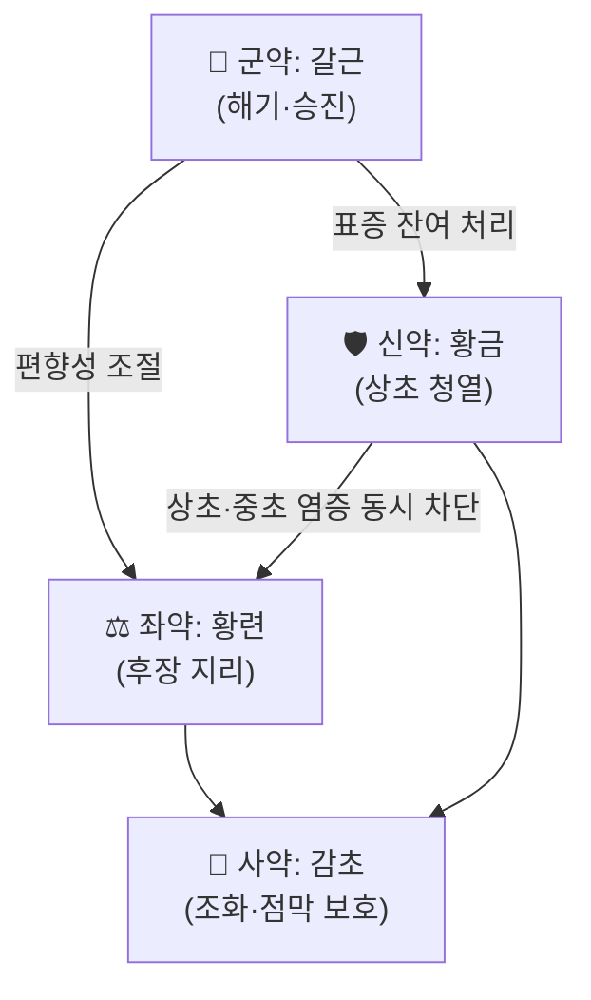

# 🍵 [[갈근금련탕]] (葛根芩連湯, Gegen Qinlian Decoction)

> **핵심 3줄 요약 (Key Summary)**:
> - 🌿 [[상한론]] 원방 — [[갈근]] 8 : [[황금]] 3 : [[황련]] 3 : [[감초]] 2 비율의 청열조습(淸熱燥濕)·해표지리(解表止利) 4미 방제
> - 🎯 습열사(濕熱瀉)·협열하리(協熱下利), 그리고 [[면역관문억제제]] 병용 시 [[면역관련 이상반응]] 감소 — 중국 다기관 무작위 대조시험 근거
> - 🔬 [[베르베린]]·[[바이칼린]]·[[푸에라린]]의 장점막 밀착연접 강화 + [[NF-κB]]·[[IL-6]] 축 억제
> - ⚠️ 주의사항: 한증(寒證)·허한 설사에는 금기. [[와파린]]·직접경구항응고제 병용 시 CYP3A4·P-gp 간섭으로 출혈 위험 확인

---

## 📌 목차
1. [기본 처방 정보 & 군신좌사 구성](#1-기본-처방-정보--군신좌사-구성)
2. [방제학적 약재 상호작용 & 시너지 네트워크](#2-방제학적-약재-상호작용--시너지-네트워크)
3. [현대 분자약리학적 효능 & 작용 기전](#3-현대-분자약리학적-효능--작용-기전)
4. [적응 병증 및 체질별 감별 (Sweet Spot vs 금기)](#4-적응-병증-및-체질별-감별-sweet-spot-vs-금기)
5. [유사 처방군 감별 매트릭스](#5-유사-처방군-감별-매트릭스)
6. [임상 가감례 & 현대 질환별 응용](#6-임상-가감례--현대-질환별-응용)
7. [💡 사용자 진료실 핵심 필기 & 임상 팁](#7--사용자-진료실-핵심-필기--임상-팁)
8. [출처 및 학술 참고 문헌 (References)](#8-출처-및-학술-참고-문헌-references)

> 🖼️ 이미지 미확보 — 이 처방은 구성 본초 4미가 모두 단미 노트([[갈근]]·[[황금]]·[[황련]]·[[감초]])에 사진이 있어, 처방 노트에는 전탕 실사 대신 본초 링크로 대체했다(템플릿상 생략 허용).

---

## 1. 기본 처방 정보 & 군신좌사 구성

* **출전**: 장중경(張仲景) 『[[상한론]]』 — 태양병 편 "利遂不止 … 喘而汗出者 葛根黃芩黃連湯主之"
* **치법**: 해표(解表)·청열(淸熱)·조습(燥濕)·지리(止利)

| 구분 | 약재명 | 원방 용량 | 임상 표준 용량 | 본초 효능 & 방제 내 역할 |
| :--- | :--- | :--- | :--- | :--- |
| 군약 (君藥) | [[갈근]] | 半斤 | 8 g | 해기청열(解肌淸熱)·승진양명(升津陽明), 표증 잔여와 진액 손상을 동시에 처리 |
| 신약 (臣藥) | [[황금]] | 3 兩 | 4 g | 청열조습, 상초·담열·장관 염증 억제([[바이칼린]] 함유) |
| 좌약 (佐藥) | [[황련]] | 3 兩 | 4 g | 청열조습·후장지리(厚腸止利), 하리(下利)의 핵심 표적([[베르베린]] 함유) |
| 사약 (使藥) | [[감초]] | 2 兩 | 2 g | 감완화중(甘緩和中)·조화제약, [[글리시리진]]으로 위점막 보호 |

> **배오 특징**: 갈근의 승산(升散)과 황금·황련의 고한(苦寒)을 감초로 완충한 구조다. 표(表)가 아직 풀리지 않았는데 열이 장으로 들어가 설사하면서 천(喘)·한(汗)이 나는 상황 — 즉 "표증 + 습열리"가 겹친 병기만 정확히 겨냥한다. 원방 1량의 현대 환산에는 이설이 있어, 위 임상 용량은 국내 통용 배오(8·4·4·2 g)이며 원방 비율 8:3:3:2를 유지한 것이다.

---

## 2. 방제학적 약재 상호작용 & 시너지 네트워크

* [[갈근]] + [[황금]] 배오: 갈근의 발한·해기 작용이 황금의 청열을 표와 장관 양쪽으로 전달한다. 갈근 이소플라본이 장관 평활근 긴장을 낮추고 황금 [[바이칼린]]이 점막 염증을 누르는 상보 구조다.
* [[황금]] + [[황련]] 배오: 같은 苦寒이지만 표적이 다르다 — 황금은 상초·담·폐, 황련은 중초·심·후장. 두 약을 함께 쓰면 설사와 함께 오는 번열(煩熱)·구갈(口渴)까지 함께 처리한다.
* [[감초]] + 3약: [[글리시리진]]이 황련·황금의 위장 자극을 완충하고, 감초 플라보노이드가 장점막 재생을 돕는다.

---

## 3. 현대 분자약리학적 효능 & 작용 기전

### 1) 장점막 밀착연접(tight junction) 강화
* [[베르베린]]은 장상피세포의 occludin·ZO-1 발현을 올려 투과성을 낮춘다. 습열리(濕熱痢)의 병태가 "장벽 균열 → 내독소 전위"로 설명되는 지점과 정확히 맞물린다.
* [[푸에라린]]은 장관 미세순환을 개선해 점막 허혈성 손상을 줄인다.

### 2) [[NF-κB]] / [[IL-6]] 축 억제
* [[바이칼린]]·[[베르베린]] 모두 TLR4→[[NF-κB]] 경로를 억제해 [[IL-6]]·TNF 생성을 낮춘다. 2025년 비소세포폐암 무작위시험에서 갈근금련정 병용군의 [[IL-6]]가 유의하게 감소한 것은 이 축과 정합적이다(직접 표적 측정은 아님).
* 궤양성 [[대장염]] 모델에서 갈근금련탕은 장내 미생물–담즙산 축을 재편하고 NLRP3 염증체 억제를 통해 염증을 줄였다(PMID 42889310).

### 3) 대사·장내환경 조절
* 제2형 당뇨병에서 갈근금련탕 병용의 혈당·지질 개선 메타분석이 있다(PMID 42539441). 장내 미생물 구성 변화와 담즙산 대사 조절이 공통 기전으로 제시된다.

---

## 4. 적응 병증 및 체질별 감별 (Sweet Spot vs 금기)

[✅ 최적 적응증 (Sweet Spot)]
* **원전 주치**: 표증이 남은 채 열이 장으로 들어가 생긴 하리(下利) — 설사와 함께 천(喘)·한출(汗出), 항강(項强), 갈증.
* **체질 소견**: [[소양인]]·[[태음인]] 중 실열(實熱) 경향, 설홍(舌紅)·태황니(苔黃膩), 맥삭(脈數).
* **임상 주치**: 급성 감염성 장염, 항생제 연관 [[설사]], 습열형 과민성 장증후군, 항암 치료 중 점막염·설사.

[⚠️ 신중 투여 및 금기 (Caution / Contraindication)]
* **허한(虛寒) 설사·오경사(五更瀉)·냉리(冷痢)** — 황금·황련의 고한이 비양(脾陽)을 더 손상시킨다.
* 위냉·식욕부진·만성 위축성 위염 환자에서 장기 복용 시 소화 불량이 흔하다.
* [[와파린]]·직접경구항응고제 병용 시 [[황련]]·[[황금]]의 CYP3A4·P-gp 저해 가능성 → INR 추적.
* 임신·수유 중 고용량, 중증 간질환, 저체중 고령자는 감량부터 시작한다.

---

## 5. 유사 처방군 감별 매트릭스

| 처방명 | 핵심 구성 차이 | 주치 및 체질 차이 | 맥진/설진 차이 |
| :--- | :--- | :--- | :--- |
| [[갈근금련탕]] | 갈근 + 황금 + 황련 + 감초 | 표증 잔여 + 습열리, 실열 | 맥삭, 태황니 |
| [[백두옹탕]] | 백두옹 + 황련 + 황백 + 진피 등 | 열독리(熱毒痢)·혈리, 후중감 | 맥활삭, 설홍 태황 |
| [[황련아교탕]] | 황련 + 황금 + 백작약 + 아교 등 | 음허(陰虛) + 심번불수, 설사 없는 번열 | 맥세삭, 설홍소태 |
| [[이중탕]] | 인삼 + 건강 + 백출 + 감초 | 중초 허한(虛寒) 설사 | 맥침세, 설담태백 |
| [[반하사심탕]] | 반하 + 황금 + 황련 + 건강 등 | 한열교잡(寒熱錯雜), 심하비 | 맥현, 태박황 |

---

## 6. 임상 가감례 & 현대 질환별 응용

* **수반 증상별 가감법**:
  * 복통·후중감이 심하면 → + [[목향]]·[[빈랑]]
  * 구토·오심 동반 → + [[반하]]·[[생강]]
  * 열이 높고 갈증 심하면 → + [[석고]]·[[지모]]
  * 만성·허증으로 넘어가면 → + [[백출]]·[[복령]] ([[사군자탕]] 계열로 전환)
* **현대 질환별 임상 매핑**:
  * **소화기**: 급성 위장염, 항생제 연관 설사, 궤양성 [[대장염]] 보조
  * **종양**: [[면역관문억제제]] 병용 시 [[면역관련 이상반응]] 예방·완화(아래 7번)
  * **대사**: 제2형 당뇨병 병용(근거 수준 낮음, 보조적)

* **양약 상호작용 (Herb–Drug Interaction)**:
  * **CYP3A4·P-gp**: [[황련]]의 [[베르베린]]은 P-gp 기질 약물(디곡신 등)의 흡수를 변화시킬 수 있다.
  * **출혈 위험**: [[와파린]]·DOAC 병용 시 INR·출혈 징후 모니터링.
  * **혈당**: 인슐린·설폰요소제 병용 시 저혈당 가능 — 자가혈당 기록을 받는다.
  * **복용 시점**: 다른 약과 1~2시간 간격.

---

## 7. 💡 사용자 진료실 핵심 필기 & 임상 팁

> [!tip] 항암 환자 병용 프로토콜 (2026-10-22 논문 기반)
> - **대상**: [[면역관문억제제]] + 항암화학요법 중인 진행성 [[비소세포폐암]] 환자로, 변증이 습열(舌紅 苔黃膩, 구갈·번열·설사 또는 변비 교대)인 경우.
> - **용법 설계**: 원 시험은 갈근금련정 1회 3정·1일 3회를 21일 연속, 항암 주기와 동기화해 3주기 시행했다. 국내에서는 동일 제형이 없으므로 갈근금련탕 과립·탕전으로 대응하되, 항암 투여일 기준 21일 on으로 맞춘다.
> - **관찰 지표**: 주기 시작 전 간기능(ALT·AST)·혈구수치, 매 주기 [[면역관련 이상반응]] 등급(피부·갑상선·폐·대장), 스테로이드 사용량.
> - **중단 기준**: ALT가 기저의 3배 초과, 새 기침·호흡곤란, 발진 진행, 황달. 이때 한약 때문이라 단정하지 말고 항암 담당의와 즉시 공유한다.
> - **변증 실수 주의**: 한열 구분 없이 복용하면 위냉·설사가 늘어난다. 항암 환자는 대부분 기허(氣虛)를 동반하므로, 순수 실열이 아니면 [[이중탕]]·[[사군자탕]] 쪽을 먼저 검토한다.

* **환자 설명 스크립트**: "이 처방은 장의 습한 열을 내리고 장 점막을 튼튼하게 하는 약입니다. 항암 치료를 받으시면서 생길 수 있는 피부 발진이나 장 염증 같은 부작용을 줄이는 데 도움이 된다는 연구가 있었습니다. 다만 몸이 찬 분에게는 맞지 않으니, 대변 상태와 갈증 여부를 보면서 조정하겠습니다."

---

## 8. 출처 및 학술 참고 문헌 (References)

1. **Lu X, et al. (2025)**. *Gegen Qinlian Tablets attenuate immune-related adverse events in NSCLC patients: A multi-center randomized controlled trial in China*. **Phytomedicine**, 145:156968. [PMID 40561860](https://pubmed.ncbi.nlm.nih.gov/40561860/)
   - **[연구 요약]**: 진행성 비소세포폐암 94명에서 면역관문억제제+항암화학요법에 갈근금련정을 더한 결과 irAE 발생률이 59.57%에서 31.91%로 감소(p=0.007)했고, 다계통 독성은 0명 대 3명이었다.
2. **Wang H, et al. (2026)**. *Gegen Qinlian decoction alleviates ulcerative colitis by remodeling the gut microbiota-bile acid axis and inhibiting NLRP3-mediated inflammation*. **Front Immunol**. [PMID 42889310](https://pubmed.ncbi.nlm.nih.gov/42889310/)
   - **[연구 요약]**: 궤양성 대장염 모델에서 갈근금련탕이 장내 미생물–담즙산 축을 재편하고 NLRP3 염증체를 억제해 점막 염증을 줄였다.
3. **He H, et al. (2026)**. *Efficacy of Gegen Qinlian decoction plus metformin for type 2 diabetes mellitus: a systematic review and meta-analysis of randomized controlled trials*. **Front Endocrinol (Lausanne)**. [PMID 42539441](https://pubmed.ncbi.nlm.nih.gov/42539441/)
   - **[연구 요약]**: 제2형 당뇨병에서 갈근금련탕 병용이 혈당·지질 지표를 추가로 개선했다는 무작위시험 메타분석.
4. **장중경 (200년경)**. 『[[상한론]]』 태양병 편 — 갈근황금황련탕 조문.
   - **[고전 원전]**: 표증 잔여 + 협열하리의 주치와 복약 지침.
