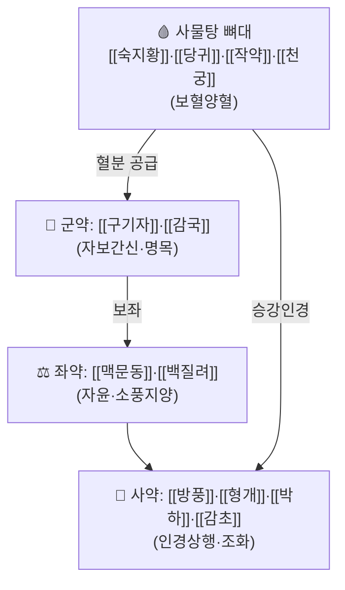

# 🍵 [[기국양혈탕]] (杞菊養血湯(추정 한자, 원전 미상), Gigukyanghyeoltang)

> ⚠️ **한자명 표기 주의**: 출처 강의(청강의감 처방 스터디 30회차)는 한글 처방명과 구성 본초만 제시하며 정식 원전 한자 표기는 확인되지 않았습니다. "杞菊"은 구성 중 [[구기자]](杞子)·[[감국]](菊花)에서, "養血"은 [[사물탕]] 골격(보혈)에서 따온 통용 추정 표기이며, 원전(의서) 확인 시 정정이 필요합니다.

> **핵심 3줄 요약 (Key Summary)**:
> - 🌿 [[사물탕]](숙지황·당귀·작약·천궁, 보혈)에 [[구기자]]·[[감국]]·[[맥문동]]·[[백질려]]·[[방풍]]·[[형개]]·[[박하]]·[[감초]]를 더한 두면부·안구 혈류 지향 변방으로, [[청간명목탕]](=[[세간명목탕]])의 **축소판**(사물탕 + 뇌혈관·안구 약물)이다.
> - 🎯 임상 실체는 "눈을 좋아지게 하는 처방"이 아니라 **[[백내장]]·[[녹내장]]** 등 안구 혈류·울혈 문제에 대한 접근이며, 강의자는 "청간명목탕과 구별할 이유 없이 하나로 대표해도 된다"고 평가한다.
> - 🔬 핵심 기전은 사물탕 계열의 미세순환 개선(당귀·천궁의 항혈소판·혈관이완)과 구기자·감국의 항산화·망막신경보호, 방풍·형개·박하의 두면부 인경(引經)·소풍 작용의 결합이다.
> - ⚠️ 주의사항: 실제 백내장·녹내장은 안압·수정체 혼탁의 구조적 문제이므로 **구조·순환 치료(침·추나)가 한약보다 우선**이며, 녹내장이 의심되면 안압 측정·안과 협진을 지연하지 않아야 한다.

---
## 📌 목차
1. [기본 처방 정보 & 군신좌사 구성](#1-기본-처방-정보--군신좌사-구성)
2. [방제학적 약재 상호작용 & 시너지 네트워크](#2-방제학적-약재-상호작용--시너지-네트워크)
3. [현대 분자약리학적 효능 & 작용 기전](#3-현대-분자약리학적-효능--작용-기전)
4. [적응 병증 및 체질별 감별 (Sweet Spot vs 금기)](#4-적응-병증-및-체질별-감별-sweet-spot-vs-금기)
5. [유사 처방군 감별 매트릭스](#5-유사-처방군-감별-매트릭스)
6. [임상 가감례 & 현대 질환별 응용](#6-임상-가감례--현대-질환별-응용)
7. [💡 사용자 진료실 핵심 필기 & 임상 팁 (원문 보존)](#7--사용자-진료실-핵심-필기--임상-팁-원문-보존)
8. [출처 및 학술 참고 문헌 (References)](#8-출처-및-학술-참고-문헌-references)
---
## 1. 기본 처방 정보 & 군신좌사 구성

* **출전**: 청강의감 처방 스터디 30회차(오관계 처방) — 원전 고전 문헌은 미확인
* **치법**: 보혈양간(補血養肝), 명목소풍(明目疏風) — 사물탕으로 혈을 채우고 구기·감국·질려로 간을 기르며 눈을 밝힌다

> 🖼️ 이미지는 첨부 폴더에 확보분이 없어 생략합니다(.agents\rules\이미지_가이드.md §3.3 — 확보 실패 시 억지로 채우지 않음).

| 구분 | 약재명 | 표준 용량(참고) | 본초 효능 & 방제 내 역할 |
| :--- | :--- | :--- | :--- |
| **군약 (君藥)** | [[구기자]], [[감국]] | 각 8~12g, 4~6g | 자보간신·명목(구기자), 평간소풍·청두목(감국) — 처방명의 유래이자 안구 자양·소풍의 핵심 |
| **신약 (臣藥)** | [[숙지황]], [[당귀]], [[작약]], [[천궁]] | 사물탕 표준량 | [[사물탕]] 전체로 보혈양혈(補血養血) — 안구 조직(망막·수정체)을 자양하는 혈분의 기반 공급 |
| **좌약 (佐藥)** | [[맥문동]], [[백질려]] | 각 6~9g | 자음윤조(맥문동)로 혈을 보하는 중 조열해지지 않게 보좌, 평간명목·소풍지양(백질려)으로 안구 가려움·충혈 완화 |
| **사약 (使藥)** | [[방풍]], [[형개]], [[박하]], [[감초]] | 각 2~4g | 소풍해표·인경상행(引經上行)하여 약력을 두면부·안구로 이끌고(방풍·형개·박하), 감초로 조화제약 |

> **배오 특징**: 사물탕(음혈 보충)이 바탕이 되고, 구기·감국이 간신(肝腎)을 길러 "눈을 기르는" 방향을 정하며, 방풍·형개·박하 같은 가벼운 소풍약이 약력을 머리·눈 쪽으로 끌어올리는 승강 구조다. 청간명목탕(세간명목탕)이 사물탕+황련해독탕+소시호탕+다수의 소풍약으로 이루어진 "중무장형"이라면, 기국양혈탕은 사물탕+소수의 안구 특이 약물만으로 이루어진 "경량형"이다.
---
## 2. 방제학적 약재 상호작용 & 시너지 네트워크

* [[당귀]] + [[천궁]] 배오: 둘 다 활혈 작용을 지녀 사물탕 내에서 상호 상승(相須)하며, 두면부·안구 미세혈류를 개선한다.
* [[구기자]] + [[감국]] 배오: 구기자의 자보(滋補)와 감국의 소산(疏散)이 서로 보완하여 "기르면서 동시에 흩어준다"는 간신음허형 안과 변증의 전형적 배합이다.
* [[방풍]]·[[형개]]·[[박하]] 배오: 모두 가볍고 상행(上行)하는 성질로 두면부 인경 역할을 공유하되, 형개·박하는 소풍지양(피부·점막 가려움)에, 방풍은 소풍해표에 더 특화되어 상호 보완한다.
---
## 3. 현대 분자약리학적 효능 & 작용 기전

### 1) 구기자(枸杞子) — 항산화 및 망막신경보호
* 구기자의 다당체인 Lycium barbarum polysaccharide(LBP)는 랫드 안압상승(ocular hypertension) 모델에서 망막 미세아교세포(microglia) 활성을 조절하여 망막절세포(retinal ganglion cell)의 생존을 높이는 것으로 보고되었다(Chiu et al., 2009, PMID: 20046845). 이는 녹내장형 시신경 손상에서 구기자가 "눈을 좋게 한다"고 여겨진 전통적 용법의 현대 약리학적 대응점으로 해석할 수 있다.

### 2) 감국(甘菊)·백질려 — 항염·항산화성 소풍명목
* 감국의 플라보노이드(루테올린, 아피제닌 등)와 클로로겐산 유도체는 항산화·항염 작용이 다수 보고되어 있으며, 전통적으로 "두면부 염증성 충혈·눈 피로"에 쓰인 배경과 부합한다.
* 백질려(Tribulus terrestris)는 사포닌 성분을 통한 항산화 작용이 보고되며, 전통적으로 간양상항(肝陽上亢)형 두목현훈·안구 가려움에 사용된다.

### 3) 사물탕 골격 — 미세순환 개선
* 당귀(Angelica sinensis)의 리구스틸라이드(ligustilide)와 천궁(Ligusticum chuanxiong)의 테트라메틸피라진(ligustrazine/TMP)은 항혈소판·혈관이완 작용이 널리 보고되어 있어, 안구를 포함한 두면부 미세순환 개선의 약리적 기반이 된다. 이는 백내장·녹내장의 병리에서 강조되는 "혈류 장애·울혈" 문제에 대한 접근과 부합한다.

> ⚠️ 위 기전은 개별 본초의 일반 약리 보고를 근거로 한 것이며, **기국양혈탕 처방 자체에 대한 임상시험·전방 약리 연구는 확인되지 않았다**. 추가 문헌 확보 시 보강이 필요하다.
---
## 4. 적응 병증 및 체질별 감별 (Sweet Spot vs 금기)

[✅ 최적 적응증 (Sweet Spot)]
* 핵심 주치: 간신음허(肝腎陰虛)형 안구 피로·시몽(視蒙, 눈이 뻑뻑하고 잘 안 보임)·만성 결막 충혈, 초기 백내장·녹내장의 보조 치료
* 체질 소견: 혈허(血虛) 경향의 마른 체형, 눈이 건조하고 뻑뻑하며 쉽게 피로해지는 환자
* 설진/맥진: 설질이 담백(淡白) 혹은 담홍(淡紅), 맥세(脈細) 혹은 맥현세(脈弦細)

[⚠️ 신중 투여 및 금기 (Caution / Contraindication)]
* 급성 결막염·각막염 등 염증이 강한 실열(實熱) 병증에는 청간명목탕·황련해독탕류가 더 적합
* **녹내장 의심 시(안압 상승·시야 결손) 안과 안압 측정·협진을 지연시키지 않아야 한다** — 한약 단독 치료로 비가역적 시신경 손상을 방치할 위험
* 사물탕 골격이므로 소화기가 약하고 습담(濕痰)이 많은 환자에서 장복 시 복부 팽만감 유발 가능
---
## 5. 유사 처방군 감별 매트릭스

| 처방명 | 핵심 구성 차이 | 주치 및 체질 차이 | 비고 |
| :--- | :--- | :--- | :--- |
| **[[기국양혈탕]]** | 사물탕 + 구기자·감국·맥문동·백질려·방풍·형개·박하·감초(12味) | 간신음허형 안구 피로·건조, 경증 | 청간명목탕의 경량판 |
| [[청간명목탕]](=[[세간명목탕]]) | 사물탕 + 소시호탕(시호·황금) + 연교·치자·황련 등 다수의 청열약 | 실열·염증이 더 강한 눈병(충혈·종창 동반) | "중무장형" — 강의자는 두 처방 구별 불필요하다고 평가 |
| [[구기지황탕]] 계열(六味+枸杞菊花, 일반형 杞菊地黃丸) | 육미지황탕(자신) + 구기자·감국 | 신음허가 중심이며 전신 음허 증상(허리·무릎 시림 등) 동반 | 기국양혈탕과 달리 사물탕(보혈) 대신 육미(자신) 골격 — 본 처방과 혼동 주의 |
---
## 6. 임상 가감례 & 현대 질환별 응용

* **수반 증상별 가감법**:
  * 안구 건조가 심할 때 → + [[맥문동]] 증량 또는 + 사삼·오미자
  * 두통·현훈 동반 시 → + [[천마]], [[갈근]]
  * 충혈·염증이 뚜렷할 때 → 청간명목탕 쪽으로 전환(연교·치자·황련 추가)
* **현대 질환별 임상 매핑**:
  * **안과**: 초기 백내장·안구건조증·만성 안정피로(VDT 증후군), 경증 녹내장의 보조 관리
  * **신경계**: 간신음허형 긴장성 두통·현훈

* **양약 상호작용 (Herb–Drug Interaction)**:
  * 당귀·천궁의 항혈소판 작용으로 항응고제(와파린·아스피린·DOAC) 병용 시 출혈 위험 증가 가능 — 복용 간격 분리 및 관찰 권고
  * 백내장·녹내장 양약(점안액, 안압강하제)과는 작용 기전이 겹치지 않아 병용에 큰 제한은 없으나, 안압 모니터링은 양약 기준을 따른다
---
## 7. 💡 사용자 진료실 핵심 필기 & 임상 팁 (원문 보존)

> [!tip] 강의 핵심 노트 (청강의감 처방 스터디 30회차)
> - "눈을 좋아지게 하는 처방"이라는 통념은 안경·안과가 없던 시대에 실명으로 이어지는 백내장·녹내장에 대응한 것이며, 현대에는 결막염(안과)·시력저하(안경/라식)·건조증(인공눈물)처럼 한약이 낄 자리가 사실상 없다.
> - 기국양혈탕과 청간명목탕을 구별할 실익이 적어, 임상에서는 청간명목탕 하나로 대표해서 이해해도 무방하다는 것이 강의자의 평가다.
> - 백내장은 수정체 단백질 변성·혼탁(혈류 장애·울혈이 촉발), 녹내장은 방수 배출 장애 → 안압 상승 → 시신경 손상(비가역적 실명 위험)이라는 구조를 이해하는 것이 처방명을 외우는 것보다 중요하다.
---
## 8. 출처 및 학술 참고 문헌 (References)

1. **청강의감 처방 스터디 30회차** (오관계_눈·귀·코·구강 처방, PPT 33슬라이드 + Vimeo 영상 자막 1:15:10, 2026-09-08 정리).
   - **[임상 강의 자료]**: 처방 구성·군신좌사 해석 및 "백내장·녹내장 중심" 임상 프레임의 1차 출처. [[오관계_눈·귀·코·구강 처방(청강의감 30)]]
2. Chiu K, Chan HC, Yeung SC, Yuen WH, Zee SY, Chang RC, So KF. (2009). *Modulation of microglia by Wolfberry on the survival of retinal ganglion cells in a rat ocular hypertension model*. J Ocul Biol Dis Infor. 2(3):127-136. [PMID 20046845](https://pubmed.ncbi.nlm.nih.gov/20046845/).
   - **[연구 요약]**: 구기자(Lycium barbarum) 다당체가 녹내장형 안압상승 모델에서 미세아교세포 조절을 통해 망막절세포 생존을 보호함을 보고 — 구기자의 "명목(明目)" 전통 효능에 대한 현대 약리 근거.
3. 허준 (1613). 『동의보감』 — 사물탕·안과 변증 관련 원문(참고, 본 처방 자체의 수록 여부는 미확인).
