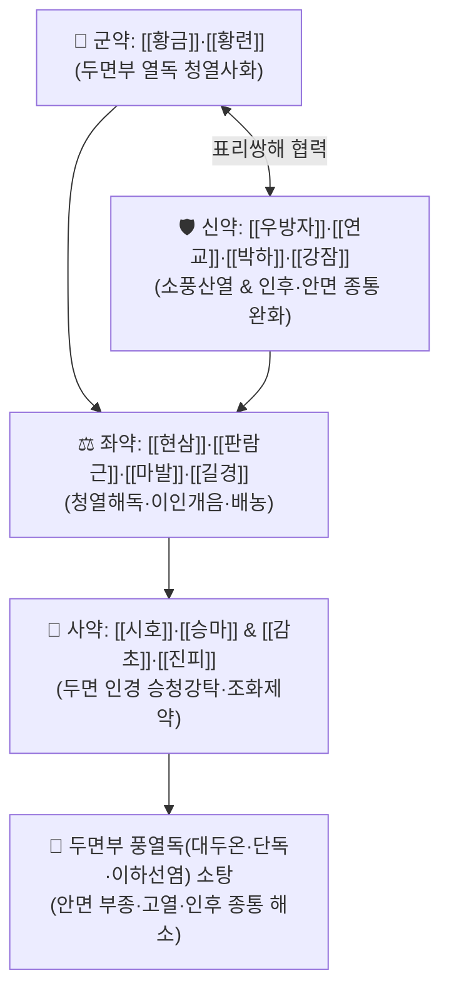

# 🍵 [[보제소독음]] (普濟消毒飮, Pu-Ji-Xiao-Du-Yin / Bojesodokeum)

> **핵심 3줄 요약 (Key Summary)**:
> - 🌿 [[황금]]·[[황련]]을 군약으로, [[우방자]]·[[연교]]·[[박하]]·[[강잠]]·[[현삼]]·[[판람근]]·[[마발]]·[[길경]]·[[감초]]·[[진피]]를 신약·좌약, [[시호]]·[[승마]]를 사약(인경약)으로 구성. 동원시효방 수록.
> - 🎯 안면·목 부위의 심한 [[부종]]·발적·동통, [[발열]], 인후 종통, 안면 [[부종]]("대두온"). 현대의 이하선염(볼거리)·단독(丹毒)·인후염·경부 림프절염 등 두면부 풍열독증에 활용.
> - 🔬 시스템 약리학 분석을 통한 항바이러스(일본뇌염) 관련 작용 기전 연구가 보고됨.
> - ⚠️ 주의사항: 청열해독 약재 위주 구성으로 비위허한 환자는 신중 투여, 표증 초기 오한이 뚜렷한 단순 [[감모]]에는 부적합.

---

## 📌 목차
1. [기본 처방 정보 & 군신좌사 구성](#1-기본-처방-정보--군신좌사-구성)
2. [방제학적 약재 상호작용 & 시너지 네트워크](#2-방제학적-약재-상호작용--시너지-네트워크)
3. [현대 분자약리학적 효능 & 작용 기전](#3-현대-분자약리학적-효능--작용-기전)
4. [적응 병증 및 체질별 감별 (Sweet Spot vs 금기)](#4-적응-병증-및-체질별-감별-sweet-spot-vs-금기)
5. [유사 처방군 감별 매트릭스](#5-유사-처방군-감별-매트릭스)
6. [임상 가감례 & 현대 질환별 응용](#6-임상-가감례--현대-질환별-응용)
7. [💡 사용자 진료실 핵심 필기 & 임상 팁 (원문 보존)](#7--사용자-진료실-핵심-필기--임상-팁-원문-보존)
8. [출처 및 학술 참고 문헌 (References)](#8-출처-및-학술-참고-문헌-references)

---

## 1. 기본 처방 정보 & 군신좌사 구성

금대(金代) 이동원(李東垣)의 《동원시효방(東垣試效方)》에 수록된 처방으로, 1202년경 유행한 "대두온(大頭瘟, Big Head Plague)" — 두면부가 크게 부어오르는 전염성 열독증 — 을 치료하기 위해 창방된 청열해독·소풍산사 대표방입니다. 현대에는 [[단독]](丹毒)·이하선염·편도염·경부 림프절염 등 두면부 풍열독증에 변증 활용됩니다.

---

* **치법**: 청열해독(淸熱解毒), 소풍산사(疏風散邪).

| 약재 | 역할 |
| :--- | :--- |
| [[황금]]·[[황련]] | 군약(君藥) — 청열사화(淸熱瀉火), 두면부 열독 직접 청소 |
| [[우방자]]·[[연교]]·[[박하]]·[[강잠]] | 신약(臣藥) — 소풍산열(疏風散熱), 인후·안면 종통 완화 |
| [[현삼]]·[[판람근]]·[[마발]]·[[길경]] | 좌약(佐藥) — 청열해독·이인개음(利咽開音) |
| [[감초]]·[[진피]] | 조화제약·이기화습 |
| [[시호]]·[[승마]] | 사약(使藥) — 소양·양명경 인경, 열독을 위로 발산·해소 |

---

## 2. 방제학적 약재 상호작용 & 시너지 네트워크

군약인 [[황금]]·[[황련]]으로 두면부에 몰린 열독을 직접 청소하고, 신약인 [[우방자]]·[[연교]]·[[박하]]·[[강잠]]으로 풍열을 발산시켜 표리쌍해(表裏雙解)를 도모합니다. 좌약인 [[현삼]]·[[판람근]]·[[마발]]·[[길경]]은 해독·이인(利咽) 작용을 더하며, 특히 사약인 [[시호]]·[[승마]]는 소양·양명경으로 인경하여 청열해독 약력을 두면부로 끌어올리는("升清降濁") 핵심 배오로 평가됩니다.

---

## 3. 현대 분자약리학적 효능 & 작용 기전

### 1) 항염증·항균 및 두면부 점막·피부 부종 완화
* 군약 [[황금]]([[바이칼린]])과 [[황련]]([[베르베린]]), 좌약 [[판람근]]·[[연교]] 구성 본초들은 일반적으로 [[NF-κB]] 염증 신호 및 [[TNF-α]]·[[IL-6]] 등 사이토카인 억제를 통해 연쇄상구균성 [[단독]] 및 급성 [[편도염]]·[[이하선염]]의 발적과 [[부종]]을 가라앉히는 방향으로 이해됩니다.

### 2) 시스템 약리학 기반 항바이러스 기전
* 시스템 약리학 기법으로 보제소독음의 항바이러스([[일본뇌염]]) 작용 기전을 분석한 연구가 보고되었습니다(상세 서지정보 및 PMID는 미확인 — 아래 References 3번 참고).

⚠️ 내용 검토 필요: 해당 시스템 약리학 연구의 상세 서지정보(저널명·PMID)는 본 노트 기준 확인되지 않았습니다.

---

## 4. 적응 병증 및 체질별 감별 (Sweet Spot vs 금기)

### [✅ 최적 적응증 (Sweet Spot)]
* **두면부 풍열독증("대두온")**: 안면·목 부위의 심한 [[부종]]·발적·동통, [[발열]], 인후 종통([[인후통]]), 눈을 뜨기 어려울 정도의 안면 부종, [[구갈]].
* **현대 임상 주치**: [[단독]](Erysipelas), 유행성 [[이하선염]](볼거리), 급성 화농성 [[편도염]], 경부 [[림프절염]], 급성 [[봉와직염]](안면부) 등에서 변증에 맞으면 활용합니다.
* **설진/맥진 및 체질**: 설홍 태황조(舌紅 苔黃燥), 맥부삭(脈浮數) 또는 홍삭; 상초 풍열이 성한 [[소양인]]·[[태음인]] [[실열]]형 환자.

### [⚠️ 신중 투여 및 금기 (Caution / Contraindication)]
* **[[비위허한]]·초기 풍한표증 금기**: 청열해독 약재가 다량 배오되므로 평소 [[설사]]·[[식욕부진]]이 있는 비위허한 환자 및 [[오한]]이 뚜렷한 초기 풍한 [[감모]]에는 부적합합니다.
* **중증 기도 압박·패혈증 응급**: 편도주위 농양·심부 경부 감염·안와 봉와직염 등으로 호흡곤란이나 고열 패혈증이 의심되면 즉시 응급실 정맥 항생제·배농 처치를 우선합니다.

---

## 5. 유사 처방군 감별 매트릭스

| 처방명 | 핵심 구성 차이 | 주치 및 특징 | 맥진/설진 차이 |
| :--- | :--- | :--- | :--- |
| [[보제소독음]] | [[황금]]·[[황련]]·[[우방자]]·[[연교]]·[[박하]]·[[강잠]]·[[현삼]]·[[판람근]]·[[마발]]·[[길경]]·[[시호]]·[[승마]] | 두면부 풍열독증("대두온") — 안면·목 부위 심한 [[부종]]·발적 | 설홍태황, 맥부삭(浮數) |
| [[은교산]] | [[금은화]]·[[연교]]·[[박하]]·[[우방자]]·[[길경]]·[[형개]] | 온병 위분증(衛分證) — 초기 풍열 표증, 두면부 [[부종]]은 경미 | 설첨홍, 맥부삭 |
| [[형개연교탕]] | [[형개]]·[[연교]]·[[방풍]]·[[백지]]·[[황금]]·[[치자]] | 두면부 풍열 + 상초 기분열 — [[비염]]·[[중이염]] 등 국소 화농 겸함 | 설홍태황, 맥삭 |

---

## 6. 임상 가감례 & 현대 질환별 응용

### 1) 변증 가감법
* 원문에 구체적인 가감(加減) 사례는 별도로 기재되어 있지 않으나, 전통 임상에서는 변비 동반 시 [[대황]]을 소량 가미하거나 구갈 극심 시 [[석고]]·[[천화분]]을 배합해 운용합니다.

### 2) 현대 질환별 매핑
* **이비인후과·소아과**: 유행성 [[이하선염]](볼거리), 급성 [[편도염]], 급성 [[인후염]], 경부 [[림프절염]].
* **피부과·감염내과**: 안면부 [[단독]](Erysipelas), 안면 [[봉와직염]] 보조.

### 양약 상호작용 (Herb–Drug Interaction)
* **항생제 (페니실린계·세팔로스포린계 등)**: 세균성 [[단독]]·급성 [[편도염]]에서 표준 항생제 치료와 병용할 수 있으나 [[황련]]·[[황금]]·[[시호]]의 위장 자극 및 대사 효소 영향을 피하기 위해 2시간 복용 간격을 둡니다.
* **해열진통제 (아세트아미노펜·NSAIDs)**: 고열·안면 동통 시 병용 가능하나 고한 약재와 NSAIDs의 위점막 부담을 줄이기 위해 식후 복용을 권장합니다.
* **[[CYP3A4]]·P-gp 기질 약물 및 이뇨제**: [[황련]]([[베르베린]])·[[시호]]·[[감초]] 배합으로 약물 대사 및 칼륨 저하 변동 가능성이 있으므로 기저질환 약물 복용 시 모니터링합니다.

---

## 7. 💡 사용자 진료실 핵심 필기 & 임상 팁 (원문 보존)

> [!tip] **진료실 실전 노하우 (User Clinical Insight)**
> - 현재 별도로 기록된 원장님 임상 필기가 없습니다. 추후 실전 진료 경험이 누적되면 이 섹션에 추가합니다.

---

## 8. 출처 및 학술 참고 문헌 (References)

1. Me & Qi — Pu Ji Xiao Du Yin (普济消毒饮): [https://www.meandqi.com/knowledge-base/formulas/pu-ji-xiao-du-yin](https://www.meandqi.com/knowledge-base/formulas/pu-ji-xiao-du-yin)
   - **[요약]**: 보제소독음의 구성·출전(동원시효방)·주치를 정리한 TCM 처방학 참고 자료.
2. Attilio D'Alberto — Pu Ji Xiao Du Yin: Chinese Formula for Mumps & Facial Toxin: [https://www.attiliodalberto.com/chinese-herbal-medicine/formulas/pu-ji-xiao-du-yin.php](https://www.attiliodalberto.com/chinese-herbal-medicine/formulas/pu-ji-xiao-du-yin.php)
   - **[요약]**: 보제소독음의 현대 임상 적응증(이하선염 등)을 정리한 참고 자료.
3. **System pharmacology reveals the mechanism of Puji Xiaodu Yin against Japanese encephalitis**. *ScienceDirect*. [https://www.sciencedirect.com/science/article/pii/S2095177926001528](https://www.sciencedirect.com/science/article/pii/S2095177926001528)
   - **[연구 요약]**: 시스템 약리학 기법으로 보제소독음의 항바이러스(일본뇌염) 작용 기전을 분석한 연구.

<!-- 보관 태그(1회용·링크오류, 필요시 복원): 청열해독제, 두면부열독 -->
