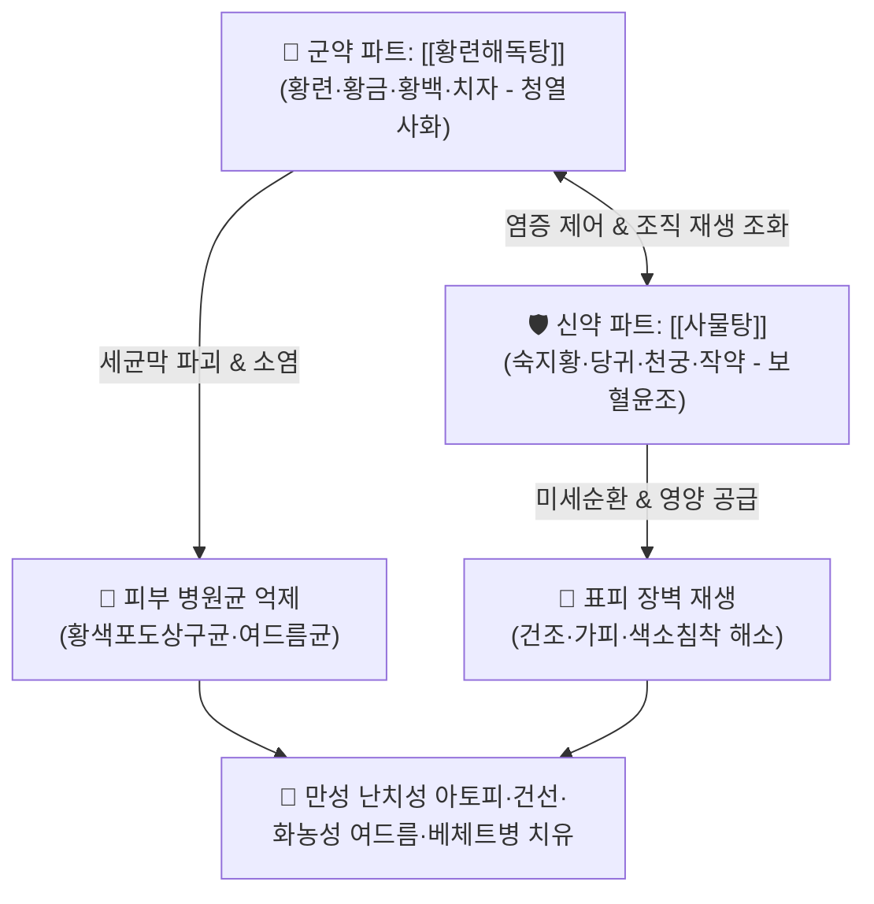

# 🍵 [[온청음]] (溫淸飲, Wen-Qing-Yin / Unchin'in)

> **핵심 3줄 요약 (Key Summary)**:
> - 🌿 기본 구성: [[황련해독탕]]([[황련]]·[[황금]]·[[황백]]·[[치자]]) + [[사물탕]]([[숙지황]]·[[당귀]]·[[천궁]]·[[백작약]]) (청열사화와 양혈보혈의 음양 병용).
> - 🎯 건조·홍반·색소침착 경향의 난치성 아토피 피부염, 황색포도상구균성 피부감염, 화농성 여드름, 가피·표피박리독소(SSSS), 베체트병, 건선.
> - 🔬 NF-κB 염증 차단 및 황색포도상구균 항균, 표피 수분 장벽(Filaggrin) 회복, 혈관 투과성 정상화, 피부 각화 및 색소침착 억제.
> - ⚠️ 주의사항: 숙지황의 자니성으로 인한 소화불량 및 황련·황백 고한성으로 비위허한자 설사 주의, 장기 복용 시 위장 상태 모니터링.

---

## 📌 목차
1. [기본 처방 정보 & 군신좌사 구성](#1-기본-처방-정보--군신좌사-구성)
2. [방제학적 약재 상호작용 & 시너지 네트워크](#2-방제학적-약재-상호작용--시너지-네트워크)
3. [현대 분자약리학적 효능 & 작용 기전](#3-현대-분자약리학적-효능--작용-기전)
4. [적응 병증 및 체질별 감별 (Sweet Spot vs 금기)](#4-적응-병증-및-체질별-감별-sweet-spot-vs-금기)
5. [유사 처방군 감별 매트릭스](#5-유사-처방군-감별-매트릭스)
6. [임상 가감례 & 현대 질환별 응용](#6-임상-가감례--현대-질환별-응용)
7. [💡 사용자 진료실 핵심 필기 & 임상 팁 (원문 보존)](#7--사용자-진료실-핵심-필기--임상-팁-원문-보존)
8. [출처 및 학술 참고 문헌 (References)](#8-출처-및-학술-참고-문헌-references)

---

## 1. 기본 처방 정보 & 군신좌사 구성

* **출전**: 공정현(龔廷賢) 『[[만병회춘]]』(萬病回春) 부인문(婦人門)
* **치법**: 청열해독(淸熱解毒), 양혈보혈(養血補血), 청열조습(淸熱燥濕), 활혈화어(活血化瘀)

| 구분 | 방제군 / 약재명 | 표준 용량 | 본초 효능 & 방제 내 역할 |
| :--- | :--- | :--- | :--- |
| **군약 (君藥)** | [[황련해독탕]] ([[황련]], [[황금]], [[황백]], [[치자]]) | 각 3~5g | **청열해독·사화조습**: 삼초의 실열과 피부·점막의 화독 및 세균 증식을 억제 |
| **신약 (臣藥)** | [[사물탕]] ([[숙지황]], [[당귀]], [[천궁]], [[백작약]]) | 각 4~6g | **양혈보혈·활혈윤조**: 손상된 피부에 영양을 공급하고 미세순환을 회복시켜 피부 재생 촉진 |
| **좌약 (佐藥)** | [[백지]] (가감 배오 시) | 3~4g | **소종배농·지통**: 두면부 및 체표 모낭 병소로 약력을 유도하고 배농 촉진 |

🔬 **분자 구조** (Wikimedia Commons, Public Domain)
![[Berberine_구조.png|480]]
> [그림] Berberine (베르베린, C20H18NO4+) 분자 구조 — 출처: Wikimedia Commons (군약 [[황련해독탕]] 중 [[황련]] 주성분, 기존 첨부 재사용)

> **방제 구조 분석**:
> * **청열해독군([[황련해독탕]])**: 피부 및 점막의 붉은 열감, 화농성 세균(황색포도상구균)을 억제하는 천연 항생·소염 파트.
> * **보혈영양군([[사물탕]])**: 피부 건조, 각질, 색소침착을 해결하고 표피 재생을 촉진하는 영양·재생 파트.
> * **청열(淸)과 보온(溫)의 완벽한 조화**: 차가운 약으로 열을 끄면서도 따뜻한 사물탕으로 혈맥이 얼어붙는 것을 막아 만성 피부염에 장기 복용이 가능합니다.

---

## 2. 방제학적 약재 상호작용 & 시너지 네트워크

* **황련해독탕의 급성 화독 차단**: 세균 증식과 염증 매개인자를 억제하여 붉은 발적과 화농, 박동통을 잡습니다.
* **사물탕의 만성 혈허윤조(血虛潤燥)**: 만성 염증으로 파괴된 피부 기저층에 혈액과 영양을 공급하여 거칠어진 피부 각질과 색소침착을 개선합니다.

---

## 3. 현대 분자약리학적 효능 & 작용 기전

### 1) 피부 병원성 황색포도상구균 항균 및 독소 억제
* [[황련]]의 [[베르베린]]과 [[황금]]의 [[바이칼린]]은 아토피 환자 피부에 과증식하는 황색포도상구균(*Staphylococcus aureus*)의 세포벽을 파괴하고, 표피박리독소(Exfoliative toxin) 분비를 차단합니다.

### 2) 표피 장벽 단백질(Filaggrin/Involucrin) 발현 촉진
* [[당귀]]와 [[숙지황]] 유효 성분은 각질형성세포의 필라그린(Filaggrin) 합성을 유도하여 수분 손실(TEWL)을 막고 피부 건조증 및 각질 탈락을 방어합니다.

### 3) 만성 염증성 색소침착 및 혈관 신생 억제
* [[치자]]의 제니포시드(Geniposide)와 [[작약]]의 패오니플로린(Paeoniflorin)은 멜라닌 생성을 억제하고 모세혈관 확장성 홍반을 정상화합니다.

![[온청음_만성_염증성_색소침착_및_혈관_신생.png]]

> [그림 설명: 황색포도상구균 감염 및 표피박리독소에 의한 피부 장벽 파괴와 온청음의 복합 치유 기전]

> 🧬 **현대 학술 근거 (2026-09-20 B-7 패치)**: 알레르기 접촉피부염(ACD) 신호 경로가 새로 규명됨 — 2,4-디니트로플루오로벤젠(DNFB) 유발 ACD 마우스 모델에서 온청음이 병리 손상·비만세포 증가·귀 두께 및 무게 증가를 완화하고, [[IL-6]]·[[IL-1β]]·IFN-γ·[[IL-4]]·T-bet·STAT1 mRNA 발현과 비장 Th1 세포 비율을 하향 조절했습니다. UPLC-MS/MS로 혈청 내 38개 성분을 동정하고 네트워크 약리 분석으로 123개 중첩 표적 유전자를 도출한 결과, 귀 조직의 `p-JAK2`·`p-STAT1`·`p-ERK`·`p-JNK`·`p-p38` 발현을 감소시켜 `JAK2/STAT1` 및 [[MAPK]] 신호 경로 억제가 핵심 기전으로 확인되었습니다 `[PubMed 40463860]`. 기존 필라그린 발현 촉진·항균 기전과는 별도로 Th1 면역반응 및 JAK-STAT/MAPK 경로 억제를 제시합니다.

---

## 4. 적응 병증 및 체질별 감별 (Sweet Spot vs 금기)

### [✅ 최적 적응증 (Sweet Spot)]
* **난치성 알레르기 & 면역 피부염**:
  * **[[아토피 피부염]]**: 붉은 홍반([[혈열]])과 거친 건조·가피·색소침착([[혈허]])이 공존하는 아급성·만성기 아토피.
  * **[[건선]] & [[습진]]**: 주부 습진, [[화폐상 습진]], 건선성 판태, 피지결핍성 습진.
* **세균성 피부 감염증**:
  * [[황색포도상구균]] 감염증, 포도상구균 열상피부증후군(SSSS), [[봉와직염]] 초기, 천포창.
  * 중증 화농성 [[여드름]]([[모낭염]]), 가피가 앉는 농포성 피부염, 세툭시맙 유발 피부 독성 보조.
* **자가면역 및 점막 질환**:
  * [[베체트병]](Behçet's disease), 재발성 아프타 [[구내염]], 외음부 궤양.
* **체질**: 피부가 붉고 가려우면서도 건조하고 각질이 일어나는 혈열과 혈허가 겹친 [[소양인]]·[[태음인]] 환자.

### [⚠️ 신중 투여 및 금기 (Caution / Contraindication)]
* **극심한 [[비위허한]] 주의**: 평소 소화력이 약하고 묽은 변([[설사]])을 자주 보는 환자는 [[숙지황]]의 자니성(더부룩함)과 [[황련]]·[[황백]]의 고한성에 주의하여 [[생지황]] 치환 또는 건비약을 병용합니다.
* **순수 [[음허]]·무염증 건조증**: 붉은 열감·발적 없이 안색만 창백하고 건조한 경우에는 [[사물탕]]이나 [[당귀음자]]가 적합합니다.

---

## 5. 유사 처방군 감별 매트릭스

| 처방명 | 기본 구성 | 주요 타깃 병태 | 변증 요점 & 감별 포인트 |
| :--- | :--- | :--- | :--- |
| [[온청음]] | [[황련해독탕]] + [[사물탕]] | 혈열 + 혈허 (화열과 건조 공존) | **홍반 + 건조 + 색소침착**: 아토피, 건선, 화농성 여드름, 베체트병 |
| [[황련해독탕]] | [[황련]], [[황금]], [[황백]], [[치자]] | 순수 실열화독 (건조증 없음) | **순수 급성 열독**: 얼굴이 불타듯 붉고 열감과 염증만 극심할 때 |
| [[사물탕]] | [[숙지황]], [[당귀]], [[천궁]], [[백작약]] | 순수 혈허 (열감 없음) | **순수 혈허 건조**: 안색이 창백하고 피부가 건조하나 열감과 염증은 없을 때 |
| [[소풍산]] | 형개, 방풍, 당귀, 지황, 고삼, 창출 등 | 풍습열(風濕熱) | **진물과 가려움 극심**: 삼출물이 흐르는 급성기 습진 |
| [[당귀음자]] | 사물탕 + 황기, 백질려, 형개, 방풍 | 노인성 혈허풍조 | **노인성 건조 가려움**: 열증과 화농성 염증 소견이 거의 없을 때 |

---

## 6. 임상 가감례 & 현대 질환별 응용

### 1) 변증 가감법
* **가려움증이 극심할 때**: [[백선피]], [[지부자]], [[고삼]]을 가미하여 거풍지양.
* **화농과 염증이 심할 때**: [[금은화]], [[연교]], [[백지]]를 가미하여 소염배농.
* **소화장애(더부룩함)가 나타날 때**: [[숙지황]]을 [[생지황]]으로 바꾸고 [[사인]], [[진피]]를 가미.
* **피부 건조 및 인설(비듬)이 극심할 때**: [[호마인]], [[하수오]]를 가미하여 자음윤조.

### 2) 현대 임상 질환별 응용
* **피부과**: 만성 [[아토피 피부염]], 심상성 [[건선]], 중증 화농성 [[여드름]], 결절성 양진, 피지결핍성 [[습진]].
* **류마티스내과**: [[베체트병]](구강·외음부 궤양), 혈관염.
* **종양 피부독성 보조**: EGFR 억제제([[세툭시맙]]) 유발 피부 발진 완화 증례 보고 `[PubMed 33253347]`.

### 양약 상호작용 (Herb–Drug Interaction)
* **항응고제·항혈소판제 ([[와파린]], [[아스피린]], [[클로피도그렐]])**: [[사물탕]] 구성 본초([[당귀]]·[[천궁]]·[[백작약]])의 활혈·항혈소판 작용이 출혈 위험이나 INR 상승에 관여할 수 있으므로 장기 병용 시 멍·출혈 여부를 관찰합니다.
* **[[CYP3A4]]·P-gp 기질 약물 및 면역억제제 (사이클로스포린·타크로리무스·JAK 억제제)**: [[황련해독탕]] 파트([[베르베린]]·[[바이칼린]])가 장관 P-gp 및 CYP3A4 대사에 영향을 줄 수 있고, 전신 면역억제제·생물학적 제제와 병용 시 혈중 농도 및 간·신기능 추적 모니터링이 필요합니다.
* **표적항암제 유발 피부독성 ([[세툭시맙]])**: 항암 피부독성 경감 목적으로 협진 보고가 있으나(단일 증례 `[PubMed 33253347]`), 반드시 종양내과 주치의 확인하에 복용 간격을 2시간 이상 유지합니다.

---

## 7. 💡 사용자 진료실 핵심 필기 & 임상 팁 (원문 보존)

* **아토피 환자의 핵심 병태 포착**:
  * 피부가 붉어지는 급성 염증(황련해독탕 증)과 긁어서 피딱지가 앉고 검게 착색되며 건조해지는 만성 영양 장애(사물탕 증)가 동시에 나타나는 환자에게 온청음은 대체 불가능한 1차 선택제입니다.
* **황색포도상구균 감염 표적 운용**:
  * 진물과 피딱지(가피), 표피 박리가 동반되는 포도상구균성 2차 감염 피부질환에 탁월한 소염 및 피부 장벽 회복 효과를 발휘합니다.

---

## 8. 출처 및 학술 참고 문헌 (References)

1. **공정현(龔廷賢) (1587)**. 『[[만병회춘]](萬病回春)』, 婦人門.
   - **[연구 요약]**: 온청음(해독사물탕) 원전 수록. 황련해독탕의 청열사화와 사물탕의 양혈보혈을 결합해 혈열·혈허 겸증 치료 표준 방제로 제시.
2. **한의학 고전 및 한국 임상 문헌**: *동의보감(東醫寶鑑)*, 전국한의과대학 방제학교수 공편저 『방제학(方劑學)』(영림사) — 난치성 아토피·건선·베체트병 등 홍반·건조·색소침착 공존 피부질환 응용 수록.
3. **Taira K et al. (2020)**. Unseiin, a Kampo medicine, Reduces the Severity and Manifestations of Skin Toxicities Induced by Cetuximab: A Case Report. *Yonago Acta Medica*, 63(4): 379-384. [PMID: 33253347](https://pubmed.ncbi.nlm.nih.gov/33253347/)
   - **[연구 요약]**: 세툭시맙(Cetuximab) 표적항암제 유발 중증 피부 독성 환자에서 온청음(Unseiin) 투여 후 중증도 및 피부 증상이 개선된 증례를 보고함.
4. **Yeh CC et al. (2019)**. Simultaneous quantification of six indicator compounds in Wen-Qing-Yin by high-performance liquid chromatography-diode array detection. *Journal of Food and Drug Analysis*, 27(3): 749-757. [PMID: 31324290](https://pubmed.ncbi.nlm.nih.gov/31324290/)
   - **[연구 요약]**: HPLC-DAD 분석을 통해 온청음 내 6종 핵심 지표 성분(베르베린·바이칼린·제니포시드·페오니플로린·페룰산 등)의 동시 정량 품질 표준을 확립함.
5. **Ren M et al. (2025)**. Wenqing Yin Attenuates the Allergic Contact Dermatitis Response by Inhibiting the JAK2/STAT1 and MAPK Signaling Pathways. *Journal of Inflammation Research*, 18: 7013-7031. [PMID: 40463860](https://pubmed.ncbi.nlm.nih.gov/40463860/)
   - **[연구 요약]**: DNFB 유발 알레르기 접촉피부염(ACD) 마우스 모델에서 온청음의 `JAK2/STAT1`·`MAPK` 경로 억제를 통한 Th1 면역반응 진정 기전을 네트워크약리·대사체 분석으로 규명함.
