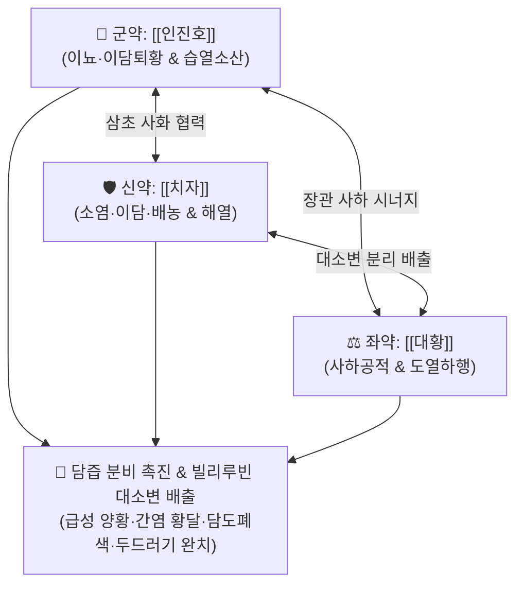

# 🍵 [[인진호탕]] (茵蔯蒿湯, Yin-Chen-Hao-Tang / Inchinko-to)

> **핵심 3줄 요약 (Key Summary)**:
> - 🌿 기본 구성: [[인진호]], [[치자]], [[대황]] (청열이습·이담퇴황의 삼미 간결 배오).
> - 🎯 양명열독(陽明熱毒)성 급만성 황달(전신 및 공막 황염), 담도 폐색, 급만성 간염, 간경변 복수 초기, 흉복부 팽만감, 갈증, 변비, 소변 붉고 찔끔거림, 만성 두드러기.
> - 🔬 담즙산 수송체(BSEP/MRP2) 발현 촉진으로 빌리루빈 직접 배출, 간세포 NF-κB 염증 차단 및 간섬유화 억제, 대장 연동운동 촉진을 통한 열독 사하.
> - ⚠️ 주의사항: 대황의 강렬한 사하성으로 설사 경향자, 안색 불량·사지 냉감의 음황(陰黃/비신양허) 환자 절대 금기, 중병즉지(황달 소퇴 후 단절).

---

## 📌 목차
1. [기본 처방 정보 & 군신좌사 구성](#1-기본-처방-정보--군신좌사-구성)
2. [방제학적 약재 상호작용 & 시너지 네트워크](#2-방제학적-약재-상호작용--시너지-네트워크)
3. [현대 분자약리학적 효능 & 작용 기전](#3-현대-분자약리학적-효능--작용-기전)
4. [적응 병증 및 체질별 감별 (Sweet Spot vs 금기)](#4-적응-병증-및-체질별-감별-sweet-spot-vs-금기)
5. [유사 처방군 감별 매트릭스](#5-유사-처방군-감별-매트릭스)
6. [임상 가감례 & 현대 질환별 응용](#6-임상-가감례--현대-질환별-응용)
7. [💡 사용자 진료실 핵심 필기 & 임상 팁 (원문 보존)](#7--사용자-진료실-핵심-필기--임상-팁-원문-보존)
8. [출처 및 학술 참고 문헌 (References)](#8-출처-및-학술-참고-문헌-references)

---

## 1. 기본 처방 정보 & 군신좌사 구성

* **출전**: 장중경(張仲景) 『[[상한론]]』(傷寒論) 양명병편 및 『[[금궤요략]]』(황달병편)
* **치법**: 청열이습(淸熱利濕), 사하퇴황(瀉下退黃), 도열하행(導熱下行)

| 구분 | 약재명 | 표준 용량 | 본초 효능 & 방제 내 역할 |
| :--- | :--- | :--- | :--- |
| **군약 (君藥)** | [[인진호]] | 18~30g (대량) | **이뇨·이담·해열**: 습열을 소변으로 빼내고 담즙 분비를 촉진하여 황달을 씻어내는 최고 성약 |
| **신약 (臣藥)** | [[치자]] | 9~12g | **소염·이담·배농·해열**: 삼초의 열독을 아래로 이끌어 소변으로 배출하고 담즙 울체 소통 |
| **좌약 (佐藥)** | [[대황]] | 6~9g (후하 권장) | **사하공적·파어도열**: 장관을 통해 어혈과 담즙 노폐물을 대변으로 쏟아내어 열독 제거 |

> **전탕 및 복용 특이사항**:
> * 전통적으로 [[인진호]]를 먼저 끓여(선전 先煎) 유효 쓴맛 성분을 충분히 우려낸 뒤, [[치자]]와 [[대황]]을 넣고 달여 복용합니다.
> * 대소변 양로(兩路)로 습열을 분리 배출시키는 '이뇨 + 사하' 복합 퇴황 메커니즘을 완성합니다.

🔬 **분자 구조** (Wikimedia Commons, Public Domain — 좌약 대황 안트라퀴논 성분)
![[Emodin_구조.png|480]]
> [그림] 에모딘(Emodin, C₁₅H₁₀O₅, 대황 PubChem CID 3220) 분자 구조 — 출처: Wikimedia Commons

---

## 2. 방제학적 약재 상호작용 & 시너지 네트워크

* **인진호 + 치자의 이담이뇨(利膽利尿)**: [[인진호]]가 간세포의 담즙 생성을 촉진하고, [[치자]]가 삼초의 화열을 소변으로 빼내어 혈중 빌리루빈 농도를 급격히 떨어뜨립니다.
* **대황의 도열하행(導熱下行)**: 장관 평활근을 자극하여 정체된 담즙산과 숙변을 대변으로 일거에 쏟아내어 장-간 순환(Enterohepatic circulation)을 차단합니다.

---

## 3. 현대 분자약리학적 효능 & 작용 기전

### 1) 담즙산 수송체(BSEP/MRP2) 발현 및 빌리루빈 배출
* [[인진호]]의 캡실라린(Capillarisin)과 [[치자]]의 [[제니포사이드]](Geniposide)는 간세포 담즙 수송체([[BSEP]]) 및 다제내성 단백질-2(MRP2) 발현을 유도하여, 담도 내로의 [[담즙산]]과 직접 빌리루빈 배출을 가속화합니다.

> 🧬 **현대 학술 근거 (2026-09-17 B-7 패치)**: 담관 결찰(BDL) 폐쇄성 [[황달]] 랫드 및 L02·HK-2 세포 모델 연구에서 인진호탕이 상피세포성장인자수용체(EGFR) 활성화를 억제하여 구성적 안드로스탄 수용체(CAR)의 핵 내 이동을 촉진하고, 간에서 [[CYP3A4]]·UGT1A1·MRP3·MRP4를, 신장에서 MRP2·MRP4를 상향 조절함으로써 담즙산 신 청소율(Clr)과 요배출을 늘려 혈중 담즙산을 낮추는 `EGFR-CAR` 신호축이 규명되었습니다 `[PubMed 40177192]`.

### 2) 간세포 보호 및 항섬유화 작용
* [[대황]]의 [[에모딘]]과 [[인진호]] 유효 성분이 간성상세포 활성화를 억제하고 Concanavalin A 유도 간염 모델의 [[NF-κB]] 염증을 차단하여 간섬유화와 간세포 괴사를 억제합니다 `[PubMed 16640837]`. 가미방 연구에서도 [[지방간]](NAFLD) 모델의 대사·항염 표적이 검증되었습니다 `[PubMed 40553824]`.

### 3) 장-간 순환 차단을 통한 독소 배출
* [[대황]]의 [[센노사이드]]가 대장 연동운동을 촉진하여 재흡수되는 담즙산 독소를 대변으로 배출시킵니다.

![[인진호탕_장-간_순환_차단을_통한_독소_배출.png|466]]

> [그림 설명: 간세포 담즙 배설 경로 및 인진호탕 약재군의 담즙 분비·사하 복합 작용 기전]

---

## 4. 적응 병증 및 체질별 감별 (Sweet Spot vs 금기)

### [✅ 최적 적응증 (Sweet Spot)]
* **양황(陽黃, 급성 [[실열]]성 [[황달]])**:
  * 눈의 흰자위(공막)와 전신 피부가 샛노랗게 물드는 황달.
  * 상복부 및 흉부 [[복부팽만]], 불쾌감, [[구역]], 심한 [[구갈]](갈증), [[변비]], 소변이 붉고 찔끔거림(요적).
* **간·담도계 급성 질환**:
  * 급성 바이러스성 간염, 독성 간염 보조, [[담석증]] 및 담도 폐색성 황달(기계적 완전 폐색 수술·내시경 평가 병행), [[간경변]] 초기 복수.
* **피부과**: 담즙 정체성 [[소양증]], 만성 난치성 [[두드러기]].
* **체질**: 체력이 건실하고 맥이 침실(沈實)하거나 활삭(滑數)하며 대변이 굳은 [[실증]] 양황 환자.

### [⚠️ 신중 투여 및 금기 (Caution / Contraindication)]
* **음황(陰黃) 절대 금기**: 환자가 마르고 안색이 어둡고 칙칙하며 손발이 차고 묽은 변([[설사]])을 보는 [[비신양허]] 황달 환자에게 투약 시 비양을 손상하므로 절대 금기입니다([[인진사역탕]], [[이중탕]] 적용).
* **[[설사]] 경향자 & [[임산부]] 주의**: 평소 대변이 무른 환자는 [[대황]]을 빼거나 대폭 감량하며, 임산부는 대황의 자궁 수축·사하 작용으로 금기입니다.
* **총담관 완전 폐색·급성 담관염 응급**: 고열·오한·황달(샤르코 3징후) 등 급성 화농성 담관염·담도 폐색 시 즉시 ERCP·외과적 감압 치료를 우선합니다.

---

## 5. 유사 처방군 감별 매트릭스

| 처방명 | 기본 구성 | 주요 타깃 병리 | 변증 요점 & 감별 포인트 |
| :--- | :--- | :--- | :--- |
| [[인진호탕]] | [[인진호]], [[치자]], [[대황]] | 양명 습열, 담즙 울체 | **급성 양황 & 변비 표준방**: 샛노란 황달, 구갈, 변비, 흉복부 팽만감 |
| [[인진오령산]] | [[인진호]] + [[오령산]] | 비위 습체, 수습 정체 | **습(濕)이 열보다 심할 때**: 황달이 있으나 열감과 변비는 없고 소변 불리 위주일 때 |
| [[인진사역탕]] | [[인진호]], [[부자]], [[건강]], [[감초]] | 비신양허 (음황) | **어둡고 차가운 음황**: 손발이 차고 맥이 미약한 만성 허랭성 황달 |
| [[생간건비탕]] | 인진, 용담, 평위, 이진, 오령 등 | 간문맥압 항진 | **만성 간-비위 울혈**: 지방간, 만성피로, GERD, 치질 |

---

## 6. 임상 가감례 & 현대 질환별 응용

### 1) 변증 가감법
* **담석으로 인한 산통이 극심할 때**: [[금전초]], [[해금사]], [[울금]]을 가미하여 이담배석.
* **간기울결로 협통(옆구리 통증)이 심할 때**: [[시호]], [[황금]], [[작약]]을 가미([[대시호탕]] 합방).
* **소변 불리와 부종이 심할 때**: [[택사]], [[복령]], [[차전자]]를 가미.
* **황달이 가라앉은 후**: 대황을 즉시 배제하고 건비보혈제로 전환하여 정기 회복.

### 2) 현대 임상 질환별 응용
* **소화기내과**: 급만성 간염, [[담낭염]], [[담석증]], 폐색성 [[황달]], [[비알코올성 지방간염]](NASH).
* **피부과**: 담즙 울체성 [[소양증]], 만성 [[두드러기]].

### 양약 상호작용 (Herb–Drug Interaction)
* **[[CYP3A4]]·UGT1A1·MRP 수송체 기질 약물 (간·담도 약물 등)**: 인진호탕이 간 내 CAR 핵 이동을 통해 `CYP3A4`·`UGT1A1`·`MRP` 수송체 발현을 상향 조절하는 기전이 보고되었으므로 `[PubMed 40177192]`, 이 효소/수송체로 대사·배설되는 양약(예: 면역억제제·스타틴·칼슘채널차단제·항부정맥제)과 병용 시 혈중 농도 변동을 모니터링합니다.
* **우르소데옥시콜산([[UDCA]]) 및 콜레스티라민**: 담즙산 배설 작용이 [[UDCA]]와 상가될 수 있으며, 콜레스티라민 같은 담즙산 결합 수지 및 경구 약물은 [[대황]]의 사하 작용에 의해 흡수가 저해될 수 있으므로 최소 2시간 이상 복용 간격을 둡니다.
* **이뇨제·강심배당체·항응고제 ([[푸로세미드]], [[디곡신]], [[와파린]])**: [[대황]] 사하로 인한 칼륨 소실([[저칼륨혈증]]) 및 비타민 K·응고인자 생성 변동(간담도 환자의 출혈 경향 포함)에 주의합니다.

---

## 7. 💡 사용자 진료실 핵심 필기 & 임상 팁 (원문 보존)

* **체력 및 대변 상태 확인 필수**:
  * 체력이 건실하고 변비가 있는 환자에게 적중하며, 환자가 안색이 불량하고 사지가 차며 설사 경향이 있을 때는 [[대황]]을 반드시 배제하거나 [[인진오령산]], [[인진사역탕]]으로 전방해야 합니다.
* **중병즉지(中病卽止) 퇴황 원칙**:
  * 대변이 뚫리고 소변이 맑아지며 눈과 피부의 황달이 걷히면 장기 복용을 중단하여 비위 양기 손상을 방지해야 합니다.

---

## 8. 출처 및 학술 참고 문헌 (References)

1. **장중경(張仲景) (200)**. 『[[상한론]](傷寒論)』 辨陽明病脈證幷治 · 『[[금궤요략]](金匱要略)』 黃疸病脈證幷治.
   - **[연구 요약]**: 인진호탕 원전 수록. 양명 습열·실열성 양황(陽黃)과 대소변 불통을 치료하는 청열이습·사하퇴황 표준 방제로 제시.
2. **한의학 고전 및 한국 임상 문헌**: *동의보감(東醫寶鑑)* 황달문(黃疸門), *방약합편(方藥合編)* — 인진호 선전과 치자·대황 배오, 음황 금기 및 중병즉지 복약 지침 수록.
3. **Liu JJ et al. (2025)**. Yinchenhao decoction alleviates obstructive jaundice liver injury by modulating epidermal growth factor receptor and constitutive androstane receptor signaling. *World Journal of Hepatology*, 17(3): 101724. [PMID: 40177192](https://pubmed.ncbi.nlm.nih.gov/40177192/)
   - **[연구 요약]**: 폐쇄성 황달 모델에서 인진호탕이 EGFR 억제를 통한 CAR 핵 이동 및 간·신장 대사/수송체(`CYP3A4`·`UGT1A1`·`MRP2/3/4`) 상향 조절로 담즙산 신배출을 촉진함을 규명함.
4. **Zhou RY et al. (2025)**. Investigating therapeutic effects and the underlying mechanisms of jia-wei-yin-chen-hao-tang in non-alcoholic fatty liver disease based on network pharmacology analysis and experimental validation. *Journal of Ethnopharmacology*, 352: 120158. [PMID: 40553824](https://pubmed.ncbi.nlm.nih.gov/40553824/)
   - **[연구 요약]**: 네트워크약리학 및 실험 검증을 통해 가미인진호탕이 비알코올성 지방간질환(NAFLD)에서 발휘하는 치료 효과와 분자 표적 기전을 분석함.
5. **Cai H et al. (2006)**. Aqueous extract of Yin-Chen-Hao decoction, a traditional Chinese prescription, exerts protective effects on concanavalin A-induced hepatitis in mice through inhibition of NF-kappaB. *Journal of Pharmacy and Pharmacology*, 58(5): 677-684. [PMID: 16640837](https://pubmed.ncbi.nlm.nih.gov/16640837/)
   - **[연구 요약]**: 콘카나발린 A 유도 마우스 간염 모델에서 인진호탕 물추출물이 NF-κB 억제를 통해 간 보호 효과를 발휘함을 규명함.
