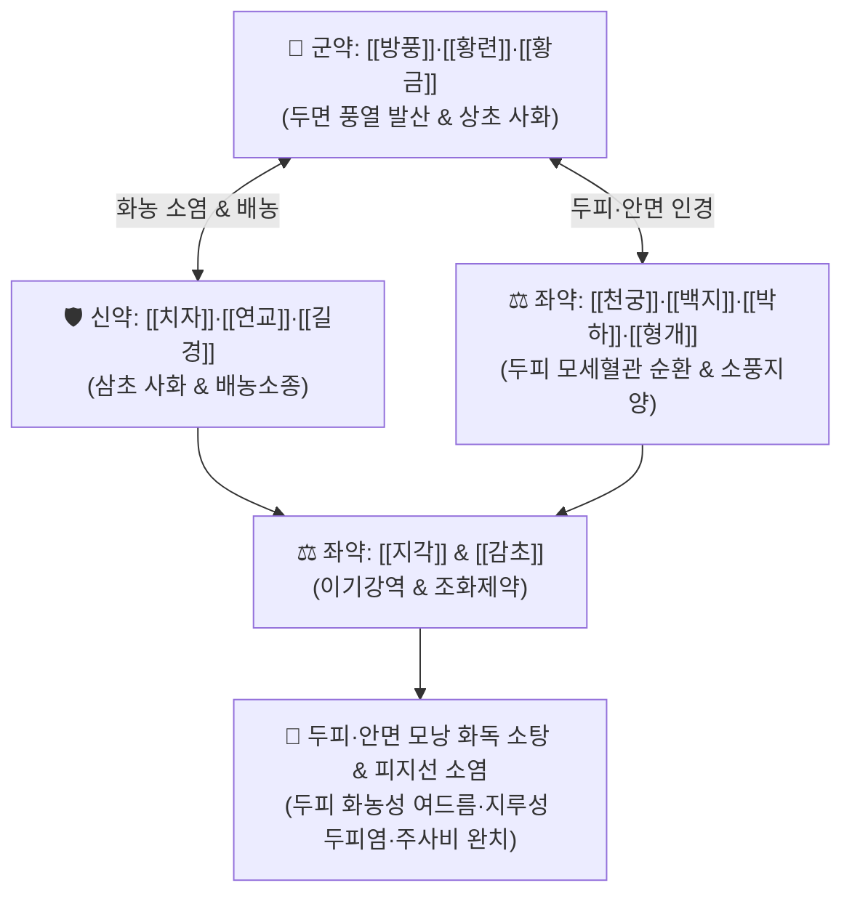

# 🍵 [[청상방풍탕]] (淸上防風湯, Qing-Shang-Fang-Feng-Tang / Seijo-bofuto)

> **핵심 3줄 요약 (Key Summary)**:
> - 🌿 기본 구성: [[방풍]], [[황련]], [[황금]], [[치자]], [[연교]], [[길경]], [[천궁]], [[백지]], [[박하]], [[형개]], [[지각]], [[감초]] (상초 풍열사화·청열해독의 두면부 여드름 표준방).
> - 🎯 두피 및 안면부의 붉고 화농된 구진·농포성 여드름, 지루성 두피염, 두피 모낭염, 안면 홍반, 주사비(딸기코), 안구 충혈, 상초 풍열 두통.
> - 🔬 *Cutibacterium acnes* 및 황색포도상구균 항균, 피지선 호르몬 수용체 안정화 및 피지 분비 억제, NF-κB 염증 차단 및 두면부 모세혈관 수축.
> - ⚠️ 주의사항: 황련·황금·치자의 고한성으로 비위허한(소화불량·설사) 환자 신중 투여, 피부가 창백하고 차가운 음저형 발진 금기.

---

## 📌 목차
1. [기본 처방 정보 & 군신좌사 구성](#1-기본-처방-정보--군신좌사-구성)
2. [방제학적 약재 상호작용 & 시너지 네트워크](#2-방제학적-약재-상호작용--시너지-네트워크)
3. [현대 분자약리학적 효능 & 작용 기전](#3-현대-분자약리학적-효능--작용-기전)
4. [적응 병증 및 체질별 감별 (Sweet Spot vs 금기)](#4-적응-병증-및-체질별-감별-sweet-spot-vs-금기)
5. [유사 처방군 감별 매트릭스](#5-유사-처방군-감별-매트릭스)
6. [임상 가감례 & 현대 질환별 응용](#6-임상-가감례--현대-질환별-응용)
7. [💡 사용자 진료실 핵심 필기 & 임상 팁 (원문 보존)](#7--사용자-진료실-핵심-필기--임상-팁-원문-보존)
8. [출처 및 학술 참고 문헌 (References)](#8-출처-및-학술-참고-문헌-references)

---

## 1. 기본 처방 정보 & 군신좌사 구성

* **출전**: 공정현(龔廷賢) 『[[만병회춘]]』(萬病回春) 두면문(頭面門)
* **치법**: 청상사화(淸上瀉火), 소풍청열(疏風淸熱), 해독배농(解毒排膿), 통락소종(通絡消腫)

| 구분 | 약재명 | 표준 용량 | 본초 효능 & 방제 내 역할 |
| :--- | :--- | :--- | :--- |
| **군약 (君藥)** | [[방풍]], [[황련]], [[황금]] | 각 3~5g | **소풍해표 & 청상사화**: 두면부의 풍열(風熱)을 흩어내고 상초의 극심한 화독을 소탕 |
| **신약 (臣藥)** | [[치자]], [[연교]], [[길경]] | 각 3~5g | **청열사화 & 배농소종**: 삼초의 열을 내리고 모낭 내 고름과 염증 삼출물 배출 |
| **좌약 (佐藥)** | [[천궁]], [[백지]], [[박하]], [[형개]] | 각 2~4g | **두면 인경 & 소풍지통**: 머리와 두피, 안면부 모세혈관으로 약력을 인경하고 가려움증 완화 |
| **좌약 (佐藥)** | [[지각]] | 3g | **관흉이기**: 상초의 기체를 풀고 열독이 위로 쏠리는 것을 하강 |
| **사약 (使藥)** | [[감초]] | 2g | **조화제약·완급**: 비위를 보호하고 제약을 조화 |

> **방제 구조 분석**:
> * **청상(淸上)의 특화 배오**: [[황련해독탕]]의 3미([[황련]], [[황금]], [[치자]])로 상초 열을 끄고, 5대 풍열 인경약([[방풍]], [[형개]], [[박하]], [[백지]], [[천궁]])으로 약력을 머리 꼭대기(두피)와 안면 모낭으로 직달시킵니다.
> * **배농과 이기**: [[길경]]의 배농력과 [[지각]]의 이기력이 결합하여 화농을 신속히 배출합니다.

---

## 2. 방제학적 약재 상호작용 & 시너지 네트워크

* **상초 열독의 직달(直達) 배오**: 두피와 얼굴로 솟구치는 화열을 끄기 위해 가볍고 맑은 풍열약과 고한 청열약을 결합하였습니다.
* **염증과 피지의 동시 제어**: 피지선의 급성 세균 감염과 혈관 확장성 홍반을 동시에 가라앉힙니다.

---

## 3. 현대 분자약리학적 효능 & 작용 기전

### 1) 여드름균(C. acnes) 및 모낭 화농균 항균
* [[황련]]의 [[베르베린]], [[황금]]의 [[바이칼린]], [[연교]]의 포시티아사이드(Forsythiaside)가 *Cutibacterium acnes*와 표피포도상구균의 세균막을 분해하고 증식을 억제합니다.

🔬 **분자 구조** (Wikimedia Commons, Public Domain)
![[Berberine_구조.png|480]]
> [그림] 베르베린(Berberine, C₂₀H₁₈NO₄⁺) 분자 구조 — 출처: Wikimedia Commons (Berberine_구조.png)

### 2) 피지 분비 억제 및 모낭 각화 정상화
* 피지선 세포의 $5\alpha$-리덕타아제 활성을 완화하고 리파아제에 의한 유리지방산 과형성을 차단하여 면포([[여드름]]) 생성을 억제합니다.

### 3) 두면부 모세혈관 확장성 홍반 개선
* [[천궁]]과 [[백지]]의 혈류 개선 작용 및 [[치자]]의 혈관 투과성 정상화 효능이 두피와 얼굴의 붉은 열감([[안면홍조]])과 울혈을 신속히 가라앉힙니다.

> 🧬 **현대 학술 근거 (2026-09-22 B-7 패치)**: 여드름 환자를 대상으로 한 임상 연구에서 청상방풍탕(Seijo-bofu-to)·[[십미패독탕]](Jumi-haidoku-to)·[[당귀작약산]](Toki-shakuyaku-san) 투여군 모두 발진뿐 아니라 동반 증상(부수 증상)까지 유의하게 억제한 반면, 항생제군에서는 부수 증상 억제 효과가 뚜렷하지 않아 한방제제 구성 성분 간의 상승작용이 시사되었습니다 `[PubMed 12635494]`.

---

## 4. 적응 병증 및 체질별 감별 (Sweet Spot vs 금기)

### [✅ 최적 적응증 (Sweet Spot)]
* **두피 및 두경부 피부 질환**:
  * **두피 [[모낭염]] & 화농성 [[여드름]]**: 머리카락 속 두피에 붉고 단단하게 솟아오르는 화농성 종기([[절종]]), 뾰루지, 낭포.
  * **[[지루성 두피염]]**: 두피의 극심한 [[소양증]](가려움), 기름진 비듬, 붉은 발적과 딱지.
* **안면부 열독성 피부염**:
  * 안면 상부(이마·관자놀이·볼)의 결절성·화농성 [[여드름]], 주사비(딸기코), [[안면홍조]], [[지루성 피부염]].
  * [[풍열]]로 인한 눈의 충혈, 상초 [[두통]].
* **체질**: 열이 머리와 얼굴로 쏠려 얼굴이 항상 붉고 두피에 피지가 많으며 뾰루지가 잦은 [[소양인]]·[[태음인]] [[실열]]형 청장년층.

### [⚠️ 신중 투여 및 금기 (Caution / Contraindication)]
* **[[비위허한]]자**: [[황련]]·[[황금]]·[[치자]]의 고한성으로 소화력이 약하고 묽은 변([[설사]])을 자주 보는 환자는 신중 투여하며, 장기 투약 시 건비약을 병용합니다.
* **건조성 [[혈허]] 질환 금기**: 열감이 없고 하얗게 각질만 일어나는 건성 피부염이나 피부가 창백하고 차가운 음저형 발진에는 부적합합니다.

---

## 5. 유사 처방군 감별 매트릭스

| 처방명 | 기본 구성 | 주요 타깃 부위 | 변증 요점 & 감별 포인트 |
| :--- | :--- | :--- | :--- |
| [[청상방풍탕]] | 방풍, 황련, 황금, 치자, 연교, 길경, 백지, 천궁 | 두피, 안면 상부 모낭 | **두피 화농성 여드름 & 상초 풍열**: 머리와 이마의 붉고 굵은 뾰루지 |
| [[십미패독탕]] | 시호, 길경, 형개, 방풍, 천궁, 독활, 복령, 앵피 | 전신 표재성 피부 | **전신 급성 피부염**: 아토피, 급성 습진, 두드러기, 모낭염, 한포진 |
| [[오미소독음]] | 금은화, 야국화, 포공영, 자화지정, 천규자 | 피부 심부 기육 | **정창종독**: 뿌리가 깊고 딱딱한 악성 절종, 급성 유선염 |
| [[황련해독탕]] | [[황련]], [[황금]], [[황백]], [[치자]] | 삼초 전신 실열 | **전신 고열 & 피부염**: 국소 뾰루지 외 전신성 실열 화독 |

---

## 6. 임상 가감례 & 현대 질환별 응용

### 1) 변증 가감법
* **두피 가려움과 비듬이 극심할 때**: [[고삼]], [[백선피]], [[지부자]]를 가미.
* **염증이 크고 단단하게 뭉쳤을 때**: [[금은화]], [[포공영]], [[조각자]]를 가미하여 소종투농.
* **변비가 동반될 때**: [[대황]]을 1~2g 가미하여 상초 열을 대변으로 배출.

### 2) 현대 임상 질환별 응용
* **피부과**: 두피 [[모낭염]], 중증 화농성 [[여드름]], [[지루성 두피염]], 주사비, [[지루성 피부염]].
* **외과**: 두경부 [[절종]], 모포염, 다래끼.

### 양약 상호작용 (Herb–Drug Interaction)
* **[[CYP1A2]]·[[CYP3A4]] 기질 약물 (건강인 임상 근거)**: 청상방풍탕에는 [[백지]]·[[방풍]] 유래 푸라노쿠마린(Furanocoumarin) 유도체가 함유되어 있어 건강 남성 자원자 대상 약물대사효소 활성 변화가 임상 연구로 평가되었습니다 `[PubMed 24612940]`. 카페인·테오필린·일부 피부과/정신과 약물 병용 시 대사 변동 가능성에 유의합니다.
* **경구 여드름 항생제(미노사이클린·독시사이클린)·이소트레티노인**: 독시사이클린 계열 항생제나 이소트레티노인 복용 환자가 백지 등 푸라노쿠마린 함유 방제를 병용할 때는 광과민성(햇빛 민감성) 및 간 효소·지질 수치를 모니터링하며, 항생제와는 2시간 이상 복용 간격을 둡니다.
* **항응고제·항혈소판제 ([[와파린]], [[아스피린]])**: [[천궁]]·[[연교]]·[[황금]] 성분과 약물 대사 효소 상호작용이 겹칠 수 있으므로 출혈 경향을 확인합니다.

---

## 7. 💡 사용자 진료실 핵심 필기 & 임상 팁 (원문 보존)

* **두피 화농성 여드름의 1차 선택제**:
  * 머리카락 속 두피에 붉고 아픈 뾰루지나 고름이 잡히는 두피 모낭염 환자에게 청상방풍탕은 가장 확실하고 신속한 치료율을 보이는 특효 방제입니다.
* **안면 상부 인경의 묘**:
  * 황련·황금의 쓴맛으로 열을 끄면서 [[박하]]·[[백지]]·[[형개]]·[[방풍]]이 약력을 이마와 두피 끝까지 끌고 올라가므로, 하초에는 부담을 주지 않고 상초 열만 정밀 타격합니다.

---

## 8. 출처 및 학술 참고 문헌 (References)

1. **공정현(龔廷賢) (1587)**. 『[[만병회춘]](萬病回春)』, 頭面門.
   - **[연구 요약]**: 청상방풍탕 원전 수록. 상초 풍열·화독으로 인한 두면부 여드름·종통 치료 청상사화 표준 방제로 제시.
2. **전국한의과대학 외관과학인쇄교재편찬위원회**. 『한의외과학』, 도서출판 정담.
   - **[연구 요약]**: 두피 모낭염·여드름·지루성 피부염에 대한 청상방풍탕의 변증 및 가감 임상 지침 수록.
3. **Higaki S et al. (2002)**. Seijo-bofu-to, Jumi-haidoku-to and Toki-shakuyaku-san suppress rashes and incidental symptoms in acne patients. *Drugs under Experimental and Clinical Research*, 28(5): 193-196. [PMID: 12635494](https://pubmed.ncbi.nlm.nih.gov/12635494/)
   - **[연구 요약]**: 여드름 환자에서 청상방풍탕 등 한방제제가 발진과 동반 부수 증상을 함께 억제함을 보고한 임상 연구.
4. **Saruwatari J et al. (2014)**. Effects of Seijo-bofu-to, a traditional Japanese herbal medicine containing furanocoumarin derivatives, on the drug-metabolizing enzyme activities in healthy male volunteers. *Basic & Clinical Pharmacology & Toxicology*, 115(4): 360-365. [PMID: 24612940](https://pubmed.ncbi.nlm.nih.gov/24612940/)
   - **[연구 요약]**: 푸라노쿠마린 유도체 함유 청상방풍탕이 건강 남성 자원자의 약물대사효소 활성에 미치는 영향을 평가한 임상 약물상호작용 연구.
