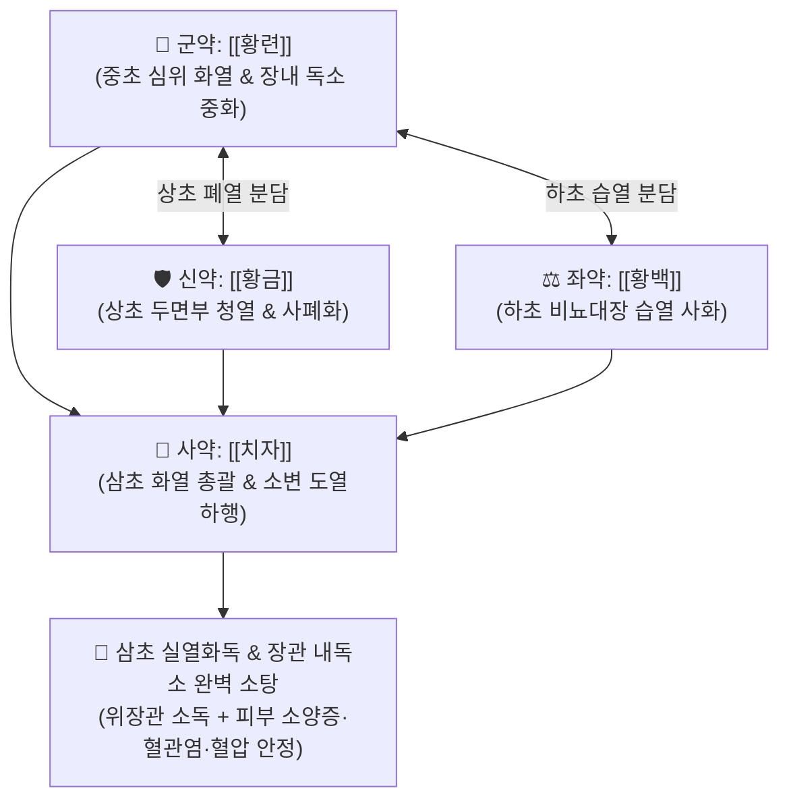

# 🍵 [[황련해독탕]] (黃連解毒湯, Huang-Lian-Jie-Du-Tang / Oren-gedoku-to)

> **핵심 3줄 요약 (Key Summary)**:
> - 🌿 기본 구성: [[황련]], [[황금]], [[황백]], [[치자]] (삼초 고한사화·청열해독의 최고 표준 방제).
> - 🎯 삼초 실열화독(實熱火毒), 장내 미생물 불균형(디스바이오시스)으로 인한 장관 독소 유입, [[소양증]] 위주의 피부 질환([[아토피 피부염]], [[여드름]], [[습진]], [[두드러기]], 주부습진, 음부소양증, 임산부 소양증), 상초 이화작용 과열(안면홍조·구갈·불면·[[고혈압]]).
> - 🔬 세균 및 내독소(LPS) 중화 및 장벽 투과성 개선, NF-κB/MAPK 차단을 통한 TNF-α·IL-6 억제, 혈관염 개선 및 국소 뇌혈류량 증가, 위점막 병변 축소 및 혈소판 응집 억제.
> - ⚠️ 주의사항: 극도로 차고 쓴 약성으로 인해 평소 속이 차고 대변이 묽은 비위허한(脾胃虛寒) 환자에게는 금기이며, 피부가 건조할 때는 [[당귀음자]]와 합방.

---

## 📌 목차
1. [기본 처방 정보 & 군신좌사 구성](#1-기본-처방-정보--군신좌사-구성)
2. [방제학적 약재 상호작용 & 시너지 네트워크](#2-방제학적-약재-상호작용--시너지-네트워크)
3. [현대 분자약리학적 효능 & 작용 기전](#3-현대-분자약리학적-효능--작용-기전)
4. [적응 병증 및 체질별 감별 (Sweet Spot vs 금기)](#4-적응-병증-및-체질별-감별-sweet-spot-vs-금기)
5. [유사 처방군 감별 매트릭스](#5-유사-처방군-감별-매트릭스)
6. [임상 가감례 & 현대 질환별 응용](#6-임상-가감례--현대-질환별-응용)
7. [💡 사용자 진료실 핵심 필기 & 임상 팁 (원문 보존)](#7--사용자-진료실-핵심-필기--임상-팁-원문-보존)
8. [출처 및 학술 참고 문헌 (References)](#8-출처-및-학술-참고-문헌-references)

---

## 1. 기본 처방 정보 & 군신좌사 구성

* **출전**: 왕도(王燾) 『[[외대비요]]』(外臺秘要) 인용 『최씨방』(崔氏方)
* **치법**: 사화해독(瀉火解毒), 청열조습(淸熱燥濕), 양혈소염(涼血消炎), 장관정화(腸管淨化)

| 구분 | 약재명 | 표준 용량 | 본초 효능 & 방제 내 역할 |
| :--- | :--- | :--- | :--- |
| **군약 (君藥)** | [[황련]] | 6~9g | **사심화·청중초열**: 심장과 위장의 실화를 끄고 장관 세균 및 내독소(LPS)를 중화 |
| **신약 (臣藥)** | [[황금]] | 6~9g | **청상초열·사폐화**: 폐열과 두면부로 치솟는 풍열을 진압하여 안면홍조와 두피 염증 차단 |
| **좌약 (佐藥)** | [[황백]] | 4~6g | **청하초열·사신화**: 방광과 대장의 습열을 내리고 골증허열을 억제 |
| **사약 (使藥)** | [[치자]] | 6~9g | **통사삼초·도열하행**: 상·중·하 삼초의 모든 화열을 소변으로 끌고 나가 배출 |

> **방제 구조 분석**:
> * **삼초 분치(三焦分治)와 도열하행(導熱下行)**: [[황금]]은 상초(폐), [[황련]]은 중초(심·비위), [[황백]]은 하초(신·방광·대장)를 각각 분담하여 사화하고, [[치자]]가 삼초 전체의 화열을 엮어 소변으로 배출시키는 완벽한 3D 입체 사화 구조.

> 🧬 **현대 학술 근거 (2026-09-12 B-7 패치)** — PubChem 실측 분자 앵커: [[베르베린]](Berberine, [[황련]] 주성분) CID **2353** · 분자식 C₂₀H₁₈NO₄⁺ · MW 336.4 / [[바이칼린]](Baicalin, [[황금]] 주성분) CID **64982** · 분자식 C₂₁H₁₈O₁₁ · MW 446.4

🔬 **분자 구조** (Wikimedia Commons, Public Domain)

![[Berberine_구조.png|420]]
> [그림] 베르베린(Berberine, C₂₀H₁₈NO₄⁺) 분자 구조 — 출처: Wikimedia Commons (기존 첨부 재사용)

![[Baicalin_구조.png|420]]
> [그림] 바이칼린(Baicalin, C₂₁H₁₈O₁₁) 분자 구조 — 출처: Wikimedia Commons (기존 첨부 재사용)

---

## 2. 방제학적 약재 상호작용 & 시너지 네트워크

* **위장관의 '빨간약(포비돈)' 작용**: 유해균 증식과 내독소 분비로 오염된 장점막을 천연 살균하듯 정화하여 전신 염증의 원천을 차단합니다.

---

## 3. 현대 분자약리학적 효능 & 작용 기전

### 1) 세균·내독소(LPS) 중화 및 장벽 투과성 개선
* [[황련]]의 [[베르베린]]과 [[황금]]의 [[바이칼린]]이 장내 그람음성균 세포벽에 결합하여 세균 및 분비되는 외독소·내독소([[LPS]])를 결합 비활성화시키고 장 점막 밀착연접(Tight junction)을 강화합니다.

### 2) 혈관염 개선 및 국소 뇌혈류량 증가 (혈압 조절)
* 혈관 내피세포의 [[eNOS]]를 활성화하여 혈관 평활근 연축을 풀고, 혈관염증을 개선하며 국소 뇌혈류량을 증가시켜 [[고혈압]] 상승을 억제하고 혈소판 응집을 차단합니다. 니모디핀 수송 연구에서도 바이칼린·베르베린의 뇌미세혈관 내피 수송 조절이 보고되었습니다 `[PubMed 17376298]`.

### 3) 위점막 장애 면적 축소 및 항궤양 작용
* 위산 과다 분비 및 스트레스성 위점막 혈류 장애를 개선하여 위점막 손상 면적을 현저히 축소시킵니다.

### 4) 상초 이화작용(Catabolism) 과열 진정
* 대사적으로 상초의 과도한 이화작용(에너지 과다 소모 및 열 발생)을 억제하여 전신 고열, 구갈, 안면 상열감 및 접촉성 과민 피부염(`Berberine` 핵심 기전 `[PubMed 42204064]`)을 가라앉힙니다.

> 🧬 **현대 학술 근거 (2026-09-12 B-7 패치)**: 통합 전사체학·네트워크약리학 분석에서 황련해독탕이 `AGEs-RAGE/MAPK/AP-1` 신호축을 억제하여 고혈압성 신장 손상(hypertensive nephropathy) 동물모델의 혈압·신기능을 용량의존적으로 개선함이 확인되어, 기존 고혈압성 안면홍조 적응증에 신장 보호 기전 근거가 추가되었습니다 `[PubMed 42035996]`.

---

## 4. 적응 병증 및 체질별 감별 (Sweet Spot vs 금기)

### [✅ 최적 적응증 (Sweet Spot)]
* **피부과 질환 (소양증·염증 위주)**:
  * 가려움([[소양증]])이 주증상인 [[아토피 피부염]], 안면 화농성 [[여드름]], 급·만성 [[습진]], [[두드러기]], 주부습진.
  * 질염 및 음부소양증, 임산부 소양증(단기·전문가 감별 투여).
* **소화기 및 장내 환경 질환**:
  * [[장내미생물]] 불균형(디스바이오시스), 잦은 [[설사]]/[[변비]] 교대, 염증성 장질환, 알코올성 [[위염]].
* **심혈관 및 자율신경계**:
  * [[고혈압]]성 [[안면홍조]], [[두통]], [[심계항진]], 번조·[[불안]], [[불면증]], 코피(비출혈).
* **체질**: 얼굴이 붉고 체격이 건실하며, 열이 많고 성격이 급하며 갈증과 불면을 호소하는 [[소양인]]·[[태음인]] [[실열]]형 환자.

### [⚠️ 신중 투여 및 금기 (Caution / Contraindication)]
* **[[비위허한]]증 환자 금기**: 극도로 차고 쓴 약성으로 인해 평소 배가 차고 묽은 변([[설사]])을 보며 소화력이 약한 [[허증]] 환자에게는 경구·[[약침]] 모두 장기 투약을 금합니다.
* **건조성 피부 환자**: 피부가 바짝 마르고 각질이 심한 음혈허 환자는 단독 투약하지 않고 [[당귀음자]]나 [[사물탕]]과 합방([[온청음]])합니다.

---

## 5. 유사 처방군 감별 매트릭스

| 처방명 | 구성 차이 | 주치 병태 차이 | 감별 요점 |
| :--- | :--- | :--- | :--- |
| [[황련해독탕]] | 황련, 황금, 황백, 치자 | **삼초 실열화독 ([[변비]] 없음)** | **전신 화독, 피부 소양증, 혈관염, 불면** |
| [[삼황사심탕]] | 대황, 황련, 황금 | **중초 실열 + 변비 (대황 추가)** | 대황으로 독소를 더 확실히 빼내나 몸에 무리가 될 수 있음 |
| [[온청음]] | 황련해독탕 + 사물탕 | **혈허 + 열독** | 건조하고 가려운 만성 피부염, [[갱년기]] 출혈 |
| [[당귀음자]] | 사물탕 + [[황기]], [[백질려]], [[방풍]], [[형개]] | **혈허풍조 (건조성 가려움)** | 피부가 버석거리고 진물 없이 가려움 극심 |

---

## 6. 임상 가감례 & 현대 질환별 응용

### 1) 변증 가감법
* **피부가 건조하고 각질이 일어나는 가려움증**: $\rightarrow$ [[당귀음자]] 또는 [[사물탕]]과 합방 ([[온청음]] 구조).
* **[[변비]]가 심하고 독소 배출이 급할 시**: + [[대황]] ([[삼황사심탕]] 계열).
* **피부 농포와 진물이 심할 시**: + [[금은화]], [[연교]], [[포공영]].

### 2) 현대 질환별 매핑
* **피부과**: [[아토피 피부염]], 중증 [[여드름]], [[화폐상 습진]], 급성 [[두드러기]], 접촉성 피부염, 주부습진.
* **소화기과**: 장내 유해균 과다 증식, 급성 세균성 장염, 알코올성 [[위염]].
* **순환기/정신과**: 본태성 [[고혈압]] [[두통]], 뇌혈관염, 조증성 [[불면증]].

### 3) 요추 척추관 협착증 약침액 연계 (2026-09-24 논문 연계)
* **임상 위치**: 12주·24회 약침 프로토콜 실용적 RCT에서 사용된 5종 [[약침]]액([[봉약침]]·[[자하거약침]]·중성오혈·[[신바로약침]]·황련해독탕) 중 하나로, **급성 염증·부종 우세형에 배치하는 축**으로 운용되었습니다 `[PubMed 42099446]`.
* **기전 연결 및 시술점**: [[황련]]([[베르베린]])·[[황금]]([[바이칼린]]) 성분의 [[NF-κB]] 억제·항염 기전이 협척혈·배수혈 주위 신경근 주변 염증 매개체 감소 가설과 연결됩니다(단, RCT 시험이 기전을 직접 검증한 것은 아님). 시술점은 L1~L5 [[협척혈(EX-B2)]] + [[신수(BL23)]]·[[대장수(BL25)]]·[[방광수(BL28)]] 기본 축에 [[승산(BL57)]]·[[환도]]를 병용했으며, 1회 주입량(0.1~10 cc)은 시술자 재량으로 결정되었습니다.
* **금기 일치**: 경구 투여와 마찬가지로 극한(極寒)·고한 약성이므로 [[비위허한]]·허한 체질에서는 금기 기준을 동일하게 적용합니다.
* **관련 참고**: [[약침]] · [[척추관 협착증]] · [[2026-09-24_통합의학약리학_심층리뷰]]

### 양약 상호작용 (Herb–Drug Interaction)
* **[[에독사반]](DOAC) 병용 임상시험 근거**: 건강인 14명 교차 1상 시험에서 황련해독탕 정제(1회 3,200 mg, 1일 3회, 6일)와 [[에독사반]] 60 mg 단회 병용 시 **AUC 불변, Cmax 18.5~28.1% 감소**, [[aPTT와 PT]] 동등으로 **경미한(minor) PK 영향**이 확인되었습니다 `[PubMed 39461388]`. 장관 [[P-당단백(P-gp)]] 유도로 흡수상 Cmax만 소폭 감소하고 전신 노출·응고 효과는 유지된 결과입니다(다만 단회·건강인 조건이므로 고위험 [[뇌졸중]] 환자는 출혈 징후 문진 및 PT/aPTT 추적을 병행).
* **[[CYP3A4]]·P-gp 및 니모디핀·강압제**: [[베르베린]]·[[바이칼린]]은 CYP3A4·P-gp 수송체 관여가 보고되어 있으며(`니모디핀` 뇌미세혈관 내피 수송 영향 `[PubMed 17376298]`), 강압제·혈당강하제와 병용 시 유도/억제 방향을 구분해 혈압·혈당을 모니터링합니다.
* **관련 참고**: [[에독사반]] · [[aPTT와 PT]] · [[P-당단백(P-gp)]] · [[CYP3A4]] · [[2026-09-10_통합의학약리학_심층리뷰]] · [[2026-09-10_통합의학약리학_개념학습]]

---

## 7. 💡 사용자 진료실 핵심 필기 & 임상 팁 (원문 보존)

> [!tip] **진료실 실전 노하우 (User Clinical Insight)**
> - **위장관의 '빨간약(포비돈)' 항균·항염 원리**: 장내 미생물 환경이 무너져 유해균 독소가 혈류를 타고 전신으로 번질 때, 위장관에 빨간약을 발라주듯 세균과 내독소(LPS)를 결합·염색하여 불활성화시킴.
> - **가려움 위주 피부 질환의 1차 선택**: 아토피 피부염에서 가려움이 극심한 경우, 임산부 가려움, 음부소양증, 화농성 여드름, 습진, 두드러기, 주부습진에 신속한 진정 효과를 발휘함.
> - **피부 건조 시 당귀음자 합방**: 피부에 진물이 없고 바짝 마르며 가려울 때는 황련해독탕 단독 투여를 피하고 [[당귀음자]]나 [[사물탕]]을 반드시 합방하여 음혈을 보강해야 함.
> - **상초 기화(氣化)의 현대적 의미**: 상초의 기화는 현대 생리학적으로 '이화작용(Catabolism)'을 의미하며, 이화작용이 지나치게 항진되면 상열감, 체중 감소, 염증열이 폭발하므로 황련해독탕으로 이를 진정시킴.
> - **삼황사심탕과의 감별**: 삼황사심탕은 [[대황]]이 추가되어 장관 독소를 더욱 강력히 배출시키지만 체력 소모가 크므로, [[설사]] 경향이 있거나 체력이 중간 이하인 환자에게는 황련해독탕이 훨씬 안전함.

---

## 8. 출처 및 학술 참고 문헌 (References)

1. **Wang T (王燾) (752)**. *Waitai Miyao* (外臺秘要), citing *Cui Shi Fang* (崔氏方).
   - **[연구 요약]**: 황련해독탕 원전 수록. 삼초 실열화독을 치료하는 사화해독 표준 방제로 제시.
2. **한의학 고전 및 한국 임상 문헌**: *동의보감(東醫寶鑑)*, *방약합편(方藥合編)* — 황련·황금·황백·치자 4미 배합의 삼초실화·피부소양·안면홍조·상열감 치료 응용 수록.
3. **Wang N et al. (2026)**. Huanglian Jiedu decoction ameliorates hypertensive nephropathy by inhibiting the AGEs-RAGE/MAPK/AP-1 axis: An integrated transcriptomics and network pharmacology study. *Journal of Ethnopharmacology*, 368: 121685. [PMID: 42035996](https://pubmed.ncbi.nlm.nih.gov/42035996/)
   - **[연구 요약]**: 통합 전사체학·네트워크약리학으로 황련해독탕이 AGEs-RAGE/MAPK/AP-1 신호축 억제를 통해 고혈압성 신병증의 혈압과 신기능을 용량의존적으로 개선함을 규명함.
4. **Nose M et al. (2026)**. Berberine is a key active component underlying the anti-allergic actions of orengedokuto in a murine model of contact hypersensitivity. *Journal of Natural Medicines*, 80(4): 1142-1151. [PMID: 42204064](https://pubmed.ncbi.nlm.nih.gov/42204064/)
   - **[연구 요약]**: 접촉성 과민 피부염 마우스 모델에서 황련해독탕(Orengedokuto)의 항알레르기 작용 핵심 활성 성분이 [[베르베린]]임을 규명함.
5. **Zhang DM et al. (2007)**. Effect of baicalin and berberine on transport of nimodipine on primary-cultured, rat brain microvascular endothelial cells. *Acta Pharmacologica Sinica*, 28(4): 573-578. [PMID: 17376298](https://pubmed.ncbi.nlm.nih.gov/17376298/)
   - **[연구 요약]**: 일차 배양 랫드 뇌미세혈관 내피세포에서 [[바이칼린]]과 [[베르베린]]이 니모디핀 수송에 미치는 영향을 분석함.
6. **Cho SJ et al. (2025)**. Impact of Banhabaekchulcheonmatang (Banxia Baizhu Tianma Tang) and Hwangryeonhaedoktang (Huang Lian Jie Du Tang) on edoxaban: Herb-drug interaction study in healthy subjects. *Journal of Ethnopharmacology*, 337(Pt 3): 118997. [PMID: 39461388](https://pubmed.ncbi.nlm.nih.gov/39461388/)
   - **[연구 요약]**: 건강인 14명 교차 1상 임상시험에서 황련해독탕과 [[에독사반]] 병용 시 Cmax 소폭 감소(18.5~28.1%) 외 AUC 및 PT/aPTT가 유지되는 경미한 약물상호작용을 입증함.
7. **Lee SW et al. (2026)**. Pharmacopuncture therapy versus usual care for lumbar spinal stenosis: A randomized controlled trial. *Integrative Medicine Research*, 15(3 Part A): 101323. [PMID: 42099446](https://pubmed.ncbi.nlm.nih.gov/42099446/)
   - **[연구 요약]**: 요추 척추관 협착증 환자 대상 12주·24회 실용적 무작위 대조 임상시험에서 황련해독탕 약침액을 포함한 5종 [[약침]] 프로토콜의 임상 운용 결과를 보고함.
