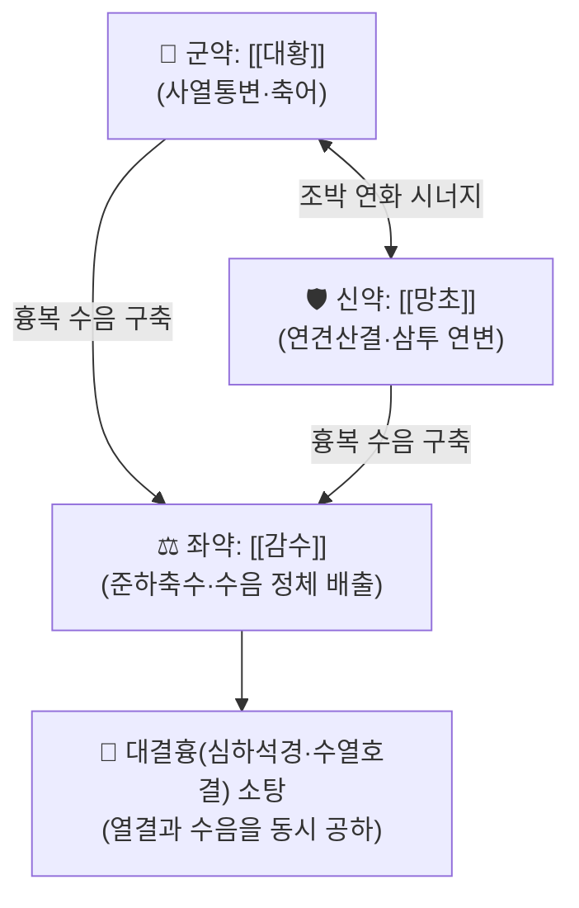

# 🍵 [[대함흉탕]] (大陷胸湯, Da-Xian-Xiong-Tang / Daehamhyung-tang)

> **핵심 3줄 요약 (Key Summary)**:
> - 🌿 [[대황]]·[[망초]]·[[감수]] 3미로 구성된 『[[상한론]]』 준하축수(峻下逐水) 대표 처방. 태양병편 결흉증 관련 조문 다수 수록.
> - 🎯 [[결흉]](結胸) — 심하부터 소복까지 단단하고 팽팽하며 압통이 심한 상태, 심하석경(心下石硬). [[소함흉탕]]보다 공하 작용이 훨씬 강력한 준제(峻劑).
> - 🔬 [[대황]]의 [[센노사이드 A]]·[[안트라퀴논]] 유도체([[에모딘]], [[레인]]), [[감수]]의 디테르펜 에스테르 성분([[칸수이닌]])이 준하축수 효능의 현대 약리학적 근거로 제시됨.
> - ⚠️ 주의사항: 준하축수제로 작용이 매우 강력하여 정기가 허약한 [[허증]] 환자, [[임산부]], 노약자에게는 금기·신중 투여. [[감수]]는 독성이 있어 법제·용량 관리 필수.

---

## 📌 목차
1. [기본 처방 정보 & 군신좌사 구성](#1-기본-처방-정보--군신좌사-구성)
2. [방제학적 약재 상호작용 & 시너지 네트워크](#2-방제학적-약재-상호작용--시너지-네트워크)
3. [현대 분자약리학적 효능 & 작용 기전](#3-현대-분자약리학적-효능--작용-기전)
4. [적응 병증 및 체질별 감별 (Sweet Spot vs 금기)](#4-적응-병증-및-체질별-감별-sweet-spot-vs-금기)
5. [유사 처방군 감별 매트릭스](#5-유사-처방군-감별-매트릭스)
6. [임상 가감례 & 현대 질환별 응용](#6-임상-가감례--현대-질환별-응용)
7. [💡 사용자 진료실 핵심 필기 & 임상 팁 (원문 보존)](#7--사용자-진료실-핵심-필기--임상-팁-원문-보존)
8. [출처 및 학술 참고 문헌 (References)](#8-출처-및-학술-참고-문헌-references)

---

## 1. 기본 처방 정보 & 군신좌사 구성

《상한론(傷寒論)》 태양병편(太陽病篇)에 수록된 처방으로, 조문상 SSB-134~137, 149 등 결흉증(結胸證) 관련 여러 조문에 걸쳐 등장합니다. 사법(瀉法)을 조기에 잘못 시행하여 표사(表邪)가 안으로 들어가 흉중의 수음과 뭉쳐 생긴 대결흉(大結胸)을 치료하는 대표 처방으로 자리잡고 있습니다.

* **치법**: 준하축수(峻下逐水).

| 약재 | 용량(원문 기준) | 역할 |
| :--- | :--- | :--- |
| [[대황]] (大黃) | 6냥(兩), 거피(去皮) | 군약(君藥) — 사하(瀉下)·축어(逐瘀) |
| [[망초]] (芒硝) | 1승(升) | 신약(臣藥) — 연견산결(軟堅散結)·조위존음(助大黃) |
| [[감수]] (甘遂) | 1전비(錢匕, 가루로 복용) | 좌약(佐藥) — 준하축수(峻下逐水) |

⚠️ 내용 검토 필요: 원문 용량 단위(兩·升·錢匕)는 고대 도량형으로, 현대 임상 환산치는 문헌·유파에 따라 편차가 있어 실제 임상 적용 시 원문·전문가 자문 확인이 필요합니다.

---

## 2. 방제학적 약재 상호작용 & 시너지 네트워크

* [[대황]] + [[망초]] 배오: 대황의 사하(瀉下) 작용에 망초의 연견산결(軟堅散結)을 더해 조박(燥結)을 무르게 하고 배출을 가속합니다.
* [[감수]] 가미: 감수의 준하축수 작용이 흉복부에 뭉친 [[수음]](水飮)까지 강력하게 몰아내어, 단순 조박 사하를 넘어 [[결흉]]의 수열호결(水熱互結)까지 함께 해소하는 것이 이 처방의 핵심입니다.

---

## 3. 현대 분자약리학적 효능 & 작용 기전

### 1) 대장 점막 자극 사하 및 연동 운동 항진
* [[대황]]의 [[센노사이드 A]](Sennoside A) 및 [[안트라퀴논]] 유도체([[에모딘]], [[레인]] 등)가 대장 점막하 [[신경총]]을 직접 자극하여 장관 연동운동을 항진시킵니다.

### 2) 삼투성 수분 저류 및 조결(燥結) 연화
* [[망초]](황산나트륨 계열 광물성 하제)가 장관 내 삼투압을 높여 수분 재흡수를 차단하고 장관 내로 수분을 끌어들여 단단히 굳은 변괴를 무르게 합니다.

### 3) 강력한 수분·장관 배출 촉진 (수음 구축)
* [[감수]]의 디테르펜 에스테르 성분([[칸수이닌]] 등)이 장관 평활근과 장벽 수분 이동을 강하게 자극하여 정체된 삼출액·장내 수분의 준하축수 효능을 발휘합니다.

---

## 4. 적응 병증 및 체질별 감별 (Sweet Spot vs 금기)

### [✅ 최적 적응증 (Sweet Spot)]
* **대결흉(大[[결흉]])**: 심하(명치)부터 소복(아랫배)까지 단단하고 팽팽하며([[복부팽만]]) 손을 대면 압통([[복통]])이 매우 심한 상태.
* **심하석경(心下石硬)**: 명치 부위가 돌처럼 단단하게 만져지는 대결흉의 대표 촉진 소견.
* **동반 증후 및 체질**: [[발열]]·[[변비]]·[[구갈]]·단기(短氣) 등 이열([[실열]])이 [[수음]]과 뭉친 조열결흉 양상을 보이며 정기가 실한 [[실증]] 환자.

### [⚠️ 신중 투여 및 금기 (Caution / Contraindication)]
* **[[허증]]·[[임산부]]·노약자 금기**: 준하축수제(峻下逐水劑)로 작용이 매우 강력하여 정기가 허약한 환자, 임산부, 노약자, 탈수·전해질 불균형 환자에게는 금기합니다.
* **[[감수]] 독성·법제 주의**: 감수는 독성이 있는 준제이므로 초(醋) 법제 및 엄격한 용량 관리(단회 소량 가루 복용 원칙)가 필수이며, 기계적 완전 [[장폐색]]·장천공 의심 급성 복증은 즉시 외과 응급 의뢰합니다.

---

## 5. 유사 처방군 감별 매트릭스

| 구분 | [[대함흉탕]] | [[소함흉탕]] | [[대승기탕]] |
| :--- | :--- | :--- | :--- |
| **구성** | [[대황]]·[[망초]]·[[감수]] | [[황련]]·[[반하]]·[[과루인]] | [[대황]]·[[망초]]·[[후박]]·[[지실]] |
| **병증 범위** | **대결흉**: 심하~소복까지 광범위·격렬한 석경(石硬)·압통 | **소결흉**: 심하 국한, 누르면 아픈 상대적 경증 | **양명부실**: 비·만·조·실(수음 없이 조시·열결 중심) |
| **치법** | 준하축수(峻下逐水) | 청열화담개결(淸熱化痰開結) | 준하열결(峻下熱結) |
| **공하력** | **최강 축수·사하 (준제)** | 완만(화해·화담에 가까움) | 강(순수 조열 공하) |

---

## 6. 임상 가감례 & 현대 질환별 응용

### 1) 변증 및 운용 주의
* 『[[상한론]]』 원문상 [[대황]]·[[망초]]를 전탕한 뒤 [[감수]] 가루를 타서 복용하는 고정 배오가 기본이며, 별도의 임의 가감 사례는 원문에 기재되어 있지 않습니다. 대결흉이 흉격 위주·만성 둥근 결절형일 때는 [[대함흉환]] 형태로 감속 운용하는 변증이 구분됩니다.

### 2) 현대 질환별 매핑
* **흉부·소화기 실증**: 삼출성 [[흉막염]](흉수), 중증 [[복수]], 급성 마비성 [[장폐색]] 초기(기계적 완전 폐색·천공 배제 후) 등 실증 위주로 신중히 응용됩니다.

### 양약 상호작용 (Herb–Drug Interaction)
* **이뇨제·강심배당체 ([[푸로세미드]], [[디곡신]])**: [[감수]]·[[대황]]·[[망초]]의 급속 축수·사하 작용으로 심한 탈수와 [[저칼륨혈증]]이 유발되어 디곡신 독성 및 부정맥 위험이 크게 증가합니다.
* **자극성·삼투성 하제 ([[센나]], [[비사코딜]], [[폴리에틸렌글리콜]])**: 사하 작용 중첩으로 장 점막 손상 및 전해질 쇼크 위험이 있으므로 병용을 피합니다.
* **[[감초]] 배합 금기(십팔반, 十八反) 및 경구 약물 흡수 저하**: 한의학 전통 반(反) 약물인 감초와의 배합을 피하며(『금궤요략』 감수반하탕 등 특수 예외 제외), 경구 약물 흡수를 급격히 떨어뜨릴 수 있으므로 동시 투여를 지양합니다.

---

## 7. 💡 사용자 진료실 핵심 필기 & 임상 팁 (원문 보존)

> [!tip] **진료실 실전 노하우 (User Clinical Insight)**
> - 현재 별도로 기록된 원장님 임상 필기가 없습니다. 추후 실전 진료 경험이 누적되면 이 섹션에 추가합니다.

---

## 8. 출처 및 학술 참고 문헌 (References)

1. **Zhang ZJ (張仲景) (200)**. 『[[상한론]]』(傷寒論) 太陽病篇 — 大陷胸湯 조문(SSB-134~137, 149 등). 참고 정리: [상한금궤plus — 대함흉탕](https://shanghanlun.pinedance.click/reference/Formulas/%EB%8C%80%ED%95%A8%ED%9D%89%ED%83%95)
   - **[연구 요약]**: 상한론 원문 조문별 대함흉탕의 구성·용량·주치(대결흉·심하석경·조열결흉) 및 전탕·복용 순서를 정리한 참고 자료.
2. **익생닷컴 — 『[[동의보감]]』 처방: 소함흉탕(小陷胸湯)**: [http://www.iksaeng.com/prescription/predong_One.jsp?prescription=gjn2b6vc](http://www.iksaeng.com/prescription/predong_One.jsp?prescription=gjn2b6vc)
   - **[연구 요약]**: 소함흉탕과의 감별 비교를 위한 동의보감 처방 정보 수록(대함흉탕 단독 대상 현대 PubMed 특이 임상시험·약리 PMID는 본 노트 기준 미확인).
