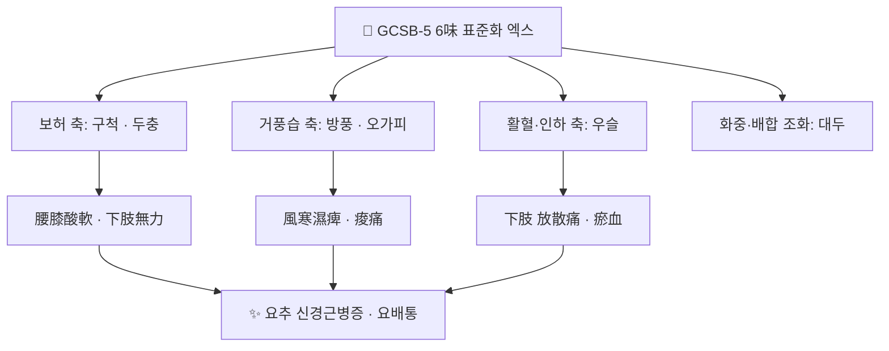

# 🍵 GCSB-5 (6味 표준화 생약 복합엑스)

> 🖼️ **이미지 미확보** — 구성 본초 원물·제제 실사 및 기전 도식 중 개방 소스에서 실물 확인된 것이 없어 수록하지 않았다(파일명 추측 매칭 금지 원칙).

> **핵심 3줄 요약 (Key Summary)**:
> - 🌿 방풍·우슬·오가피·구척·대두·두충 6味 고정 배합을 물로 추출한 뒤 10,000 Da 초과 분획을 한외여과로 제거하고 동결건조한 표준화 생약 복합엑스
> - 🎯 요추 추간판 탈출증에서 12주 위약 대조 시험으로 허리 통증·다리 방사통 NRS를 개선했고, 기능(ODI)은 16주에만 개선. 급성기 방사통에서 위장관·신장 위험이 큰 환자의 NSAID 절감 카드
> - 🔬 iNOS·COX-2 하향과 NF-κB·Akt 억제를 통한 항염(PMID 20621661), 탈출 모델에서 척수 후각 Iba1·GFAP 및 후근신경절 CGRP·TRPV1 하향
> - ⚠️ 거대 탈출·마미 증후군·진행성 근력 저하에는 쓰지 않는다. 허가 제품과 탕약은 용량·표준화가 달라 동일시하지 않는다.

---
## 📌 목차
1. [기본 처방 정보 (Formula Profile)](#1-기본-처방-정보-formula-profile)
2. [구성 본초와 방제 구조](#2-구성-본초와-방제-구조)
3. [핵심 분자약리 기전](#3-핵심-분자약리-기전)
4. [임상 응용 — 적응증과 배제 기준](#4-임상-응용--적응증과-배제-기준)
5. [유사 처방·제형 감별](#5-유사-처방제형-감별)
6. [양약 상호작용 및 안전성](#6-양약-상호작용-및-안전성)
7. [진료실 핵심 필기](#7-진료실-핵심-필기)
8. [출처 및 참고 문헌](#8-출처-및-참고-문헌)

---
## 1. 기본 처방 정보 (Formula Profile)

| 항목 | 상세 내용 |
| :--- | :--- |
| **처방명** | GCSB-5 (지씨에스비-5) |
| **성격** | 고전 방제의 가감이 아니라, 6味를 고정 배합해 표준화한 **현대 개발 생약 복합엑스** |
| **구성** | 방풍 · 우슬 · 오가피 · 구척 · 대두 · 두충 (6味) |
| **제조 공정** | 물 추출 → 한외여과로 10,000 Da 초과 분획 제거 → 동결건조 |
| **허가 제제 용량** | 건조엑스 300 mg/캡슐, 2캡슐 1일 2회(1,200 mg/일), 12주 |
| **효능 분류** | 補肝腎·强筋骨 + 祛風濕·活血通絡 (요슬 동통·하지 방사통) |
| **대표 근거** | 요추 추간판 탈출증 다기관 이중맹검 위약 대조 RCT (PMID 42013328) |

> ⚠️ **용량 표기의 함정**: 위 허가 용량은 시판 제제 기준이고, 2026년 발표된 이중맹검 RCT의 **시험 용량은 초록에 기재돼 있지 않다**. 논문 수치를 인용할 때 "1일 1,200 mg으로 시험했다"고 쓰면 안 된다.

### 📋 처방 구성표

| 약재 | 한자 | 배합 내 역할(방제 해석) |
| :--- | :--- | :--- |
| [[우슬]] | 牛膝 | 活血通絡·補肝腎·引而下行 — 하지로 약성을 끌어내리는 축 |
| [[두충]] | 杜仲 | 補肝腎·强筋骨 — 신(腎)-골 축의 중심 |
| [[구척]] | 狗脊 | 補肝腎·强筋骨·祛風濕 — 요배통·슬통의 강근 축 |
| [[방풍]] | 防風 | 祛風勝濕·止痛 — 풍습 비증의 표층 축 |
| [[오가피]] | 五加皮 | 祛風濕·補肝腎·强筋骨 — 풍습과 보허의 겸용 |
| 대두 | 大豆 | 健脾寬中·완화 — 위기 보호와 배합 조화(식품성 약재) |

> 위 君·臣·佐 배치는 **제품 문헌이 공식적으로 규정한 것이 아니라 방제 해석**이다. 6味를 같은 비율로 배합했다는 것 외에 개별 배합비는 공개 자료에서 확인되지 않는다.

---
## 2. 구성 본초와 방제 구조

- **보허 축(구척·두충)**: 요슬 산연·하지 무력 같은 '허'의 층을 맡는다. 만성·재발성 요통에서 이 축이 없으면 통증만 잡고 재발을 못 막는다.
- **거풍습 축(방풍·오가피)**: 찬 바람·습기에 악화되는 양상, 즉 '실(實)'의 층을 맡는다.
- **활혈·인하 축(우슬)**: 약성을 하지로 끌어내리는 동시에 어혈성 통증을 겨냥한다. 방사통이 하지로 내려가는 양상과 맞물린다.
- **표준화 공정의 의미**: 10,000 Da 초과 분획을 제거하는 것은 단백질·다당체 대분자를 걷어내 **경구 흡수와 제형 안정성**을 확보하려는 설계다. 탕약과 성분 프로파일이 같다고 볼 수 없는 이유다.

---
## 3. 핵심 분자약리 기전

### (1) 염증 축 — NF-κB와 iNOS·COX-2

- 대식세포 자극 모델에서 GCSB-5는 iNOS·COX-2 발현과 NF-κB 활성, Akt 인산화를 억제하고 그 하류의 IL-1β·IFN-β 분비를 낮췄다(PMID 20621661).
- [[NF-κB]]는 염증성 사이토카인 전사의 중심 스위치이고, [[iNOS]]·[[COX]]는 각각 산화질소·프로스타글란딘 생성을 담당한다. 즉 GCSB-5의 항염은 **단일 효소 차단이 아니라 상류 전사 조절** 층에 걸린다.
- 이 층은 NSAID(선택적 COX-2 억제)와 겹치면서도 다르다. 위 점막 보호에 필요한 COX-1을 건드리지 않는 대신, 항염 강도는 NSAID에 미치지 못한다.

### (2) 신경 축 — 신경교 활성과 통각 수용체

- 추간판 탈출 동물 모델에서 척수 후각의 Iba1(미세아교 표지)·GFAP(성상교 표지) 발현과 후근신경절의 [[CGRP]]·[[TRPV1]] 발현이 감소했다.
- 해석: 말초의 염증성 구심성 입력을 줄이는 동시에, 척수·후근신경절 수준의 감작을 낮추는 **이중 작용**이다. [[TRPV1]]은 열·산성·캡사이신에 반응하는 통각 수용체로, 이 하향은 방사통의 작열감 성분과 연결된다.
- ⚠️ 인체에서 신경교 표지나 후근신경절 수용체 발현을 측정한 연구는 없다. **기전은 전임상 층**으로 남겨야 한다.

### (3) 임상 지표와 기전의 층위 차이

- 이 시험에서 MRI상 탈출 형태·크기는 군간 차이가 없었다. 기전이 항염·신경감작 조절이라면 **구조 변화가 없는데 통증이 줄어드는 것이 오히려 일관된 그림**이다.
- 따라서 환자 설명은 "디스크를 녹인다"가 아니라 "디스크 주변 염증과 신경 과민을 낮춘다"로 해야 한다.

---
## 4. 임상 응용 — 적응증과 배제 기준

### ✅ 적응증 (Sweet Spot)
- 요추 추간판 탈출증 또는 신경근병증에서 **허리 통증 + 하지 방사통**이 주 증상인 성인
- NSAID·근이완제에 위장관 불편, 신기능 저하, 심혈관 위험이 있어 장기 복용이 어려운 환자
- 통증 NRS 4~7 수준의 중등도, 신경학적 결손이 경미한 층

### ⚠️ 배제·신중 (Contraindication / Caution)
- **거대 탈출(large extrusion)**, **마미 증후군**(회음부 감각 저하·대소변 장애·양측 하지 증상)
- **진행성 근력 저하** — 족관절 배굴근 MRC 3등급 이하, 보행 시 발목 처짐
- 임신·수유부, 소아: 안전성 자료 없음
- 항응고제·항혈소판제 병용: 우슬을 포함한 활혈약 계열이므로 출혈 경향을 문진하고 수술 전 7~10일 중단을 권고한다
- 4주 복용에도 통증이 전혀 반응하지 않으면 12주를 채우지 말고 영상·신경학적 재평가로 전환한다

---
## 5. 유사 처방·제형 감별

| 처방·제형 | 구성 축 | 주치 | GCSB-5와의 감별점 |
| :--- | :--- | :--- | :--- |
| GCSB-5 | 보허 + 거풍습 + 활혈인하 | 요추 신경근병증 방사통 | 표준화 엑스, 위약 대조 RCT 근거 있음 |
| [[독활기생탕]] | 보허 + 거풍습 + 기혈보익 | 만성 요통·하지 무력·허증 | 탕약, 보익 축이 훨씬 두껍다 |
| [[오적산]] | 산한·소식·행기 | 한습 요통·소화불량 동반 | 소화 증상 동반 시 |
| [[신바로약침]] | 동일 계열 생약 복합엑스 계통 | 요추 질환 국소 투여 | **제형·농도·투여 경로가 달라 동일시 금지** |
| [[세레콕시브]] | 선택적 COX-2 억제 | 급성 염증성 통증 | 진통 강도·속도는 앞서나 위장관·신장 위험 |

---
## 6. 양약 상호작용 및 안전성

- **출혈 위험**: 우슬 등 활혈약 포함 — 와파린·DOAC·아스피린·클로피도그렐 병용 시 멍·잇몸 출혈을 문진하고, 수술·시술 전 중단을 안내한다.
- **혈압·혈당**: 오가피·두충 계열의 강압·혈당 간섭 보고가 있으므로 강압제·경구혈당강하제 복용자는 자가혈압·혈당 일지를 확인한다.
- **신기능**: 대두 등 식품성 약재와 병용 시 단백 부하를 고려해 eGFR 저하 환자에서는 용량을 보수적으로 잡는다.
- **복용 시점**: 다른 한약·양약과 30분~2시간 간격을 권고한다.
- **이상반응**: 이 시험에서 중대 이상반응은 없었고 탈락은 활성 1명·위약 4명이었다. 경증 소화불량·묽은 변은 실무에서 흔하므로 식후 복용으로 완화한다.

---
## 7. 진료실 핵심 필기

> 🛡️ **Melt-In 원칙**: 위 1~6번 섹션에 담지 못한 실전 노하우만 여기에 남긴다.

### (1) 4주 판정 규칙
- 4주에 **통증 NRS가 2점 이상 또는 30% 이상** 감소하면 지속, 그렇지 않으면 재조합한다.
- 기능(ODI)은 16주에야 따라오므로 **4주에 ODI로 판정하지 않는다**. 이 시험의 지표 시간차가 그 근거다.
- 12주를 채운 뒤에도 NRS 3 이상이면 중재를 바꾼다.

### (2) 환자 스크립트
- "이 약은 디스크를 없애는 약이 아닙니다. MRI에서 디스크 모양이 변하지 않았다는 연구 결과가 있습니다. 대신 디스크 주변의 염증과 신경 과민을 낮춰서 통증과 저림을 줄입니다. 그래서 4주째 통증이 먼저 줄고, 일상 기능은 3~4개월에 걸쳐 따라옵니다."
- "다리 힘이 빠지거나 소변·대변 조절이 안 되거나 안장 부위 감각이 둔해지면 즉시 응급 진료가 필요합니다. 그건 이 약으로 볼 문제가 아닙니다."

### (3) 병용 설계
- 급성 2주: GCSB-5 + 필요 시 [[세레콕시브]] 또는 NSAID 반나절 용량
- 3~8주: GCSB-5 단독 + [[추나]]·[[약침]]·[[신경가동술]]
- 9~12주: 운동([[맥켄지 운동]]) 전환, 약은 감량

### (4) 제형 주의
- 허가 캡슐과 산제·탕약은 **표준화 지표와 흡수가 다르다**. 동일 처방명으로 같은 효과를 가정하지 않는다.
- [[신바로약침]]은 같은 계열 엑스에서 출발했으나 주사 제형으로, 경구 제품과 용량·안전성 프로파일이 별개다.

---
## 8. 출처 및 참고 문헌

1. **Cho PG 등 (2026)**. *Evaluating the Efficacy of GCSB-5 in Lumbar Disc Herniation: A Randomized Controlled Trial*. **Pain Physician**, 29(2), 163-170. [PMID 42013328](https://pubmed.ncbi.nlm.nih.gov/42013328/)
   - **[연구 요약]**: 성인 46명(활성 23·위약 23) 12주 복용·16주 평가. 허리 통증 NRS-11은 4·8·16주, 다리 방사통은 4·8·12·16주에 유의 개선. ODI는 16주에만 유의, MRI 탈출 형태 무변화, 중대 이상반응 없음.
2. **Chung HJ 등 (2010)**. *Modulation of acute and chronic inflammatory processes by a traditional medicine preparation GCSB-5 both in vitro and in vivo animal models*. **Journal of Ethnopharmacology**, 130(3), 450-459. [PMID 20621661](https://pubmed.ncbi.nlm.nih.gov/20621661/)
   - **[연구 요약]**: 급성·만성 염증 모델에서 GCSB-5의 항염 작용을 in vitro·in vivo로 평가. iNOS·COX-2와 NF-κB·Akt 축 억제, IL-1β·IFN-β 감소 보고. 동물·세포 수준 기전 연구로 인체 효과를 직접 입증하지는 않는다.
3. **ClinicalTrials.gov NCT01910116**. *Shinbaro (GCSB-5) for hand osteoarthritis*. [https://clinicaltrials.gov/ct2/show/NCT01910116](https://clinicaltrials.gov/ct2/show/NCT01910116)
   - **[연구 요약]**: GCSB-5 제제의 3상 등록 정보. 허가 제제 용량(300 mg 캡슐 2캡슐 1일 2회) 확인 경로로만 인용하며, 요추 추간판 탈출증 시험의 용량 근거로 쓰지 않는다.
4. **한의학 교과서 범위 지식**. 補肝腎·强筋骨·祛風濕의 방제 해석과 6味 각각의 전통 효능(성미·귀경·주치)은 표준 본초학·방제학 교과 범위로 기술했으며, 개별 배합비는 공개 자료에서 확인되지 않아 규정하지 않았다.

## 함께 보기
- [[요추 추간판 탈출증]] · [[신경병증성 통증]] · [[추나]] · [[약침]] · [[신바로약침]]
- [[방풍]] · [[우슬]] · [[오가피]] · [[구척]] · [[두충]]
- [[NF-κB]] · [[iNOS]] · [[COX]] · [[TRPV1]] · [[CGRP]]
- [[2026-11-23_근골격계-척추관절_심층리뷰]] · [[2026-11-23_근골격계-척추관절_개념학습]]
