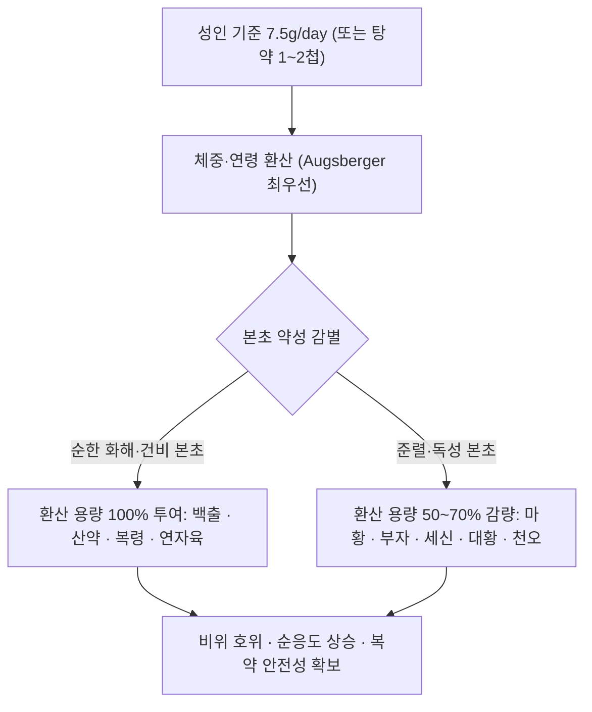

# 📊 소아 한약 처방 용량 및 환산 기준 가이드 (Pediatric Dosage Guide)

> **핵심 요약 (Key Summary)**:
> - 소아는 생리적으로 장부(臟腑)가 부드럽고 약하며(장부교약 臟腑嬌弱), 기혈이 아직 온전하지 못하므로(기혈미충 氣血未充) 성인 용량을 그대로 쓸 수 없습니다.
> - **성인 1일 기준 추출 엑스제(단미/복합 엑스제) 용량 7.5g/day(또는 탕약 1첩)**을 기준으로 체중, 연령 및 신체 발달 상태에 따라 정밀하게 비례 환산하여 투약합니다.
> - 소아의 체중(kg) 및 나이에 따른 옥스버거(Augsberger) 공식과 연령별 환산율을 적용하여 부작용을 예방하고 치료 효과를 극대화합니다.

---

## 📌 목차
1. [기본 처방 정보 & 군신좌사 구성](#1-기본-처방-정보--군신좌사-구성)
2. [방제학적 약재 상호작용 & 시너지 네트워크](#2-방제학적-약재-상호작용--시너지-네트워크)
3. [현대 분자약리학적 효능 & 작용 기전](#3-현대-분자약리학적-효능--작용-기전)
4. [적응 병증 및 체질별 감별 (Sweet Spot vs 금기)](#4-적응-병증-및-체질별-감별-sweet-spot-vs-금기)
5. [유사 처방군 감별 매트릭스](#5-유사-처방군-감별-매트릭스)
6. [임상 가감례 & 현대 질환별 응용](#6-임상-가감례--현대-질환별-응용)
7. [💡 사용자 진료실 핵심 필기 & 임상 팁 (원문 보존)](#7--사용자-진료실-핵심-필기--임상-팁-원문-보존)
8. [출처 및 학술 참고 문헌 (References)](#8-출처-및-학술-참고-문헌-references)

---

## 1. 기본 처방 정보 & 군신좌사 구성

* **성인 1일 기준 용량**:
  * 단미 엑스산제 / 복합 엑스제 기준: **7.5g/day** (1일 3회 분복 시 1회 2.5g)
  * 탕약 기준: 성인 1일 2~3팩(1첩~2첩 분량)
* **소아 투약 원칙**:
  * 성인 용량을 7.5g/day를 기준으로 아래와 같이 환산하며, 생리적 미성숙(장부교약·기혈미충)과 체질 편차([[소아]] 체질 특성)를 반영해 최소 유효량에서 점진 증량한다.

![[소아 처방 용량-20240516161601375.png|500]]
> [그림 설명: 소아 연령 및 체중에 따른 한약 처방 1일 투약 용량 환산 기준표]

### 소아 처방 용량 환산표 (연령 및 체중별)

| 연령 구분 | 표준 체중 (kg) | 성인 용량 대비 비율 | 1일 엑스제 투약량 (g/day) | 1회 분복량 (1일 3회 기준) |
| :--- | :--- | :--- | :--- | :--- |
| **신생아 (~1개월)** | 3.5 kg 이하 | 성인의 1/10 ~ 1/8 | **0.75 ~ 0.9 g** | 0.25 ~ 0.3 g |
| **영아 (1~6개월)** | 4 ~ 7 kg | 성인의 1/7 ~ 1/6 | **1.0 ~ 1.25 g** | 0.35 ~ 0.4 g |
| **영아 (6~12개월)** | 8 ~ 10 kg | 성인의 1/5 | **1.5 g** | 0.5 g |
| **유아 (1~3세)** | 11 ~ 14 kg | 성인의 1/4 ~ 1/3 | **2.0 ~ 2.5 g** | 0.7 ~ 0.8 g |
| **학령전기 (4~6세)** | 15 ~ 20 kg | 성인의 1/3 ~ 2/5 | **2.5 ~ 3.0 g** | 0.8 ~ 1.0 g |
| **학령기 (7~10세)** | 21 ~ 30 kg | 성인의 1/2 | **3.75 g** | 1.25 g |
| **청소년기 (11~14세)** | 31 ~ 45 kg | 성인의 2/3 ~ 3/4 | **5.0 ~ 5.6 g** | 1.7 ~ 1.9 g |
| **성인 (15세 이상)** | 50 kg 이상 | 성인의 1.0 (기준) | **7.5 g** | 2.5 g |

### 소아 방제 구성 원칙 (군신좌사 배오 기준)
* **군약(君) · 주치 감량**: 질환의 핵심 표적 본초를 선정하되, [[마황]]·[[부자]]·[[세신]] 등 준렬·독성 본초는 환산량의 **50~70%**로 제한해 안전역을 확보합니다.
* **신약(臣) · 조화 완화**: 발열·경풍·소화불량 등 동반 증상을 다스리는 순한 본초([[갈근]], [[황금]], [[형개]], [[천마]])를 배합해 과도한 한열 편향을 막습니다.
* **좌사약(佐使) · 호위 비위**: 소아의 연약한 비위를 보호하고 약성 흡수를 돕기 위해 [[백출]], [[산약]], [[복령]], [[연자육]], [[감초]], [[대추]]로 완충·교미합니다.

---

## 2. 방제학적 약재 상호작용 & 시너지 네트워크

* **건비 호위 시너지**: 성질이 차거나 무거운 [[숙지황]]·[[석고]]·[[지모]] 대신 [[백출]]·[[산약]]·[[복령]]·[[진피]]를 좌사로 배치하면 소아의 식욕 저하와 설사를 예방하면서 주약 흡수율을 높입니다.
* **공보(攻補) 완충 배오**: 급성 열증·경풍에 [[대황]]·[[황련]]·[[조구등]]을 쓸 때 [[감초]]·[[대추]]·[[맥아]]를 곁들이면 위점막 자극과 교감신경 과흥분을 완화합니다.

---

## 3. 현대 분자약리학적 효능 & 작용 기전

### 1) 임상 주요 환산 공식 (Augsberger / Clark / Young)
* **옥스버거 공식 (Augsberger Rule) - 임상 최우선 권장**: 체표면적(BSA) 근사치를 반영해 저체중·과체중 오차를 줄입니다.
  * **체중 기준 (가장 정확)**:
    $$\text{소아 용량} = \text{성인 용량} \times \frac{4 \times \text{체중(kg)} + 10}{100}$$
  * **연령 기준**:
    $$\text{소아 용량} = \text{성인 용량} \times \frac{4 \times \text{나이(세)} + 20}{100}$$
* **클라크 공식 (Clark's Rule) - 체중 비례**:
  * $$\text{소아 용량} = \text{성인 용량} \times \frac{\text{체중(kg)}}{70}$$
* **영 공식 (Young's Rule) - 연령 비례**:
  * $$\text{소아 용량} = \text{성인 용량} \times \frac{\text{나이(세)}}{\text{나이(세)} + 12}$$

### 2) 소아 발달 약동학(Developmental PK)과 용량 보정 근거
* **흡수 및 위 배출**: 영유아는 위산 분비가 적고 위 배출 시간이 길어 [[지황]]·[[당귀]] 같은 자니(滋膩) 본초의 흡수 지연·복부 팽만이 생기기 쉽습니다.
* **분포용적(Vd) 차이**: 신생아·영아는 체수분 비율(70~80%)이 성인(60%)보다 높아 수용성 배당체·사포닌의 초기 혈중 농도가 달라지며, 혈장 알부민 결합률이 낮아 유리형 약물 농도가 쉽게 상승합니다.
* **대사·배설 성숙도**: [[사이토크롬 P450]](CYP3A4·CYP1A2) 효소계와 사구체 여과율(GFR)이 생후 1~2년 동안 단계적으로 성숙하므로, 영아기에는 성인 체중 비례량보다 낮은 1/10~1/5 계수를 적용해 축적 독성을 차단합니다.

---

## 4. 적응 병증 및 체질별 감별 (Sweet Spot vs 금기)

### [✅ 최적 적응증 (Sweet Spot)]
* **원전·임상 원칙**: 『동의보감』·『한방소아청소년의학』의 "소아 장부교약(臟腑嬌弱), 이보위주(以補爲主), 한열허실 변별 후 소량 빈복(少量頻服)" 원칙에 부합하는 모든 소아 내·외감 질환.
* **체질 소견**:
  * [[소음인]]: 비위 허약·식욕부진이 잦아 [[소건중탕]]·[[향사양위탕]]·[[보중익기탕]] 계열을 소량 분복.
  * [[소양인]]: 열감·야제·열성 [[경련]] 소인이 있어 [[형방패독산]]·[[양격산화탕]] 등을 체중 환산 후 단기 투여.
  * [[태음인]]: 기관지·[[비염]]·변비 경향에 [[태음조위탕]]·[[마황정천탕]] 변방을 [[마황]] 감량 원칙에 따라 적용.
* **임상 주치**:
  1. 소아 [[감기]]·[[알레르기성 비염]]·[[아데노이드 비대]] 등 반복성 상기도 질환.
  2. 소아 [[야제증]]·[[열성 경련]] 예방 및 수면 불안.
  3. 소아 [[식욕부진]]·만성 소화불량·[[변비]]·[[아토피 피부염]] 등 허실 협잡 만성 증상.

### [⚠️ 신중 투여 및 금기 (Caution / Contraindication)]
* **독성·광물성 본초 금기 및 제한**: [[주사]](수은 화합물), [[웅황]](비소 화합물), [[경분]], [[파두]], [[감수]] 등 중금속·맹독성 약재는 소아에게 **절대 금기**이며, [[부자]]·[[천오]]·[[초오]]·[[마황]]·[[세신]]·[[대황]]은 필수 시 환산 용량의 **50~70%로 감량**하고 3~5일 이내 단기 추적 관찰합니다.
* **1세 미만 영아 꿀(백밀) 혼합 금기**: 보툴리누스균(*Clostridium botulinum*) 아포로 인한 영아 [[보툴리누스 중독]] 위험 때문에 만 1세 미만에게는 복약 보조로 꿀을 절대 사용하지 않습니다.
* **체중과 연령 불일치 시 우선 기준**: 비만아 또는 저체중·성장지연아는 나이 공식(Young) 대신 **표준체중 또는 실측 체중 기반 Augsberger 공식**을 적용하되, 과체중 소아에게 성인량을 초과하지 않도록 상한을 둡니다.

---

## 5. 유사 처방군 감별 매트릭스

| 구분 (소아 다빈도 처방) | 핵심 병기 & 주치 증상 | 대표 구성 & 용량 주의점 | 소아 체중별 적용 감별 |
| :--- | :--- | :--- | :--- |
| **[[소아 처방 용량]] (공통 기준)** | 전 질환 공통 연령·체중 비례 환산 원칙 | 성인 7.5g/day 기준 1/10~3/4 환산 | **Augsberger 체중 공식 최우선** (독성약 50~70% 감량) |
| **[[포룡환]] / [[호박포룡환]]** | 소아 [[열성 경련]], 고열 경풍, 야제, 흉민 담음 | [[천남성]]·[[천마]]·[[호박]]·[[우황]] 등 청열진경 | 급성기 단기 소량 분할 투여, [[주사]] 포함 제제 배제 |
| **[[억간산]]** | 신경 과민, 야경증, 틱 증상, 분노 발작 | [[조구등]]·[[시호]]·[[백출]]·[[복령]]·[[감초]] | 간양상항 진정과 건비 조화가 겸비되어 장기 복용 용이 |
| **[[소건중탕]] / [[이중탕]]** | 허약아 복통, 식욕부진, 코피, 만성 설사 | [[작약]]·[[계지]]·[[인삼]]·[[백출]]·[[건강]] | [[교이]](맥아당) 가미 시 복약 순응도 우수, 비위 보익 표준 |
| **[[형개연교탕]]** | 만성 비염, 축농증, 편도 비대, 중이염 | [[형개]]·[[연교]]·[[황금]]·[[길경]]·[[당귀]] | 고열 없을 시 장기 투여 가능하나 변비·위장 자극 시 감량 |

---

## 6. 임상 가감례 & 현대 질환별 응용

* **소아 급성 발열·경풍 동반**: 본방 환산량에 [[조구등]]·[[천마]]·[[박하]]·[[석고]](미량)를 가미해 해열·진경 효과를 보강합니다.
* **소아 식욕부진·위장 허약**: [[백출]]·[[산약]]·[[복령]]을 주축으로 [[산사]]·[[신곡]]·[[맥아]](초)를 가미하고 무거운 자음약은 감량합니다.
* **복약 거부(쓴맛 민감)**: 엑스제 1회분을 미지근하거나 약간 식힌 물에 개어 1세 이상은 올리고당·배즙·사과즙에 섞어 분할 투여합니다.
* **현대 질환별 임상 매핑**:
  * **소아청소년과**: [[소아 급성 상기도 감염]], [[열성 경련]], [[야제증]], [[알레르기성 비염]], [[아토피 피부염]], 성장기 [[식욕부진]].

### 양약 상호작용 (Herb–Drug Interaction)
* **해열진통제 ([[아세트아미노펜]], [[이부프로펜]])**: 소아 발열 시 양약 해열제와 해표·청열 한약을 동시 과다 투여하면 급격한 발한·저체온이나 탈수가 발생할 수 있으므로 1~2시간 간격을 두고 투여하며 수분 섭취를 확인합니다.
* **항생제 ([[아목시실린]], [[클라리스로마이신]])**: 항생제 유발 소아 설사·복통에 건비지사 처방을 병용할 때는 위장관 흡착 간섭을 피하기 위해 최소 1~2시간 간격을 두고, [[클라리스로마이신]] 등 CYP3A4 억제제 병용 시 강심·기관지확장 본초 용량을 점검합니다.
* **항경련제·진정제 ([[디아제팜]], [[페노바르비탈]])**: [[천마]]·[[조구등]]·[[석창포]] 등 중추 진정·진경 약재 병용 시 과도한 졸음이나 기면이 나타나지 않는지 용량을 보수적으로 감량해 관찰합니다.
* **기관지확장제·교감신경흥분제 ([[살부타몰]], [[테오필린]])**: [[마황]](에페드린) 함유 소아 감기·천식 처방과 병용 시 빈맥·손떨림·수면장애·구토 위험이 급증하므로 반드시 [[마황]]을 거(去)하거나 최소량으로 조정합니다.

---

## 7. 💡 사용자 진료실 핵심 필기 & 임상 팁 (원문 보존)

> [!tip] **진료실 실전 노하우 (User Clinical Insight)**
> - **쓴맛 한약 복약 지도 팁**:
>   - 엑스제나 탕약을 거부하는 영유아는 올리고당, 꿀(1세 이상), 사과즙, 배즙에 소량 타서 투약합니다. (1세 미만 영아는 보툴리누스균 위험으로 꿀 금기).
>   - 차갑게 식히면 쓴맛 수용체 감각이 둔화되므로 미온수나 약간 시원하게 복용시키는 것이 수월합니다.
> - **독성 본초 소아 투약 주의**:
>   - [[마황]], [[부자]], [[세신]], [[대황]], [[천오]] 등 작용이 강하거나 독성이 있는 약재는 환산 용량의 50~70% 수준으로 감량하여 신중 투여합니다.
> - **소아 보익제의 기본 원칙**:
>   - 소아는 비위가 연약하므로 소화 장애를 일으키기 쉬운 숙지황 등 무거운 약재보다는 [[백출]], [[산약]], [[복령]], [[연자육]] 등 건비(健脾) 약재 위주로 처방을 구성합니다.

---

## 8. 출처 및 학술 참고 문헌 (References)

1. **대한한방소아과학회 교재편찬위원회 (2020)**. 『한방소아청소년의학』. 의성당.
   - **[연구 요약]**: 소아의 생리병리적 특성에 따른 한약재 용량 환산 및 안전성 가이드라인 수록.
2. **식품의약품안전처 (2021)**. 『한약(생약)제제 소아 용법·용량 설정 가이드라인』.
   - **[임상 지침]**: 성인 기준량 대비 연령 및 체중별 표준 환산 계수 수록.