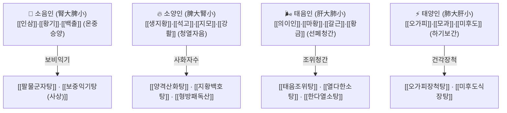

# 🍵 사상체질 처방 임상 가이드 & 체질별 핵심 방제 체계

> **핵심 3줄 요약 (Key Summary)**:
> - 🌿 기본 구성: 이제마(李濟馬)의 사상의학(四象醫學) 4대 체질별([[소음인]], [[소양인]], [[태음인]], [[태양인]]) 생리·병리 기전에 맞춘 특화 처방 체계.
> - 🎯 체질별 고유 장부 대소(臟腑大小)에 따른 표리병(表裏病) 감별 및 맞춤형 치료.
> - 🔬 현대 유전체·체성분·자율신경계 반응성과 분자약리 표적 매핑.
> - ⚠️ 주의사항: 사상체질 처방은 체질이 다르면 같은 약재라도 정반대의 독성 또는 부작용을 일으키므로 엄격한 체질 감별 필수.

---

## 📌 목차
1. [기본 처방 정보 & 군신좌사 구성](#1-기본-처방-정보--군신좌사-구성)
2. [방제학적 약재 상호작용 & 시너지 네트워크](#2-방제학적-약재-상호작용--시너지-네트워크)
3. [현대 분자약리학적 효능 & 작용 기전](#3-현대-분자약리학적-효능--작용-기전)
4. [적응 병증 및 체질별 감별 (Sweet Spot vs 금기)](#4-적응-병증-및-체질별-감별-sweet-spot-vs-금기)
5. [유사 처방군 감별 매트릭스](#5-유사-처방군-감별-매트릭스)
6. [임상 가감례 & 현대 질환별 응용](#6-임상-가감례--현대-질환별-응용)
7. [💡 사용자 진료실 핵심 필기 & 임상 팁 (원문 보존)](#7--사용자-진료실-핵심-필기--임상-팁-원문-보존)
8. [출처 및 학술 참고 문헌 (References)](#8-출처-및-학술-참고-문헌-references)

---

## 1. 기본 처방 정보 & 군신좌사 구성

* **출전**: 이제마(李濟馬) 『[[동의수세보원]]』(東醫壽世保元) 사상인 장부성리·표리병론
* **치법**: 보명지주(保命之主)의 편급(偏急)을 조절하는 체질별 한열·승강 평형 치법 (소음인 온중승양, 소양인 자음청열, 태음인 선폐청간, 태양인 하기보간)

> **체질 처방의 군신좌사 원칙**: 사상방은 일반 팔강방제와 달리 체질별 **약한 장부(소장부)**의 보명지주를 북돋우는 약재가 군약이 되며, 체질 금기 본초([[태음인]]에게 [[석고]]·[[인삼]] 다량 주의, [[소음인]]에게 [[생지황]]·[[석고]]·[[마황]] 금기, [[소양인]]에게 [[인삼]]·[[부자]] 금기)를 철저히 배제합니다.

### 1) [[소음인]] (少陰人) - 신대비소(腎大脾小)
* **주요 약재**: [[인삼]], [[황기]], [[백출]], [[당귀]], [[천궁]], [[적작약]], [[진피]], [[계지]], [[생강]], [[대추]], [[곽향]], [[자소엽]]
* **체질 특징**: 마르고 허약하며 근육량이 적고, 소화기능이 약하여 위장 장애 및 만성 설사가 호발함.
* **핵심 처방군**:
  * [[팔물군자탕]]: 기혈양허, 면역력 저하, 만성 피로, 살이 안 찌는 쇠약증.
  * [[보중익기탕(사상)]]: 소화불량, 장염, 설사형 과민성 장 증후군, 망양증 초기.

### 2) [[소양인]] (少陽人) - 비대신소(脾大腎小)
* **주요 약재**: [[생지황]], [[숙지황]], [[산수유]], [[복령]], [[택사]], [[목단피]], [[방풍]], [[형개]], [[강활]], [[독활]], [[석고]], [[지모]], [[치자]], [[연교]]
* **체질 특징**: 상초 화열이 치솟고 신수가 마르기 쉬우며, 뇌혈관·심혈관 장애, 고혈압, 당뇨병 및 신경계 흥분이 호발함.
* **핵심 처방군**:
  * [[독활지황탕]]: 성기능 저하, 배뇨 장애, 만성 피로, 혈당·혈압 조절.
  * [[형방사백산]]: 표한이열, 고혈압, 당뇨, 안면부 부종 및 성인병.
  * [[양격산화탕]]: 흉격열증, 가슴 답답함, 변비, 구내염, 급성 화열.
  * [[지황백호탕]]: 위열옹성, 39도 고열, 극심한 번갈, 양명병.
  * [[형방패독산]]: 외감 풍한감모, 두통, 오한발열, 초기 종기.
  * [[형방지황탕]]: 비수보한, 소양인 요통, 신경통, 허로.

### 3) [[태음인]] (太陰人) - 간대폐소(肝大肺小)
* **주요 약재**: [[마황]], [[맥문동]], [[길경]], [[행인]], [[의이인]], [[건율]](건밤), [[나복자]], [[오미자]], [[황금]], [[갈근]], [[고본]], [[대황]]
* **체질 특징**: 살이 찌기 쉽고, 폐활량이 적어 숨을 잘 못 쉬며, 대사증후군, 기관지 질환, 혈관 질환이 호발함.
* **핵심 처방군**:
  * [[태음조위탕]]: 비만, 과식, 혈당 스파이크, 연소-저장 불균형, 비만저환기 증후군.
  * [[조위승청탕]]: 비만 동반 우울·불안, 감정 기복, 다이어트 스트레스, 불면.
  * [[열다한소탕]]: 간수열이열병, 고혈압, 안구 충혈, 중풍 전조증, 대사증후군.
  * [[한다열소탕]]: 간열 초기, 오한이 많고 열이 적은 외감 표한증.
  * [[마황발표탕]]: 기관지 경련 천식, 마른 기침, 인두 점막 건조.
  * [[마황정통탕]]: 태음인 비습체질 좌골신경통, 요통, 무릎 관절통.

### 4) [[태양인]] (太陽人) - 폐대간소(肺大肝小)
* **주요 약재**: [[오가피]], [[모과]], [[방풍]], [[송절]], [[포도근]], [[미후도]](다래)
* **체질 특징**: 상체가 발달하고 하체가 빈약하며, 기운이 위로 솟구쳐 다리에 힘이 빠지는 해역증(하지마비) 호발.
* **핵심 처방군**:
  * [[오가피장척탕]]: 해역증(다리 풀림), 하지 무력, 척추관 협착 및 보행 곤란.

---

## 2. 방제학적 약재 상호작용 & 시너지 네트워크

* **체질별 음양 승강 배오**: [[소음인]]은 양기 함몰을 막는 승양(升陽)과 비위 온보가 핵심이고, [[소양인]]은 상초 화열을 식히며 하초 신수를 보하는 사화자수(瀉火滋水)가 핵심입니다. [[태음인]]은 폐의 발산과 간의 해열로 연소-저장을 균형화하고, [[태양인]]은 치솟는 폐기를 내려 간음을 지키는 하기(下氣) 배오를 따릅니다.

---

## 3. 현대 분자약리학적 효능 & 작용 기전

### 1) 소음인 방제군 — 장관 장벽 복구 및 미토콘드리아 에너지 대사 촉진
* [[진세노사이드]]·[[황기]] 다당체가 장 상피 밀착연접(Occludin/Claudin-1)과 골격근 [[PGC-1α]]/ATP 합성을 촉진해 저대사·만성 피로·설사를 개선합니다.
### 2) 소양인 방제군 — 신경염증 및 대사성 발열 축 차단
* [[생지황]] [[카탈폴]]·[[지모]] [[티모사포닌]]·[[석고]] 칼슘 이온이 [[TLR4]]/[[NF-κB]] 및 시상하부 [[PGE2]] 합성을 억제해 교감신경 과항진과 고열·혈압 변동을 안정화합니다.
### 3) 태음인 방제군 — 갈색지방 열발생 및 뇌혈류·지질대사 조절
* [[마황]] [[에페드린]]이 [[UCP-1]]을 유도하고 [[갈근]] [[푸에라린]]·[[황금]] [[바이칼린]]이 [[eNOS]]/[[AMPK]] 경로를 활성화해 비만저환기와 지방간·뇌허혈을 방어합니다.
### 4) 태양인 방제군 — 운동신경원 보호 및 근단백질 합성 유지
* [[오가피]] [[엘레우테로사이드 E]]와 [[모과]] [[우르솔산]]이 [[Akt]]/[[mTOR]] 경로를 통해 근위축을 막고 신경근 접합부 전달을 보전합니다.

---

## 4. 적응 병증 및 체질별 감별 (Sweet Spot vs 금기)

### [✅ 최적 적응증 (체질별 장부 생리 및 현대 질환 매핑)]

| 체질 | 장부 대소 | 취약 장부 & 병리 | 주요 현대 질환 연관성 | 핵심 대응 원칙 |
| :--- | :--- | :--- | :--- | :--- |
| **[[소음인]]** | 腎大脾小 | 비위 허한(脾胃虛寒), 표음 부족 | 소화불량, [[과민성 장 증후군]], 만성 피로, 저혈압, 수족냉증 | 온중건비, 승양익기 |
| **[[소양인]]** | 脾大腎小 | 흉격 화열(胸膈火熱), 신음 고갈 | [[고혈압]], [[뇌졸중]], [[당뇨병]], 불면, 전립선 비대, 안면홍조 | 청열사화, 보신수 음양보 |
| **[[태음인]]** | 肝大肺小 | 간열 조열(肝熱燥熱), 폐기 불선 | [[비만]], [[대사증후군]], 지방간, 천식, COPD, 요통·신경통 | 선폐윤폐, 청간사열, 조위승청 |
| **[[태양인]]** | 肺大肝小 | 상초 기충(上焦氣衝), 간음 허약 | 하지마비(해역증), 근위축증, 만성 식도 역류 | 하기건각, 보간원 |

### [⚠️ 신중 투여 및 금기 (오투약 경보)]
* **체질 오진 시 역반응**: [[소음인]]에게 [[석고]]·[[생지황]]·[[마황]]을 쓰면 설사·기력탈진이, [[소양인]]에게 [[인삼]]·[[황기]]·[[부자]]를 쓰면 두통·상열·불면이, [[태음인]]에게 [[인삼]] 다량을 쓰면 흉민·부종이 유발되므로 투약 전 체질 감별이 필수입니다.

---

## 5. 유사 처방군 감별 매트릭스

| 처방명 | 소속 체질 | 고전 일반 방제와의 기원 관계 | 핵심 임상 감별점 |
| :--- | :--- | :--- | :--- |
| [[팔물군자탕]] | 소음인 | [[팔진탕]]에서 [[숙지황]]·[[복령]] 제거 후 [[진피]]·[[황기]] 가미 | 소화 약하고 살 안 찌는 마른 체형 기혈쌍보 |
| [[보중익기탕(사상)]] | 소음인 | [[보중익기탕]]에서 [[시호]]·[[승마]] 제거 후 [[곽향]]·[[자소엽]] 가미 | 만성 설사·복통 동반 소음인 망양증 |
| [[지황백호탕]] | 소양인 | [[백호탕]]에서 [[감초]]·갱미 제거 후 [[생지황]]·[[방풍]]·[[독활]] 배합 | 소양인 39℃ 고열·극심한 번갈 |
| [[태음조위탕]] | 태음인 | 이제마 창방 (위완수한표한병 대표) | 식후 공복감·혈당 스파이크·비만저환기 |
| [[오가피장척탕]] | 태양인 | 이제마 창방 (외감요척병 대표) | 상체 건장·하지 무력(해역증)·족하수 |

---

## 6. 임상 가감례 & 현대 질환별 응용

* **대사·소화·호흡 증상별 가감 기준**:
  * 태음인 변비·열독 심화 시 → + [[대황]] ([[열다한소탕]]·[[태음조위탕]] 가미)
  * 소양인 배뇨곤란·고혈압 동반 시 → + [[복령]], [[택사]] ([[형방사백산]])
  * 소음인 심층 한증·수족냉증 심화 시 → + [[육계]], [[부자]]
* **현대 질환별 임상 매핑**:
  * **대사·심혈관계**: 제2형 [[당뇨병]], 본태성 [[고혈압]], [[비만]], 비알코올성 지방간([[태음인]]·[[소양인]])
  * **소화·면역계**: 설사형 [[과민성 장 증후군]], 만성 위염, 항암 후 면역 저하([[소음인]])
  * **신경·근골격계**: [[척추관 협착증]], 하지 무력·해역증, 급성 발열성 [[상기도 감염]]

### 양약 상호작용 (Herb–Drug Interaction)
* **교감신경흥분제·혈압약([[에페드린]], [[암로디핀]], [[프로프라놀롤]])**: 태음인 방제의 [[마황]] 성분은 혈압 상승·빈맥 및 항고혈압제 길항 위험이 있어 MAO 억제제·고카페인 병용을 피합니다.
* **혈당강하제·항응고제([[메트포르민]], [[인슐린]], [[와파린]], [[아스피린]])**: [[생지황]]·[[갈근]]·[[의이인]]·[[인삼]]·[[당귀]] 등은 혈당 변동 및 [[CYP3A4]]·[[CYP2C9]]·혈소판 응집 간섭 가능성이 있어 수치 모니터링이 필요합니다.
* **흡수 킬레이션·면역억제제([[테트라사이클린]], [[레보티록신]], [[사이클로스포린]])**: 소양인 방제의 [[석고]](칼슘 이온)는 경구 약물 흡수를 저해하고, 소음인 방제의 [[황기]]·[[인삼]]은 면역억제제와 길항하므로 최소 2시간 간격 복용 및 금기 확인이 필요합니다.

---

## 7. 💡 사용자 진료실 핵심 필기 & 임상 팁 (원문 보존)

* **사용자 원문 필기**:
  1. **[[소음인]]**: [[팔물군자탕]], [[보중익기탕(사상)]]
     - 주로 [[감초]], [[적작약]], [[생강]], [[대추]], [[인삼]], [[진피]], [[계지]], [[백출]], [[당귀]], [[황기]]가 들어감.
     - 마르고 허하고 근육 적은 체질과 연관
  2. **[[소양인]]**: [[형방사백산]], [[독활지황탕]]
     - [[방풍]], [[형개]], [[복령]], [[택사]], [[지황]], [[강활]], [[독활]]
     - 뇌혈관, 심혈관 장애, 혈압 장애 등과 연관
  3. **[[태음인]]**: [[태음조위탕]], [[조위승청탕]]
     - [[마황]]지제, [[맥문동]], [[길경]]지제, [[황금]]지제, [[대황]]지제
     - 살찌고, 숨 잘 못 쉬는 것과 연관
* **실전 진료실 체질 감별 요령**:
  * 환자가 문을 열고 들어올 때의 체형, 걸음걸이, 말의 빠르기와 톤, 식사 후 소화 패턴 및 대변 양상을 종합하여 체질을 1차 스크리닝한다.

---

## 8. 출처 및 학술 참고 문헌 (References)

1. 이제마(李濟馬). 『[[동의수세보원]](東醫壽世保元)』.
2. 전국한의과대학 사상의학교실. 『사상의학』. 집문당.
