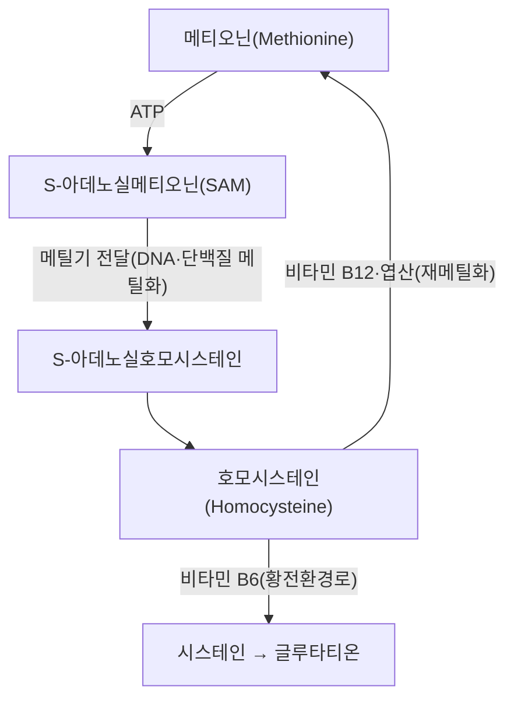

# 🥗 [[메티오닌]] (Methionine)

> **핵심 3줄 요약 (Key Summary)**:
> - 📍 **정체 & 대사**: 황(S)을 함유한 필수 아미노산으로 음식(육류·생선·계란 등)을 통해서만 공급되며, DNA 메틸화 등 체내 메틸화 반응의 핵심 메틸기 공급원이다.
> - 🚩 **기능 & 결핍 양상**: SAM(S-아데노실메티오닌)으로 활성화돼 메틸기를 전달한 뒤 호모시스테인이 되고, 비타민 B12·엽산에 의해 메티오닌으로 돌아가거나 비타민 B6에 의해 시스테인으로 전환돼 무독화된다(PMID 30693532).
> - 🛠️ **평가 & 교정**: MTHFR 유전자 C677T 변이가 있으면 재메틸화 효율이 떨어져 같은 식단에서도 호모시스테인이 더 쉽게 쌓인다(PMID 25449138) — 혈중 호모시스테인이 평가 지표다.
> - ⚠️ **과잉·독성 주의**: 비타민 B군 결핍 상태에서 메티오닌 대사가 막히면 고호모시스테인혈증으로 혈관 내피 손상·죽상경화·인지기능 저하와 연관된다 → [[호모시스테인]]

---

## 📌 목차
1. [기본 정보 & 화학 구조 (Nutrient Basics)](#1-기본-정보--화학-구조-nutrient-basics)
2. [체내 대사 & 흡수·운반 (Metabolism & Transport)](#2-체내-대사--흡수운반-metabolism--transport)
3. [생리 기능 & 작용 기전 (Physiological Function)](#3-생리-기능--작용-기전-physiological-function)
4. [급원 식품 & 함량 (Dietary Sources)](#4-급원-식품--함량-dietary-sources)
5. [권장섭취량 & 기준치 (RDA & Reference Intake)](#5-권장섭취량--기준치-rda--reference-intake)
6. [결핍증 & 과잉·독성 (Deficiency & Toxicity)](#6-결핍증--과잉독성-deficiency--toxicity)
7. [관련 질환 & 임상 연계 (Clinical Correlation)](#7-관련-질환--임상-연계-clinical-correlation)
8. [💡 진료실 핵심 필기 & 식이 지도 (Clinical Pearls & Diet Counseling)](#8--진료실-핵심-필기--식이-지도-clinical-pearls--diet-counseling)
9. [출처 및 학술 참고 문헌 (References)](#9-출처-및-학술-참고-문헌-references)

---

## 1. 기본 정보 & 화학 구조 (Nutrient Basics)

> [!abstract]+ 🧪 3D 분자 구조 (Interactive 3D Viewer)
> <iframe src="https://molecule-viewer-rho.vercel.app/?cid=6137" style="width: 100%; height: 600px; border: none; border-radius: 12px; box-shadow: 0 4px 20px rgba(0,0,0,0.15);" allowfullscreen></iframe>

메티오닌(C₅H₁₁NO₂S, 149.21g/mol, PubChem CID [6137](https://pubchem.ncbi.nlm.nih.gov/compound/6137))은 황을 함유한 필수 아미노산이다. 체내에서 합성되지 않아 육류·생선·계란 등 단백질 식품으로만 공급되며, DNA·단백질 메틸화 반응의 핵심 메틸기(-CH₃) 공급원 역할을 한다.

![[Pasted image 20240510012212.png]]
![[Pasted image 20240510012224.png]]
![[Pasted image 20240510012404.png]]

---

## 2. 체내 대사 & 흡수·운반 (Metabolism & Transport)

메티오닌은 ATP와 결합해 SAM(S-아데노실메티오닌)으로 활성화되고, SAM이 DNA·히스톤·신경전달물질에 메틸기를 넘겨준 뒤 남는 것이 S-아데노실호모시스테인이다. 이것이 가수분해되면 호모시스테인이 되는데, 이후 두 갈래로 처리된다. [[비타민 B12]]와 엽산의 도움으로 메틸기를 다시 받아 메티오닌으로 돌아가는 재메틸화 경로, 또는 [[비타민 B6]]의 도움으로 시스테인이 돼 [[글루타티온]] 합성에 쓰이는 황전환 경로다(PMID 30693532). 이 재메틸화 경로의 핵심 효소인 MTHFR(메틸렌테트라하이드로엽산 환원효소)에 C677T 변이가 있으면 효소 활성이 떨어져, 같은 엽산·B12 섭취량에서도 호모시스테인이 더 쉽게 쌓인다 — 이 변이는 인구집단에 따라 동형접합 빈도가 5~20%에 이를 정도로 드물지 않다(PMID 25449138).

---

## 3. 생리 기능 & 작용 기전 (Physiological Function)

메틸기 공급원으로서 DNA·히스톤·신경전달물질의 메틸화 반응을 지탱하는 외에, 동물의 성장과 소화관 발달을 돕고 [[글루타티온]]을 통한 항산화 작용, 고온 스트레스 완화, 지방간 억제와 간 해독 기능에도 관여한다. 최근에는 반대 방향의 연구도 주목받는다 — 동물실험에서 메티오닌 섭취를 제한하면 산화 스트레스가 줄고 수명이 늘어나는 효과가 반복 관찰됐는데, 이는 메티오닌이 과다할 때 생기는 산화적 부담과 성장 신호(mTOR 등) 과활성을 동시에 낮추는 기전으로 설명된다(PMID 36152485). 다만 이는 전임상 동물연구 수준의 결과로, 인체에 그대로 적용해 메티오닌을 임의로 제한하도록 권고할 근거는 아니다.

---

## 4. 급원 식품 & 함량 (Dietary Sources)

| 급원 식품 | 비고 |
| :--- | :--- |
| 육류·생선·계란 | 주요 급원 |
| 유제품 | 급원 |
| 식물성 단백질 | 상대적으로 함량 낮음 |

---

## 5. 권장섭취량 & 기준치 (RDA & Reference Intake)

메티오닌은 단백질 섭취 전체의 일부로 공급되므로 별도 단일 영양소 RDA는 일반적으로 설정하지 않는다 — [[단백질]] 권장량을 따른다.

---

## 6. 결핍증 & 과잉·독성 (Deficiency & Toxicity)

비타민 B6·B12·엽산이 부족하면 호모시스테인이 세포 내에 쌓여 혈관내피를 손상시키고 염증을 일으키는 것으로 논의된다 — 이 기전은 [[단삼]] 노트가 다루는 혈관 내피 보호(살비아놀산 B) 논의와도 이어진다. 이렇게 쌓인 고호모시스테인혈증은 혈관 내피 손상·죽상경화·인지기능 저하와 연관된다(PMID 12611557) → [[호모시스테인]]. MTHFR C677T 동형접합자는 같은 영양 상태에서도 더 쉽게 이 경로가 막히므로, 반복적으로 호모시스테인이 높게 나오는 환자에서는 유전형을 고려할 수 있다(PMID 25449138).

---

## 7. 관련 질환 & 임상 연계 (Clinical Correlation)

| 관련 질환 | 연관 기전 | 임상 적용 |
| :--- | :--- | :--- |
| **고호모시스테인혈증** | 비타민 B군 결핍 또는 MTHFR 변이로 재메틸화·황전환 경로 정체 | 혈중 호모시스테인 측정, B6·B12·엽산 보충(MTHFR 변이자는 활성형 엽산 고려) |
| **인지기능 저하·혈관성 치매** | 메티오닌-호모시스테인 회로 이상 | 호모시스테인 관리가 보조적 예방 전략으로 논의(PMID 12611557) |
| **노화 관련 대사(연구 단계)** | 메티오닌 과다가 산화 스트레스·성장신호 과활성과 연관 | 동물연구 수준, 임의 제한 식이는 권고하지 않음(PMID 36152485) |

---

## 8. 💡 진료실 핵심 필기 & 식이 지도 (Clinical Pearls & Diet Counseling)

"메틸기를 나눠주는 분자(메티오닌)가 비타민 B군이 부족하면 독성 중간물질(호모시스테인)로 쌓인다"는 설명으로 비타민 B군 보충의 필요성을 전달하면 이해가 쉽다. 반복적으로 호모시스테인이 높게 측정되는 환자에서는 단순 영양 결핍 외에 MTHFR 변이 같은 유전적 요인도 염두에 둔다. [[호모시스테인]]·[[비타민 B12]]·[[비타민 B6]]·[[엽산]]·[[글루타티온]]·[[시스테인]] 노트와 함께 묶어 설명한다.

---

## 9. 출처 및 학술 참고 문헌 (References)

1. (2019). Vitamin B12, folate, and the methionine remethylation cycle—biochemistry, pathways, and regulation. *Journal of Inherited Metabolic Disease*, 42(4):673-685. PMID: [30693532](https://pubmed.ncbi.nlm.nih.gov/30693532/)
2. (1999). Homocysteine metabolism. *Annual Review of Nutrition*, 19:217-246. PMID: [10448523](https://pubmed.ncbi.nlm.nih.gov/10448523/)
3. (2003). The methionine-homocysteine cycle and its effects on cognitive diseases. *Alternative Medicine Review*, 8(1):7-19. PMID: [12611557](https://pubmed.ncbi.nlm.nih.gov/12611557/)
4. (2015). Methylenetetrahydrofolate reductase (MTHFR) C677T polymorphism: epidemiology, metabolism and the associated diseases. *European Journal of Medical Genetics*, 58(1):1-10. PMID: [25449138](https://pubmed.ncbi.nlm.nih.gov/25449138/)
5. (2022). Methionine restriction - Association with redox homeostasis and implications on aging and diseases. *Redox Biology*, 57:102464. PMID: [36152485](https://pubmed.ncbi.nlm.nih.gov/36152485/)

## 함께 보기
- [[호모시스테인]] · [[비타민 B12]] · [[비타민 B6]] · [[엽산]] · [[글루타티온]] · [[시스테인]] · [[단백질]] · [[단삼]]

> ⚠️ 2026-10-14 클로드 재작업(비오님 지시로 영양학 전체 처음부터 재진행): MTHFR C677T 유전적 변이·메티오닌 제한-노화 연구 추가 조사로 깊이 보강, 통합 서술로 재작성. 이미지 3장 100% 보존.
