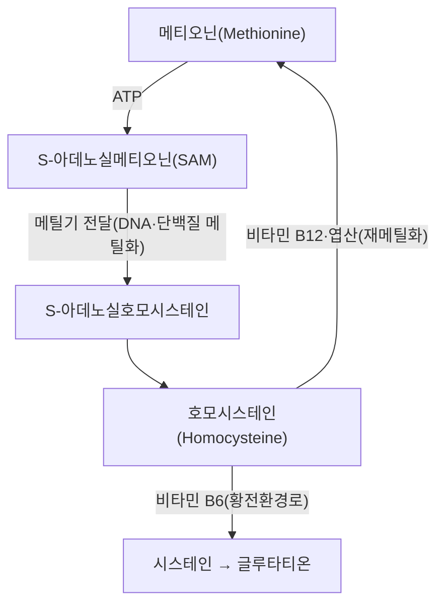

# 🥗 [[메티오닌]] (Methionine)

> **핵심 3줄 요약 (Key Summary)**:
> - 📍 **정체 & 대사**: 황(S)을 함유한 **필수 아미노산**으로, 음식(육류·생선·계란 등 단백질)을 통해서만 공급 가능하다. 메티오닌-호모시스테인 회로(황전환 경로)의 출발 물질이자 DNA 메틸화 등 체내 메틸화 반응의 핵심 메틸기(-CH₃) 공급원이다.
> - 🚩 **기능 & 결핍 양상**: 메티오닌이 SAM(S-아데노실메티오닌)으로 활성화되어 메틸기를 DNA·단백질 등에 전달하면 호모시스테인이 생성되며, [[비타민 B12]]·엽산에 의한 재메틸화로 메티오닌으로 회귀하거나 [[비타민 B6]]에 의해 [[시스테인]]으로 전환되어 무독화된다(PMID 30693532).
> - 🛠️ **평가 & 교정**: 비타민 B군(B6·B12·엽산) 결핍 시 이 경로가 정체되어 호모시스테인이 축적된다 — 혈중 호모시스테인 농도가 평가 지표다.
> - ⚠️ **과잉·독성 주의**: 비타민 B6·B12·엽산 결핍 상태에서 메티오닌 대사가 정체되면 고호모시스테인혈증으로 혈관 내피 손상·죽상경화·인지기능 저하와 연관된다 → [[호모시스테인]]

> **사용자 원문 필기 (보존) — 첨부 이미지**:
![[Pasted image 20240510012212.png]]
![[Pasted image 20240510012224.png]]
![[Pasted image 20240510012404.png]]

---

## 📌 목차
1. [기본 정보 & 화학 구조 (Nutrient Basics)](#1-기본-정보--화학-구조-nutrient-basics)
2. [체내 대사 & 흡수·운반 (Metabolism & Transport)](#2-체내-대사--흡수운반-metabolism--transport)
3. [생리 기능 & 작용 기전 (Physiological Function)](#3-생리-기능--작용-기전-physiological-function)
4. [급원 식품 & 함량 (Dietary Sources)](#4-급원-식품--함량-dietary-sources)
5. [권장섭취량 & 기준치 (RDA & Reference Intake)](#5-권장섭취량--기준치-rda--reference-intake)
6. [결핍증 & 과잉·독성 (Deficiency & Toxicity)](#6-결핍증--과잉독성-deficiency--toxicity)
7. [관련 질환 & 임상 연계 (Clinical Correlation)](#7-관련-질환--임상-연계-clinical-correlation)
8. [💡 진료실 핵심 필기 & 식이 지도 (Clinical Pearls & Diet Counseling)](#8--진료실-핵심-필기--식이-지도-clinical-pearls--diet-counseling)
9. [출처 및 학술 참고 문헌 (References)](#9-출처-및-학술-참고-문헌-references)

---

## 1. 기본 정보 & 화학 구조 (Nutrient Basics)

> [!abstract]+ 🧪 3D 분자 구조 (Interactive 3D Viewer)
> <iframe src="https://molecule-viewer-rho.vercel.app/?cid=6137" style="width: 100%; height: 600px; border: none; border-radius: 12px; box-shadow: 0 4px 20px rgba(0,0,0,0.15);" allowfullscreen></iframe>

| 항목 | 상세 내용 |
| :--- | :--- |
| **분자식/분자량** | C₅H₁₁NO₂S / 149.21 g/mol — PubChem CID [6137](https://pubchem.ncbi.nlm.nih.gov/compound/6137)(검증됨, L-형) |
| **분류** | 필수 아미노산(황 함유) |

---

## 2. 체내 대사 & 흡수·운반 (Metabolism & Transport)

* **대사 경로**: 메티오닌은 ATP와 결합해 SAM(S-아데노실메티오닌)으로 활성화되며, SAM은 DNA·히스톤·신경전달물질 등에 메틸기(-CH₃)를 전달하는 체내 주요 메틸기 공여체로 작용한다. 메틸기를 전달하고 남은 S-아데노실호모시스테인은 가수분해되어 호모시스테인이 되며, 이는 두 경로로 처리된다: ① [[비타민 B12]]와 엽산의 도움으로 메틸기를 재공급받아 메티오닌으로 회귀(재메틸화 경로), ② [[비타민 B6]]의 도움으로 시스테인으로 전환되어 [[글루타티온]] 합성에 사용되는 황전환 경로(transsulfuration pathway)(PMID 30693532).

---

## 3. 생리 기능 & 작용 기전 (Physiological Function)

* **메틸기 공급원**: DNA·히스톤·신경전달물질의 메틸화 반응에 메틸기를 공급한다.
* **기타 생리적 기능**: 동물의 성장과 소화관 발달을 돕고, [[글루타티온]] 등 대사산물을 통한 항산화 효과, 고온 스트레스 감소, 지방간 억제 및 간 해독 기능에도 관여한다.

---

## 4. 급원 식품 & 함량 (Dietary Sources)

| 급원 식품 | 비고 |
| :--- | :--- |
| 육류·생선·계란 | 주요 급원 |
| 유제품 | 급원 |
| 식물성 단백질 | 상대적으로 함량 낮음 |

---

## 5. 권장섭취량 & 기준치 (RDA & Reference Intake)

* 메티오닌은 필수 아미노산으로서 단백질 섭취 전체(§5 [[단백질]] 권장량 참조)의 일부로 공급된다 — 별도 단일 영양소 RDA는 일반적으로 설정하지 않는다.

---

## 6. 결핍증 & 과잉·독성 (Deficiency & Toxicity)

* **결핍/대사 정체**: 비타민 B6·B12·엽산이 부족하면 호모시스테인이 세포 내에 축적되어 혈관내피세포를 손상시키고 염증을 유발하는 것으로 논의된다 — 이는 [[단삼]] 노트에서 다뤄지는 혈관 내피 보호 기전(살비아놀산 B) 논의와도 연결된다.
* **고호모시스테인혈증**: 혈관 내피 손상·죽상경화·인지기능 저하와 연관된다(PMID 12611557) → [[호모시스테인]]

---

## 7. 관련 질환 & 임상 연계 (Clinical Correlation)

| 관련 질환 | 연관 기전 | 임상 적용 |
| :--- | :--- | :--- |
| **고호모시스테인혈증** | 비타민 B군 결핍으로 메티오닌 재메틸화·황전환 경로 정체 | 혈중 호모시스테인 측정, 비타민 B6·B12·엽산 보충 |
| **인지기능 저하·혈관성 치매** | 메티오닌-호모시스테인 회로 이상 | 호모시스테인 관리가 보조적 예방 전략으로 논의(PMID 12611557) |

---

## 8. 💡 진료실 핵심 필기 & 식이 지도 (Clinical Pearls & Diet Counseling)

* **볼트 내 관련 개념 연계**: [[호모시스테인]], [[비타민 B12]], [[비타민 B6]], [[엽산]], [[글루타티온]], [[시스테인]] 노트와 상호 연계해 설명한다.
* **환자 설명 포인트**: "메틸기를 나눠주는 분자(메티오닌)가 비타민 B군이 부족하면 독성 중간물질(호모시스테인)로 쌓인다"는 설명으로 비타민 B군 보충의 필요성을 전달한다.

---

## 9. 출처 및 학술 참고 문헌 (References)

1. (2019). Vitamin B12, folate, and the methionine remethylation cycle—biochemistry, pathways, and regulation. *Journal of Inherited Metabolic Disease*, 42(4):673-685. PMID: [30693532](https://pubmed.ncbi.nlm.nih.gov/30693532/)
   - `[연구 요약]` 비타민 B12·엽산에 의한 메티오닌 재메틸화 경로의 생화학·조절 기전을 정리한 종설.
2. (1999). Homocysteine metabolism. *Annual Review of Nutrition*, 19:217-246. PMID: [10448523](https://pubmed.ncbi.nlm.nih.gov/10448523/)
   - `[연구 요약]` 호모시스테인 대사 전반(재메틸화·황전환 경로)을 정리한 고전적 종설.
3. (2003). The methionine-homocysteine cycle and its effects on cognitive diseases. *Alternative Medicine Review*, 8(1):7-19. PMID: [12611557](https://pubmed.ncbi.nlm.nih.gov/12611557/)
   - `[연구 요약]` 메티오닌-호모시스테인 회로와 인지기능 질환의 연관성을 논의.

## 함께 보기
- [[호모시스테인]] · [[비타민 B12]] · [[비타민 B6]] · [[엽산]] · [[글루타티온]] · [[시스테인]] · [[단백질]] · [[단삼]]

> ⚠️ 내용 검토 필요 (2026-10-14 클로드): 비표준 4섹션 구조(원문 필기, 이미지3)를 9섹션 영양학 표준 템플릿으로 재구성, 원문 필기·이미지 100% 보존. CID 6137 PubChem 대조 결과 정확함(수정 없음). 기존 PMID 3건 재검증 통과.
