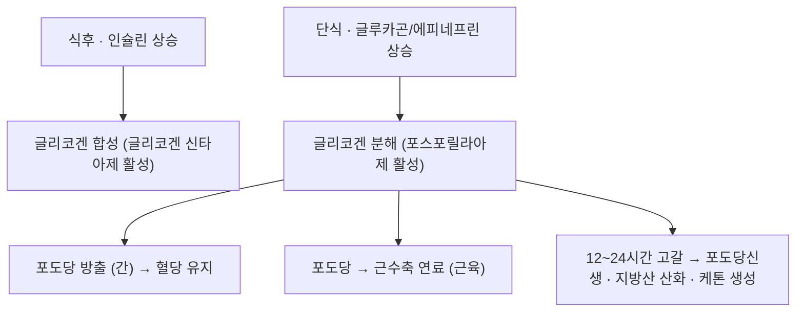

# 🥗 [[글리코겐]] (Glycogen)

> **핵심 3줄 요약 (Key Summary)**:
> - 📍 **정체 & 대사**: 포도당이 α-1,4 결합으로 곁가지(α-1,6)를 이룬 **가지형 포도당 저장 고분자**다. 간·골격근에 저장된다.
> - 🚩 **기능 & 결핍 양상**: 간 글리코겐은 **혈당 유지**(전신 공급), 근 글리코겐은 **근수축 연료**(국소 사용)로 역할이 다르다.
> - 🛠️ **평가 & 교정**: 단식 12~24시간에 간 글리코겐이 고갈되면 포도당신생·지방산 산화·[[케톤체]] 생성이 시작된다. 운동 강도·지구력의 핵심 변수다(PMID 22248338).
> - ⚠️ **과잉·독성 주의**: 저탄수화물·공복·격렬한 운동을 겹치면 글리코겐 고갈이 빠르고, 당뇨 환자에서는 저혈당 위험이 커진다.

---

## 📌 목차
1. [기본 정보 & 화학 구조 (Nutrient Basics)](#1-기본-정보--화학-구조-nutrient-basics)
2. [체내 대사 & 흡수·운반 (Metabolism & Transport)](#2-체내-대사--흡수운반-metabolism--transport)
3. [생리 기능 & 작용 기전 (Physiological Function)](#3-생리-기능--작용-기전-physiological-function)
4. [급원 식품 & 함량 (Dietary Sources)](#4-급원-식품--함량-dietary-sources)
5. [권장섭취량 & 기준치 (RDA & Reference Intake)](#5-권장섭취량--기준치-rda--reference-intake)
6. [결핍증 & 과잉·독성 (Deficiency & Toxicity)](#6-결핍증--과잉독성-deficiency--toxicity)
7. [관련 질환 & 임상 연계 (Clinical Correlation)](#7-관련-질환--임상-연계-clinical-correlation)
8. [💡 진료실 핵심 필기 & 식이 지도 (Clinical Pearls & Diet Counseling)](#8--진료실-핵심-필기--식이-지도-clinical-pearls--diet-counseling)
9. [출처 및 학술 참고 문헌 (References)](#9-출처-및-학술-참고-문헌-references)

---

## 1. 기본 정보 & 화학 구조 (Nutrient Basics)

* **구조**: 포도당 단위가 α-1,4 결합으로 선형 사슬을 이루고 α-1,6 결합으로 곁가지를 형성한다. 가지가 많아 분해·합성이 빠르다.
* **저장량(성인 기준 개략)**: 간 약 80~120g, 골격근 약 300~400g. 간은 농도가 높고(약 5~8%), 근육은 총량이 많다.
* **수분 결합**: 글리코겐 1g당 약 3g의 물을 함께 저장한다 — 저장 시 체중 증가로 나타난다.

---

## 2. 체내 대사 & 흡수·운반 (Metabolism & Transport)

* **합성**: 인슐린 → 글리코겐 신타아제 활성화(식후 저장).
* **분해**: [[글루카곤]]·에피네프린 → 포스포릴라아제 활성화.
* **기관 차이**: 간은 분해한 포도당을 **혈중으로 내보내** 전신(특히 뇌)에 공급하고, 근육은 **자기 연료로만** 쓴다(포도당-6-포스파타아제 부재).

---

## 3. 생리 기능 & 작용 기전 (Physiological Function)

* **혈당 항상성**: 간 글리코겐이 식간·야간 혈당을 유지하는 완충 장치다.
* **운동 연료**: 근 글리코겐은 고강도 운동의 주 연료다 — 고갈되면 피로·수행능 저하가 나타난다.
* **단식 생리**: 고갈 시점부터 포도당신생(간)·지방산 산화·[[케톤체]] 생성이 켜진다.

---

## 4. 급원 식품 & 함량 (Dietary Sources)

* 글리코겐 자체는 체내에서 합성·저장되는 고분자이므로 "급원 식품"이 직접 적용되지 않는다 — 식이 탄수화물(전분·당류) 섭취가 글리코겐 저장의 원료가 된다 → [[당질]]

---

## 5. 권장섭취량 & 기준치 (RDA & Reference Intake)

* 글리코겐 저장을 목적으로 한 탄수화물 섭취는 운동 강도·지구력 종목에 따라 다르며, 지구력 운동 전 탄수화물 로딩(체중 1kg당 8~12g/일)이 활용된다.

---

## 6. 결핍증 & 과잉·독성 (Deficiency & Toxicity)

* **결핍(고갈)**: 단식 12~24시간에 간 글리코겐이 고갈되면 포도당신생·지방산 산화·케톤체 생성이 시작된다. 저탄수화물·공복·격렬한 운동이 겹치면 글리코겐 고갈이 빨라지고, 당뇨 환자에서는 저혈당 위험이 커진다.
* **과잉**: 유전적 글리코겐 축적병(글리코겐 저장병, GSD)에서는 효소 결핍으로 글리코겐이 비정상적으로 축적돼 간비대·저혈당 등을 유발한다.

---

## 7. 관련 질환 & 임상 연계 (Clinical Correlation)

| 관련 질환 | 연관 기전 | 임상 적용 |
| :--- | :--- | :--- |
| **[[제2형 당뇨병]]** | 간 글리코겐·당신생 조절 이상 | 혈당 조절·운동 처방 |
| **[[간헐적 단식]]** | 단식 12~24시간에 고갈 | 단식 강도·저혈당 감시(PMID 40533200) |
| **운동수행** | 근 글리코겐 고갈 → 피로 | 탄수화물 보충 전략 → [[저항운동]] · [[유산소운동]] |
| **[[저혈당]]** | 저장 고갈 + 약물 | 인슐린·설폰요소제 감시 |

---

## 8. 💡 진료실 핵심 필기 & 식이 지도 (Clinical Pearls & Diet Counseling)

* **환자 설명 포인트**: "밥을 하루 안 먹으면 간에 저장된 당(글리코겐)이 하루 안에 바닥나고, 그 다음부터 몸은 지방을 태우기 시작한다"는 비유로 단식 생리를 설명한다.
* **체중 변동 설명**: 저탄수화물 식이 초기의 급격한 체중 감소는 글리코겐과 함께 저장된 수분(1g당 약 3g)이 함께 빠지는 것임을 설명해 과도한 기대를 조정한다.

---

## 9. 출처 및 학술 참고 문헌 (References)

1. Roach PJ, Depaoli-Roach AA, Hurley TD, Tagliabracci VS (2012). Glycogen and its metabolism: some new developments and old themes. *Biochemical Journal*, 441(3):763-787. PMID: [22248338](https://pubmed.ncbi.nlm.nih.gov/22248338/)
   - `[연구 요약]` 글리코겐 합성·분해 조절과 관련 질환을 정리한 대표 종설.
2. Semnani-Azad Z, et al. (2025). Intermittent fasting strategies and their effects on body weight and other cardiometabolic risk factors. *BMJ*, 389:e082007. PMID: [40533200](https://pubmed.ncbi.nlm.nih.gov/40533200/)
   - `[연구 요약]` 단식 기간 글리코겐 저장 고갈 → 지방산 산화·케톤 생성이 단식 생리의 축임을 서술.

## 함께 보기
- [[글루코스]] · [[글루카곤]] · [[인슐린]] · [[케톤체]] · [[간헐적 단식]] · [[격일단식]] · [[저혈당]] · [[제2형 당뇨병]] · [[당질]]

> ⚠️ 내용 검토 필요 (2026-10-14 클로드): 비표준 6섹션 구조를 9섹션 영양학 표준 템플릿으로 재구성(§4·5 신설해 매핑, 내용 삭제 없음). 기존 PMID 2건 재검증 통과(정확).
