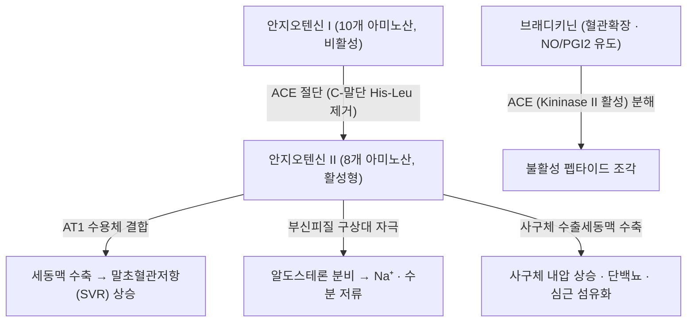

# 🔬 [[ACE]] (Angiotensin-Converting Enzyme, 안지오텐신전환효소)

> **핵심 요약 (Key Summary)**:
> - **분자 정체**: 아연(Zn²⁺) 의존성 금속카복시펩티다아제(EC 3.4.15.1, 유전자명 *ACE*, 염색체 17q23.3)로, 폐 모세혈관 내피세포 등에 풍부하게 발현되는 막결합형 외막효소(Ectoenzyme).
> - **이중 촉매 기능**: [[RAAS]](레닌-안지오텐신-알도스테론계)의 중심 효소로서 ① 비활성 [[안지오텐신 I]](10aa)을 강력한 혈관수축 물질인 [[안지오텐신 II]](8aa)로 전환하고, ② 동시에 혈관확장 물질인 [[브래디키닌]]을 분해(Kininase II 활성)하여 혈압을 이중으로 상승시킴.
> - **임상 약물 표적**: [[ACE 억제제]](-pril 계열: [[에날라프릴]], [[라미프릴]], [[페린도프릴]] 등)는 활성 부위 아연 이온을 킬레이트하여 [[고혈압]], [[심부전]], [[당뇨병성 신증]]의 1차 표준 치료제로 사용됨.
> - **핵심 부작용**: 브래디키닌 및 Substance P 축적으로 인한 **만성 마른기침(10~20%)**과 치명적일 수 있는 [[혈관부종]](Angioedema)을 유발하며, 임신 중 투여는 태아 신장 발달 장애로 **절대 금기**임.

---

## 📌 목차
1. [분자 정체 및 도메인 구조 (Molecular Identity & Structural Domains)](#1-분자-정체-및-도메인-구조-molecular-identity--structural-domains)
2. [촉매 기전: RAAS와 키닌계의 이중 조절 (Dual Catalytic Mechanism)](#2-촉매-기전-raas와-키닌계의-이중-조절-dual-catalytic-mechanism)
3. [조직 분포 및 체성형 vs 생식기형 ACE (Tissue Distribution & Isoforms)](#3-조직-분포-및-체성형-vs-생식기형-ace-tissue-distribution--isoforms)
4. [관련 질환 및 병태생리 (Pathophysiology & Clinical Significance)](#4-관련-질환-및-병태생리-pathophysiology--clinical-significance)
5. [약물 표적으로서의 ACE: 억제제 약리 및 부작용 (ACE Inhibitors & Clinical Safety)](#5-약물-표적으로서의-ace-억제제-약리-및-부작용-ace-inhibitors--clinical-safety)
6. [한의학적 연계 및 진료실 임상 체크포인트 (Integrative Korean Medicine)](#6-한의학적-연계-및-진료실-임상-체크포인트-integrative-korean-medicine)
7. [출처 및 학술 참고 문헌 (References)](#7-출처-및-학술-참고-문헌-references)

---

## 1. 분자 정체 및 도메인 구조 (Molecular Identity & Structural Domains)

| 항목 | 상세 내용 |
| :--- | :--- |
| **공식 명칭** | Angiotensin I-Converting Enzyme (Peptidyl-dipeptidase A, Kininase II, CD143) |
| **유전자 / 위치** | *ACE* (염색체 17q23.3) / UniProt [P12821](https://www.uniprot.org/uniprotkb/P12821/entry) |
| **효소 분류** | EC 3.4.15.1 (Zn²⁺ 의존성 디펩티딜 카복시펩티다아제) |
| **체성형 구조 (sACE)** | 약 170 kDa, 약 60% 서열 상동성을 공유하는 **N-도메인**과 **C-도메인**의 이중 촉매 부위 보유 |
| **촉매 모티프** | 각 도메인에 보존된 **HExxH** 아연 결합 모티프 포함 (His2개 + Glu1개가 Zn²⁺ 배위) |

* 체성형 ACE(sACE)의 두 도메인은 기질 특이성에 차이가 있습니다. **C-도메인**이 혈압 조절에 핵심적인 안지오텐신 I $\rightarrow$ 안지오텐신 II 전환을 주로 담당하며, **N-도메인**은 조혈 조절 펩타이드(Ac-SDKP) 및 브래디키닌 분해에 더 높은 기여도를 보입니다.

---

## 2. 촉매 기전: RAAS와 키닌계의 이중 조절 (Dual Catalytic Mechanism)

ACE는 혈압 상승 인자를 생성함과 동시에 혈압 하강 인자를 파괴하는 이중 스위치를 가집니다.

1. **안지오텐신 I 전환**: 신장 사구체옆장치에서 분비된 [[레닌]](Renin)이 간에서 생성된 안지오텐시노겐을 안지오텐신 I으로 자르면, 혈액이 폐 모세혈관을 통과할 때 내피세포 표면의 ACE가 C-말단 디펩타이드(His-Leu)를 절단해 [[안지오텐신 II]]를 생성합니다.
2. **브래디키닌 불활성화 (Kininase II)**: ACE는 강력한 혈관확장 및 내피 [[NO]]·[[PGI2]] 유리 촉진 물질인 브래디키닌의 C-말단을 절단해 불활성화합니다. 따라서 ACE가 활성화되면 혈압 상승(안지오텐신 II $\uparrow$)과 혈관확장 소실(브래디키닌 $\downarrow$)이 동시에 일어납니다.

---

## 3. 조직 분포 및 체성형 vs 생식기형 ACE (Tissue Distribution & Isoforms)

* **체성형 ACE (Somatic ACE, sACE)**: 폐 혈관 내피세포 표면에 가장 고농도로 발현되며, 전신 혈관 내피, 신장 근위세뇨관 솔가장자리(Brush border), 소장 상피, 대식세포 및 뇌 혈관에도 분포합니다. 특히 사르코이드증(Sarcoidosis) 육아종의 활성화된 대식세포에서 ACE가 과발현되어 혈중 ACE 수치가 질병 활성도 지표로 활용됩니다.
* **생식기형 ACE (Germinal ACE, gACE)**: 고환의 정자세포에 특이적으로 발현되는 짧은 동위효소(C-도메인 단일 구조, 약 90 kDa)로, 정자 성숙과 수정 능력에 필수적입니다.
* [[ACE2]]와의 구별: 이름과 달리 ACE2는 ACE 억제제에 의해 억제되지 않으며, 안지오텐신 II를 혈관확장·항염 물질인 **Ang-(1-7)**으로 분해하는 RAAS의 역조절 효소이자 SARS-CoV-2 수용체입니다.

---

## 4. 관련 질환 및 병태생리 (Pathophysiology & Clinical Significance)

* [[고혈압]]: RAAS 과활성화와 내피성 ACE 발현 증가는 본태성 및 신혈관성 고혈압에서 말초저항 상승과 체액 저류를 유도합니다.
* **[[심부전]] 및 심근 리모델링**: 만성적인 안지오텐신 II 과다는 심근세포 비대와 심장 섬유아세포의 콜라겐 침착([[TGF-β]] 매개 섬유화)을 촉진해 심실 재형성(Remodeling)을 악화시킵니다.
* [[당뇨병성 신증]]: 안지오텐신 II는 사구체 수입세동맥보다 **수출세동맥(Efferent arteriole)을 우선 수축**시켜 사구체 모세혈관 내압(사구체 고혈압)과 단백뇨를 악화시킵니다.
* **ACE 유전자 I/D 다형성**: 인트론 16의 삽입/결실(I/D) 다형성 중 D 대립유전자가 혈중 ACE 활성 상승과 연관된다는 보고가 있으나, 개별 환자의 질환 예측이나 약물 선택 기준으로 활용하기에는 연구 간 이질성이 커 임상적 활용도는 제한적입니다.

---

## 5. 약물 표적으로서의 ACE: 억제제 약리 및 부작용 (ACE Inhibitors & Clinical Safety)

| 구분 | 상세 내용 |
| :--- | :--- |
| **대표 약물 (-pril)** | [[캡토프릴]], [[에날라프릴]], [[리시노프릴]], [[라미프릴]], [[페린도프릴]] |
| **작용 기전** | 활성 부위 Zn²⁺에 배위 결합하여 ACE를 경쟁적 억제 $\rightarrow$ Ang II 생성 차단 + 브래디키닌 보존 |
| **임상 이점** | 혈압 강하, 사구체 수출세동맥 이완을 통한 사구체 내압 감소(단백뇨 감소), 심부전 생존율 개선 (Messerli et al. 2018) |
| **마른기침 (10~20%)** | 기관지 내 **브래디키닌 및 Substance P 축적**으로 C-섬유 기침 반사 과민화 $\rightarrow$ [[ARB]]로 교체 시 소실 |
| **혈관부종 (0.1~0.7%)** | 입술·혀·후두 점막의 급격한 부종(브래디키닌 매개, Bas et al. 2017) $\rightarrow$ 항히스타민/에피네프린 반응 불량, 즉시 기도 확보 및 약물 영구 중단 |
| **기타 주의·금기** | [[고칼륨혈증]](알도스테론 감소), 양측성 신동맥 협착 시 급성 신손상, **임신 전 기간 절대 금기**(태아 신장 형성 저하) |

---

## 6. 한의학적 연계 및 진료실 임상 체크포인트 (Integrative Korean Medicine)

> [!tip] 진료실 실전 감별 포인트 (고혈압 환자의 원인 미상 마른기침)
> 1. **약인성 기침 감별**: 호흡기 감염 징후나 가래 없이 수 주~수 개월간 지속되는 **야간·건성 마른기침** 환자가 내원했을 때, 복용 중인 고혈압·심부전 약에 `-pril`(에날라프릴·라미프릴·페린도프릴 등)이 포함되어 있다면 한약 처방 전 **ACE 억제제 유발 기침**을 우선 배제해야 합니다.
> 2. **[[K+]] 모니터링 주의**: ACE 억제제나 [[ARB]] 복용 환자에게 칼륨 함량이 높은 생약 즙이나 [[감초]]·[[스피로놀락톤]] 계열 병용 시 전해질(고칼륨혈증 vs 저칼륨혈증) 변동을 확인합니다.
> 3. **본초의 ACE 저해 근거 주의**: 일부 본초 유래 플라보노이드·펩타이드 성분이 시험관 내(in vitro)에서 ACE 저해 활성을 보인다는 기초 스크리닝 보고가 있으나, 인체 혈압강하 효과를 대체할 수 있는 임상 근거는 확립되어 있지 않으므로 혈압약의 임의 중단을 권고하지 않습니다.

---

## 7. 출처 및 학술 참고 문헌 (References)

1. Acharya KR, Sturrock ED, et al. (2024). Advances in the structural basis for angiotensin-1 converting enzyme (ACE) inhibitors. *Biosci Rep*, 44(8):BSR20240130. PMID: 39046229
   - **핵심 요약**: ACE의 N-/C-도메인 3차원 구조, 아연 결합 촉매 기전, 안지오텐신 I·브래디키닌 이중 기질 특이성 및 도메인 선택적 억제제 설계 발전을 정리한 종설.
2. Messerli FH, et al. (2018). Angiotensin-Converting Enzyme Inhibitors in Hypertension: To Use or Not to Use?. *J Am Coll Cardiol*, 71(13):1474-1482. PMID: 29598869
   - **핵심 요약**: 고혈압 및 심혈관 질환에서 ACE 억제제의 심혈관 보호 효과와 ARB 대비 마른기침·혈관부종 부작용 프로파일을 비교 평가한 종설.
3. Bas M, et al. (2017). The Angiotensin-Converting-Enzyme-Induced Angioedema. *Immunol Allergy Clin North Am*, 37(1):183-200. PMID: 27886906
   - **핵심 요약**: 브래디키닌 축적에 의한 ACE 억제제 유발 혈관부종의 병태생리, 기도 폐쇄 위험 및 응급 처치 원칙을 다룬 임상 종설.

<!-- 보관 태그(1회용·링크오류, 필요시 복원): 혈압조절 -->
