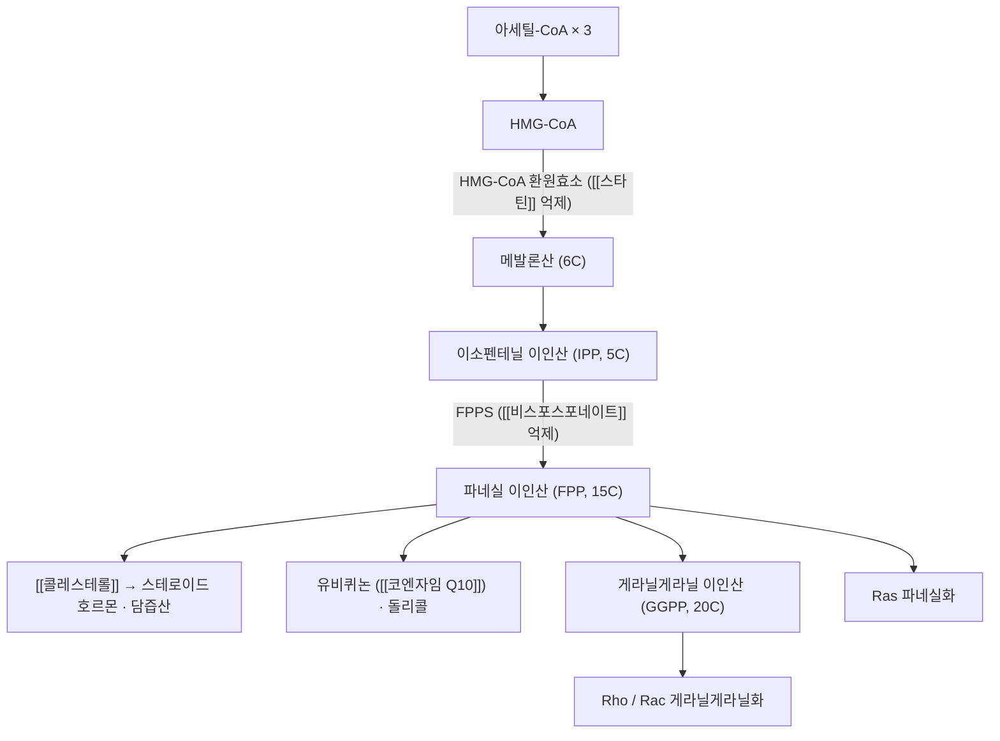

# 🧬 [[메발론산]] (Mevalonic Acid, Mevalonate)

> **핵심 요약 (Key Summary)**:
> - **분자 정체**: 아세틸-CoA로부터 **HMG-CoA 환원효소(HMGCR)**에 의해 생성되는 6탄소 화합물($\text{C}_6\text{H}_{12}\text{O}_4$, 생리활성형 (R)-형). [[콜레스테롤]], 스테로이드 호르몬, [[코엔자임 Q10]](유비퀴논), 돌리콜 및 단백질 프레닐화(Prenylation) 기질 등 모든 이소프레노이드 생합성의 필수 중간대사물임.
> - **속도결정단계와 약물 표적**: HMG-CoA $\rightarrow$ 메발론산 전환 단계가 경로 전체의 속도결정단계(Rate-limiting step)이며, [[스타틴]] 계열 약물의 직접 경쟁 억제 표적임. 하위 파네실 이인산 합성효소(FPPS)는 질소 함유 [[비스포스포네이트]](골다공증 치료제)의 표적임.
> - **다중 생리·부작용 축**: 스타틴에 의한 메발론산 경로 차단은 [[LDL]] 수용체 증가를 통한 지질 강하뿐 아니라 Ras/Rho GTPase 프레닐화 억제를 통한 다면발현(Pleiotropic) 항염 효과를 내지만, 동시에 골격근 내 **CoQ10 및 프레닐화 저하**로 인한 [[스타틴 유발 근병증]](SAMS) 기전과도 연결됨.
> - **한의 연계**: [[홍국]](모나콜린 K = 천연 로바스타틴)은 메발론산 경로를 직접 억제하므로 처방 [[스타틴]]과 병용 시 중복 독성(근육통·횡문근융해)에 유의해야 함.

---

## 📌 목차
1. [기본 화학·생화학 정보 (Molecular Identity & Properties)](#1-기본-화학생화학-정보-molecular-identity--properties)
2. [메발론산 경로 개관 및 핵심 분기점 (Mevalonate Pathway & Branch Points)](#2-메발론산-경로-개관-및-핵심-분기점-mevalonate-pathway--branch-points)
3. [경로 조절 기전: SREBP-2와 되먹임 통제 (Feedback Regulation)](#3-경로-조절-기전-srebp-2와-되먹임-통제-feedback-regulation)
4. [임상 약리학: 스타틴·비스포스포네이트·종양학 (Clinical Pharmacology)](#4-임상-약리학-스타틴비스포스포네이트종양학-clinical-pharmacology)
5. [한의학적 연계: 홍국·고지혈증 본초 및 SAMS 감별 (Integrative Korean Medicine)](#5-한의학적-연계-홍국고지혈증-본초-및-sams-감별-integrative-korean-medicine)
6. [💡 사용자 진료실 핵심 필기 & 실전 임상 체크리스트](#6--사용자-진료실-핵심-필기--실전-임상-체크리스트)
7. [출처 및 학술 참고 문헌 (References)](#7-출처-및-학술-참고-문헌-references)

---

## 1. 기본 화학·생화학 정보 (Molecular Identity & Properties)

> [!abstract]+ 🧪 3D 분자 구조 (Interactive 3D Viewer)
> <iframe src="https://molecule-viewer-rho.vercel.app/?cid=439230" style="width: 100%; height: 600px; border: none; border-radius: 12px; box-shadow: 0 4px 20px rgba(0,0,0,0.15);" allowfullscreen></iframe>

| 항목 | 상세 내용 |
| :--- | :--- |
| **공식 명칭 / PubChem CID** | (R)-(-)-Mevalonic acid / [CID 439230](https://pubchem.ncbi.nlm.nih.gov/compound/439230) |
| **분자식 / 분자량** | $\text{C}_6\text{H}_{12}\text{O}_4$ / $148.16\text{ g/mol}$ |
| **생성 효소** | **HMG-CoA 환원효소** (3-hydroxy-3-methylglutaryl-CoA reductase, 소포체 막 단백질) |
| **성격** | 단일 약리성분이 아닌 진핵생물 공통의 핵심 생화학 대사 중간체 |

---

## 2. 메발론산 경로 개관 및 핵심 분기점 (Mevalonate Pathway & Branch Points)

* 아세틸-CoA 3분자가 HMG-CoA로 축합된 뒤, HMG-CoA 환원효소가 NADPH 2분자를 소모해 **메발론산**으로 환원시킵니다. 이후 인산화·탈탄산화를 거쳐 활성 이소프렌 단위인 IPP와 파네실 이인산(FPP)을 거쳐 4대 생리 산물(콜레스테롤, CoQ10, 돌리콜, 단백질 프레닐화 기질)로 분기됩니다.

---

## 3. 경로 조절 기전: SREBP-2와 되먹임 통제 (Feedback Regulation)

* **다가(Multivalent) 음성 되먹임 (Goldstein & Brown 1990)**: 세포 내 스테롤이 충분하면 소포체 막의 Insig-SCAP 복합체가 전사인자 **SREBP-2**의 골지체 이동을 차단해 *HMGCR* 및 *LDLR* 전사를 억제하고, 과잉 스테롤과 비스테롤 이소프레노이드는 HMG-CoA 환원효소의 유비퀴틴화·분해를 촉진합니다.
* **스타틴 투여 시 보상 반응**: 스타틴으로 메발론산 합성을 막으면 세포 내 콜레스테롤이 떨어져 **SREBP-2**가 활성화되고, 간세포 표면에 [[LDLR]](LDL 수용체)이 대량 발현되어 혈중 LDL-C를 강력하게 제거합니다(단, [[PCSK9]]도 동반 증가).

---

## 4. 임상 약리학: 스타틴·비스포스포네이트·종양학 (Clinical Pharmacology)

| 표적 효소 / 단계 | 약물군 및 기전 | 임상 효과 및 부작용 |
| :--- | :--- | :--- |
| **HMG-CoA 환원효소** | [[스타틴]] (아토르바스타틴, 로수바스타틴 등 경쟁 억제) | LDL-C 강하 및 [[ASCVD]] 예방; 비콜레스테롤 분지(CoQ10·GGPP) 감소로 [[스타틴 유발 근병증]](SAMS) 연관 |
| **파네실 이인산 합성효소 (FPPS)** | **질소 함유 [[비스포스포네이트]]** (알렌드로네이트, 졸레드론산) | 파골세포 내 소형 GTPase 프레닐화 차단 $\rightarrow$ **파골세포 아폽토시스 유도(골흡수 억제)** |
| **암 대사 표적** | 유방암·[[전립선암]] 등에서 경로 과발현 (Guerrero-Ochoa et al. 2024) | 종양 세포의 콜레스테롤 막 합성 및 Ras/Rho 성장 신호 유지에 기여해 항암 보조 표적으로 연구 중 |

---

## 5. 한의학적 연계: 홍국·고지혈증 본초 및 SAMS 감별 (Integrative Korean Medicine)

* **[[홍국]](紅麴, *Monascus purpureus*)과 중복 위험**: 홍국의 주요 활성 성분인 **모나콜린 K(Monacolin K)**는 화학적으로 **로바스타틴(Lovastatin)**과 동일하며 HMG-CoA 환원효소를 직접 억제합니다. 양방 [[스타틴]] 복용자가 홍국 함유 건강기능식품이나 한약을 중복 섭취하면 근육통·CK 상승·간독성 위험이 배가됩니다.
* **비콜레스테롤 표적 본초와의 구분**: [[황련]]([[베르베린]])은 메발론산 경로가 아닌 [[AMPK]] 활성 및 [[PCSK9]] mRNA 분해 경로를 통해 LDL-C를 낮추므로 스타틴과 기전이 독립적입니다. [[산사]], [[택사]], [[결명자]], [[단삼]] 등도 지질·어혈 개선에 보조적으로 응용됩니다.

---

## 6. 💡 사용자 진료실 핵심 필기 & 실전 임상 체크리스트

> [!warning] 진료실 스타틴·홍국·비스포스포네이트 병용 점검 3원칙
> 1. **홍국 건기식 중복 스크리닝**: 고지혈증 환자가 "한방 성분이 든 콜레스테롤 영양제"를 함께 먹고 있다고 하면 원재료에 **홍국(Monacolin K)**이 포함되었는지 확인해 스타틴과 중복 투여되지 않도록 지도합니다.
> 2. **비스포스포네이트 근육·관절통 감별**: 골다공증 주사(졸레드론산 등) 투여 직후 1~3일 내 발생하는 급성기 발열·근육통은 메발론산 경로의 IPP 축적에 의한 γδ T세포 활성화 반응이므로 진통·보존적 처치로 감별합니다.
> 3. **스타틴 근육통 호소 시**: 단순 근막통증으로만 치부하지 말고 양방 주치의와 [[스타틴 유발 근병증]](SAMS) 여부(CK 검사, 용량 감량 또는 친수성 스타틴/에제티미브 전환)를 확인하도록 안내합니다.

---

## 7. 출처 및 학술 참고 문헌 (References)

1. Goldstein JL, Brown MS. (1990). Regulation of the mevalonate pathway. *Nature*, 343(6257):425-430. PMID: 1967820
   - **핵심 요약**: HMG-CoA 환원효소를 중심으로 한 메발론산 경로의 스테롤/비스테롤 다가 음성 되먹임 조절 기전을 확립한 고전 논문.
2. Bathaie SZ, et al. (2017). Mevalonate Pathway and Human Cancers. *Curr Mol Pharmacol*, 10(2):77-85. PMID: 26758953
   - **핵심 요약**: 메발론산 경로의 이소프레노이드 및 단백질 프레닐화가 정상 세포와 종양 생물학에 미치는 역할을 정리한 종설.
3. Guerrero-Ochoa P, et al. (2024). Prostate Cancer and the Mevalonate Pathway. *Int J Mol Sci*, 25(4):2152. PMID: 38396837
   - **핵심 요약**: 호르몬·지질 대사와 연계된 메발론산 경로의 종양학적 의의 및 스타틴/비스포스포네이트의 재창출 가능성을 다룬 종설.

<!-- 보관 태그(1회용·링크오류, 필요시 복원): 이소프레노이드 -->
