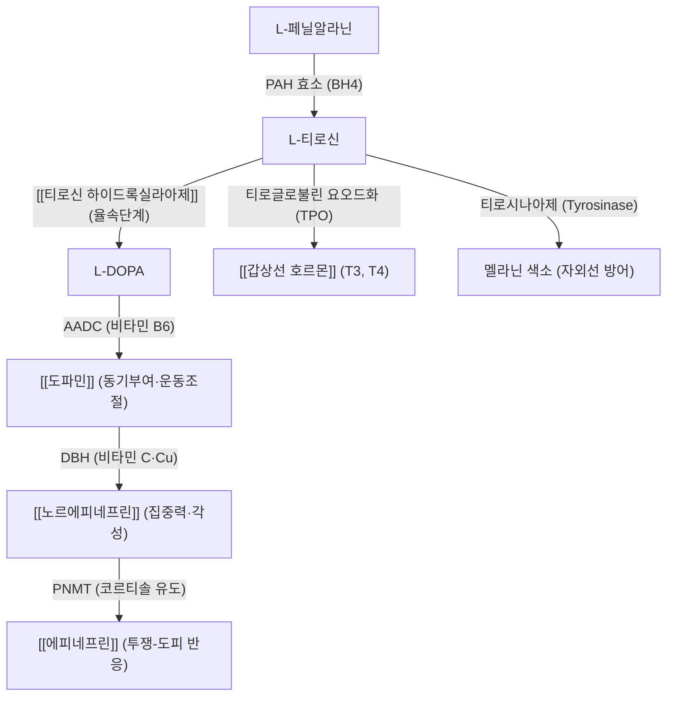

# 🧬 [[티로신]] (L-Tyrosine, Tyr / Y)

> **핵심 요약 (Key Summary)**:
> - **분자 정체**: 필수아미노산인 L-페닐알라닌으로부터 간 내 **페닐알라닌 하이드록실라아제(PAH)**에 의해 합성되는 조건부 필수 방향족 아미노산($\text{C}_9\text{H}_{11}\text{NO}_3$, 페놀성 하이드록실 곁사슬 보유).
> - **3대 생합성 전구체**: ① 뇌·부신수질에서 **[[티로신 하이드록실라아제]](TH)**를 거쳐 **[[도파민]]·[[노르에피네프린]]·[[에피네프린]]** 등 카테콜아민을 합성하고, ② 갑상선 여포에서 요오드화되어 **갑상선 호르몬($T_3$, $T_4$)**이 되며, ③ 멜라닌세포에서 **멜라닌 색소**의 모체가 됨.
> - **신호전달 및 임상 의의**: 단백질 내 티로신 잔기의 인산화(티로신 키나아제 RTK)는 세포 성장 신호의 핵심이며, 급성 스트레스 상황에서의 인지기능·작업 기억 보존과 **페닐케톤뇨증(PKU)**·[[갑상선 기능 저하증]]·백색증 병태와 직결됨.
> - **한의 연계**: 카테콜아민·갑상선 대사 저하에 따른 기력 저하 및 의욕 감퇴(비신양허·심비양허)와 급성 스트레스성 심신 불안에 활용되는 보기보양·안신 본초(인삼·황기·숙지황 등)의 신경내분비 연계 맥락을 제공함.

---

## 📌 목차
1. [생화학적 구조 및 대사적 특징 (Biochemical Properties)](#1-생화학적-구조-및-대사적-특성-biochemical-properties)
2. [3대 주요 생합성 경로: 카테콜아민·갑상선·멜라닌 (Key Biosynthetic Pathways)](#2-3대-주요-생합성-경로-카테콜아민갑상선멜라닌-key-biosynthetic-pathways)
3. [신경생리학적 기능: 급성 스트레스와 인지기능 (Stress & Cognitive Resilience)](#3-신경생리학적-기능-급성-스트레스와-인지기능-stress--cognitive-resilience)
4. [관련 유전·대사 질환 및 약물 표적 (Clinical Disorders & TKI)](#4-관련-유전대사-질환-및-약물-표적-clinical-disorders--tki)
5. [한의학적 연계: 신양허·심비양허와 신경내분비 (Integrative Korean Medicine)](#5-한의학적-연계-신양허심비양허와-신경내분비-integrative-korean-medicine)
6. [💡 사용자 진료실 핵심 필기 & 실전 임상 체크리스트](#6--사용자-진료실-핵심-필기--실전-임상-체크리스트)
7. [출처 및 학술 참고 문헌 (References)](#7-출처-및-학술-참고-문헌-references)

---

## 1. 생화학적 구조 및 대사적 특성 (Biochemical Properties)

> [!abstract]+ 🧪 3D 약리 분자 구조 (Interactive 3D Viewer)
> <iframe src="https://molecule-viewer-rho.vercel.app/?cid=6057" style="width: 100%; height: 600px; border: none; border-radius: 12px; box-shadow: 0 4px 20px rgba(0,0,0,0.15);" allowfullscreen></iframe>

| 항목 | 상세 내용 |
| :--- | :--- |
| **IUPAC 명칭 / CAS** | (2S)-2-amino-3-(4-hydroxyphenyl)propanoic acid / CAS 60-18-4 |
| **분자식 / 분자량** | $\text{C}_9\text{H}_{11}\text{NO}_3$ / $181.19\text{ g/mol}$ (PubChem CID 6057) |
| **체내 합성** | 필수아미노산 L-페닐알라닌으로부터 간 내 **PAH 효소**(조효소 BH₄ 필수)에 의해 합성 |
| **대사 분류** | 당신생(Glucogenic, 푸마르산) 및 케톤생성(Ketogenic, 아세토아세틸-CoA) 양친매성 아미노산 |

---

## 2. 3대 주요 생합성 경로: 카테콜아민·갑상선·멜라닌 (Key Biosynthetic Pathways)

1. **카테콜아민 생합성 (Fernstrom & Fernstrom 2007)**: 뇌의 흑질·청반핵 및 부신수질에서 **[[티로신 하이드록실라아제]](TH)**에 의해 [[L-DOPA]]로 전환되는 과정이 전체 카테콜아민 합성의 속도결정단계입니다. 이후 탈탄산 반응 등을 거쳐 도파민, 노르에피네프린, 에피네프린으로 순차 합성됩니다.
2. **[[갑상선 호르몬]]($T_3$, $T_4$) 합성**: 갑상선 여포강 내 티로글로불린(Thyroglobulin)의 티로신 잔기가 갑상선 과산화효소(TPO)에 의해 요오드화되어 MIT·DIT를 형성하고, 이들의 축합으로 티록신($T_4$)과 트리요오드티로닌($T_3$)이 만들어집니다.
3. **멜라닌 색소 합성**: 멜라닌세포의 티로시나아제에 의해 도파퀴논으로 산화된 뒤 유멜라닌·페오멜라닌으로 중합됩니다.

---

## 3. 신경생리학적 기능: 급성 스트레스와 인지기능 (Stress & Cognitive Resilience)

* **급성 스트레스 하 카테콜아민 고갈 방어 (Jongkees et al. 2015)**: 극한의 한랭 노출, 수면 박탈, 고강도 인지 부하 상황에서는 뇌 청반핵의 [[노르에피네프린]]과 전전두엽 [[도파민]] 회전율이 급증해 신경전달물질 풀이 고갈됩니다. 문헌 고찰에서 티로신 보충은 정상 휴식 상태보다는 **급성 스트레스·인지 고갈 상태**에서 작업 기억(Working memory)과 인지적 유연성을 보존하는 효과가 일관되게 보고되었습니다.

---

## 4. 관련 유전·대사 질환 및 약물 표적 (Clinical Disorders & TKI)

| 질환 / 약리 개념 | 병태생리 및 임상 특징 |
| :--- | :--- |
| **페닐케톤뇨증 (PKU)** | *PAH* 효소 결핍으로 페닐알라닌이 티로신으로 전환되지 못해 혈중 페닐알라닌 축적(지적장애 위험) 및 **티로신이 필수아미노산**이 됨 |
| [[갑상선 기능 저하증]] | 요오드 결핍·자가면역([[하시모토 갑상선염]]) 등으로 $T_3$/$T_4$ 합성 장애 시 기초대사 저하 및 극심한 피로 유발 |
| **백색증 (Albinism)** | 티로시나아제 유전자 변이로 인한 멜라닌 합성 결손 |
| **티로신 인산화 및 TKI (Shyam Sunder et al. 2023)** | 세포 수용체 티로신 키나아제(RTK)는 표적항암제(**TKI**: 이매티닙·오시머티닙 등)의 핵심 표적이며, 심혈관·피부·갑상선 부작용 관리가 중요 |

---

## 5. 한의학적 연계: 신양허·심비양허와 신경내분비 (Integrative Korean Medicine)

* **기초대사 저하와 신양허(腎陽虛)**: 티로신 유래 갑상선 호르몬과 카테콜아민이 주관하는 기초열량 생산, 각성, 동기부여 기능 저하는 한의학의 명문화쇠(命門火衰)·신양허(냉증·무력·부종) 및 심비양허(우울·집중력 저하·피로) 변증과 맞닿아 있습니다.
* **임상 응용**: 만성 피로 및 스트레스성 인지 저하 환자에게 [[보중익기탕]], [[팔미지황환]], [[귀비탕]] 등의 처방과 더불어 양질의 단백질(티로신 전구체) 및 조효소(비타민 B6·C·철분·요오드 균형) 섭취를 병행 지도합니다.

---

## 6. 💡 사용자 진료실 핵심 필기 & 실전 임상 체크리스트

> [!warning] 진료실 티로신 보충제 병용 금기 및 주의사항
> 1. **[[레보도파]](L-DOPA) 복용 파킨슨병 환자**: L-티로신 보충제를 고함량 동시 복용하면 혈뇌장벽(BBB)의 대형 중성 아미노산 수송체(LAT1)에서 레보도파와 **흡수·뇌 유입 경쟁**을 일으켜 파킨슨 증상 조절을 방해할 수 있으므로 시간차를 두거나 병용을 피합니다.
> 2. **[[MAO 억제제]](MAOI) 및 갑상선기능항진증**: MAOI 복용자(고혈압 위기 위험)나 갑상선기능항진증([[그레이브스병]]) 환자는 카테콜아민/호르몬 전구체 보충을 금기시합니다.

---

## 7. 출처 및 학술 참고 문헌 (References)

1. Jongkees BJ, et al. (2015). Effect of tyrosine supplementation on clinical and healthy populations under stress or cognitive demands--A review. *J Psychiatr Res*, 70:50-57. PMID: 26424423
   - **핵심 요약**: 급성 스트레스 및 고강도 인지 과제 상황에서 티로신 보충이 작업 기억과 인지적 유연성을 유지함을 입증한 체계적 고찰.
2. Fernstrom JD, Fernstrom MH. (2007). Tyrosine, phenylalanine, and catecholamine synthesis and function in the brain. *J Nutr*, 137(6 Suppl 1):1539S-1547S. PMID: 17513421
   - **핵심 요약**: 뇌 내 페닐알라닌·티로신 수송과 티로신 하이드록실라아제 경유 카테콜아민 합성 조절 기전을 정리한 종설.
3. Shyam Sunder S, et al. (2023). Adverse effects of tyrosine kinase inhibitors in cancer therapy: pathophysiology, mechanisms and clinical management. *Signal Transduct Target Ther*, 8(1):262. PMID: 37414756
   - **핵심 요약**: 티로신 인산화 신호를 표적하는 항암제(TKI)의 병태생리적 부작용(갑상선·심혈관 등)과 임상 관리 전략을 다룬 종설.

<!-- 보관 태그(1회용·링크오류, 필요시 복원): 갑상선호르몬 -->
