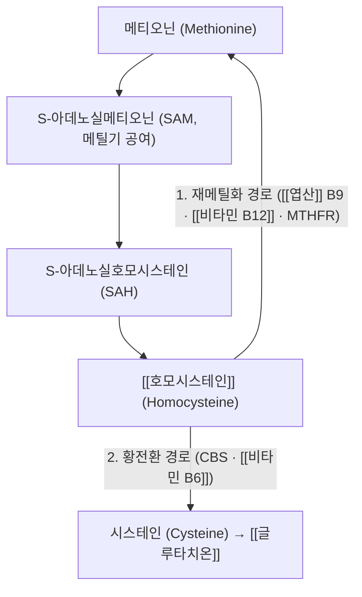
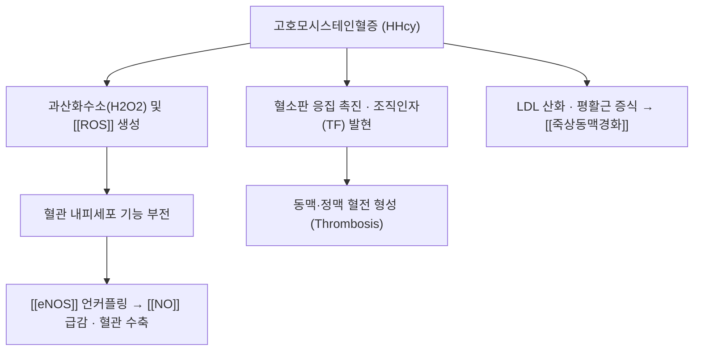

# 🧬 [[호모시스테인]] (Homocysteine, Hcy)

> **핵심 요약 (Key Summary)**:
> - **분자 정체**: 필수아미노산 [[메티오닌]]이 체내 메틸기 공여(SAM $\rightarrow$ SAH) 대사를 거치며 생성되는 황 함유 비단백 아미노산 중간체($\text{C}_4\text{H}_9\text{NO}_2\text{S}$, PubChem CID 778).
> - **무독화 2대 경로**: ① **재메틸화 경로**(메티오닌 합성효소, **[[엽산]](B9)** + [[비타민 B12]] + [[MTHFR]] 필요) 및 ② **황전환 경로**(CBS 효소, [[비타민 B6]] 필요 $\rightarrow$ 시스테인·[[글루타치온]] 합성)를 통해 즉시 대사되어야 함.
> - **혈관 독성 및 심뇌혈관 위험**: 대사 정체로 혈중 농도가 15 $\mu\text{mol/L}$ 이상 상승(고호모시스테인혈증)하면 [[ROS]] 생성, [[eNOS]] 언커플링([[NO]] 고갈), 혈소판 응집·조직인자(TF) 활성 및 [[NMDA 수용체]] 흥분독성을 유발하여 **[[뇌졸중]], [[관상동맥 질환]], H형 고혈압, [[치매]]**의 독립적 위험 인자로 작용함.
> - **한의 연계**: 혈관 내피 손상과 미세혈전 형성이라는 병태생리가 한의학 **[[어혈]](瘀血)**의 분자 바이오마커와 일치하며, [[단삼]]([[살비아놀산 B]])·[[은행엽]]·[[도핵승기탕]]·[[혈부축어탕]] 및 엽산·비타민 B군 보충과 연계됨.

---

## 📌 목차
1. [생화학적 구조 및 2대 대사 경로 (Biochemistry & Metabolic Pathways)](#1-생화학적-구조-및-2대-대사-경로-biochemistry--metabolic-pathways)
2. [혈관 독성, 내피 기능 부전 및 신경독성 기전 (Vascular & Neurotoxicity Mechanisms)](#2-혈관-독성-내피-기능-부전-및-신경독성-기전-vascular--neurotoxicity-mechanisms)
3. [임상 기준치 및 주요 호발 질환 (Clinical Thresholds & Diseases)](#3-임상-기준치-및-주요-호발-질환-clinical-thresholds--diseases)
4. [원인 감별 및 현대 의학적 관리: 비타민 B군과 메트포르민 (Etiology & Management)](#4-원인-감별-및-현대-의학적-관리-비타민-b군과-메트포르민-etiology--management)
5. [한의학적 연계: 어혈(瘀血) 바이오마커와 활혈거어 (Integrative Korean Medicine)](#5-한의학적-연계-어혈-바이오마커와-활혈거어-integrative-korean-medicine)
6. [💡 사용자 진료실 핵심 필기 & 실전 임상 체크리스트](#6--사용자-진료실-핵심-필기--실전-임상-체크리스트)
7. [출처 및 학술 참고 문헌 (References)](#7-출처-및-학술-참고-문헌-references)

---

## 1. 생화학적 구조 및 2대 대사 경로 (Biochemistry & Metabolic Pathways)

> [!abstract]+ 🧪 3D 약리 분자 구조 (Interactive 3D Viewer)
> <iframe src="https://molecule-viewer-rho.vercel.app/?cid=778" style="width: 100%; height: 600px; border: none; border-radius: 12px; box-shadow: 0 4px 20px rgba(0,0,0,0.15);" allowfullscreen></iframe>

1. **재메틸화 경로 (Remethylation, 간 및 전신)**: 메티오닌 합성효소(MS)가 [[비타민 B12]](코발라민)를 보조인자로 하여 5-MTHF(활성 [[엽산]])로부터 메틸기를 전달받아 메티오닌을 재생합니다. [[MTHFR]] 유전자(C677T 등) 변이 시 5-MTHF 공급이 줄어 Hcy가 상승합니다.
2. **황전환 경로 (Transsulfuration, 간·신장)**: 시스타티오닌 $\beta$-합성효소(CBS)가 [[비타민 B6]](PLP)를 조효소로 사용하여 Hcy를 시스테인으로 전환하고, 이는 세포 내 핵심 항산화제인 [[글루타치온]] 합성에 쓰입니다.

---

## 2. 혈관 독성, 내피 기능 부전 및 신경독성 기전 (Vascular & Neurotoxicity Mechanisms)

* **내피세포 손상 및 [[NO]] 고갈 (Jakubowski & Witucki 2025)**: 호모시스테인 티올락톤 형성과 자가산화 과정에서 [[ROS]]가 대량 발생해 eNOS 보효소인 $\text{BH}_4$를 산화시켜 eNOS 언커플링을 유발합니다.
* **혈전 촉진 (Prothrombotic State)**: 응고 인자 V와 조직인자(TF)를 활성화하고 천연 항응고 인자인 단백질 C(Protein C) 활성화를 억제해 혈전 경향을 높입니다.
* **뇌신경 흥분독성**: 신경세포의 [[NMDA 수용체]]를 과활성화해 칼슘 독성을 유발하고 혈뇌장벽(BBB)을 손상시킵니다.

---

## 3. 임상 기준치 및 주요 호발 질환 (Clinical Thresholds & Diseases)

| 공복 총 호모시스테인 (tHcy) | 판정 | 주요 연관 질환 및 임상 특징 |
| :--- | :--- | :--- |
| **5 ~ 15 $\mu\text{mol/L}$** | 정상 범위 | 대사 균형 유지 (심혈관 예방 목표치 < 10 $\mu\text{mol/L}$ 권고 연구 다수) |
| **15 ~ 30 $\mu\text{mol/L}$** | 경도 상승 | 엽산·B12·B6 경계 결핍, MTHFR 변이, **H형 고혈압**(뇌졸중 위험 상승, Wu et al. 2024) |
| **30 ~ 100 $\mu\text{mol/L}$** | 중등도 상승 | 만성콩팥병, 심한 비타민 결핍 — [[뇌졸중]], 심근경색, 심부정맥혈전증(DVT), [[치매]] |
| **> 100 $\mu\text{mol/L}$** | 중증 상승 | 선천성 호모시스틴뇨증(CBS 결핍) — 수정체 탈구, 마르판양 체형, 조기 혈전색전증 |

* **임신·치매 연계**: 태반 미세혈전증으로 인한 습관성 유산·임신중독증 및 알츠하이머병·혈관성 치매 위험 증가와 연관됩니다(Zaric et al. 2019).

---

## 4. 원인 감별 및 현대 의학적 관리: 비타민 B군과 메트포르민 (Etiology & Management)

* **비타민 B군 보충**: [[엽산]](B9, 0.4~0.8 mg/일 — MTHFR 변이 시 L-메틸폴레이트 고려), [[비타민 B12]](메틸코발라민), [[비타민 B6]]의 병합 투여는 혈중 Hcy를 효과적으로 낮춥니다(단, 비타민 B12 결핍을 배제하지 않고 엽산만 고용량 투여하면 B12 결핍성 신경병증이 가려질 수 있음).
* **약인성 원인 감별**: **[[메트포르민]] 장기 복용**이나 [[PPI]](양성자 펌프 억제제) 장기 복용은 위장관 내 비타민 B12 흡수를 저해하여 이차성 고호모시스테인혈증을 유발할 수 있습니다.

---

## 5. 한의학적 연계: 어혈(瘀血) 바이오마커와 활혈거어 (Integrative Korean Medicine)

* **어혈(瘀血)과 담음(痰飮)의 분자 실체**: 혈관 내피 손상, NO 저하 및 혈전 형성을 유발하는 고호모시스테인혈증은 한의학에서 혈행 정체와 탁혈로 정의하는 [[어혈]] 병태와 정합성을 가집니다.
* **활혈거어 본초·처방**:
  - **[[단삼]]([[살비아놀산 B]])**: eNOS 활성을 회복해 호모시스테인 유발 내피 손상을 보호.
  - [[은행엽]]: 혈소판 응집 억제 및 뇌 미세순환 개선.
  - **대표 처방**: [[도핵승기탕]], [[혈부축어탕]](심뇌혈관 어혈 정체 해소), 사물탕 가미방(조혈 및 엽산·비타민 B군 대사 보조).

---

## 6. 💡 사용자 진료실 핵심 필기 & 실전 임상 체크리스트

> [!tip] 진료실 고혈압·당뇨·뇌졸중 위험군 호모시스테인 점검 포인트
> 1. **H형 고혈압(고혈압 + 고호모시스테인혈증)**: 고혈압 환자가 뇌졸중 가족력이 있거나 혈압 조절이 잘 되는데도 미세혈관/경동맥 죽상경화가 진행할 때는 혈중 호모시스테인과 비타민 B12·엽산 수치를 확인하도록 권고합니다.
> 2. **메트포르민·PPI 장기 복용자**: 손발 저림이나 빈혈, 인지 저하가 동반된다면 B12 결핍에 따른 호모시스테인 상승 여부를 반드시 점검합니다.

---

## 7. 출처 및 학술 참고 문헌 (References)

1. Jakubowski H, Witucki Ł. (2025). Homocysteine Metabolites, Endothelial Dysfunction, and Cardiovascular Disease. *Int J Mol Sci*, 26(2):746. PMID: 39859460
   - **핵심 요약**: 호모시스테인 대사체(호모시스테인 티올락톤)가 혈관 내피 기능 부전, 단백질 N-호모시스테인화 및 심혈관 질환을 유발하는 분자 기전을 정리한 최신 종설.
2. Wu DF, et al. (2024). Homocysteine, hyperhomocysteinemia, and H-type hypertension. *Eur J Prev Cardiol*, 31(9):1092-1103. PMID: 38236144
   - **핵심 요약**: 고혈압과 고호모시스테인혈증이 동반된 H형 고혈압의 뇌졸중 상승 위험과 엽산 보충 전략을 분석한 종설.
3. Ramires Júnior OV, et al. (2025). Uncovering Hyperhomocysteinemia: Global Risk Patterns and Molecular Disruption in Brain and Vascular Health. *J Neurochem*, 169:e70327. PMID: 41427720
   - **핵심 요약**: 고호모시스테인혈증의 글로벌 위험 양상과 뇌·혈관 건강에서의 분자적 손상 기전을 종합한 최신 종설.

<!-- 보관 태그(1회용·링크오류, 필요시 복원): 대사물질 -->
