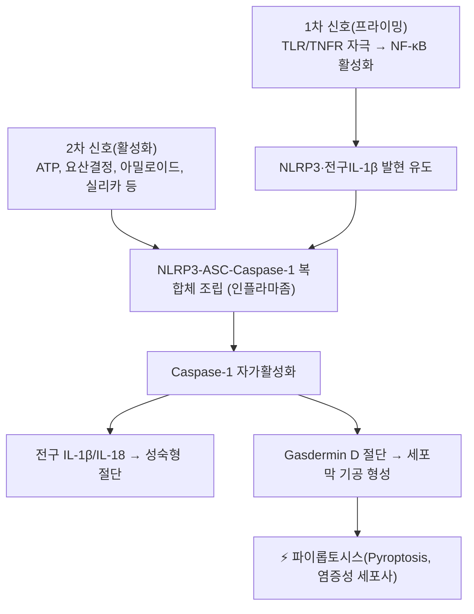

# NLRP3 (NLRP3 인플라마좀, NOD-, LRR- and Pyrin domain-containing protein 3)

> **핵심 요약 (Executive Summary)**
> 1. **분자 정체**: 선천면역세포(대식세포 등) 세포질 내 위험신호를 감지하는 패턴인식수용체(PRR)로, ASC 어댑터·Caspase-1과 결합해 다단백질 복합체인 **NLRP3 인플라마좀**을 형성(유전자 *NLRP3*, 염색체 1q44).
> 2. **핵심 기전**: 1차 프라이밍([[NF-κB]] 유도) → 2차 활성화 신호(ATP, 요산 결정, [[ROS]], K⁺ 유출)를 거쳐 Caspase-1을 활성화하고, 전구 [[IL-1β]]·IL-18 절단 분비 및 Gasdermin D(GSDMD) 매개 **파이롭토시스(Pyroptosis)**를 유도함.
> 3. **임상·한의 의의**: [[통풍]], [[죽상동맥경화증]], 제2형 [[당뇨병]], 알츠하이머병, CAPS의 핵심 병태이며 [[카나키누맙]]·[[아나킨라]]·MCC950 등의 표적임. [[바이칼레인]]·[[목통]]·[[방기]]·[[갈근금련탕]] 등 본초의 항염 연구가 보고되나 대부분 전임상 수준임에 유의.

## 목차
1. [핵심 요약 (Executive Summary)](#1-핵심-요약-executive-summary)
2. [분자·생화학적 구조 및 특성 (Molecular Structure & Properties)](#2-분자·생화학적-구조-및-특성-molecular-structure--properties)
3. [생리적 기능 및 작용 기전 (Physiological Functions & Mechanisms)](#3-생리적-기능-및-작용-기전-physiological-functions--mechanisms)
4. [임상적 의의 및 병태생리 (Clinical Significance & Pathophysiology)](#4-임상적-의의-및-병태생리-clinical-significance--pathophysiology)
5. [조절 인자 및 약리·한의학적 중재 (Modulators & Interventions)](#5-조절-인자-및-약리·한의학적-중재-modulators--interventions)
6. [관련 검사 및 바이오마커 (Diagnostics & Biomarkers)](#6-관련-검사-및-바이오마커-diagnostics--biomarkers)
7. [출처 및 학술 참고 문헌 (References)](#7-출처-및-학술-참고-문헌-references)

---

## 1. 핵심 요약 (Executive Summary)

**NLRP3**는 병원체연관분자패턴(PAMP)뿐 아니라 요산 결정, 콜레스테롤 결정, 세포외 ATP 같은 비감염성 내인성 손상신호(DAMP)를 감지해 강력한 급·만성 염증과 세포 사멸을 촉발하는 세포질 선천면역 센서이다.

---

## 2. 분자·생화학적 구조 및 특성 (Molecular Structure & Properties)

| 항목 | 상세 내용 |
| :--- | :--- |
| **공식 명칭** | NLR Family Pyrin Domain Containing 3 (구 명칭: Cryopyrin, NALP3) |
| **유전자 좌위** | 인간 *NLRP3* (1q44) |
| **도메인 구성** | N-말단 파이린 도메인(PYD) — 중심 NACHT 도메인(ATPase/올리고머화) — C-말단 류신-풍부 반복 도메인(LRR) |
| **분류** | 세포질 패턴인식수용체(PRR), NOD-유사 수용체(NLR) 계열 |
| **핵심 파트너** | ASC(PYD-CARD 어댑터 단백질), Pro-caspase-1(CARD 도메인 통해 동원·자가활성화), NEK7 |

---

## 3. 생리적 기능 및 작용 기전 (Physiological Functions & Mechanisms)

* **1차 신호(프라이밍, Priming)**: TLR이나 TNF 수용체 자극이 [[NF-κB]] 경로를 활성화해 NLRP3와 전구 [[IL-1β]]의 전사 및 번역 후 준비 상태를 유도한다.
* **2차 신호(활성화, Activation)**: 세포외 ATP(P2X7 수용체), 요산 결정, 콜레스테롤 결정, 아밀로이드-β 응집체, 실리카·석면 입자 등이 세포 내 칼륨($K^+$) 유출, 리소좀 파열(카텝신 B 방출), 미토콘드리아 [[ROS]] 생성을 통해 NLRP3-ASC-Caspase-1 복합체 조립을 촉발한다.
* **하위 신호전달**: 활성화된 Caspase-1은 전구 [[IL-1β]]·IL-18을 활성 성숙형으로 절단하고, 동시에 Gasdermin D(GSDMD)를 절단해 N-말단 조각이 세포막 기공을 형성하게 하여 사이토카인 방출과 용해성 염증 세포사인 **파이롭토시스**를 일으킨다.

---

## 4. 임상적 의의 및 병태생리 (Clinical Significance & Pathophysiology)

* **[[통풍]](Gout)**: 관절강 내 요산 나트륨(MSU) 결정이 대식세포의 NLRP3를 직접 활성화해 급성 통풍 발작의 극심한 IL-1β 주도 염증을 유발한다.
* [[죽상동맥경화증]]: 혈관벽 대식세포 내 콜레스테롤 결정 축적이 NLRP3를 활성화해 죽상판 형성과 플라크 불안정화에 기여한다.
* **대사·신경퇴행 질환**: 제2형 [[당뇨병]](췌장 아밀로이드·유리지방산에 의한 인슐린 저항성 및 β세포 손상), 알츠하이머병(아밀로이드-β에 의한 미세아교세포 NLRP3 활성화), [[궤양성 대장염]] 등 점막 염증에 관여한다.
* **CAPS(Cryopyrin-Associated Periodic Syndromes)**: *NLRP3* 유전자 기능획득 돌연변이로 인한 선천적 자가염증 증후군군이다.

---

## 5. 조절 인자 및 약리·한의학적 중재 (Modulators & Interventions)

* **양방 약리 표적**:
  * **[[IL-1β]] 차단제**: 카나키누맙(Canakinumab, 단클론항체), 아나킨라(Anakinra, IL-1 수용체 길항제) 등이 CAPS 및 난치성 통풍성 관절염에 임상 사용된다.
  * **직접 NLRP3 억제제**: MCC950(NACHT 도메인 ATPase 억제) 등 소분자 저해제가 활발히 연구 중이나 대부분 전임상·초기 임상 단계이며 국내 시판 허가된 직접 표적 치료제는 아직 제한적이다.
  * [[콜키신]]: 미세소관 중합 억제를 통해 요산 결정에 의한 NLRP3 조립을 간접 억제해 급성 통풍에 활용된다.
* **한의학·본초 연계**:
  * [[바이칼레인]], [[목통]], [[방기]] 유래 성분 및 [[갈근금련탕]](Wang 등, 2026) 등이 세포·동물 실험에서 [[NF-κB]] 프라이밍 및 NLRP3 인플라마좀 활성 억제를 보이는 것으로 보고되었다.
  * 다만 대부분 세포·동물실험 수준이므로 특정 본초의 직접적 "NLRP3 억제 임상 효능"으로 과잉 해석하지 않도록 주의한다.

---

## 6. 관련 검사 및 바이오마커 (Diagnostics & Biomarkers)

* 연구 수준에서 말초혈액 단핵구(PBMC) 내 ASC speck 형성, Caspase-1 p20 절단편, 혈청 [[IL-1β]]·IL-18 농도를 측정하며, 유전성 자가염증 의심 시 *NLRP3* 유전자 패널 검사를 시행한다.
* 일반 임상에서는 [[CRP]], ESR, 혈청 요산 수치 및 관절액 결정 검사(편광현미경)로 병태를 평가한다.

---

## 7. 출처 및 학술 참고 문헌 (References)

1. Swanson KV, Deng M, Ting JPY. (2019). The NLRP3 inflammasome: molecular activation and regulation to therapeutics. *Nat Rev Immunol*, 19(8):477-489. PMID: 31036962
   - **핵심 요약**: NLRP3 인플라마좀의 2단계 활성화 모델, 하위 신호전달(IL-1β/IL-18 성숙, 파이롭토시스), 관련 질환 및 치료제 개발 현황을 종합한 대표적 종설.
2. Wang H, et al. (2026). Gegen Qinlian decoction alleviates ulcerative colitis by remodeling the gut microbiota-bile acid axis and inhibiting NLRP3-mediated pyroptosis. *Front Immunol*, 17:1895206. PMID: 42889310
   - **핵심 요약**: 궤양성 대장염 모델에서 갈근금련탕이 장내 미생물-담즙산 축 재편 및 NLRP3 매개 파이롭토시스를 억제함을 입증한 연구.
3. GeneCards — NLRP3 Gene: [https://www.genecards.org/cgi-bin/carddisp.pl?gene=NLRP3](https://www.genecards.org/cgi-bin/carddisp.pl?gene=NLRP3)

<!-- 보관 태그(1회용·링크오류, 필요시 복원): 인플라마좀 -->
