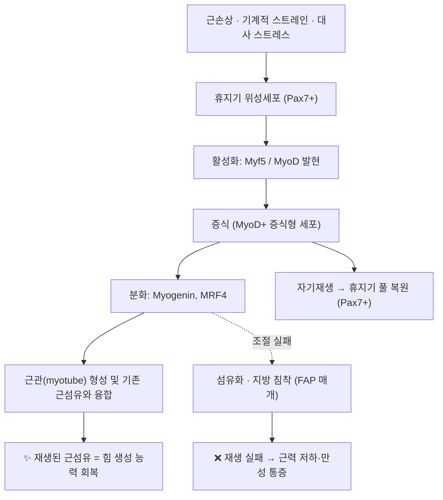

# 위성세포 (Satellite cell)

> **핵심 요약 (Executive Summary)**
> 1. **세포 정체**: 성숙 [[골격근]] 근섬유의 근초(sarcolemma)와 기저판(basal lamina) 사이에 상주하는 근줄기세포로, [[Pax7]]을 표지자로 삼아 평상시 [[휴지기(quiescence)]] 상태로 대기함.
> 2. **핵심 기전**: 근손상 시 [[Myf5]]·[[MyoD]] 의존적으로 활성화·증식하고 [[Myogenin]]·[[MRF4]]를 거쳐 기존 근섬유와 융합해 재생을 수행하며, 일부는 자기재생으로 줄기세포 풀을 유지함. [[섬유-지방 전구세포(FAP)]]와의 FGF7 상호작용 및 후성유전학적 조절이 재생 vs [[섬유-지방 침착]] 분기점을 결정함.
> 3. **임상·한의 의의**: 노화·[[근감소증]]에서는 [[미토콘드리아]] 기능 저하로 활성이 떨어지므로 점진적 저항부하·단백질·수면 회복 조건이 핵심이며, [[신기고]] 등 약식동원 처방 가설([[PI3K-Akt 경로]]-[[mTOR]]) 및 [[족삼리]]·[[양릉천]] 등은 순환·영양을 돕는 병행 축으로 이해함.

## 목차
1. [핵심 요약 (Executive Summary)](#1-핵심-요약-executive-summary)
2. [분자·생화학적 구조 및 특성 (Molecular Structure & Properties)](#2-분자·생화학적-구조-및-특성-molecular-structure--properties)
3. [생리적 기능 및 작용 기전 (Physiological Functions & Mechanisms)](#3-생리적-기능-및-작용-기전-physiological-functions--mechanisms)
4. [임상적 의의 및 병태생리 (Clinical Significance & Pathophysiology)](#4-임상적-의의-및-병태생리-clinical-significance--pathophysiology)
5. [조절 인자 및 약리·한의학적 중재 (Modulators & Interventions)](#5-조절-인자-및-약리·한의학적-중재-modulators--interventions)
6. [관련 검사 및 바이오마커 (Diagnostics & Biomarkers)](#6-관련-검사-및-바이오마커-diagnostics--biomarkers)
7. [출처 및 학술 참고 문헌 (References)](#7-출처-및-학술-참고-문헌-references)

---

## 1. 핵심 요약 (Executive Summary)

![[위성세포(Satellite cell)_1.jpg|540]]
> [그림 1: ① 병태생리·영상 — Alcian blue and periodic acid Schiff (PAS) stained **histological** sections through the **skeletal muscle** of Pe]

**"근육은 근섬유가 아니라 줄기세포가 결정한다"** — [[위성세포]]는 성인 골격근 재생의 유일한 내인성 세포 원천으로, 근력 저하나 회복 지연을 볼 때 근육량뿐 아니라 회복 이력과 니치(niche) 환경을 함께 평가해야 하는 세포학적 근거다.

---

## 2. 분자·생화학적 구조 및 특성 (Molecular Structure & Properties)

| 항목 | 상세 내용 |
| :--- | :--- |
| **해부 위치** | 성숙 [[골격근]] 근섬유의 **근초(sarcolemma)와 기저판(basal lamina) 사이** 좁은 틈에 단일 세포층으로 위치 |
| **세포 형태** | 휴지기에는 세포질이 극히 적은 방추형; 활성화 시 세포질 확장 및 [[리보솜]]·[[미토콘드리아]] 증가 |
| **분자 표지자** | [[Pax7]](휴지·활성 전 단계 표지) → **[[Myf5]]·[[MyoD]]**(활성화·증식) → **[[Myogenin]]·[[MRF4]]**(분화·성숙) |
| **니치(Niche) 구성** | 기저판(라미닌·콜라겐 IV), 근섬유, [[섬유-지방 전구세포(FAP)]], [[대식세포]], 혈관주위세포, [[운동신경]] 말단 |
| **신경·혈관·발생** | 직접 시냅스 유무는 근거 미확인이나 [[신경근접합부]]와 미세환경 공유(탈신경 시 활성 변화). 주위 모세혈관망으로 산소·영양 공급. 체절 [[진피근절(dermomyotome)]]의 Pax3/Pax7 전구세포 유래 |

---

## 3. 생리적 기능 및 작용 기전 (Physiological Functions & Mechanisms)

![[위성세포(Satellite cell)_2_1.jpg|540]]
> [그림 2: ② 관련 해부 구조물 — Muscle Tissue Skeletal Muscle Fibers (28089114338).jpg]

* **근육형성 조절인자(MRF) 캐스케이드**: 휴지기 위성세포가 손상 자극을 받으면 [[Myf5]]·[[MyoD]]를 발현해 증식하고, [[Myogenin]]·[[MRF4]]를 거쳐 근관(myotube) 형성 및 기존 근섬유 융합을 완성한다(Zammit, 2017).
* **후성유전학적 조절**: DNA 메틸화, 히스톤 변형, 크로마틴 리모델링, 비암호화 RNA가 휴지·활성·분화 운명을 결정한다(Massenet & Gardner, 2021). 즉 반복되는 부하·휴식·대사 환경이 유전자 발현 스위치를 바꾼다.
* **FAP–위성세포 상호작용**: 단일세포 RNA 시퀀싱에서 [[섬유-지방 전구세포(FAP)]]와의 **FGF7 신호 매개 상호작용**이 재생 성공과 [[섬유-지방 침착]] 사이의 분기점을 결정함이 보고되었다(Ma & Meng, 2024).

---

## 4. 임상적 의의 및 병태생리 (Clinical Significance & Pathophysiology)

| 임상 질환 / 증후군 | 병리적 연관 기전 | 주요 증상 및 이학적 검사 | 핵심 교정 타깃 |
| :--- | :--- | :--- | :--- |
| [[근감소증]] | 노화에 따른 [[미토콘드리아]] 기능 저하 및 위성세포 신호전달 이상 | 점진적 근력·근량 저하, 의자 일어서기·보행속도 저하, 악력 감소 | 미토콘드리아 기능 개선, 저항운동, 단백질 |
| **[[근좌상]] / 근손상** | 기계적 손상 후 위성세포 활성화·융합 실패 또는 지연 | 국소 압통, 신장 시 통증, 근력 저하, 재손상 반복 | 초기 보호 → 점진적 원심성 부하 |
| **[[지연성 근육통]](DOMS)** | 반복적 편심성 수축 후 미세손상과 염증·재생 반응 | 24–72시간 지연성 압통, 가동범위 감소 | 부하 조절, 순환 촉진, 회복기 영양 |
| [[섬유-지방 침착]] | 위성세포-FAP 상호작용(FGF7 신호) 이상으로 섬유·지방화 | 근 에코 강도 증가, 기능 저하, 회복 지연 | 니치 환경 개선, 항염·대사 관리 |
| **[[듀센 근이영양증]] · [[근위축]]** | 위성세포 자원 소진·재생 실패 또는 불용에 의한 활성 저하 | 근위부 근력 저하, 둘레 감소 | 다학제 관리, 조기 가동·신경근 재교육 |

* **[[근막통증증후군]]·[[해부학 기차(Anatomy Trains)]] 연계**: 위성세포 자체는 [[Travell & Simons]] 발통점(TrP)의 직접 부위가 아니나, 사슬 과부하가 걸린 근육에서 반복 미세손상 후 재생이 실패하면 만성 통증의 조직 기질이 형성된다.
* **원장님 임상 필기 (회복 지연 경고 신호 3종 세트)**: ① 미세손상 후 72시간 이상 지속되는 압통 ② 좌상 반복(연 2회 이상) ③ 근력 유지되나 피로 회복 지연 → 자극 강도보다 **휴지기 회복 조건**을 먼저 만든다.

---

## 5. 조절 인자 및 약리·한의학적 중재 (Modulators & Interventions)

![[위성세포(Satellite cell)_3_1.jpg|540]]
> [그림 3: ③ 치료·시술점 — Research in progress (IA researchinprogre00howa 0).pdf]

* **실험적 양방 전략**: [[지질나노입자(LNP)]] 탑재 [[CRISPR-Cas9]]으로 위성세포를 편집해 근손상 저항성을 부여하려는 전임상 연구가 보고되었으나(Mochida & Fujimoto, 2026), 아직 임상 적용 단계가 아니다.
* **4단계 재활 프로토콜 (전환 기준: 통증이 아닌 기능 지표)**:
  1. **보호기(0–72시간)**: 통증·부종 조절, 무리한 신장 회피.
  2. **재생기(3일–2주)**: 순환 촉진, 가동범위 회복, 저강도 등장성 수축.
  3. **재건기(2–6주)**: **점진적 원심성 부하** — 위성세포 활성화·융합 자극 핵심 구간.
  4. **복귀기(6주~)**: 기능적·스포츠 특이 훈련.
  * 노화·근감소증에서는 유산소 자극 + 점진적 저항 훈련 + 단백질(류신)·비타민D를 병행한다(Marzetti & Lozanoska-Ochser, 2024).
* **한의학 연계 (MET/PIR · 침구·약침 · 약식동원)**:
  * **경혈 매핑(순환·영양·진통 지원 — 직접 재생 근거 미확인)**: [[족삼리]](ST36), [[양릉천]](GB34), [[승산]](BL57), [[곤륜]](BL60), [[혈해]](SP10), [[격수]](BL17), [[신수]](BL23), [[비수]](BL20) 및 [[보기생혈]] 원칙.
  * **MET/PIR**: 급성기 강한 신장을 피하고 등척성 수축 위주로 시작한다.
  * **2026-10-03 논문 연계 ([[당뇨병성 근감소증]] 신기고 RCT, Hua 등, 2026)**: [[황기]]·[[당삼]] 다당체가 [[PI3K-Akt 경로]]-[[mTOR]]를 통해 단백합성과 위성세포 활성을 높인다는 가설이 제시되었으나 동물 수준 추정이며, 시험에서 직접 측정된 것은 CRP·사이토카인·공복혈당·악력·[[골격근지수(SMI)]]·[[5회 의자 일어서기 검사]]다. 처방은 운동·단백질의 대체가 아니라 **병행 축**이다.

---

## 6. 관련 검사 및 바이오마커 (Diagnostics & Biomarkers)

* **초음파 한계**: 위성세포는 수 ㎛ 크기라 초음파로 직접 보이지 않는다. 초음파로는 결과 지표인 **근 두께, 단면적, 에코 강도(지방·섬유 침착), 근섬유 구조**를 평가하며, 세포 확진은 근생검 [[면역조직화학]]([[Pax7]] 염색) 또는 [[단일세포 RNA 시퀀싱]]이 필요하다.
* **환자 설명 스크립트**: *"근육 세포는 유전자가 같아도 켜고 끄는 스위치가 있고, 그 스위치는 반복되는 부하·휴식·대사 환경이 결정합니다."*

---

## 7. 출처 및 학술 참고 문헌 (References)

1. Zammit PS. (2017). Function of the myogenic regulatory factors Myf5, MyoD, Myogenin and MRF4 in skeletal muscle, satellite cells and regenerative myogenesis. *Semin Cell Dev Biol*, 72:19-32. PMID: 29127046
   - **핵심 요약**: 위성세포의 휴지·활성화·증식·분화를 조율하는 근육형성 조절인자(MRF) 계층을 정리한 종설.
2. Massenet J, Gardner E. (2021). Epigenetic regulation of satellite cell fate during skeletal muscle regeneration. *Skelet Muscle*, 11:4. PMID: 33431060
   - **핵심 요약**: 골격근 재생 중 위성세포 운명을 결정하는 DNA 메틸화·히스톤 변형 등 후성유전학적 기전을 정리한 종설.
3. Marzetti E, Lozanoska-Ochser B. (2024). Restoring Mitochondrial Function and Muscle Satellite Cell Signaling: Remedies against Age-Related Sarcopenia. *Biomolecules*, 14. PMID: 38672432
   - **핵심 요약**: 노화성 근감소증에서 미토콘드리아 기능 회복과 위성세포 신호전달 개선 전략을 고찰한 종설.
4. Ma L, Meng Y. (2024). Single-cell RNA-seq reveals novel interaction between muscle satellite cells and fibro-adipogenic progenitors mediated with FGF7 signalling. *J Cachexia Sarcopenia Muscle*, 15:1388-1403. PMID: 38751367
   - **핵심 요약**: 단일세포 전사체 분석으로 위성세포와 섬유-지방 전구세포 간 FGF7 매개 상호작용을 규명한 연구.
5. Mochida T, Fujimoto N. (2026). Muscle satellite cell editing by LNP-CRISPR-Cas9 to resist muscle injury. *Cell Rep*, 45:116695. PMID: 41411128
   - **핵심 요약**: 지질나노입자 기반 CRISPR-Cas9으로 위성세포를 편집해 근손상 저항성을 부여한 전임상 연구.
6. Hua L, et al. (2026). Efficacy and safety of medicine-food homology Shenqi paste in older adults with diabetic sarcopenia: A randomized, double-blind, placebo-controlled trial. *J Ethnopharmacol*, 363:121444. PMID: 41763617
   - **핵심 요약**: 고령 당뇨병성 근감소증 환자에서 약식동원 신기고의 악력·골격근지수·기능 개선 효과를 평가한 무작위 대조시험.

<!-- 보관 태그(1회용·링크오류, 필요시 복원): Satellite cell, Pax7, Notch, 근줄기세포 -->
