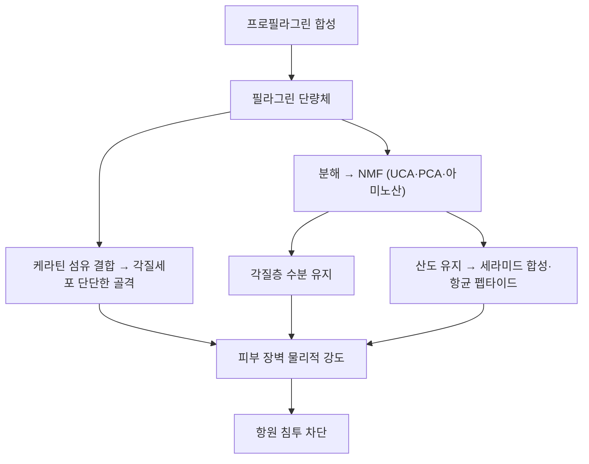

# 🧬 필라그린 (Filaggrin, FLG)

> **핵심 요약 (Key Summary)**:
> - 🧬 **정체**: 표피 각질형성세포의 각질화 과정에서 생성되는 구조 단백질. 프로필라그린이 분해되어 필라그린 단량체가 되고, 최종적으로 천연보습인자(NMF)로 분해된다.
> - 🎯 **핵심 기능**: 각질세포 골격 결합 + 피부 수분 유지 + 산도 조절 → 피부 장벽의 물리·화학적 기반.
> - 🛠️ **임상 의의**: 기능상실 변이(R501X, 2282del4)는 어린선 vulgarus와 [[아토피 피부염]] 위험을 크게 높인다. Th2 염증은 필라그린 발현을 추가로 억제한다.

---

## 📌 목차
1. [정의·구조·합성](#1-정의구조합성)
2. [기능·기전](#2-기능기전)
3. [임상 의의·치료 연계](#3-임상-의의치료-연계)
4. [논문 연결](#4-논문-연결)
5. [함께 보기](#5-함께-보기)

---

## 1. 정의·구조·합성

| 항목 | 내용 |
| :--- | :--- |
| **유전자** | FLG (염색체 1q21.3, 표피분화복합체 내) |
| **전구체** | 프로필라그린(반복 도메인 다수, 과립층에서 저장) |
| **성숙 과정** | 프로필라그린 → 필라그린 단량체(각질세포 골격 결합) → 아미노산·NMF로 분해 |
| **발현 부위** | 표피 과립층·각질층 |
| **주요 변이** | R501X, 2282del4 (기능상실) |

* **NMF 구성**: 필라그린 분해산물인 유로칸산(UCA), 피롤리돈카르복실산(PCA), 유리 아미노산이 각질층 수분을 붙잡는다.
* **pH 조절**: UCA 등이 각질층 산도를 유지해 세라미드 합성 효소와 항균 펩타이드 기능을 돕는다.

---

## 2. 기능·기전

* **구조 기능**: 필라그린은 케라틴 중간섬유를 묶어 각질세포를 편평하고 단단하게 만든다. 부족하면 각질층이 쉽게 갈라지고 벗겨진다.
* **수분 기능**: NMF는 흡습성 아미노산 복합체로 각질층 함수량을 유지한다. 필라그린 결핍은 경피수분손실(TEWL) 증가로 이어진다.
* **면역 기능**: 산도 저하와 항균 펩타이드 발현이 세균 집락을 억제한다. 장벽 손상은 황색포도상구균 집락 → 염증 악화로 이어진다.
* **양방향 악순환**: Th2 사이토카인([[IL-4]]·[[IL-13]])이 필라그린 발현을 억제하므로, 염증이 장벽을 무너뜨리고 장벽 손상이 염증을 부른다.

---

## 3. 임상 의의·치료 연계

* **질환 연관**:
  * [[아토피 피부염]] — FLG 기능상실 변이는 위험을 수 배 높이며, 변이가 없어도 Th2 염증이 발현을 낮춘다.
  * 어린선 vulgarus — FLG 변이의 대표 단일유전질환.
  * 알레르기 행진 — 장벽 손상이 경피 감작을 촉진.
* **치료적 함의**: 필라그린을 직접 보충하는 약물은 없다. 따라서 **장벽 복원(보습·세라마이드) + 염증 차단([[dupilumab]]·국소 스테로이드)** 이 실질 전략이다.
* **한의 접근**: 건조·각질·소양은 혈허풍조(血虛風燥) 변증에 해당한다. 양혈윤조·보습 외치(한방 보습제·좌훈)는 장벽 회복을 보조하는 방향으로 활용한다.
* **환자 교육**: "피부 장벽 단백질이 부족한 체질은 보습을 '치료'로 생각해야 합니다. 목욕 후 3분 안에 보습제를 바르는 것이 핵심입니다."

---

## 4. 논문 연결

* **Paller AS, et al. (2022)**. *Lancet*, 400(10356), 908-919. [PMID 36116481](https://pubmed.ncbi.nlm.nih.gov/36116481/)
  * [연구 요약] 소아 아토피에서 IL-4Rα 차단 후 임상 개선이 관찰되어, Th2 신호가 장벽 단백질 억제에 관여한다는 기전과 정합적이다.
* **Palmer CN, et al. (2006)**. Common loss-of-function variants of the epidermal barrier protein filaggrin are a major predisposing factor for atopic dermatitis. *Nat Genet*, 38(4), 441-446. [PMID 16550169](https://pubmed.ncbi.nlm.nih.gov/16550169/)
  * [연구 요약] FLG 기능상실 변이(R501X, 2282del4)와 아토피 피부염 위험의 대표 연관 연구.

---

## 5. 함께 보기

* 상위 신호: [[Th2 세포]] · [[IL-4]] · [[IL-13]]
* 임상: [[아토피 피부염]] · [[IgE]]
* 약물: [[dupilumab]]
