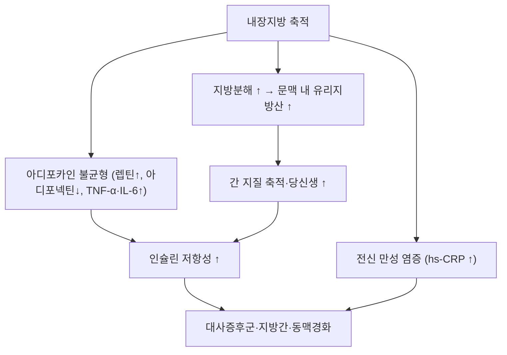

# 🧬 내장지방 (Visceral Adipose Tissue, VAT)

> **핵심 요약 (Key Summary)**:
> 내장지방은 장기 사이 장간막·복막에 붙은 지방으로, 피하지방(SAT)과 **혈류·대사 경로가 다르다**. 정맥 배출이 문맥을 통해 간으로 직접 들어가 유리지방산·아디포카인을 간에 먼저 쏟아붓는다(portal hypothesis).
> 그래서 같은 체중·같은 체지방률이라도 내장지방이 많으면 인슐린 저항성·지방간·심혈관 위험이 더 높다. 체중계가 아니라 **영상 면적(CT/MRI)** 으로 봐야 하는 이유다.
> 2026년 베르베린 6개월 RCT에서 내장지방 면적은 249.2→241.9 cm² 대 250.1→246.8 cm²로 양군 모두 줄었지만 **군간 차이는 1.4%(−2.4~5.2)로 없었다** — 생활습관 중재만으로도 줄어드는 지표임을 보여준다.

---

## 1. 정의·구분 (Definition)

| 구분 | 위치·혈류 | 대사 특성 |
| :--- | :--- | :--- |
| 내장지방 (VAT) | 장간막·복막·신주위, 문맥으로 배출 | 지방분해 활성 높음, 염증성 아디포카인 분비 ↑, 인슐린 저항성과 직결 |
| 피하지방 (SAT) | 복벽·둔부·대퇴, 전신 순환으로 배출 | 저장 능력 크고 상대적으로 대사적으로 '안전' |
| 이소성 지방 | 간·근육·심장·췌장 내 축적 | 지방간·근육 내 지질은 기능 장애를 직접 유발 |

* **복부비만과의 관계**: 허리둘레는 VAT와 SAT가 섞인 값이다. 허리둘레가 같아도 VAT 비중은 사람마다 크게 다르므로, 연구에서는 영상 면적을 1차 지표로 쓴다.
* **한국 임상에서의 참조값**: 아시아인에서 내장지방 면적 **100 cm² 전후**를 대사 위험 상승의 참조값으로 쓰는 보고가 있으나, 측정 단위(복부 CT 단면, 부위)와 인구에 따라 다르다. 본 노트는 특정 가이드라인 컷오프를 확정값으로 제시하지 않는다.

---

## 2. 측정 방법 (Measurement)

* **CT·MRI 단면적**: 표준은 배꼽 또는 L4-L5 수준 단일 축상 단면에서 VAT 면적(cm²)을 측정하는 방식. 연구 1차 지표로 가장 많이 쓰인다.
* **DXA**: VAT를 간접 추정. 조사량이 적지만 정확도는 CT에 못 미친다.
* **생체전기저항분석(BIA)**: 체지방률은 볼 수 있지만 VAT를 분리하지 못한다. 진료실에서 "내장지방형"을 추정하는 용도로만 쓴다.
* **대리지표**: 허리둘레, 허리-신장비, 중성지방/HDL 비. 선별에는 충분하지만 중재 효과 판정에는 부족하다.

---

## 3. 기능·기전 (Mechanism)

* **문맥 가설**: VAT의 정맥혈이 문맥을 통해 간으로 직접 유입돼, 지방산과 염증성 사이토카인이 간에 먼저 도달한다. 이것이 "복부비만 = 지방간"의 해부학적 연결이다.
* **아디포카인**: 내장지방은 [[렙틴]] 분비를 늘리고 [[아디포넥틴]] 분비를 줄이며, TNF-α·IL-6를 통해 전신 염증([[C반응성 단백질]])을 올린다.
* **지방산 산화 vs 저장**: VAT는 저장 용량이 작아 넘치면 이소성 지방(간·근육)으로 밀려난다. 그래서 "내장지방을 줄인다"는 것은 결국 **에너지 과잉을 저장고 밖으로 밀어내지 않는 상태**를 만드는 일이다.

---

## 4. 임상 의의 (Clinical Implications)

* **위험 예측**: 같은 BMI에서 VAT가 높으면 인슐린 저항성([[HOMA-IR]] 상승)·지방간·고혈압·이상지질혈증 위험이 높다. BMI는 이 차이를 잡지 못한다.
* **중재 판정**: 내장지방 면적은 생활습관 중재만으로도 유의하게 줄어든다(2026 베르베린 시험: 위약군 −0.6 cm², 시험군 −2.0 cm²). 따라서 약물·한약의 "부가 효과"를 주장하려면 **양군 모두 생활습관 중재를 받은 add-on 설계**에서 군간 차이를 봐야 한다.
* **측정의 함정**: 단일 단면 측정은 호흡·자세·절단 위치에 따라 변동이 생긴다. 임상연구에서 유의차가 없다는 결과를 해석할 때 측정 오차 범위를 함께 고려해야 한다.
* **한의 임상 연계**: 변증상 담습(痰濕)·습열(濕熱) 체형은 허리둘레·내장지방과 임상적으로 겹친다. 다만 "담습 = VAT"라는 등식은 검증된 것이 아니므로, 진단은 어디까지나 영상·계측으로 하고 변증은 치료 전략 선택에 쓴다.

---

## 5. 논문 연결 (2026-11-19)

* **베르베린 6개월 RCT (비당뇨 비만 + MASLD, n=337)**: 내장지방 면적은 베르베린군 249.2→241.9 cm²(−2.0), 위약군 250.1→246.8 cm²(−0.6). 군간 상대 변화 차이는 **1.4% (97.5% CI −2.4~5.2)** 로 유의하지 않았다.
* **함께 읽을 점**: 같은 시험에서 간 지방 함량(17.9→16.8% vs 16.9→17.1%)과 체중(−1.9 vs −1.8 kg)·허리둘레(−2.8 vs −2.7 cm)도 군간 차이가 없었다. 즉 **지방 축적 지표 전체가 "생활습관 중재 수준"에서 멈췄고, 베르베린은 지질·염증 지표에서만 더했다**.
* **일반화 금지**: 이 결과는 1 g/일·6개월·중국인·비당뇨 비만 MASLD 코호트에 한정된다. 고용량에서 내장지방이 줄었다는 소규모 보고와 충돌하므로 "베르베린은 내장지방에 무효"가 아니라 **"1 g/일 6개월은 무효"** 로 읽는다.

---

## 6. 함께 보기

* [[대사증후군]] · [[비만]] · [[인슐린 저항성]] · [[대사이상 관련 지방간염]] · [[지방간]]
* [[렙틴]] · [[아디포넥틴]] · [[C반응성 단백질]] · [[아포지단백 B]]
* [[베르베린]] · [[황련]] · [[GLP-1]] · [[세마글루타이드]]
* [[생체전기저항분석]] · [[HOMA-IR]] · 허리둘레

---

## 7. 출처 및 학술 참고 문헌

1. **Lei L, Wang B, Zhao L, et al. (2026)**. *Berberine and Adiposity in Diabetes-Free Individuals With Obesity and MASLD: A Randomized Clinical Trial*. **JAMA Network Open**, 9(1):e2554152. [PMID 41543854](https://pubmed.ncbi.nlm.nih.gov/41543854/) · doi:10.1001/jamanetworkopen.2025.54152
   - **[연구 요약]**: 비만 + MASLD 비당뇨 성인 337명, 베르베린 1 g/일 6개월. CT 내장지방 면적과 간 지방 함량의 군간 차이는 없었고(1.4%, 0.9%), LDL-C·apoB·hs-CRP만 유의하게 감소했다. 30일 run-in으로 내약성을 선별한 설계가 특징이다.

> 검증 메모 (2026-11-19): PMID 41543854는 NCBI esummary로 대조했다. 내장지방 면적 컷오프(100 cm²)는 인구·측정법에 따라 달라지므로 본 노트는 참조값으로만 제시하고 특정 가이드라인 인용으로 확정하지 않았다.
