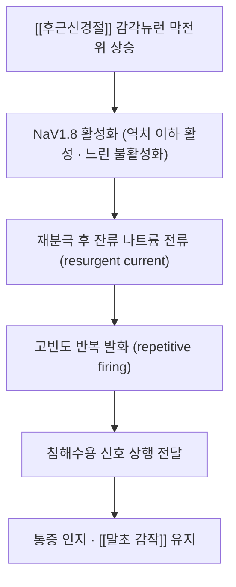

# ⚡ NaV1.8 (SCN10A — 말초 감각뉴런 선택적 나트륨통로)

> **핵심 요약 (Key Summary)**:
> 🔬 정체: [[후근신경절]] 감각뉴런에 주로 발현되는 테트로도톡신 저항성 전압개폐 나트륨통로(유전자 SCN10A).
> 📍 기능: 역치 이하에서도 활성화되어 반복 발화(repetitive firing)를 만들어내 통증 신호의 상행 전달을 담당한다.
> 🎯 임상 의의: 사람에서 기능획득 변이가 통증 표현형과 연결되고, 선택적 차단제([[수제트리진]])가 급성 통증 치료제로 승인되면서 '말초 표적 진통'의 대표 사례가 되었다.
> ⚠️ 주의: 중추신경계 표적이 아니므로 호흡억제·의존 위험은 낮지만, 그만큼 효과 크기 상한도 오피오이드·복합진통제를 넘지 못한다.

---

## 1. 정의·구조

- NaV1.8은 전압개폐 나트륨통로 9종(NaV1.1~1.9) 가운데 하나로, 유전자 SCN10A에 암호화된다. 24회 막관통 소단위로 구성된 α-소단위가 기능의 본체이고, 보조 β-소단위가 발현·역학을 조절한다.
- 발현 분포가 특징적이다: [[후근신경절]]의 감각뉴런과 말초 침해수용 뉴런에 주로 모여 있고, 중추신경계 발현은 제한적이다 → [[후근신경절]]
- 이 분포 덕분에 '말초에서만 통증 신호를 끊는' 약물 표적으로 주목받았다 → [[수제트리진]]

## 2. 기능·기전

- 일반 나트륨통로와 달리 NaV1.8은 역치 이하의 탈분극에서도 활성화되고 불활성화가 느리다. 그래서 손상·염증으로 감각뉴런이 흥분성에 기울어졌을 때 반복 발화를 증폭시키는 역할을 한다 → [[말초 감작]]
- 염증 매개체([[프로스타글란딘]]·[[CGRP]] 등)는 감각뉴런의 흥분성을 올리고, 이때 NaV1.8 전류가 커지면서 통증 신호가 증폭된다.
- 기능획득 변이는 통증 표현형(통증성 신경병증 등)과 연결되고, 기능상실 변이는 통증 민감도 감소·무통증 사례와 연결된다는 보고가 있다(SCN9A·SCN10A 변이 모델 연구) — 다만 변이-표현형 관계는 개체차가 크다.

## 3. 임상 의의 (치료 연계)

| 층위 | 내용 |
| :--- | :--- |
| 약물 | 선택적 NaV1.8 차단제 [[수제트리진]](VX-548)이 2025년 급성 중등도~중증 통증 치료제로 승인되었다 |
| 검증 근거 | 사람 [[후근신경절]] 뉴런 발화가 수제트리진에 의해 조절됨이 확인되었다([PMID 40424150](https://pubmed.ncbi.nlm.nih.gov/40424150/)) |
| 한의 임상 | 침·[[전침]]은 말초·중추 감작 조절 방향, NaV1.8 차단제는 말초 통로 직접 차단 방향 — 표적이 달라 병용 축으로 이해한다 |
| 한계 | 급성 통증에서 위약 대비 효과는 작음~중등도(SPID48 SMD 0.42)이며, [[하이드로코돈]]/[[아세트아미노펜]] 대비 우월하지 않았다 → [[NPRS]] |

- 만성 통증에서 NaV1.8 표적화 근거는 아직 확립되지 않았다. 급성기 48시간(시험)·최대 14일(허가)이 근거 범위다.

## 4. 논문 연결

- **Safety and efficacy of Suzetrigine (VX-548) for acute moderate to severe pain in adults: SR·MA.** *J Clin Anesth*. 2026;111:112156. [PMID 41785614](https://pubmed.ncbi.nlm.nih.gov/41785614/)
  - `[연구 요약]` RCT 5편·2,855명에서 위약 대비 SPID48 SMD 0.42(95% CI 0.31~0.53, I²=9%), 이상반응 RR 0.86 — NaV1.8 차단의 임상 효과 크기를 보여준다.
- **Modulation of human dorsal root ganglion neuron firing by the NaV1.8 inhibitor suzetrigine.** *PNAS*. 2025. [PMID 40424150](https://pubmed.ncbi.nlm.nih.gov/40424150/)
  - `[연구 요약]` 사람 [[후근신경절]] 뉴런 발화가 NaV1.8 억제로 조절됨을 확인한 기전 연구.
- **Pain behavior in SCN9A (Nav1.7) and SCN10A (Nav1.8) mutant rodent models.** *Neurosci Lett*. 2021. [PMID 33775738](https://pubmed.ncbi.nlm.nih.gov/33775738/)
  - `[연구 요약]` 채널 변이 동물 모델에서 통증 행동 표현형 차이를 확인 — NaV1.7·NaV1.8의 역할 분담 근거.

## 함께 보기
- [[후근신경절]] · [[수제트리진]] · [[말초 감작]] · [[중추 감작]] · [[오피오이드]] · [[전압의존성 칼슘채널]] · [[TRPV1]]
- [[2026-10-15_통합의학약리학_심층리뷰]] 3번
