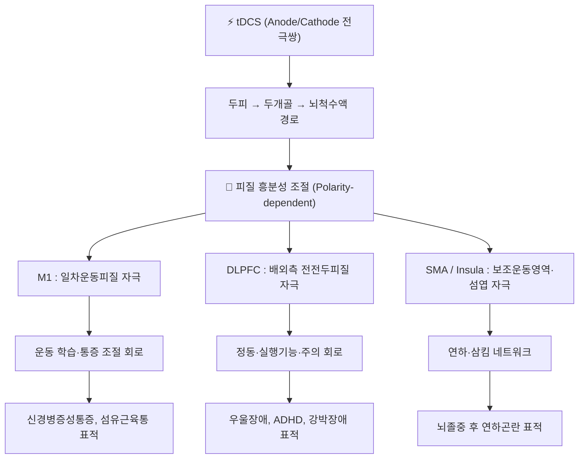

---
aliases:
  - tDCS
  - 경두개 직류자극
  - 경두개직류전기자극
  - transcranial direct current stimulation
tags:
  - 의학개념
  - 신경조절
  - 비침습뇌자극
  - 신경병증성통증
  - tDCS
template: 신경
---
# ⚡ tDCS (경두개 직류자극 / transcranial direct current stimulation)

![[tDCS_1_1.jpg|540]]
> [그림 1: ① 병태생리·영상 — Brain stimulation methods to reduce the seizure symptoms.jpg]

> [!info] 핵심 3줄 요약
> - **자극 원리 & 표적 회로**: 두피 위 두 개의 전극(양극 Anode / 음극 Cathode) 사이에 **1–2 mA 수준의 미세 직류 전류**를 흘려 대뇌피질의 **휴지기 막전위를 극성 의존적으로 이동**시켜 피질 흥분성을 조절하는 비침습 뇌자극([[Neuromodulation]]) 기법이다.
> - **표적 네트워크 & 임상 영역**: [[일차운동피질]](M1), [[배외측 전전두피질]](DLPFC), [[보조운동영역]](SMA), [[섬엽]](Insula) 등이 주요 표적이며, [[신경병증성통증]], [[섬유근육통]], [[만성통증]], [[뇌졸중 후 연하곤란]], [[소아청소년 정신질환]] 등에서 연구된다.
> - **주요 안전 이슈**: 두피 작열감·발적·두통·가려움이 흔하며, 경련 병력·두개 내 금속 임플란트·심장박동기·두개골 결손 부위는 주의/금기 대상이다. 전극-피부 접촉 저항 점검과 병력 스크리닝이 필수이다.

> [!IMPORTANT]
> **🧪 본 노트의 근거 등급 및 서술 원칙 (Anti-Hallucination Rule)**
> 1. **인용 범위 엄수**: 본 노트의 학술 인용은 PubMed 검증 문헌 7편을 기반으로 하며, 출처가 없는 수치·프로토콜·효과크기는 창작하지 않는다.
> 2. **수치 서술 원칙**: 자극 강도·시간·전극 면적 등은 통상적으로 통용되는 범용 원칙과 원문 확인 범위를 구분해 기술하고, 개별 연구의 미확인 세부 수치는 **'근거 미확인'**으로 명시한다.
> 3. **한의 결합 서술 원칙**: 경혈 전극 배치, 침-tDCS 병용 프로토콜 등 확인되지 않는 항목은 **'근거 미확인(가설적 임상 응용)'**으로 표기한다.

## 목차
- [1. 자극 원리 & 전극 배치 해부학 (Mechanism & Montage)](#1-자극-원리--전극-배치-해부학-mechanism--montage)
- [2. 자극 표적 맵 & 기능 네트워크 (Target Map)](#2-자극-표적-맵--기능-네트워크-target-map)
- [3. 호발 문제 부위 & 전극·안전 병태생리](#3-호발-문제-부위--전극안전-병태생리)
- [4. 자극 프로토콜별 적응증 & 임상 효과 매트릭스](#4-자극-프로토콜별-적응증--임상-효과-매트릭스)
- [5. 관련 평가 도구 & 감별 매트릭스](#5-관련-평가-도구--감별-매트릭스)
- [6. 한의 신경 치료 프로토콜 (침·전침·약침과의 결합)](#6-한의-신경-치료-프로토콜-침전침약침과의-결합)
- [7. 💡 사용자 진료실 핵심 필기 & 임상 팁 (원문 보존)](#7--사용자-진료실-핵심-필기--임상-팁-원문-보존)
- [8. 출처 및 학술 참고 문헌 (References)](#8-출처-및-학술-참고-문헌-references)

## 1. 자극 원리 & 전극 배치 해부학 (Mechanism & Montage)

tDCS는 두개골을 열지 않고 두피 전극을 통해 미세 직류를 흘려보내는 기법으로, 신경을 직접 발화시키는 것이 아니라 **자극 중 신경막의 흥분 역치를 이동시켜 자발적 활동과 시냅스 가소성을 조절**한다.

* **전극 극성에 따른 방향성 (Polarity Principle)**:
  * **양극(Anodal, +)**: 전류가 조직 내로 유입되어 피라미드세포의 탈분극 방향으로 막전위를 이동시켜 피질 흥분성을 높이는 방향으로 설명된다.
  * **음극(Cathodal, −)**: 전류가 조직 밖으로 유출되어 과분극 방향으로 작용, 피질 흥분성을 낮추는 방향으로 설명된다.
  * ⚠️ 실제 효과는 자극 시간·강도·전극 위치·두개골 두께·병변 유무에 따라 가변적이며, 단순 이분법으로 모든 임상 반응을 설명할 수는 없다(구체적 비율·원인 세부 **근거 미확인**).
* **전기적 파라미터의 기본 골격 (범용 원칙)**:
  * **전류 강도**: 통상 1–2 mA / **자극 시간**: 통상 10–30분 / **전극 면적**: 통상 25–35 cm² 스펀지 전극.
  * **전류 밀도(Current density)**: 전류(mA) ÷ 전극 면적(cm²)으로 계산되며 두피 자극감의 주요 결정 인자이다. (개별 논문별 정확한 세부 파라미터 미대조 항목은 **근거 미확인**)
* **전극 재질·형태·접촉 매질**: Solomons CD & Shanmugasundaram V 리뷰(2020)는 전극 재질·형태·접촉 매질(젤·식염수)·피부-전극 계면 저항이 전류 분포와 재현성에 결정적 영향을 미침을 정리하였다.
* **전류 경로**: 전극 A → 두피 → 두개골(고저항) → 뇌척수액(저저항, 전류 분류/shunting 발생) → 피질/백질 → 두개골 → 두피 → 전극 B.

## 2. 자극 표적 맵 & 기능 네트워크 (Target Map)

### 1) 주요 자극 표적과 기능 축 (Target–Function Axis)

| 자극 표적 | 통상적 전극 위치(국제 10-20 시스템) | 기대되는 기능 축 | 관련 문헌 영역 |
| :--- | :--- | :--- | :--- |
| [[일차운동피질]] (M1) | C3 / C4 부근 | 운동 흥분성, 통증 조절, 운동 재학습 | 신경병증성 통증(2024), 만성통증(2021) |
| [[배외측 전전두피질]] (DLPFC) | F3 / F4 부근 | 정동 조절, 실행기능, 주의, [[하행성 통증억제계]] | 소아청소년 정신질환(2019), 섬유근육통 자가시행 RCT(2025) |
| [[보조운동영역]]·[[섬엽]] | 정중선 인근·측두 피질 인근 | 삼킴(연하) 네트워크 조절 | 뇌졸중 후 연하곤란(2023) |
| 상부 M1–전전두 영역 | 두피 광범위 배치 | 중추 감작·통증 억제 하향성 조절 | 섬유근육통(2023), 만성통증(2021) |

> ※ 위 10-20 좌표는 통상적 임상 관행 정리이며 개별 논문 원문 미대조 수치는 **근거 미확인**으로 취급한다.

### 2) 자극 후 지속되는 가소성 (After-effect)
* 자극 종료 후 수십 분~수 시간 지속되는 **[[NMDA 수용체]] 의존성 시냅스 가소성**을 통해 하행 억제계 기능을 회복시키는 것으로 설명되며, 물리치료·언어치료·통증신경과학 교육·운동과의 시간적 결합(priming)이 효과를 증폭시킨다.

## 3. 호발 문제 부위 & 전극·안전 병태생리

* **제1 문제 지점 — 전극-피부 계면**: 접촉 저항 상승(젤 건조·모발 개재·압박 불균일) 시 국소 전류 밀도가 급증하여 두피 작열감·발적·가려움·화상 위험이 증가한다.
* **제2 문제 지점 — 전류 분포의 비균일성 (Current Shunting)**: 두개골 고저항과 뇌척수액 저저항으로 인해 개인 간·좌우 간 자극 강도가 달라져 임상 반응의 이질성이 발생한다.
* **제3 문제 지점 — 병변 뇌의 비대칭성**: 뇌졸중 위축·뇌척수액 공간 확장·두개골 결손 부위는 전류 경로가 정상 뇌와 달라진다(구체적 보정 알고리즘 **근거 미확인**).

| 구분 | 항목 | 임상 대응 |
| :--- | :--- | :--- |
| **절대적 주의/금기** | 두개 내 금속 임플란트·전극·코일, 심장박동기 등 이식형 전자기기 | 시행하지 않음(전문의 협진) |
| **절대적 주의/금기** | 두개골 결손 부위 및 인접부 전극 배치 | 전극 위치 변경 또는 회피 |
| **상대적 주의** | 경련(발작) 병력, 뇌전증 관련 질환 | 위험-이익 재평가, 의뢰 |
| **상대적 주의** | 임신, 두피 상처·피부 질환, 소아청소년 | 개별 판단, 강도·시간 신중 |
| **흔한 경미 반응** | 작열감, 발적, 두통, 저림, 일시적 피로 | 저항 확인, 자극 강도 조정·중단 |

## 4. 자극 프로토콜별 적응증 & 임상 효과 매트릭스

| 적응증 (표적 질환) | 연구 유형 | 인용 문헌 | 보고된 방향성 및 한계 |
| :--- | :--- | :--- | :--- |
| **뇌졸중 후 연하곤란** | 메타분석 | Gómez-García N 등 (2023) | 연하 기능 개선에 유리한 방향; 프로토콜·평가도구 이질성, 표본 규모 제한 |
| **섬유근육통** | 체계적 문헌고찰 | Conde-Antón Á 등 (2023) | tDCS·[[rTMS]] 모두 통증 강도 감소 방향; 소규모·장기 추적 부족 |
| **섬유근육통 (가정 자가시행)** | 무작위 대조시험 | Caumo W 등 (2025) | 여성 112명, 좌 DLPFC 양극+우 DLPFC 음극(bifrontal, 35 cm², 2 mA·20분·주 5회 4주 20회). 통증 간섭지수 38.76% vs 16.08% 감소(d=0.73), [[조건통증조절]] 개선(3개월 유지 후 감소). 통증신경과학 교육+운동 병행. 부작용: 통증 71.5%·작열감 62.1%·저림 50.0% |
| **신경병증성 통증** | 서술적 리뷰 | da Cunha PHM 등 (2024) | 비침습 뇌자극(tDCS/rTMS)이 신경조절 스펙트럼 내 병용 옵션으로 위치 |
| **만성 통증 (총론)** | 리뷰 | Knotkova H 등 (2021) | 적응증별 근거 강도 편차 큼; 최적 표적·용량 **근거 미확인** |
| **소아청소년 정신질환** | 리뷰 | Lee JC 등 (2019) | 우울·ADHD·자폐·강박 등에서 예비적 근거, 전반적 내약성 양호 |
| **전극 재질·재현성** | 공학 리뷰 | Solomons CD 등 (2020) | 전극 재질·접촉 매질·계면 저항이 전류 분포와 재현성에 결정적 영향 |

## 5. 관련 평가 도구 & 감별 매트릭스

| 평가 영역 | 도구/검사 | 측정 내용 | 관련 적응증 |
| :--- | :--- | :--- | :--- |
| 통증 강도 | [[NRS]], [[VAS]] | 주관적 통증 강도 | [[섬유근육통]], [[만성통증]] |
| 신경병증성 통증 특성 | [[DN4]], [[PainDETECT]] | 작열통·저림·이질통 등 | [[신경병증성통증]] |
| 삼킴 기능 | [[VFSS]], [[침습성 연하검사]] | 연하 안전성·침습 여부 | [[뇌졸중 후 연하곤란]] |
| 운동 기능 | [[FMA]], [[MAS]] | 상·하지 운동 회복 정도 | 뇌졸중 재활 |
| 정신·행동 | [[CGI]], [[CBCL]], [[ADHD-RS]] | 정동·행동 증상 중증도 | [[소아청소년 정신질환]] |

* **감별 시 고려사항**: Sham(거짓자극) 대조에서 효과크기가 작게 나오는 경향이 있으므로 "표준 재활/약물 + tDCS 병용"으로 설계를 구분해야 하며, [[통증신경과학 교육]]과 운동 병행이 중요하다.

## 6. 한의 신경 치료 프로토콜 (침·전침·약침과의 결합)

> ⚠️ 아래 내용 중 상단 인용 문헌에서 직접 확인되지 않는 항목은 **'근거 미확인(임상 응용 가설)'**으로 표기한다.

* **치료 목표 정렬 & 전침(EA)과 비교**: 한의학의 침·[[전침]]은 자침 부위에 맥동 전류를 흘려 말초 구심성 섬유(Aδ·C)를 통해 하향 통증 억제를 유도하는 반면, tDCS는 직류로 두피를 거쳐 피질 흥분성을 직접 조절한다. 두 기법 병용의 상승효과와 최적 순서는 **근거 미확인**.
* **경혈 전극 배치 (가설적 응용)**: 이론적으로 [[백회]](GV20), [[사신총]](EX-HN1), [[풍지]](GB20) 등이 거론될 수 있으나 국제 10-20 좌표와 일치하지 않으며 검증 근거가 없어 **근거 미확인**.
* **안전 관행 통합**: 침 치료의 감염·금침 관리와 tDCS의 저항 점검(스펀지 충분히 적시기·두피 상처 확인·20분 초과 금지)·금기 스크리닝(두개내 금속·심장박동기·임신)을 별개 체크리스트로 관리한다.

## 7. 💡 사용자 진료실 핵심 필기 & 임상 팁 (원문 보존)

* **사용자 원문 필기**:
  * (현재 이 노트에 기존 등록된 진료실 원문 필기는 없음 — 추후 실제 임상 메모 발생 시 이 항목에 100% 원문 그대로 보존한다.)
  * 노트 별칭: `tDCS`, `경두개 직류자극`, `경두개직류전기자극`, `transcranial direct current stimulation`
  * 태그: `신경조절`, `비침습 뇌자극`, `tDCS`, `신경병증성통증`, `NeuPSIG`
* **진료실 활용 실무 팁**:
  1. **"tDCS는 단독 치료가 아니다"** — 재활·약물·수기치료·통증신경과학 교육·운동의 부가 옵션으로 설명한다.
  2. **부작용 1순위는 두피 작열감** — 시술 전 전극 밀착·전도성 매질 상태를 확인하고 시술 중 불편감을 구두 확인한다.
  3. **효과 판정 시점** — 단회 자극이 아닌 수 주 반복(예: 4주 20회 등) 후 기능 지표로 재평가한다.
  4. **기록 템플릿**: `[tDCS 세션] 날짜 / 적응증 / 표적 / 극성 / 강도(mA) / 시간(min) / 전극 면적(cm²) / 병용치료 / 이상반응 / 피부 소견 / 직후 평가 지표`

<!-- 보관 태그(1회용·링크오류, 필요시 복원): 비침습 뇌자극, tDCS, NeuPSIG -->

## 8. 출처 및 학술 참고 문헌 (References)

1. Gómez-García N, Álvarez-Barrio L, Leirós-Rodríguez R, Soto-Rodríguez A, Andrade-Gómez E, Hernández-Lucas P. (2023). Transcranial direct current stimulation for post-stroke dysphagia: a meta-analysis. *J Neuroeng Rehabil*. 20(1):165. PMID: 38082316
- **핵심 요약**: 뇌졸중 후 연하곤란 환자에서 tDCS의 연하 기능 개선 효과를 분석한 메타분석이다.

2. Solomons CD, Shanmugasundaram V. (2020). Transcranial direct current stimulation: A review of electrode characteristics and materials. *Med Eng Phys*. 85:63-74. PMID: 33081965
- **핵심 요약**: tDCS 전극의 재질, 기하학적 형태, 접촉 매질 및 피부-전극 계면 저항이 전류 분포와 재현성에 미치는 영향을 정리한 공학적 리뷰이다.

3. Lee JC, Kenney-Jung DL, Blacker CJ, Doruk Camsari D, Lewis CP. (2019). Transcranial Direct Current Stimulation in Child and Adolescent Psychiatric Disorders. *Child Adolesc Psychiatr Clin N Am*. 28(1):61-78. PMID: 30389077
- **핵심 요약**: 소아청소년 정신질환에서 tDCS의 적용 근거와 안전성·내약성 프로파일을 정리한 종설이다.

4. da Cunha PHM, Lapa JDDS, Teixeira MJ, de Andrade DC. (2024). Neuromodulation for neuropathic pain. *Int Rev Neurobiol*. 179:471-502. PMID: 39580221
- **핵심 요약**: 신경병증성 통증 관리에서 비침습 뇌자극(tDCS/rTMS)과 침습적 신경조절 전략의 임상적 위치를 정리하였다.

5. Caumo W, et al. (2025). Home-Based Transcranial Direct Current Stimulation vs Placebo for Fibromyalgia: A Randomized Clinical Trial. *JAMA Netw Open*. 8(6):e2514262. PMID: 40478572
- **핵심 요약**: 섬유근육통 여성 환자에서 원격 감독 하 가정 자가 시행 tDCS가 통증 간섭지수 및 조건통증조절에 미치는 임상 효과를 입증한 무작위 대조시험이다.
