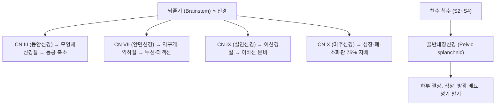
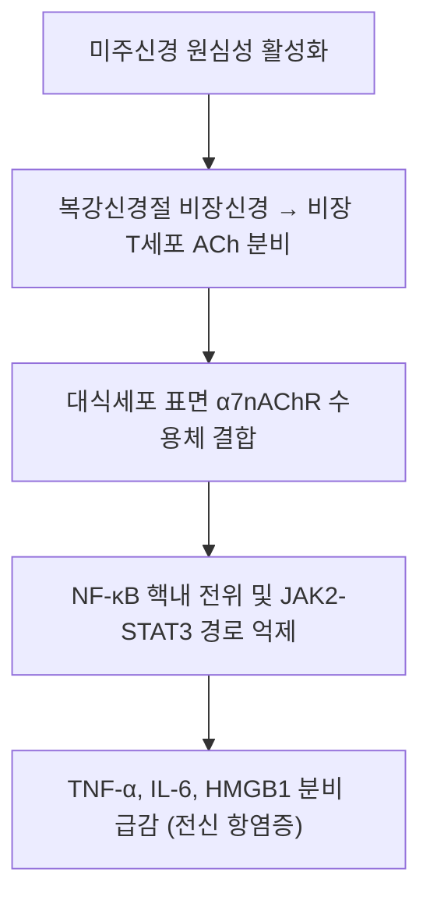

---
aliases:
  - 부교감신경
  - 부교감신경계
  - Parasympathetic nervous system
  - PNS
tags:
  - 의학개념
  - 신경생리
  - 자율신경
  - 미주신경
---
# 🌿 부교감신경 (Parasympathetic Nervous System, PNS)

> [!info] 핵심 요약
> **부교감신경(Parasympathetic Nervous System, PNS)** 은 뇌줄기 뇌신경(CN III·VII·IX·X)의 **뇌분과(Cranial outflow)** 와 천수 척수(S2–S4)의 **천수분과(Sacral outflow)** 로 구성된 뇌천수계(Craniosacral division)이다. 절전·절후 말단 모두에서 **[[아세틸콜린]](ACh)** 을 분비하여 무스카린 수용체(M1–M5)를 통해 **"휴식 및 소화(Rest and Digest)"** 와 에너지 보존, 배뇨·배변, 그리고 **[[미주신경]]성 콜린성 항염증 경로**를 주관한다.

## 목차
- [1. 개요 및 기본 특성](#1-개요-및-기본-특성)
- [2. 분자 생물학적 기전 및 신호 전달](#2-분자-생물학적-기전-및-신호-전달)
- [3. 전신 생리학적 역할 및 병태생리](#3-전신-생리학적-역할-및-병태생리)
- [4. 임상적 의의 및 약리·치료적 표적](#4-임상적-의의-및-약리치료적-표적)
- [5. 한의학적 통합 관점 및 임상 응용](#5-한의학적-통합-관점-및-임상-응용)
- [6. 핵심 요약 및 임상 팁](#6-핵심-요약-및-임상-팁)
- [7. 📚 출처 및 현대 학술 연구 요약](#7--출처-및-현대-학술-연구-요약)

## 1. 개요 및 기본 특성

* **신경절 구조 (긴 절전, 극히 짧은 절후)**:
  * **절전 섬유**: 기원핵에서 표적 장기 바로 인접부 또는 장기 벽 내부(Intramural ganglion)까지 길게 주행한다.
  * **절후 섬유**: 표적 세포까지 수 밀리미터(mm)에 불과해 [[교감신경]]의 전신 폭발 반응과 달리 **국소적이고 정밀한 조절**을 수행한다.

## 2. 분자 생물학적 기전 및 신호 전달

* **신경전달물질**: 절전 신경(니코틴성 $N_N$ 수용체)과 절후 신경 말단(무스카린성 M 수용체) **모두에서 [[아세틸콜린]](ACh)** 을 분비한다.

| 수용체 아형 | 주요 분포 장기 | 세포 내 신호 기전 | 생리적 반응 |
| :--- | :--- | :--- | :--- |
| **M1** | 중추신경계, 위점막 벽세포 | $G_q$ 단백질 ($\text{IP}_3/\text{DAG}$) | 위산 분비 촉진, 인지 기능 |
| **M2** | 심장(동방결절, 방실결절) | $G_i$ 단백질 (cAMP 감소, $\text{K}^+$ 유출) | 심박수 감소(음성 변시), 방실전도 지연 |
| **M3** | 평활근(기관지·방광·위장관), 외분비선 | $G_q$ 단백질 ($\text{Ca}^{2+}$ 증가, [[eNOS]]) | 소화관 연동 촉진, 기관지 수축, 배뇨, 타액 분비 |
| **M4 / M5** | 중추신경계 기저핵, 흑질 | $G_i$ / $G_q$ 단백질 | 도파민 유리 조절, 운동 제어 |

* **미주신경성 콜린성 항염증 경로 (Cholinergic Anti-inflammatory Pathway, CAP)**:

  * 케빈 트레이시(Kevin Tracey) 등이 규명한 신경-면역 반사로, 대식세포 표면의 [[α7nAChR]]에 ACh가 결합해 [[NF-κB]] 전위를 차단함으로써 [[TNF-α]], [[IL-6]], HMGB1 등 전염증성 사이토카인 폭풍을 제어한다.

## 3. 전신 생리학적 역할 및 병태생리

* **장기별 Rest and Digest 작용**:
  * **심혈관계**: 심박수 감소(서맥), 방실전도 지연, 심박출량·심근 산소 소비 절감.
  * **소화기계**: 위장관 평활근 연동운동 항진, 오디 괄약근 이완, 소화효소·위산·담즙 분비 촉진.
  * **호흡기계**: 기관지 평활근 수축 및 점액 분비 증가.
  * **비뇨생식기계**: 방광 배뇨근 수축 및 내요도괄약근 이완으로 **배뇨 촉진(S2–S4 골반신경)**, 해면체 혈관 확장으로 발기 유도.
  * **안구**: 동공괄약근 수축(축동) 및 모양체근 수축(근거리 조절).
* **자율신경 불균형 & 실신**:
  * **부교감 톤 저하**: 만성 스트레스, 불안, [[불면증]], 고혈압, 기능성 소화불량, [[과민성 장 증후군]], [[심박변이도]](HRV) 저하.
  * **미주신경성 실신 (Vasovagal Syncope)**: 급격한 통증·공포·장시간 기립 시 미주신경 과흥분으로 급격한 서맥과 혈관 확장이 발생해 일시적 뇌허혈을 유발한다.

## 4. 임상적 의의 및 약리·치료적 표적

* **약리적 표적**:
  * **무스카린 작용제** (베타네콜): 방광 무긴장증·수술 후 요폐 치료 / **필로카르핀**: 녹내장(축동)·구강건조증.
  * **항콜린제 (무스카린 길항제)**: 아트로핀(서맥 응급), 스코폴라민(멀미), 티오트로피움(COPD 기관지 확장), 솔리페나신·옥시부티닌(과민성 방광 — 단, 고령자 인지 저하·입마름·요폐 주의).
* **[[산후 요폐]]와 천골 부교감 축 (2026-10-18 논문 연계)**: S2–S4 골반신경은 [[배뇨 반응]]의 원심성 축이다. 척추마취 하위군에서 요폐 발생률이 4.6% vs 8.5%(RR 0.54, 95% CI 0.31–0.95)로 경혈 온열 중재 효과가 더 뚜렷했으며, 부교감 출력 회복이 느린 군에서 부가 효과가 컸다. 단, 마취 감각 회복이 곧 배뇨 회복은 아니므로 과팽창 여부를 확인해야 한다.

## 5. 한의학적 통합 관점 및 임상 응용

* **침구 치료의 미주신경·부교감 활성화**:
  * [[족삼리(ST36)]]: 심비골신경 자극을 통해 미주신경-부신/비장 축을 거쳐 전신 콜린성 항염증 경로를 가동하는 대표 혈위로 연구된다.
  * [[내관(PC6)]]: 정중신경 자극 → 연수 고립로핵(NTS)을 경유해 미주신경 심장·위장관 가지를 조절하여 심계항진 진정 및 오심·구토·소화관 운동 정상화에 응용된다.
  * **[[이침]] (이갑강 Concha)**: 미주신경 이개분지(ABVN)가 분포하는 체표 부위로, 신문·심혈 자극을 통한 부교감 톤 상향 및 경피 미주신경자극(taVNS)과 해부학적 접점을 공유한다.
  * **팔료혈(BL31–BL34) 및 [[신궐(CV8)]]**: 천골 S2–S4 부교감 신경절 근접 온열·자극으로 골반·배뇨 반사 회복 보조에 응용된다(단, 혈위 특이성 분리는 추가 검증 필요).
* **5분 도입 이완 루틴과 호흡성 부정맥 (2026-11-05 논문 연계)**: [[마사지]] RCT(2026)의 도입 5분(횡격막 호흡 유도·늑골 가동·후두부 이완)은 흡기·호기 심박 변동을 키워 [[심박변이도]]를 높이고 교감 출력을 낮추는 부교감 전환 루틴으로 설계되었다(단, 시험에서 HRV·코르티솔을 직접 측정한 것은 아님). 침 치료 전 이완 루틴이나 항암·말기 환자 세션에도 응용 가능하다.
* **추나 및 한약**: 상부 경추·후두골 이완(C0–C2, 경정맥공 미주신경 긴장 완화), 천골 추나(S2–S4), 자율신경 안정 처방([[시호가용골모려탕]], [[온담탕]], [[산조인탕]], [[귀비탕]]).

## 6. 핵심 요약 및 임상 팁

> [!tip] 임상 적용 포인트
> * 부교감신경은 단순 휴식 신경이 아니라 **장기 국소 정밀 제어 + 미주신경 콜린성 항염증 브레이크($\alpha7\text{nAChR}$)** 를 담당하는 생존·회복 축이다.
> * 진료실에서 **느린 복식호흡(호기 연장) + 후두부·상경추 이완(5분)** 을 침 치료나 수기 전에 도입하면 부교감 전환과 환자 긴장 완화에 실용적이다.
> * 척추마취·수술·분만 후 환자는 감각이 돌아와도 S2–S4 골반 부교감 배뇨 출력이 늦게 회복될 수 있으므로 방광 과팽창 및 요폐 징후를 반드시 점검한다.

<!-- 보관 태그(1회용·링크오류, 필요시 복원): 아세틸콜린 -->

## 7. 📚 출처 및 현대 학술 연구 요약

1. Tracey KJ. (2002). The inflammatory reflex. *Nature*. 420(6917):853-9. PMID: 12490958
- **핵심 요약**: 미주신경과 아세틸콜린 매개 콜린성 항염증 경로가 대식세포의 전염증성 사이토카인 분비를 억제하는 신경-면역 반사 회로를 최초로 규명한 논문이다.

2. McCorry LK. (2007). Physiology of the autonomic nervous system. *Am J Pharm Educ*. 71(4):78. PMID: 17786266
- **핵심 요약**: 부교감신경의 뇌천수계 해부학적 분포, 무스카린 수용체 아형(M1–M5)의 세포 내 신호 전달 및 장기별 생리 기능을 정리한 종설이다.

3. Kwag E, et al. (2026). Acupuncture vs. Massage for Insomnia and Pain in Advanced Cancer: Exploratory RCT. *J Pain Symptom Manage*. 72(5):486-496. PMID: 42471129
- **핵심 요약**: 진행성 암 환자에서 횡격막 호흡·후두부 이완 도입 루틴을 포함한 마사지와 침 치료가 불면과 통증에 미치는 효과를 비교한 무작위 대조시험이다.
