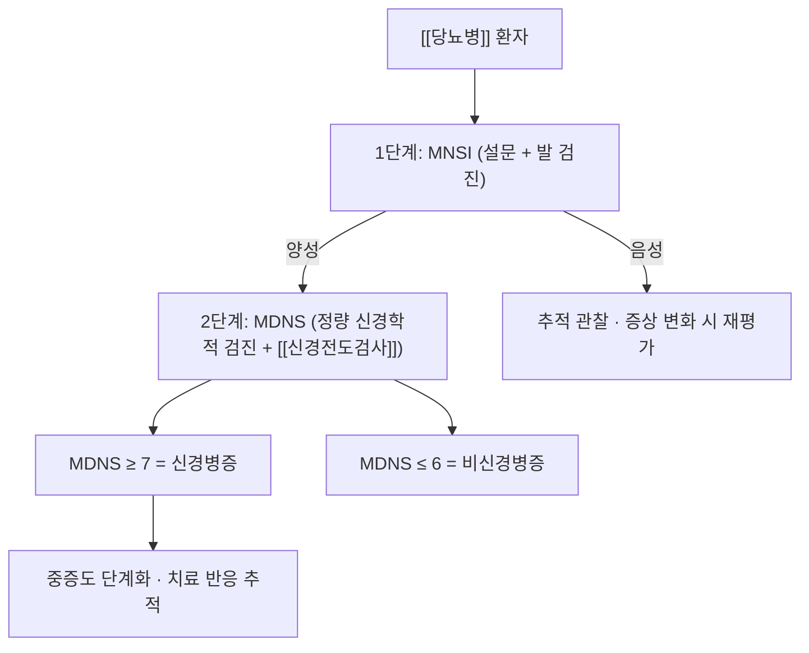

# 📚 MDNS (Michigan Diabetic Neuropathy Score, 미시간 당뇨병성 신경병증 점수)

> **핵심 요약 (Key Summary)**:
> 📋 목적: [[당뇨병성 말초신경병증]]의 진단 확인·중증도 단계화를 위한 정량 평가도구.
> 🧩 구성: 선별도구 MNSI(설문 + 간단 검진)에서 양성이 나온 환자에게 시행하는 정량 신경학적 검진 + 신경전도검사 조합이다.
> 🎯 해석: 개발 코호트(당뇨병 외래 56명)에서 MDNS 7점 이상은 신경병증, 6점 이하는 비신경병증으로 분류되었고, 신경병증 환자 35명 중 34명에서 신경전도 이상이 2개 이상이었다.
> ⚠️ 한계: 검사자·기관 간 표준화와 신경전도검사 접근성이 전제다. 2026-10-15 한약 시험처럼 MDNS를 결과 지표로 쓸 때는 기저값과 변화량을 함께 읽는다.

---

## 1. 목적·구성

| 구분 | 내용 |
| :--- | :--- |
| 개발 | Feldman EL 등, *Diabetes Care* 1994 (미시간 대학) |
| 1단계 선별 | MNSI(Michigan Neuropathy Screening Instrument) — 설문 + 발 검진 |
| 2단계 확인 | MDNS — 정량 신경학적 검진 + 신경전도검사 |
| 범위 | 정량 검진 소견과 신경전도 결과를 합산하는 복합 점수(개발 논문 기준 총점 체계) |
| 적용 대상 | 말초 대칭성 감각운동 다발신경병증이 의심되는 당뇨병 환자 |

> ⚠️ **같은 이름의 다른 도구와 혼동 금지 (기억에 의존하지 말 것)**: MNSI는 선별(설문·검진) 도구이고 MDNS는 확인·단계화(정량 검진 + [[신경전도검사]]) 도구다. 문헌마다 두 이름이 뒤섞여 인용되므로, 수치를 인용할 때는 어느 도구의 값인지 원문으로 확인한다.

## 2. 채점·해석

- 개발 코호트 실측: MNSI 임상 점수 2 초과인 29명 중 28명이 신경병증이었다. MDNS 7점 이상 28명은 신경병증, 6점 이하 21명은 비신경병증이었고, 신경병증 환자 35명 중 34명에서 신경전도 이상이 2개 이상이었다.
- 임상에서는 이 절단값을 참고하되, 개별 환자의 변화 판단에는 기저값 대비 변화량(Δ)을 쓴다.

## 3. 임상 사용·한계

| 항목 | 내용 |
| :--- | :--- |
| 강점 | 선별(MNSI) → 확인(MDNS)의 2단계 구조로 외래에서 운용 가능하다 |
| 약점 | 신경전도검사가 포함되어 접근성·비용 부담이 있다. 검사자 숙련도에 따라 변동한다 |
| 해석 규칙 | MDNS는 ① 진단 확인용이고 ② 중재 효과 판정 지표로도 쓰인다 — 이때는 기저값과 변화량을 함께 보고한다 |
| 대안·보조 | 경증 선별은 MNSI·[[NPRS]]·[[DN-4]]로, 중증도 분류는 [[신경전도검사]]와 병용한다 |

- 2026-10-15 한약 부가요법 시험([[목단과립]])에서는 24주 시점 MDNS 변화가 중재군 −4.80, 대조군 −2.66(ANCOVA 최소제곱평균 −4.74 대 −2.72)이었다 — MDNS가 중재 효과의 1차 지표로 쓰인 사례다.

## 4. 논문 연결

- **A practical two-step quantitative clinical and electrophysiological assessment for the diagnosis and staging of diabetic neuropathy.** *Diabetes Care*. 1994;17(11):1281-9. [PMID 7821168](https://pubmed.ncbi.nlm.nih.gov/7821168/) · [DOI 10.2337/diacare.17.11.1281](https://doi.org/10.2337/diacare.17.11.1281)
  - `[연구 요약]` MNSI(선별) + MDNS(정량 검진·신경전도) 2단계 체계를 제안한 원논문. 56명 코호트에서 MDNS ≥7 = 신경병증 기준을 제시했다 — 본 노트 절단값의 출처다.
- **Efficacy and safety of Mudan granules for diabetic peripheral neuropathy.** *J Ethnopharmacol*. 2026;368:121754. [PMID 42069162](https://pubmed.ncbi.nlm.nih.gov/42069162/)
  - `[연구 요약]` MDNS를 1차 결과로 삼아 24주 변화를 비교한 다기관 이중맹검 RCT — MDNS를 중재 판정 지표로 쓴 실제 사례다.

## 함께 보기
- [[당뇨병성 말초신경병증]] · [[신경전도검사]] · [[DN-4]] · [[NPRS]] · [[목단과립]] · [[메코발라민]] · [[당뇨발]]
- [[2026-10-15_통합의학약리학_심층리뷰]] 1번
