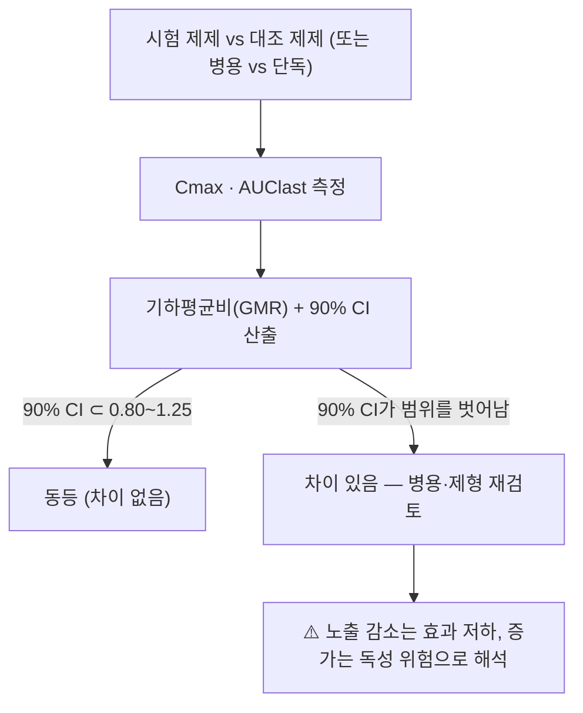

# 📚 생물학적 동등성 (Bioequivalence, GMR · 90% CI 0.80~1.25)

> **핵심 요약 (Key Summary)**:
> 📋 목적: 같은 성분의 두 제제(또는 병용 조건)가 체내 노출에서 동등하다고 볼 수 있는지 판정하는 약동학 평가 틀이다.
> 🧩 구성: Cmax(최고혈중농도)와 AUClast(총노출)의 기하평균비(GMR)와 90% 신뢰구간을 비교한다.
> 🎯 판정 기준: 90% CI가 0.80~1.25 안에 들어오면 동등, 벗어나면 차이가 있다고 본다 — 2026-10-15 [[에페리손]]·[[오적산]] 병용 시험은 Cmax 0.34, AUClast 0.51로 범위를 뚜렷하게 벗어났다.
> ⚠️ 한계: 건강 지원자·단회 투여 설계가 기본이라 실제 환자의 반복 투여·임상 결과와 다를 수 있다. '동등'은 '임상 효과 동등'을 자동 의미하지 않는다.

---

## 1. 목적·구성

| 항목 | 내용 |
| :--- | :--- |
| 기본 설계 | 무작위 교차설계(2×2 또는 다기간), 휴약기(washout) 설정 |
| 대상 | 건강 지원자(상호작용·제형 비교 시험의 다수) 또는 환자 |
| 측정 | LC-MS/MS 등 검증된 정량법으로 혈장 농도 측정 → Cmax·AUClast 산출 |
| 판정 통계 | 로그 변환 후 GMR과 90% 신뢰구간 |
| 다기간 설계 | 3처치·6순서·3기간 교차처럼 병용 조건을 한 시험에 넣기도 한다 |

## 2. 채점·해석

- 노출이 **떨어지면** 효과 부족으로, **올라가면** 부작용·독성 위험으로 해석한다. 방향을 반대로 읽으면 임상 판단이 뒤집힌다.
- 2026-10-15 시험 실측: [[에페리손]] Cmax GMR 0.34(0.25~0.46), AUClast 0.51(0.41~0.64)로 병용 시 노출이 1/3~1/2로 감소. 반대로 [[오적산]] 지표 성분 [[에페드린]] 노출은 영향받지 않았다(Cmax 1.04, AUClast 1.12).

## 3. 임상 사용·한계

| 층위 | 내용 |
| :--- | :--- |
| 제네릭·제형 변경 | 성분 동일·제조사 상이 제품의 대체 근거로 쓴다 |
| 병용 상호작용 | 병용 조건과 단독 조건을 비교하면 흡수 단계 상호작용을 정량할 수 있다 |
| 한계 ① 설계 | 건강 지원자·단회 투여라 환자의 반복 투여·질환 상태를 반영하지 못한다 |
| 한계 ② 결과 | 약동학 지표만 본다 — 통증 점수·근긴장도 같은 임상 결과는 별도 검증이 필요하다 |
| 한계 ③ 미검증 변형 | 동시 투여만 검증했다면 '시간차 복용이 상호작용을 없앤다'는 결론은 나오지 않는다 |
| 민감도 | Cmax는 흡수 속도·음식·위배출에, AUC는 흡수 정도와 제거에 민감하다 |

- 진료실 적용 규칙: **동등성 시험은 '무엇이 검증되었고 무엇이 검증되지 않았는지'를 분리해 읽는다.** 검증되지 않은 변형(예: 2시간 간격 복용)을 근거처럼 말하지 않는다 → [[에페리손]] · [[오적산]]

## 4. 논문 연결

- **Pharmacokinetic Interaction Between Eperisone and Ojeok-San in Healthy Subjects.** *Clin Pharmacol Drug Dev*. 2026;15(10):e70111. [PMID 42850974](https://pubmed.ncbi.nlm.nih.gov/42850974/) · [DOI 10.1002/cpdd.70111](https://doi.org/10.1002/cpdd.70111)
  - `[연구 요약]` 건강한 남성 24명, 공개표지·무작위·단회투여·3처치·6순서·3기간 교차(휴약 7일). [[오적산]] 15.0 g 병용 시 [[에페리손]] 150 mg의 Cmax GMR 0.34·AUClast 0.51로 노출이 감소했다 — GMR·90% CI 판정의 실제 사례다.
- **Effects of Ojeok-san on the Pharmacokinetics of Celecoxib at Steady-state in Healthy Volunteers.** *Basic Clin Pharmacol Toxicol*. 2018. [PMID 29377603](https://pubmed.ncbi.nlm.nih.gov/29377603/)
  - `[연구 요약]` 같은 한약제제([[오적산]])와 [[세레콕시브]]의 정상상태 약동학 상호작용을 검토한 선행 시험 — 한약-양약 PK 상호작용 연구 축의 근거다.
- **Pharmacokinetic and Pharmacodynamic Interaction of Metformin and Ojeok-san in Healthy Volunteers.** *Drug Des Devel Ther*. 2025. [PMID 40951699](https://pubmed.ncbi.nlm.nih.gov/40951699/)
  - `[연구 요약]` [[오적산]]-[[메트포르민]] 병용의 PK·PD 상호작용 시험 — 같은 약물군에서 상호작용 검증이 이어지고 있음을 보여준다.

## 함께 보기
- [[에페리손]] · [[오적산]] · [[에페드린]] · [[CYP3A4]] · [[P-당단백(P-gp)]]
- [[2026-10-15_통합의학약리학_심층리뷰]] 2번
